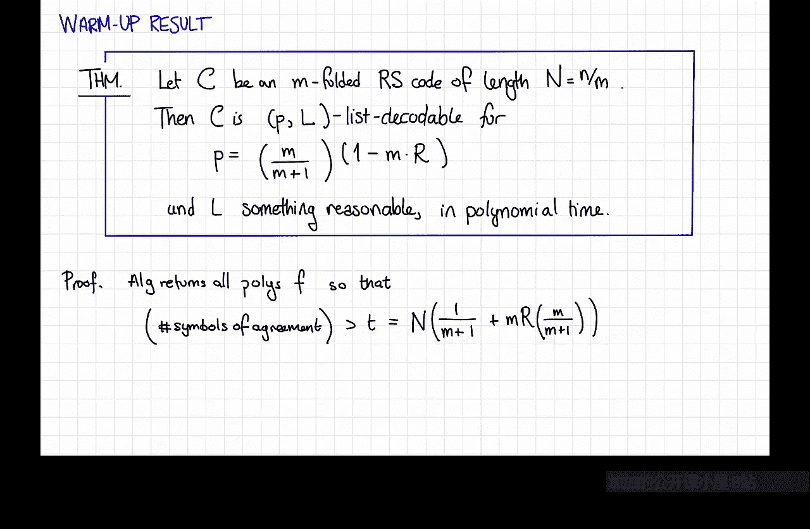

# 斯坦福大学【中英⚡代数编码导论｜Introduction to Algebraic Coding Theory】 p45 p44 13, Video 2： List-Decoding FRS Codes, Take 1 -BV16sRYYTEwg_p45-

In this video， we'll prove a warmup result about the list decodability of folded read Solomon codes。

This won't prove the theorem that we stated at the end of the previous video。

 but it will give us a starting point。Here's the result that we're going to prove。

Suppose that C is an M folded read Solomon code of length capital N。

 which is equal to little n divided by M。 So M is the folding parameter。

 and little N is the length of the original read Solomon code。Then， the theorem says。

The folded read Solomon code C is P commma L list decodable for P equal to M divided by M plus 1 times 1 minus M times R。

 where the list size is something reasonable， and the algorithm can run in polynomial time。

This result is not actually very interesting。 We wanted P equal to 1 minus R or close to it。

 And you can check that no matter how you choose M， this is not going to do that。However。

 the proof of this theorem illustrates a few of the main ideas that will need to prove the full blown theorem。

 so we're going to start with this。We are going to prove this theorem by giving an algorithm。

Our algorithm is going to take as input。 a received word Y。

 So y is going to be of the same form as a folded read Solomon code。

 So the first symbol is a little vector。 Y not through Y M -1。 The second symbol is a little vector。

 Y M through Y 2 M，-1 and so on。We're also going to take as input some parameters， T and capital D。

 which we're going to choose later。 Then what the algorithm is supposed to output。

 It's a list decoding algorithm， So it should output a list curly L that contains all polynomials F over F Q of degree at most K -1。

So that for strictly greater than t values of I。The Ithe symbol of the received word。

So this little vector here， Y M I through Y M plus M -1。

Should agree with the Ithe symbol of the folded read Solomon code word that arises from F。

 So that would be this。F of gamma to the M， F of gamma to the M plus1 dot dot all the way down to F of gamma to the M plus M -1。

Here， T is this parameter that we put into the algorithm。

 and we're going to choose it later to get that value of P that we claim to the theorem on the previous slide。

Okay， so this is the goal。 this input， that output。 How are we going do it。

As you might be used to by now， after seeing the Welt Spl camp algorithm， Sudan's algorithm。

 and the Girlwami Sudan algorithm， this algorithm is going to have two steps。In the first step。

 we will interpolate some polynomial to satisfy some constraints。

 and in the second step we are going to find some roots of that polynomial。

More precisely in the first step， we are going to find an M plus1 variant polynomial Q of a very particular form。

So Q is going to have variables x， and then y1 up through YM。And it's going to have this form。

So it has some polynomial in x a n of x plus y1 times some polynomial a1 of x plus y2 times some polynomial A2 of x。

 and so on all the way up to YM times some polynomial A in x。

And we're going to do this interpolation so that a has degree D plus k minus1。

And all of these AIs have degree at most capital D。Moreover。

 we're going to want it to vanish on a bunch of particular points。That is。

 we're going to want Q of gamma to the M I comma Y M I。

 YM I plus 1 dot ta dot up to yM I plus M -1 to be equal to 0 for all I between 0 and n -1。

Notice that this mimics the sort of constraint that we wanted on cu in the Growami Sudan algorithm。

You think of the variable X as taking on some evaluation point。

 It's sort of the first evaluation point for a symbol。

And the rest of the wise are taking on the value of the received word。That is all of these things。

Assuming we can do step 1， we're going to move on to step 2。

 which is to find some appropriate roots of Q。 In this case， that's going to mean the following。

We're going to find all polynomials F of degree at most K -1。So that when we take Q。

And we plug in x comma F of x， comma F of gamma x dot dot comma F of gamma to the M times x。

So that is， we're going to plug in F of gamma to the I times x for Yi。

This is going to give us some univevariate polynomial in x。

 And we want that univariate polynomial to be identically equal to 0。

So step 2 is to find all such polynomials F and return them as our list。

As usual with these sorts of algorithms， we have two questions。First。Can we do step 1， and if so。

 how。And second is step two a good idea， and also how can we do it？As usual。

 we're going to answer question1。By counting coefficients and counting constraints。

And we're going to answer question2， at least the first part of question2 is step to a good idea by asserting that low degree polynomials do not have too many roots。

So let's answer these two questions now。Starting with question1。Okay， can we do step 1。

So I've copied step one here。I've also copied our input and output goals。

 and I've also added a little box here for how we are going to choose parameters。

So we're going to choose T to be greater than or equal to this thing。

And we're going to choose D to be equal to this。And we'll see as we answer step 1 and step 2。

 why those are the right things to do。Okay， so let's argue that we can do step 1。

 that we can find such a polynomial。As usual， we're going to solve some linear system to do this。

We have a bunch of variables that is the coefficients of Q， and we have a bunch of constraints。

 That's these things。So as long as we have strictly more variables than constraints。

We can solve the linear system to find such a cute。So how many variables are there。

So the number of variables are just the number of coefficients in Q。

 and I claim that this is D plus k。Plus， M times D plus 1。

This D plus K here is the number of coefficients in a n， because a n has degree D plus K -1。

In this M times d plus one term。Is for all the possible coefficients in the AIs。

 for the M different AIs。That is， this is coefficients on powers of x。

 and these guys are going to be coefficients on monoomials of the form Y sub I x to the something。

We can rearrange this expression as m plus 1 times d plus 1 plus k minus 1。

So that's how many variables we have， how many constraints are there。

The number of linear constraints is just equal to n。

We have a constraint that looks like this for each I from 0 to10 minus-1。Thus。

 in order to do this polynomial interpolation， we need the number of variables to be strictly greater than the number of constraints。

And you'll see that conveniently， this is exactly satisfied by how we chose D here。

So if we plug in this D to this requirement。The M -1 here cancels with the M -1 down there。

This plus one deals with that floor。And then， this is satisfied。So we can do step one。Check。Now。

 let's answer our next question， why is step 2 a good idea？

So here I've copied both step 1 and step 2。And our setup and our choices of T And D。

So to show that step 2 is a good idea， we want to show that any polynomial F that we should return。

 that is a polynomial F that agrees with the receive word Y in a bunch of places strictly greater than T places is going to satisfy this requirement that this polynomial is identically equal to 0 so that then we will return it。

Actually， let's give this polynomial a name， let's call that R of x。

So let's suppose that F agrees with y in strictly greater than t places。

 then we want to show that R of x is identically equal to0。As usual。

 we will do this by observing that the degree of R is not too large， but that if this is true。

 then R has many roots。So let's observe that the degree of R。Is it most？D plus K -1。

That's because Q has this very particular form。So this a n of x。

 this has degree at most d plus k minus-1。 So that's in line with this。And each of these things。

 well， in order to get R， we just replace each of these variables， Y I。

With F of gamma to the something times x。And so that means that each of these terms。

 once we've plugged in F of gamma to the I times X for Y I is going to have degree at most D coming from the AI。

Plus， k -1 coming from F。 So again， that's D plus K -1。So altogether。

 the degree of R is at most D plus k minus-1。I claim that it also has strictly greater than tea roots。

This is true since R of gamma to the M is equal to this。Just by definition。

 and if F happens to agree with y in place I， then that's equal to this。

Ca we can replace gamma to the M with Y submiI and the same for all of these other terms。

But then by how we've interpolated Q。This is equal to 0。

So that means that gamma to the M is a root of R of x whenever F agrees with y。

 and we're supposing that F agrees with I in strictly more than t places。So now， right。

 Mo polynomials don't have too many roots。 Yes， thank you， Polly。 So， yes。

 since low degree polynomials don't have too many roots。

 This means that as long as t is greater than equal to this。

 the polynomial R of x must be identically equal to 0。

I'm going to erase this blue stuff now to give Miss room to verify that that's true。

So to see that this is true， notice that it's enough to show that T is greater than equal to n minus k divided by M plus 1 plus k。

So here I've just replaced D with its definition here and then fiddled with the plus minus ones and the floors to make a statement so that this will imply that。

we can rearrange this。And see that this is equal to capital n divided by M plus 1 plus K times M over M plus 1。

And now we can use the fact that the rate capital R of the folded read Solomon code is the same as the rate of the original read Solomon codes that's k divided by little n。

And by the definition of capital N， this is K divided by capital N times M。

So that implies that K is equal to capital N times M times R。

 And then we can plug that in here to rewrite this whole thing。As capital N times 1 over M plus1。

Plus， M times R times M divided by M plus1。And very conveniently， this is exactly how we chose tea。

Allright。So this establishes that step 2 is a good idea。That is。

 if F agrees with Y in strictly greater than T places， R of x is going to be identically equal to 0。

 and we're going to return this F as part of our list。The next question we need to answer is。

 can we do step two efficiently？The answer turns out to be yes。

 but we will come back to this in the next video， so let's punt on that for now。

So I claim that this essentially proves this warmup result。Let's finish off the proof。

So we saw that the algorithm works and returns all polynomials F。

So that the number of symbols of agreement between F and the received word Y is strictly greater than T。

 which we set equal to this thing。In other words， the algorithm returns all polynomial F so that the number of symbols of disagreement。

Is not too large， Naly so that the fraction of symbols in disagreement。

 which is also going to be our list decoding radius P， can be as large as 1 minus this divided by n。

And if you check out what1 minus this is， it turns out to be exactly that。

So that explains where this expression for P comes from。And now we have proved this theorem。Great。😊。

However， as we said before， this theorem is not particularly interesting。In the next video。

 we'll improve on this idea to get a result that we actually want。

