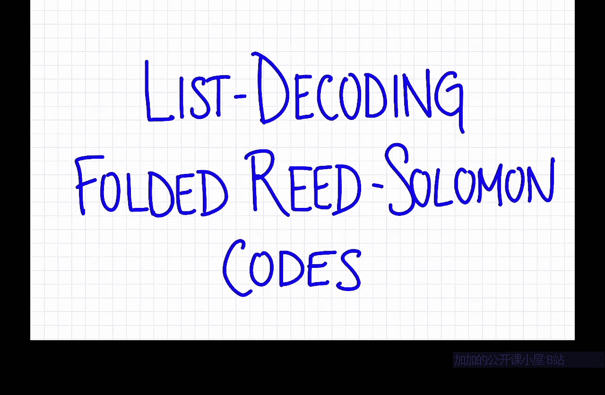
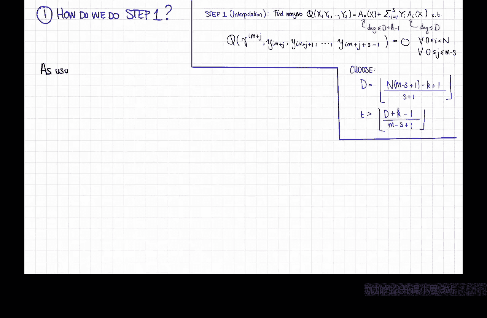
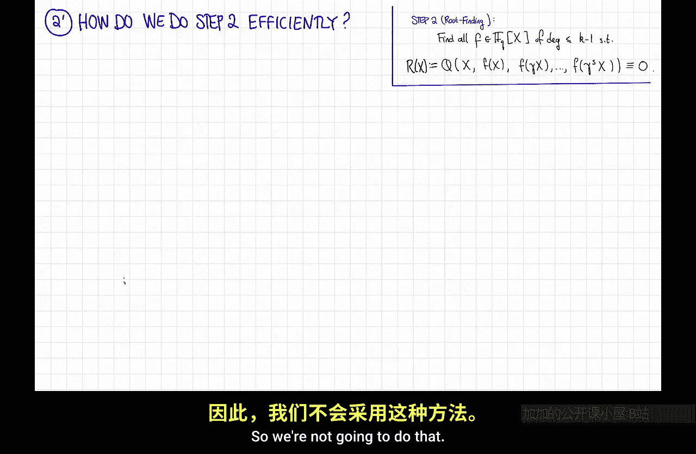
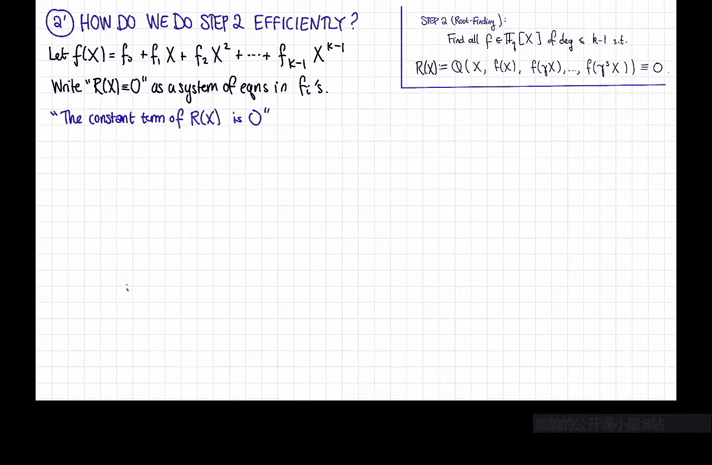
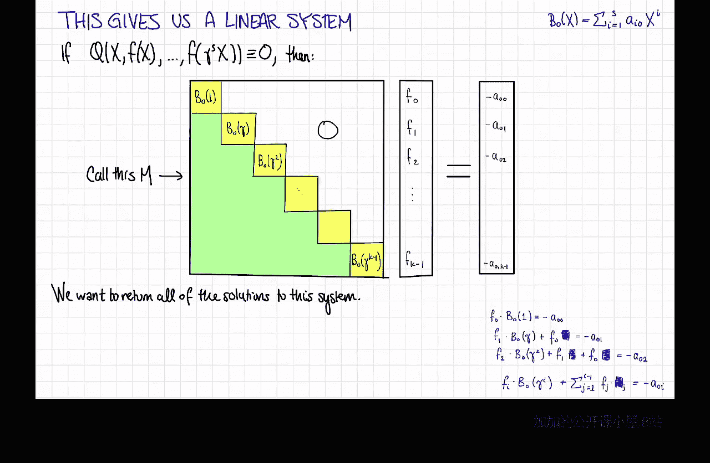

# 斯坦福大学【中英⚡代数编码导论｜Introduction to Algebraic Coding Theory】 p46 p45 13 Video 3： List-Decoding FRS Codes, Take 2 -BV16sRYYTEwg_p46-

In this video， we will improve on our result from the previous video and see how to list tocode Fed readsel codes all the way up to list decoding capacity。

More precisely， we're going to prove the following theorem。

Let's choose parameters S and M so that one is less than or equal to S is less than or equal to M。

 and S and M are integers。Let's see be an Med read Solomon code of rate capital R。

Then C is P comma El list deoiddable in polynomial time。Where P is equal to this thing。

 we'll break that down in just a second。And the list size L is cud the S， or at most cud to the S。

Moreover， the list happens to be really structured， not just as it have size at most cud the S。

 but also it contained in an affe subspace of dimension S。Here。

 Q is the field size for the original read Solomon code。Okay。

 let's try to break down this radius P here。This theorem is interesting if we choose S to be。

 let's say one over epsilon and M to be， let's say， one over epsilon squared。

For some small parameter epsilon。Then let's work out what these things are。We have that P。

Is approximately equal to one minus epsilon。Times 1-1 plus epsilon times R。

That's because if we let S be 1 over epsilon。Then this is approximately one minus epsilon just by the Taylor expansion。

And similarly， this is also going to be approximately  one plus epsilon。 again。

 looking at the Taylor expansion。 So for small enough epsilon， P is about equal to this。

But then this is equal to1 minus the rate， minus some big of epsilon term。

So that's looking pretty good。 That means that the list decoding radius P can approach the list decoding capacity theorem 1 minus R。

 as we let epsilon get smaller and smaller。The list size L。 So this is equal to Q to the S。

 So that's approximately Q to the one over epsilon。 If S is approximately one over epsilon。Now。

 Q is the field size for the original read Solomon code， so it's approximately equal to little n。

 the length of the original read Solomon code。And little n is equal to capital n times M。

 where capital N is the block length of the folded read Solomon code。

Now plugging in M equal to 1 over epsilon squared。We see that the list size L is polynomial in capital N。

 the block length of the folded read Solomon code provided that epsilon is some constant。

So this is going to achieve what we claimed in an earlier video。And in particular。

 when epsilon is some small constant， we can get really close to list decocoding capacity with polynomial list sizes。

And it's all going to happen in polynomial time。Pretty cool。Before we introduce our new algorithm。

 let's talk about some intuition for how we are going to improve on the algorithm we saw in the previous video。

So let's suppose that F agrees with the received word Y in some particular place， I。

That is this little vector， which is the eighthh symbol of the received word。

 agrees with this little vector， which is the eighthh symbol of the corresponding folded read Solomon code。

In our previous algorithm， we saw that this meant that this polynomial Q of x comma F of x comma F of gamma X dot dot has one root at gamma to the M I。

 What we're going to do now is change how we're doing our interpolating polynomial a little bit so that one agreement like this is going to correspond to several routes for our interpolating polynomial。

So now what we're going to do is we're going to interpolate a polynomial Q。In a variable X。

 And now S variables y1 through Y S， where S remember is some parameter that is less than or equal to M the folding parameter。

 So we're going to have fewer variables now。So we're going to interpolate this polynomial so that it vanishes sort of on a whole bunch of sliding windows here。

Of width S。That is， we're first going to ask that it vanish on the point。Gamma to the M I， Y sub M I。

 Y sub M I plus1。All the way up to Y submi plus S。So that sort of this first window here。

But then we're also going to ask that it vanish on the point where x is equal to gamma to the M plus 1。

And the Y's take on the values， Y M I plus 1。Y M I plus2 dotta， dot up to Y M I plus S plus 1。

And so on。 So the next point it would vanish on would have x value gamma to the M plus 2。

 And then y values Y 1 is equal to Y M I plus 2。 Y 2 is equal to Y M plus 3。And so on。

 all the way up to why。A I plus S plus 2。And we're going to be able to keep doing this with windows of size S until we run out of room。

So you can check that there is going to be M minus S plus one different requirements here。

If we do this， that is we interpolate Q this way， then it means that for any I so that the receive word Y agrees with the folded read Solomon code word F。

We don't just get one root of this polynomial， but rather。

 we get this many roots M  S plus one of the corresponding polynomial。 That's great。

 More roots helps us in our argument。You might have noticed that it also means that we need to interpolate a polynomial with more constraints。

 so that hurts us。 But it turns out that this trade off is worth it。

We'll see why next when we make this argument precise。Okay， so here's the algorithm。

I've copied our desired input。 This received word why and our desired output。

Some polynomial F that agrees with Y in a bunch of places。And as usual。

 our algorithm is going to have two steps， an interpolation step， and a root finding step。

Here's the interpolation step。So we're going to interpolate a polynomial Q of x。And y 1 through Y S。

Of the same form as before。So it's some univevariate polynomial a not。Plus。

 the sum from I equals 1 to S of Y I times sum univariate polynomial AI。

 So that exactly the same degree restrictions as before hold。

 So the degree of a n is at most D plus K -1， and the degree of AI is at most D。

And so that Q vanishes on all of those sliding windows that we alluded to earlier。

 That is Q of gamma to the I M plus J。So that's some evaluation point here。

And then the corresponding sliding window that starts with the Jith position。 So y I M plus J。

 Y I M plus J plus1 dot dot all the way up to Y I M plus J plus S -1。Equals 0 for all I'。

 That is for all of these symbols of the receive word。

 and then also for all Js between 0 and M minus S。 That is for all possible windows of length S。

So we're going to interpolate our polynomial Q in that way。Assuming we can do that。

 our next step is going to be the root finding step。 and this is exactly the same as before。That is。

 we're going to find all polynomials F over F Q of degree at most K -1。So that the polynomial r of x。

 which we define to beq of x comma f of x comma f of gamma x dot dot up to f of gamma to the s times x is identically equal to 0。

So that's the algorithm。As before， we have a couple of questions。First。

How do we do step 1 And second is step 2， a good idea， and how do we do it efficiently。

Let's answer both of these questions， starting with the first one， how do we do step one？Okay。

 so I've written step one up here。And I've also written what our choice for the parameters D and T are going to be down here。

 So we're going to choose capital D。 That is the degree of these AIs。

To be the floor of n times M minus S plus 1 minus k plus 1 all over S plus 1。

And we're going to choose T。 That is the parameter of agreement to be the floor of D plus K -1 divided by M  S plus 1。

And we'll see why we chose D& T like this shortly。Okay， so how do we do step one， As usual。

 we're going to do polynomial interpolation by showing that the number of variables that we have。

 that is the number of coefficients of  Q is strictly larger than the number of constraints。

So how many variables are there？Just as before， there's D plus K。Plus， S times D plus 1。

The only difference here is that this S here used to be an M。

 but now it's an S because we only have S terms in this sum。

 And we can write this as D times S plus 1。Plus K plus S。

The number of constraints is now a bit more than it was before。Previous， it was just n。

 but now it's n times M minus S plus 1。That's because we have a linear constraint like this for each I。

 their N of those， and also for each J， their M minus S plus one of those。

So what we need is for the number of variables to be strictly larger than the number of constraints。

And if you'll allow me to be a bit sloppy for a moment and just ignore the floor on the definition of D。

This is the same as asking that n times M minus S plus 1 is strictly less than n times M minus S plus 1。

mininus。K plus 1 plus K plus S。Using the fact that this S plus one here conveniently cancels what's going on in the denominator there。

 assuming we're just going to ignore those floors。But this reads that 0 is strictly less than S plus  one。

Which is true。Moreover， it's true enough with enough slack to deal with this floor if you want to do it rigorously。

So that shows that we can do step one。Check， we can find such a polynomial cu。That has this form。

And that satisfies all these constraints that we want。Let's move on to step 2。

Why is step two a good idea？Here， I've added step 2 to our little copy pasted thing in the corner。

Along with step one and our choice of D and T。So let's suppose that F is a polynomial of degree at most k -1。

That agrees with the received word Y in strictly greater than tea places。

 So that is this little vector。That is the I symbol of Y agrees with the little vector。

 That is the eh symbol of the folded read Solomon code word corresponding to F for strictly greater than T values of I。

 where T is this parameter here。To show that step 2 is a good idea， as before。

 we want to show that if this happens， then R of x is identically equal to 0。

Because that will mean that we will return this F， which is what we want to do。

And remember that R of x is just defined to be equal to that polynomial there。

Q of x comma F of x comma F of gamma X dotta dot。We're going to do exactly the same thing as before。

 Let's observe that the degree of R is less than the number of roots that it would have if this were true。

Exactly as before， we have that the degree of R。Is less than or equal to D plus K -1。

But now we have more roots。The number of roots of R。

This is strictly greater than T times M minus S plus 1。That's because for each eye， so this is true。

I'm now going to get M minus S plus1 roots。To see why， let's see what happens to R。

Of gamma to the IM plus J。Where I is such that。The I symbol of the received word Y agrees with F。

And J is anything between 0 and M minus S。By definition。

 this is equal to Q of gamma to the IM plus J。Times F of gamma to the I M plus J。

That I dot up to F of gamma to the I M plus J plus S -1。And now。

 by the fact that we're assuming that this holds for I。I can replace each of these Fs with a Y。

And now， by how we interpolated Q。Q actually vanishes on this， so this is equal to 0。

So this gives us t times M minus S plus1 different roots， because there are t such values of I。

 and there are M minus S plus 1， such values of J。Okay。

 so now I'm going to erase this justification so that we have room to finish arguing that step 2 is a good idea。

So we have that the degree of R is less than or equal to d plus k minus1。 however。

 the number of roots of R is strictly greater than t times M minus S plus1。And we conclude that， if。

D plus k -1 is less than equal to T times M S plus1。Then R of x will be identically equal to 0。

 All right， Moary polynomials don't have too many roots。 Yes， thank you， Polly。Now。

 referring to our choice of tea， we see that it is enough to show。

That d plus k -1 is less than or equal to D plus k -1 divided by M minus S plus 1。

 all times M minus S plus 1。Here you can check that it's okay to drop these floors because this is a strict greater than。

And of course， this is true because this and that just cancel， and then that's obviously true。

So that explains why step 2 is a good idea。 If indeed。

 F agrees with the received word a lot or that is the folded readallo and code word corresponding to F agrees with the received word a lot。

 then we will return it。However， we still need to answer the question。

 how do we do step 2 efficiently in the past for algorithms like this。

 like the Welsh Burla camp algorithm of the Girl Homi Sudan algorithm。

We just asserted that we can factor polynomials quickly， and that will give us our answer。But here。

 being able to factor polynomials quickly won't actually solve the problem。

 It's not clear that if F satisfies something like this， that F appears as some factor of Q。

 So we're not going to do that。 Instead， we're going to do something else。

 which is set up and solve some system of linear equations。

In a bit more detail， suppose that we can write out F of x like this。So F has coefficients。

 f not F1 dotta dot up to fk minus1。Let's consider writing R of x is identically equal to 0 as a big system of linear equations in the F Is。

So this statement， R of x is identically equal to 0。

 Another way to say that is the constant term of r of x is equal to 0 and the coefficient on x in R of x is equal to0。

 and the coefficient on x squared in R of x is equal to 0 and so on。

So each one of those statements corresponds to a linear equation。

Let's try to write down what those linear equations look like。Let's start with the constant term。

So what does the statement the constant term of R of x is 0 look like？

We have that R of x is equal。To a knot of x。Plus， the sum from I equals 1 to S。

Of F of gamma to the I times x。Times AI of X。This follows from the form that Q takes and the definition of R of X。

So what is the constant term of this polynomial？Well。

 it's going to be the constant term of this plus the sum of the product of the constant term of this guy and the constant term of this one。

So let's write that as a0，0。Here， I'm using the notation that。

AI of x is going to be equal to the sum。Over J。Of AI J x to the J。So going back over here。

 the constant term of this。Is a0，0。And then we also have the sum from I equals 1 to S of the constant term of this。

 that's just F 0。Times the constant term of this。 that's AI0。Or another way to write this is。A0，0。

Plus， if not。Times， this thing。The sum from I equals 0 to S。Of AI 0。

For reasons that are going to become clear in a moment， I'm going to define a new polynomial B0 of x。

And let's define B0 of x。To be equal to the sum from I equals 1 to S of A I 0 x to the I。

I just noticed that I wrote I equals0 down here that should be I equals1。

So with this definition of b 0， this thing here is equal to a 0，0 plus F n times B 0 of 1。Again。

 it's not at all clear why I decided to name this thing a polynomial and write this thing as that polynomial evaluated at one。

 We'll see why in a moment。So the expression， the constant term of r of x is equal to 0。

 means that this thing is equal to 0。Or， in other words。That F n times B 0 of one。

Is equal to minus a 0，0。Okay， so let's erase this work that we did。

I'll move this down because we'll want it in a moment。

And now let's consider the next sort of statement that is implied by R of x is identically equal to 0。

 which is that the coefficient of x in R of x is equal to 0。

What does that sort of statement look like。We still have that R of x looks like this。

 So let's try to think about what is the coefficient on x in this term。

Why don't you pause the video now and try to figure it out？Okay， so the coefficient on x。

In this expression is the following。So first， we have the coefficient on x in a n， sets a01。

And then we have the sum from I equals1 to S。Of the sum of two things。First。

 we have the constant coefficient of F times the linear coefficient of AI。

And then we also have the linear coefficient of F times the constant coefficient of AI。

Sa that's going to be F naught times AI 1。Plus， the linear coefficient of this thing。

 which is F1 times gamma to the eye。Times the constant coefficient of that thing。Which is AI 0。

Rearranging this。This is equal to a01。Plus， F n times the sum from I equals 1 to S of AI 1。Plus。F1。

Times B not of gamma。Here， I'm bringing this sum into there。And using our definition of be not。

And hopefully now it's a little more clear why we define to be not the way it is。

So now we see that this statement， the coefficient of x in R of x is 0， is the same as the statement。

F1 times B n of gamma。Plus， F not。Times， something。Well， I know what that something is。

 it's this thing， but I'm just going to write something。It a placeholder is equal to minus a01。Okay。

 so let's keep on doing this， so I'm going to racese this。Let's move this down。

Let's consider the next statement， the coefficient of x squared in R of x is 0。

So why don't you pause the video now and work out what you get？Okay。

 so I'm not going to do out the details because they're basically exactly the same as what we just did。

But perhaps you got something like this。 The coefficient of x squared in R x is equal to 0 means that F 2。

Times B n of gamma squared。Plus， F1 times something。

And possibly a different something from that something。Plus， F n times yet a different something。

Is equal to minus a02。And in general， we have。That the coefficient of x to the I。In R of x is0。

Means that F I。Times， be not。Of gamut to the eye。Plus。

 the sum from J equals 1 to I-1 of F J times something。Which can depend on J。Is equal to minus a0 i。

And this is going to continue all the way up to the coefficient of x to the k minus1。

And now we see that this statement， R of x is identically equal to 0。

 gives rise to a system of linear equations。Let's write this system as a matrix。So down here。

 I've copied what we got on the previous slide。And I claim that this corresponds to a matrix vector equation that looks like this。

That is， if r is identically equal to 0。Then we have that some matrix that looks like this。

Times the matrix that has the coefficients F n through F K -1 in it。

Is equal to a vector that has minus a 0，0， minus a0，1， and so on in it。

And what is this matrix look like。Let's call this thing M。

So this is a lower triangular matrix that has on the diagonal。Be not of one。 Be not of gamma。

 Be not of gamma squared。 dot， tat dot。 And then it has some stuff below the diagonal。

That corresponds to these， whatevers that I didn't bother writing down。 And importantly。

 it has zeroes above the diagonal。So the fact that there are all zeroes above the diagonal here。

 this corresponds to the fact that F naught is in its own equation。 F1 is an equation just with F n。

 F 2 is in an equation with F1 and F naught and so on。

 And F I is in an equation with all of the F Js less than I。Therefore。

 we want to return all of the solutions to this linear system。

At this point it's very tempting to say， okay， we can do linear algebra。

 let's just return all of the solutions to this K by K system。We can solve this system in time polyK。

 so we're done。Okay， so that doesn't work。

If you don't immediately see why， pause the video and think about what's wrong with that。

The problem is that there might be tons of solutions to this linear system。For example。

 if M is really low rank。That is that M has a big kernel。

Then there might be as many solutions to this linear system as there are vectors in the kernel of M。

But let's say that M has rank1 or something like that。 So its kernel has rank K -1。

 Then there might be Q to the K -1 possible solutions。That is not a very interesting list size。

 I want a list size that's polynomial in n， not exponential in N and something that looks like  Q to the K -1。

 that's exponential in K， which is exponential in N。So that's not gonna do it。Instead。

 we need to argue that M has reasonably high rank so that this system of equations does not have too many solutions。

So let's erase this hopeful logic here， which is unfortunately wrong。So instead。

 let's observe that the number of solutions。To this system。Is it most the size of the kernel of M。

Which is equal to Q to the dimension of the kernel of M。

So how big is the dimension of the kernel then。Now。

 we can fortunately use the fact that this system is so nice and structured。

Because M is lower triangular， the dimension of the kernel of M is exactly equal to the number of zeroes that it has on the diagonal。

How many zeros are there on the diagonal of M。Well。

 that's just the number of roots of this polynomial。 B not。

 because notice that these diagonal values are just B not evaluated at K -1 different evaluation points。

 So this is at most。The number of roots of B not。Hey， that's convenient。 All right。

 Mograde polynomials don't have too many roots。 Yeah， thanks， Polly。

So this is at most S because going back to our definition of B， B n had degree at most S。

So that implies that the number of solutions to this system is at most Q to the S。Therefore。

 the list size that we're going to return is at most cut to the S。

 and we can do it efficiently by solving this linear system。

So that tells us how to do step two efficiently， and this gives us our final result。

So this is just the theorem statement that we had before。

It says that we can list a code an M folded read Solomon code C of rate R in polynomial time up to radius P。

 which is equal to this and up to list size L， which is equal to that。

So we just saw why L is equal to  Q to the S to see why P is equal to this thing。

Let's go back to our choice of tea。There we go。 I've copied it up in the corner here。

 So this is how we chose T。So that means that we can return a list of size at most of that containing all the polynomials that agree with the received word in tea places。

A K， A disagree with the received word in n minus T places。

 And when you work out what that is and you normalize by dividing by capital N。

 you're going to get this value of P here。So that proves this theorem。Moreover。

 we saw that the list is contained in an affe subspace of dimension S。

 It's just the solution to that linear system that we saw earlier。

So this pretty much finishes up our story for listtic codingd。

Before we knew how to list a code all the way up to radius 1 minus the square root of R。

 That's the Johnson Bo using the Gs Sammi Sudan algorithm。

But our impossibility result didn't kick in until 1 minus R， the list codingding capacity theorem。

 So there was this gap between 1 root R and 1 R。Now we know how to fill in that gap using folded read Solomon codes。

That is folded to read Solomon codes。 according to this theorem。

 If we pick M to be roughly one over epsilon squared and S to be roughly one over epsilon for small enough Epsilon can be list decod efficiently all the way up to capacity。

 So now we've extended our efficient list decoding。

All the way up to where our impossibility result kicks in。

There has been work since the introduction of folded Read Solomon codes。

 improving on the parameters somewhat， for example。

 making the list size smaller or the alphabet size smaller。

But I think this is a pretty nice punchline， so we're going to leave it here for these videos。

