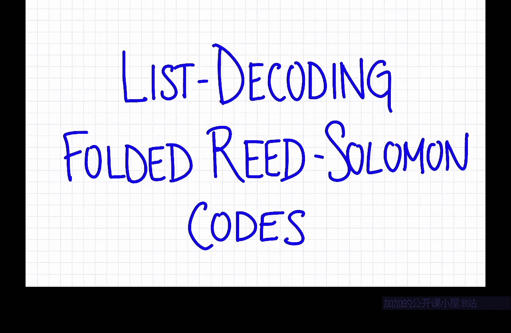
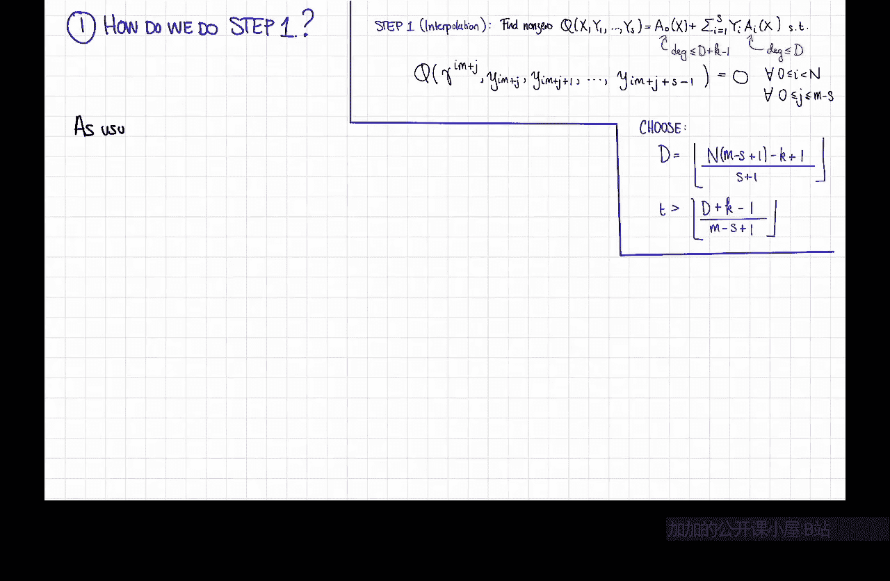
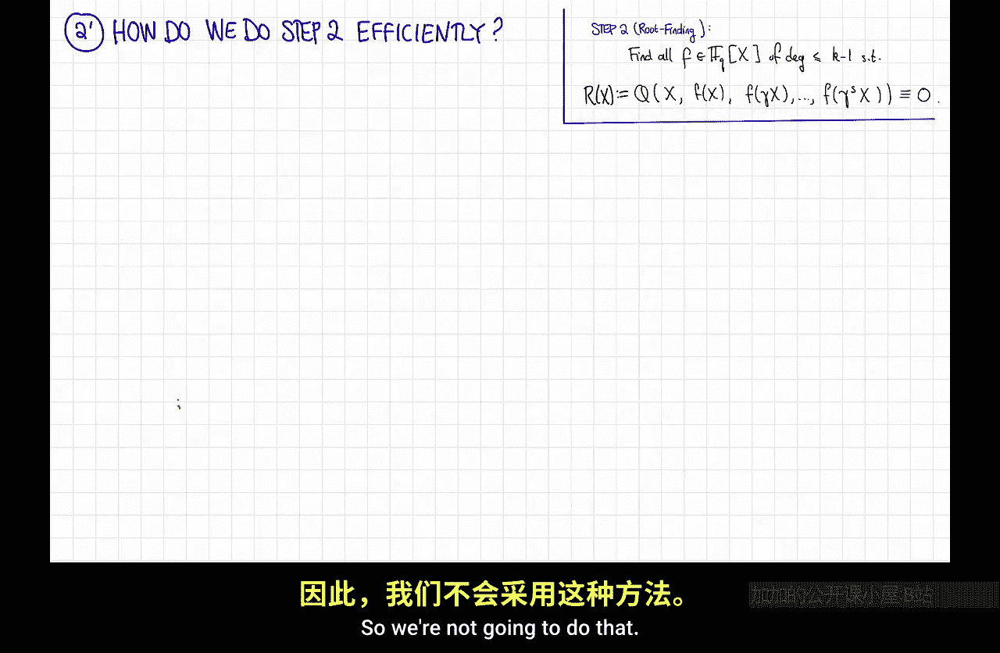
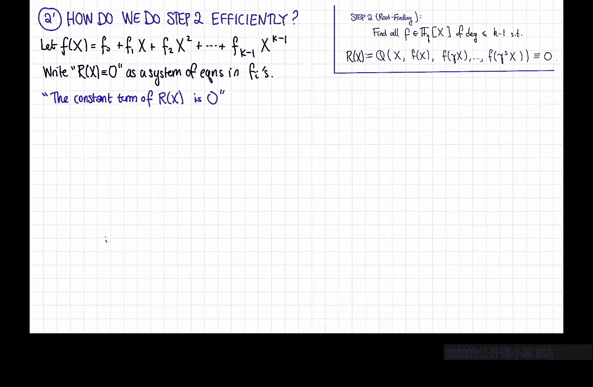
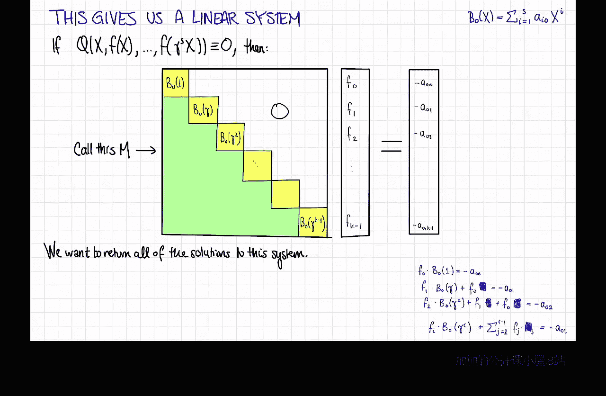

# 代数编码导论：13：折叠RS码的列表译码（第二部分）🎯



在本节课中，我们将改进上一视频的结果，学习如何将折叠里德-所罗门码的列表译码半径提升至列表译码容量。具体来说，我们将证明一个关键定理，并详细解析其背后的算法和参数选择。

## 定理陈述与参数解析 📊

我们将证明以下定理：选择整数参数 **S** 和 **M**，满足 **1 ≤ S ≤ M**。设 **C** 是一个码率为 **R** 的 **M** 折叠里德-所罗门码。那么，**C** 可以在多项式时间内进行列表译码，译码半径为 **P**，列表大小 **L** 至多为 **Q^S**。此外，列表中的码字实际上包含在一个维度为 **S** 的仿射子空间中。

其中，译码半径 **P** 的公式为：
```
P = (1 - S/M) * (1 - (K-1)/(N*(M-S+1)))
```
这里，**Q** 是原始里德-所罗门码的域大小。

为了理解这个定理的意义，让我们分析参数选择。如果我们选择 **S ≈ 1/ε** 且 **M ≈ 1/ε²**（其中 **ε** 是一个小参数），那么：
*   **P ≈ (1 - ε) * (1 - (1+ε)R) ≈ 1 - R - O(ε)**。这意味着译码半径 **P** 可以无限接近列表译码容量 **1-R**。
*   列表大小 **L ≈ Q^(1/ε)**。由于 **Q ≈ n**（原始RS码长），且 **n = N * M**（**N** 是折叠码的码长），代入 **M ≈ 1/ε²**，可得 **L** 是折叠码码长 **N** 的多项式大小（当 **ε** 为常数时）。

因此，通过选择常数 **ε**，我们能够以多项式列表大小和多项式时间，高效地实现接近容量界的列表译码。

## 算法改进的直观思路 💡

在上一节的算法中，接收字 **Y** 与候选码字 **F** 在一个位置 **i** 上的一致，会为我们的插值多项式 **Q** 带来一个根。



本节我们将改变策略，让**一次一致带来多个根**。我们不再像之前那样使用 **M** 个变量，而是只使用 **S** 个变量 **y₁, …, y_S** 来构造插值多项式 **Q(x, y₁, …, y_S)**。我们要求 **Q** 在一系列“滑动窗口”上为零。

具体来说，对于每个位置 **i**，我们要求 **Q** 在点 **(γ^(Mi+j), Y_{Mi+j}, Y_{Mi+j+1}, …, Y_{Mi+j+S-1})** 上为零，其中 **j** 从 **0** 取到 **M-S**。这样，每个窗口的宽度是 **S**。

这样做的结果是：如果接收字 **Y** 与码字 **F** 在第 **i** 个位置一致，那么我们将为相关的多项式 **r(x)** 获得 **M-S+1** 个根，而不仅仅是一个。虽然这增加了插值的约束条件数量，但根数量的显著增加对后续论证更有利。

## 改进的列表译码算法 ⚙️

我们的算法依旧分为两步：**插值**和**求根**。

### 第一步：插值



我们插值一个具有以下形式的多项式：
```
Q(x, y₁, …, y_S) = a₀(x) + Σ_{i=1}^{S} y_i * a_i(x)
```
其中，**deg(a₀) ≤ D + K - 1**，且对于 **i ≥ 1**，有 **deg(a_i) ≤ D**。



我们要求 **Q** 满足所有滑动窗口的消失条件：
```
Q(γ^(Mi+j), Y_{Mi+j}, Y_{Mi+j+1}, …, Y_{Mi+j+S-1}) = 0
```
对于所有 **i**（从 **0** 到 **N-1**）和所有 **j**（从 **0** 到 **M-S**）。

参数 **D** 和 **T** 的选择如下：
```
D = floor( (N*(M-S+1) - (K-1)) / (S+1) )
T = floor( (D + K - 1) / (M - S + 1) )
```
通过比较变量数（多项式系数个数）和约束数（消失条件个数），可以证明这样的多项式 **Q** 总是存在的。

### 第二步：求根

这一步的目标是找到所有满足以下条件的次数小于 **K** 的多项式 **F(x)**：
```
r(x) = Q(x, F(x), F(γx), …, F(γ^(S-1)x)) ≡ 0
```
与之前不同，我们不再直接进行多项式分解。我们将证明，如果 **F** 对应的折叠码字与接收字 **Y** 在超过 **T** 个位置上一致，那么 **r(x)** 必然恒等于零。

**论证的关键**在于比较 **r(x)** 的次数和根的数量：
*   **次数**：**deg(r) ≤ D + K - 1**。
*   **根的数量**：每个一致的位置 **i** 会贡献 **M-S+1** 个根。因此，如果一致位置数 **> T**，则根的总数 **> T * (M-S+1)**。
根据我们对于 **T** 的选择，有 **D + K - 1 ≤ T * (M-S+1)**。这意味着根的数量超过了多项式的次数，因此 **r(x)** 必须是零多项式。

## 高效求解与列表大小控制 🔍

现在我们需要高效地找到所有使 **r(x) ≡ 0** 的 **F(x)**。我们将条件 **r(x) ≡ 0** 转化为一个关于 **F** 的系数 **f₀, f₁, …, f_{K-1}** 的线性方程组。



通过展开 **r(x)** 并令其各项系数为零，我们可以得到一个 **K × K** 的线性系统 **M · f = v**。关键在于，矩阵 **M** 是**下三角矩阵**，其对角线元素是 **B₀(1), B₀(γ), B₀(γ²), …, B₀(γ^{K-1})**，其中 **B₀(x)** 是一个次数至多为 **S** 的多项式。

这个结构带来了巨大优势：
1.  **求解效率**：下三角系统可以在 **O(K²)** 时间内高效求解。
2.  **控制列表大小**：方程组的解空间维度等于矩阵 **M** 的零空间维度。由于 **M** 是下三角矩阵，其零空间维度恰好等于其对角线上零元素的个数。而对角线上的零元对应着多项式 **B₀(x)** 在点集 **{1, γ, …, γ^{K-1}}** 中的根。因为 **deg(B₀) ≤ S**，所以这样的根最多有 **S** 个。

因此，解空间的维度至多为 **S**，这意味着满足条件的多项式 **F** 的个数（即列表大小 **L**）至多为 **Q^S**。并且，所有这些解构成一个维度至多为 **S** 的仿射子空间。

## 总结 📝

本节课我们一起学习了如何将折叠里德-所罗门码的列表译码推到容量界。
*   我们引入了一个使用更少变量（**S**个）的插值多项式，通过“滑动窗口”技术将一次一致转化为多个根。
*   我们证明了改进后的算法可以在多项式时间内，列表译码至半径 **P ≈ 1 - R - O(ε)**，列表大小 **L** 为多项式量级（**≈ Q^(1/ε)**）。
*   算法的核心在于将求根问题转化为一个特殊的线性系统，并利用其下三角结构高效求解，同时利用多项式根的数量限制来严格约束最终列表的大小。

这项工作填补了之前约翰逊界（**1 - √R**）与列表译码容量界（**1 - R**）之间的空白，展示了折叠码在实现高效、大容量列表译码方面的强大能力。