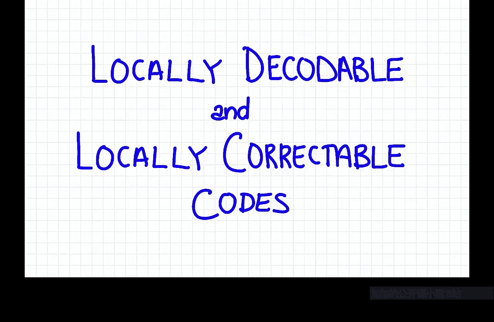
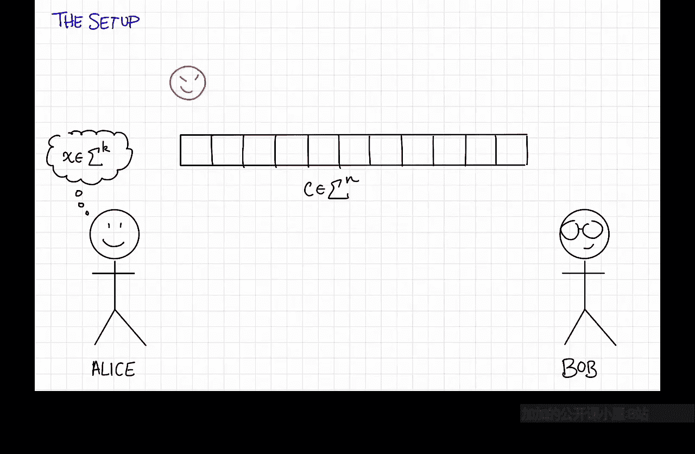

# 斯坦福大学【中英⚡代数编码导论｜Introduction to Algebraic Coding Theory】 p47 p46 14, Video 1： Locally Correctable Codes -BV16sRYYTEwg_p47-

In this video， we will begin a new topic on locality in coding theory。 In particular。

 we will discuss locally decodable and locally correctable codes。

Here's the basic set up for locally correctable codes。 As usual， we have a sender Alice。

 who has a message X in Sigma to the K that she wants to send to a receiver， Bob。

So what she does is she's going to encode her message X as some code word C in Sigma to the n。

And send it to Bob。And as usual， something bad is going to happen。

As is normal for us， the bad thing that's going to happen is that some P fraction of symbols are going to be adversararily corrupted。

 So there's some bad guy pictured here。Who's going to corrupt some P fraction of the symbols？

 That will give us a corrupted code word C twiddle。So far。

 this is exactly the same as what we've been talking about before。

The difference is that now Bob does not actually want to recover all of Alice's message。 Instead。

 Bob just wants to recover part of Alice's message or perhaps part of the code word。In this example。

 maybe Bob only wants C 7， the seventh symbol of the code word。

The astute viewer will realize that if Alice and Bob are using an error correcting code。

 they should be fine。Bob can just read this entire corrupted code word， fix the errors。

 correct it to recover the original code word C， and then just look at the seventh symbol。However。

 that might seem somewhat wasteful。 Bob is going to do a lot of work。

 and he's going to recover the entire code word that Alice sent just to throw it all away and keep just the seventh symbol。

If there weren't any errors， Bob would just go ahead and look at the7 symbol。

 If he's given this code word C as an array， he can do that in constant time， and he'd be happy。

The issue is， what if the bad guy being very mean happened to corrupt that7 symbol。

So our goal is going to be for Bob to do something else。

We're going to want Bob to do something that's closer to just look up the seventh symbol than it is to read the entire thing。

 do the decoding， and then throw away almost all of it。

What we're going to hope for Bob to be able to do is to query just a few different positions of this code word。

 like that one， that one and that one， which may or may not include the seventh symbol。

 And from those few positions， be able to deduce the information that he wants。If Bob can do that。

 we say that the underlying code is a locally correctable code。So here's the definition。

Just a quick warning。 This is not the actual definition。

We're going to have to modify it a bit to get a definition that we like。But let's start with this。

So this definition says that a code C in sigma to the N is P comma capital Q locally correctable。

Or it is an L C。If theres some algorithm， B， B here stands for Bob so that the following holds for all received words W of length。

 N。So that W is close to some code word。That is， so there exists some code word。

 So that the haming distance， a relative hamming distance between C and W is at most P。

And for all positions， I， when I run this algorithm with query access to W on input I。

The algorithm makes at most Q queries to W and returns C， I， the Ithe symbol of the code word here。

 this notation with little W and fronthees up top means that the algorithm B has access to。

 let's say， an array that contains W。And it can access any coefficient of W。

WJ or something like that in time， Big O of one。And such an access is called a query。

 and our guarantee says that at most Q queries are made。Let's draw a picture of this definition。

As before， we have some code word。And then some bad guy comes along and corrupts this code word。

So let's say the bad guy corrupts it in at most a P fraction of places。

 and that's going to change this code word into some received word W。

So that the hamming distance or relative hamming distance between W and C is at most P。

The bad guy is also going to come up with some index I。And demand that， Bob。

Given this corrupted code word， recover the Ithe index of the original code word。So Bob。

 also known as our algorithm B， has query access to this word W。

And he's allowed to make at most cu queries， however he wants。Let's say he queries this position。

 this position。And so on。Notice that Bob might query corrupted symbols， he doesn't know。

Then Bob's job is to do what the adversary asked him to do and recover C I。

Our hope is going to be that Q is not too large。And that we can get away with a constant fraction of errors。

So let's say that Q is little o of n。So that is Q divided by n goes to0 as n goes to infinity。

And let's hope that P is big theta of  one。So P SM constant。If we could get this。

 that would be pretty neat。 That would mean that Bob could recover just a little bit of information with just a little bit of information Instead of having to recover just a little bit of information by reading a lot of information and spending a lot of time to decode it。

Unfortunately， though， getting this definition with these sorts of parameters is impossible。

 Can you see why。If not， pause the video now and think about it。

The reason that this is impossible is that， as stated。This algorithm B， A K， A bo， is deterministic。

So if I were the adversary， I would not behave like this。Instead， what I would do is the following。

I know that whenever I tell Bob to recover C。 I， he's going to query these positions。

I can mess up a constant fraction of positions as the adversary。

 And this is a less than constant fraction of positions。 So I'm not going to waste my budget。

Corrupting positions that Bob isn't going to query。I'm just going to mess up all of those positions。

 And at this point， Bob is just going to get garbage。

So while this definition would be really nice to have， unfortunately， it's impossible。

In order to make it possible and still allow Bob to do something interesting。

 we're going to allow Bob to randomize his queries。More precisely。

 here is the actual definition of a locally correctable code。The differences are highlighted in red。

We say that a code C subset of sigma to the N。Is a P comma Q comma gamma locally correctable code or LCC if the following holds。

We want there to be a randomized algorithm， B。So， that。

The same bunch of quantifiers for all received words W that are close to a code word C and for all positions I and N。

The algorithm B has query access to W。And it still makes it most Q queries。

 but now these queries are allowed to be randomized。

And we still want B with query access to W on input I to output C sub I。

 the I symbol of the code word。 But now we're going to allow ourselves some small failure probability。

 and that failure probability is this parameter gamma。

 So we want this to be the case with probability at least one minus gamma over the randomness in the queries。

So now the picture looks like this。We have the same setup as before。

But now Bob is allowed to flip some coins before making his queries。

Imagine that this is a coin being flipped。As opposed to a disc on a spring or however it might look。

 It's a coin。 It's a coin。Okay， I give up。 Let's try this again。Okay。

 I'm not sure that's much better。Bob is flipping a coin。Anyway， so Bob flips some coins。

 make some random choices， and based on those random choices。

 Bob is going to make at most capital Q queries。And as before， he's supposed to come up with CI。

 but now he only needs to do it with high probability。Notice that this time。

 the adversary can't do the same trick that he did on the previous slide because he does not know when he comes up with I and when he comes up。

With his errors。How Bob's coins are going to land。Okay。

 so this is the definition of a locally correctable code。And as we will see in future videos。

 it is actually possible to get locally correctable codes with non trivial parameters。

Before we talk about that， though， I just want to mention briefly a few other notions of locality。

Localality broadly， refers to Bob's ability to get a small piece of informationote locally。

 That is by querying only a few places of the code word。

There are lots of different types of codes which exhibit locality in various different ways。

What we just saw was the definition of a locally correctable code。Here。

 Bob can recover any symbol C in the presence of worst case errors， at least with high probability。

Is a very related notion called a locally decodable code or LDC。In this situation。

 Bob doesn't want to recover any C I， but rather he wants to recover any X I。

 That is any single symbol of the message that Alice meant to send again。

 in the presence of worst case errors。Notice that if your code is systematic。

 then the message symbols appear as some of the code word symbols。

And so a locally correctable code is stronger than a locally decodable code in that case。

There's also a notion of a locally testable code。Where Bob just wants to make a few queries and figure out whether or not the code word seems legit。

And there's another notion called a locally repairable code or locally recoverable code or LRC。

In which Bob wants to recover X， I or C， I， depending on the context from just a few queries。

But in the presence of worst case erasureers rather than worst case errors。There are also many。

 many more， but I ran out of room on the slide。As you can tell from this proliferation of definitions。

 locality has applications all over the place。One natural example is in storage。

Perhaps you want only a small piece of your data。But then it would be wasteful to decode the entire code word。

That's the situation where locally repairable codes are useful。These things， LCCs， LDCs and LTCs。

Also have lots of different applications， and they come up。

 especially in complexity theory and cryptography。We'll see a few applications of these different types of locality in later videos。

In the next few videos， though， we'll seek some constructions of locally correctable codes with non trivialvi parameters。

