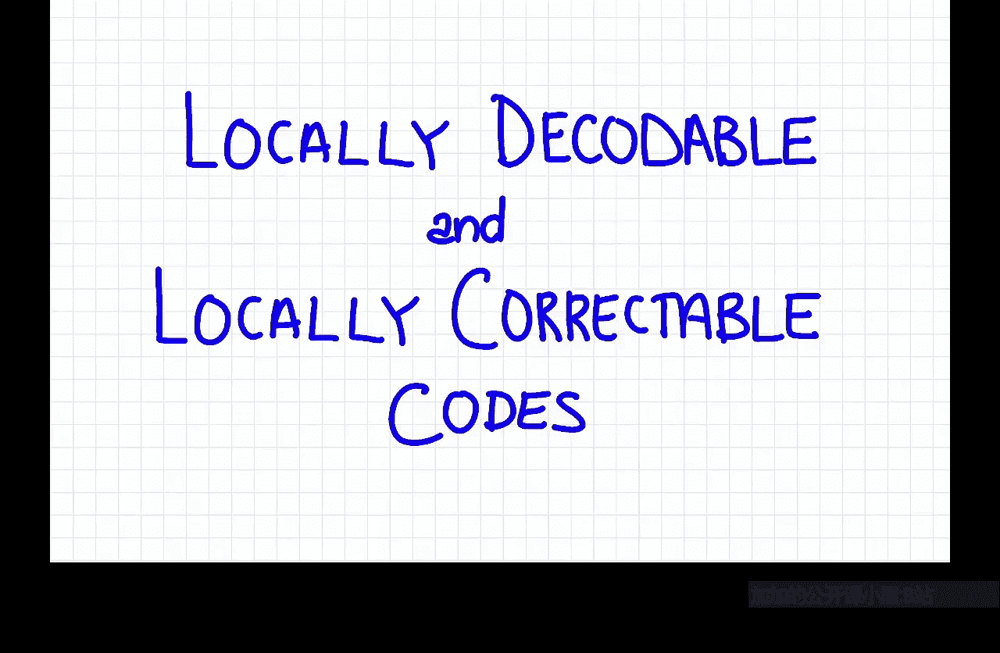
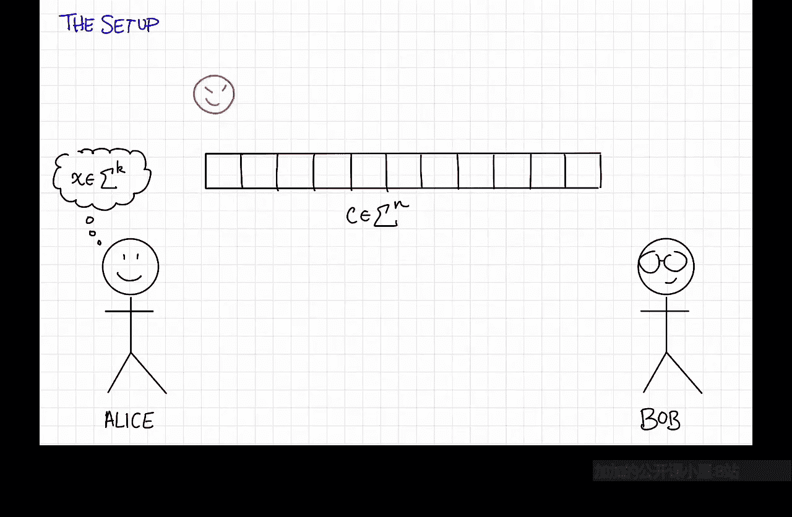

# 代数编码导论：14：局部可纠正码

在本节课中，我们将开始学习编码理论中的一个新主题：局部性。具体来说，我们将讨论**局部可解码码**和**局部可纠正码**。

## 概述

我们将首先介绍局部可纠正码的基本设置和动机，然后探讨其定义，并解释为什么最初的朴素定义不可行。接着，我们将给出正确的、基于随机化的定义。最后，我们会简要介绍其他几种局部性概念，为后续课程打下基础。

## 局部可纠正码的基本设置

以下是局部可纠正码的基本场景。和往常一样，发送者爱丽丝有一个她想发送给接收者鲍勃的消息 `X`，该消息属于字母表 `Σ` 的 `k` 次幂集合。

她的做法是将消息 `X` 编码为某个码字 `C`，该码字属于字母表 `Σ` 的 `n` 次幂集合，然后将其发送给鲍勃。和往常一样，过程中会发生一些不好的事情。

对我们来说，通常发生的坏事是，有 `ρ` 比例的符号会被恶意地篡改。图中描绘了一个坏人，他将篡改 `ρ` 比例的符号，从而给我们一个被破坏的码字 `C̃`。

到目前为止，这与我们之前讨论的内容完全相同。

不同之处在于，现在鲍勃实际上并不想恢复爱丽丝的全部消息。相反，鲍勃只想恢复爱丽丝消息的一部分，或者可能是码字的一部分。在这个例子中，也许鲍勃只想要码字的第七个符号 `C[7]`。

敏锐的观众会意识到，如果爱丽丝和鲍勃使用的是纠错码，他们应该没问题。鲍勃可以读取整个被破坏的码字，修复错误，将其纠正以恢复原始码字 `C`，然后只看第七个符号。然而，这似乎有些浪费。鲍勃将要做很多工作，恢复爱丽丝发送的整个码字，却只是为了丢弃几乎所有内容，只保留第七个符号。

如果没有错误，鲍勃会直接查看第七个符号。如果他得到的码字 `C` 是一个数组，他可以在常数时间内完成，并且会很高兴。

问题是，如果坏人非常恶意，恰好篡改了第七个符号呢？

因此，我们的目标是让鲍勃做点别的事情。

我们希望鲍勃做的事情更接近于“直接查找第七个符号”，而不是“读取整个码字、进行解码、然后丢弃几乎全部内容”。

我们希望鲍勃能够做到的是，只查询这个码字的少数几个不同位置（可能包括也可能不包括第七个符号），并从这少数几个位置中，推导出他想要的信息。如果鲍勃能做到这一点，我们就说底层编码是一个**局部可纠正码**。

## 局部可纠正码的定义（初步尝试）

首先是一个快速警告：这不是最终的定义。我们需要稍作修改才能得到一个我们喜欢的定义。但让我们从这个开始。

这个定义说，一个码 `C ⊆ Σ^n` 是 `(ρ, Q)` **局部可纠正的**，或者说它是一个 **LCC**，如果存在某个算法 `B`（这里的 `B` 代表鲍勃），使得以下条件对所有长度为 `n` 的接收字 `W` 成立：
*   `W` 接近某个码字。即，存在某个码字 `C`，使得 `C` 和 `W` 之间的（相对）汉明距离至多为 `ρ`。
*   对于所有位置 `i`，当我以查询访问 `W` 的方式运行这个算法，输入为 `i` 时，该算法至多对 `W` 进行 `Q` 次查询，并返回 `C[i]`，即码字的第 `i` 个符号。

这里，符号 `B^{W}(·)` 表示算法 `B` 可以访问一个包含 `W` 的数组。它可以在 `O(1)` 时间内访问 `W` 的任何系数 `W[j]`。这样的一次访问称为一次**查询**，我们的保证是至多进行 `Q` 次查询。

让我们画图说明这个定义。

和之前一样，我们有一个码字 `C`。然后某个坏人出现并破坏了这个码字。假设坏人至多破坏了 `ρ` 比例的位置，这将把码字 `C` 变成某个接收字 `W`，使得 `W` 和 `C` 之间的汉明距离（或相对汉明距离）至多为 `ρ`。

坏人还会想出一个索引 `i`，并要求鲍勃在给定这个被破坏的码字的情况下，恢复原始码字的第 `i` 个索引。

鲍勃，也就是我们的算法 `B`，拥有对这个字 `W` 的查询访问权。他最多可以进行 `Q` 次查询，方式任意。假设他查询这个位置、这个位置等等。注意，鲍勃可能会查询到被破坏的符号，他并不知道。

然后，鲍勃的工作就是按照对手的要求，恢复 `C[i]`。

我们的希望是 `Q` 不要太大，并且我们能够容忍一个常数比例的误差。也就是说，我们希望 `Q` 是 `o(n)`（即当 `n` 趋于无穷时，`Q/n` 趋于 0），并且希望 `ρ` 是 `Θ(1)`（即 `ρ` 是一个常数）。如果我们能做到这一点，那将非常棒。这意味着鲍勃可以用很少的信息恢复很少的信息，而不是为了恢复很少的信息而必须读取大量信息并花费大量时间解码。

## 为什么朴素定义不可行

然而，不幸的是，用这类参数实现这个定义是不可能的。你能看出为什么吗？如果看不出来，现在可以暂停视频思考一下。

之所以不可能，是因为如上所述，算法 `B`（即鲍勃）是**确定性的**。如果我是对手，我不会像之前那样做。相反，我会这样做：我知道每当我要鲍勃恢复 `C[i]` 时，他都会查询这些特定的位置。作为对手，我可以破坏一个常数比例的位置，而鲍勃查询的位置少于常数比例。我不会浪费我的“预算”去破坏鲍勃不会查询的位置。我只会破坏所有那些位置。这样一来，鲍勃只会得到垃圾信息。

因此，虽然这个定义非常理想，但不幸的是，它是不可能的。

## 局部可纠正码的正确定义

为了使它成为可能，并仍然允许鲍勃做一些有趣的事情，我们将允许鲍勃**随机化**他的查询。更准确地说，以下是局部可纠正码的实际定义。不同之处已用红色高亮显示。

我们说一个码 `C ⊆ Σ^n` 是一个 `(ρ, Q, γ)` **局部可纠正码** 或 **LCC**，如果以下条件成立：
我们希望存在一个**随机化算法** `B`，使得对于所有接近某个码字 `C` 的接收字 `W`（即 `Δ(C, W) ≤ ρ`），以及对于所有位置 `i ∈ [n]`，算法 `B` 拥有对 `W` 的查询访问权。它仍然最多进行 `Q` 次查询，但现在这些查询可以是随机的。我们仍然希望拥有查询访问权 `W` 的 `B` 在输入 `i` 时输出码字的第 `i` 个符号 `C[i]`。但现在我们允许一个小的失败概率，这个失败概率就是参数 `γ`。因此，我们希望这在查询的随机性上以至少 `1 - γ` 的概率成立。

现在的情况如下图所示。

我们拥有和之前相同的设置。但现在鲍勃在进行查询之前被允许抛一些硬币（做随机选择）。想象一下这是一枚正在抛出的硬币。鲍勃抛一些硬币，做出一些随机选择，基于这些随机选择，鲍勃将最多进行 `Q` 次查询。和之前一样，他应该得出 `C[i]`，但现在他只需要以高概率做到这一点。

注意，这一次，对手无法像上一张幻灯片那样玩同样的把戏，因为当他提出 `i` 和他的错误时，他并不知道鲍勃的硬币会如何落地。

好的，这就是局部可纠正码的定义。正如我们将在后续视频中看到的，实际上有可能获得具有非平凡参数的局部可纠正码。

## 其他局部性概念简介

在讨论具体构造之前，我想简要提一下其他几种局部性概念。

**局部性**广义上指的是鲍勃通过只查询码字的少数几个位置来**局部**获取一小部分信息的能力。有许多不同类型的编码以各种不同的方式展现出局部性。

我们刚刚看到的是**局部可纠正码**的定义。在这种情况下，鲍勃可以在存在最坏情况错误的情况下（至少以高概率）恢复任何符号 `C[i]`。

有一个非常相关的概念叫做**局部可解码码** 或 **LDC**。在这种情况下，鲍勃不想恢复任何 `C[i]`，而是想恢复任何 `X[i]`，即爱丽丝想要发送的消息的任何单个符号，同样是在存在最坏情况错误的情况下。注意，如果你的编码是**系统码**，那么消息符号会作为码字符号的一部分出现。在这种情况下，局部可纠正码比局部可解码码更强。

还有**局部可测试码**的概念，鲍勃只想进行几次查询，以判断码字是否看起来合法。

另一个概念是**局部可修复码** 或 **局部可恢复码** 或 **LRC**。在这种情况下，鲍勃希望仅通过几次查询来恢复 `X[i]` 或 `C[i]`（取决于上下文），但这是在存在最坏情况**擦除**而非最坏情况错误的情况下。

当然还有更多概念，但幻灯片上没地方了。从这些定义的激增可以看出，局部性在各个领域都有应用。

一个自然的例子是在存储中。也许你只想要数据的一小部分，但解码整个码字会很浪费。这就是局部可修复码有用的场景。LCC、LDC 和 LTC 等也有许多不同的应用，尤其是在复杂性理论和密码学中。我们将在后面的视频中看到这些不同类型局部性的一些应用。

## 总结

在本节课中，我们一起学习了局部可纠正码。我们首先了解了其应用场景和动机：接收者希望高效地恢复码字中的单个符号，而不是解码整个码字。我们发现了一个朴素的确定性定义是不可行的，因为对手可以针对性的破坏算法必然查询的位置。因此，我们引入了基于随机化算法的正确定义，该算法通过随机选择查询位置，以高概率正确恢复目标符号，从而挫败对手的针对性攻击。最后，我们还简要介绍了局部可解码码、局部可测试码和局部可修复码等其他局部性概念，认识到局部性在编码理论及相关领域具有广泛的应用价值。

在接下来的几个视频中，我们将探索具有非平凡参数的局部可纠正码的一些构造。