# 斯坦福大学【中英⚡代数编码导论｜Introduction to Algebraic Coding Theory】 p48 p47 14, Video 2： Locally Correcting Hadamard Codes -BV16sRYYTEwg_p48-

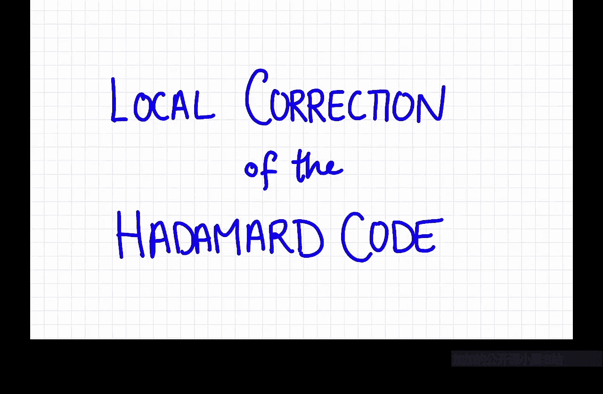

In this video， we'll see a first example of locally correctable codes with the Haamard code。

So here's the definition of the Haamard code。The Haamard code of dimension M and length2 the M is defined as follows。

It's the set of all vectors， F of alpha 1， f of alpha 2， dota dot up to f of alpha 2 to the M。

Where these alpha I are all of the points in F 2 to the M， and where F。Is a function of this form。

So that is F of x1， x2， dot dot up to X M。It's just the inner product。

Of some vector with coefficients F I and the Xs。 That is the。

 it is the sum from I equals 1 to M of F I times X I。 Notice that there are2 to the M。

 such functions F corresponding to all of the possible different choices of F I。

And so the dimension of this code is M。The length of the code is 2 to the M because there are2 to the M such evaluation points。

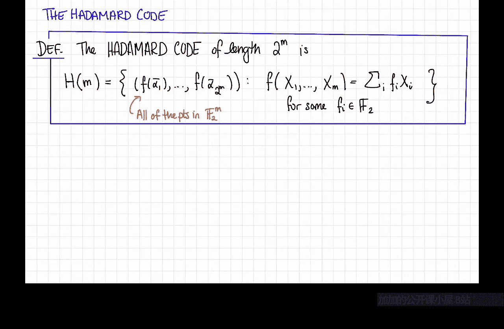

And so the rate of this code is M divided by 2 to the M。Which is notably pretty small。

So this is not a very good code as far as the rate is concerned。 However。

 the code does have really good distance。You can check that the distance of this code is 2 to the M divided by 2。

 or rather that the relative distance of this code is a half。 So the distance is very large。

So this code is useful in applications where we want really big distance and don't care so much about the rate。

Notice that I did not say why the distance is one half， if it's not obvious immediately。

 pause a video and try to figure it out， Fun exercise。Okay， so that's the headard code， bad rate。

 good distance。The reason we're talking about it now is because it also happens to be an LCC that is a locally correctable code with query complexity。

 just2。Let's see why。So we're going to establish that the Haamard code is an LCCC by giving an algorithm to locally correct it。

The input to this algorithm is going to be first query access to some corrupted code word。And second。

 the index of some coordinate that we want to evaluate。In the language of the Haamard code。

That means the following。Query access to some corrupted code word means query access to some function G。

 which takes inputs in F2 to the M and spits out a bit in F2。

So that G is close to some F in our code。That is so that the heming distance between G and F here I'm abusing notation a little bit by heming distance between two functions。

 I mean the number of points on which those two functions differ。Like this。

So we want this heming distance between G and F to be at most p times2 to the M for some parameter p。

 which is strictly less than a fourth， and we'll see why we want it to be less than a fourth in a moment。

And F here is going to correspond to our code word。

 so it should be some function of the form that shows up in the definition of the Hadmar code。

Then when we say that we want to evaluate the code word corresponding to F in a particular symbol。😡。

That means that we're asking for a particular evaluation point alpha in F2 to the M。

 so that will be our actual input some point alpha in F2 to the M。

Our output is supposed to be some guess at F of alpha。

 and we're going to want this guess to be correct with reasonably high probability。

If it isn't clear to you at this point， while producing an output like this。

 given an input like this is the same problem as locally correcting the headamard code。

 pause a video and go back to the various definitions until it becomes clear。Okay。

 so this is the problem we're going to solve。 Here's how we're going to do it。Very simple algorithm。

First， we're going to choose some beta in F2 to the N at random。

Then we're going to return G is beta plus G is beta plus alpha。That is。

 we're going to query G this corrupted code word in two places， beta and beta plus alpha。

Notice that since beta is random， both of these evaluation points are randomized。

We're going to take those two queries。 We're going to add them together。

And we are just going to hope for the best and hope that they are equal to F of alpha。

It might not be immediately clear why we would hope for that。

 we'll come back to that in just a moment。But for now。

 I claim that this local correction algorithm indeed works。More precisely。

 I claim that this algorithm is a local correction algorithm for the Haamard code。With parameter P。

Query complexity Q equals 2。And failure probability gamma， which is equal to 2 P。

 And this actually works for any P。 The reason that I demanded appear here that P be less than a fourth。

Is because I want the failure probability to be strictly less than a half。

 That's because if the failure probability can be as large as a half。

 this isn't a very interesting guarantee。 The answer is either 0 or1。 So if I guess randomly。

 I can always do that with probability a half。 So P being strictly less than a quarter。

 says that this failure probability should be nontrial。Okay， so that's the claim。 Why is that true？

Why does this algorithm work， So I've copied sort of the meat of the algorithm。

 just those two lines over there。Perhaps you already see why it works。 But if not。

 let's work out the details。 So our code word corresponds to some function F， which looks like this。

That is F is the sum from I equals 1 to M of F times Xi。

 which I can write as an inner product between a vector F。And the vector X。

 which contains these variables。Now。The probability， when I pick a random beta。In F2 to the M。

That f of beta is not equal to g of beta。Is at most P。That's because by assumption。

 F and G differ in at most a P fraction of places， and this is strictly less than a quarter。Now。

 let's suppose that we get very lucky or at least somewhat lucky。

 and f of beta is equal to g of beta。For this beta that we choose。And further。

 f of beta plus alpha is equal to G of beta plus alpha。

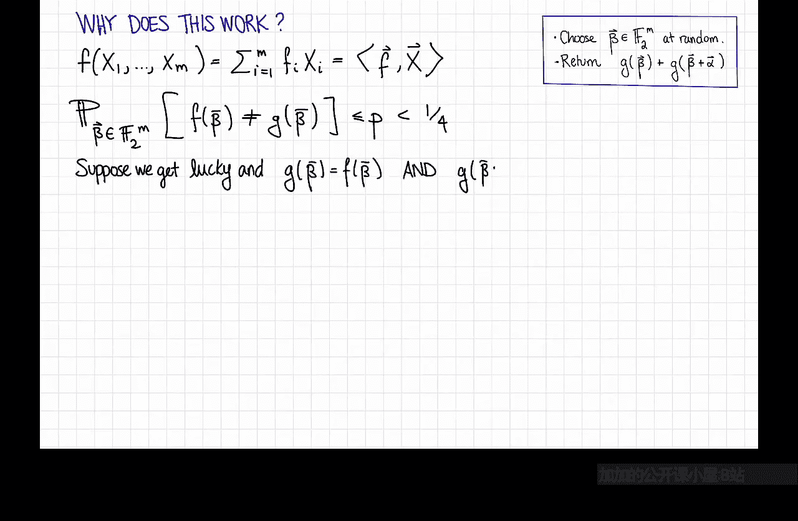

If we were to get so lucky， then this thing that we return。Is the following？

So we return G of beta plus G of beta plus alpha。 If we got lucky。

 this is equal to f of beta plus f of beta plus alpha。And now， by the definition of F。

This is equal to the inner product of the vector F with beta plus the inner product of the vector F with beta plus alpha。

 Now， we can use the fact that this function is linear to break it up over this sum。

And then we can use the fact that we're working over F 2。

 which means that anything plus itself is just equal to 0。 Plus， it's the same as minus。

So these two terms cancel。And were left with the inner product of F and alpha。

 also known as F of alpha。So if we got lucky and these two things occurred， then indeed。

 what we return is what we wanted to return， which is F of alpha。Now。

 let's compute the probability that we get lucky in this way。Okay。

 so this is greater than or equal to one minus。The probability that this fails to happen。

Minus the probability that this fails to happen。Here， we're using the union bound。

But we already said that this happened with probability at most P。And for exactly the same reason。

 this also happens with probability at most P。 That's because if beta is completely random in F 2 to the M。

 then beta plus alpha for any fixed alpha is also uniformly random in F 2 to the M。

 So the probability that we get lucky is greater than equal to 1-2 p。And in particular。

 the failure probability is at most2 P， which is what we claimed。So we've just shown this theorem。

 the hadamard code of length2 to the M。

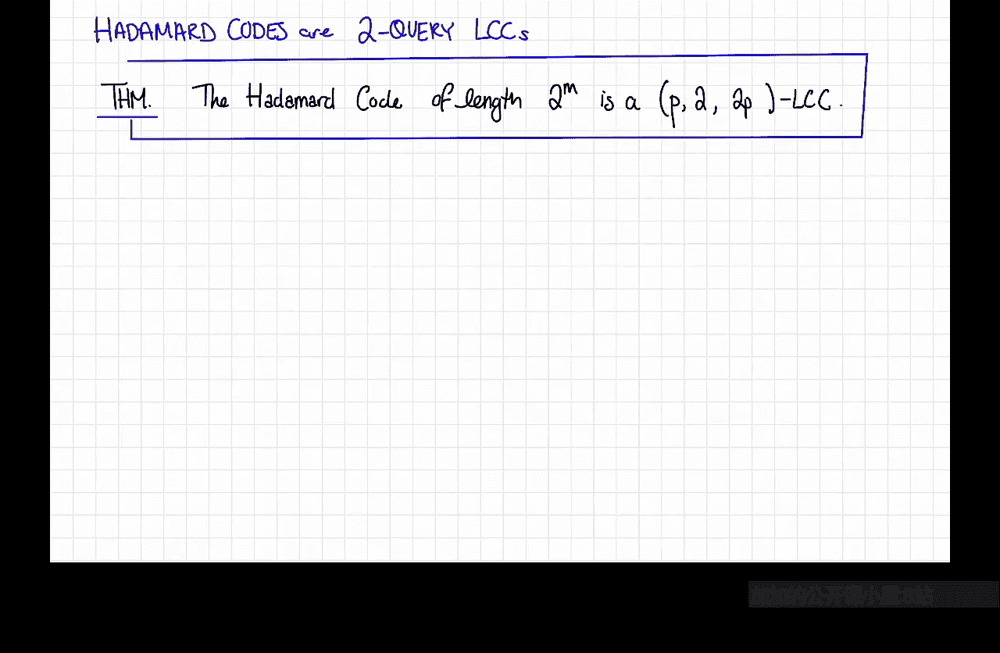

Is a P comma 2， comma 2 P， locally correctable code for any P。

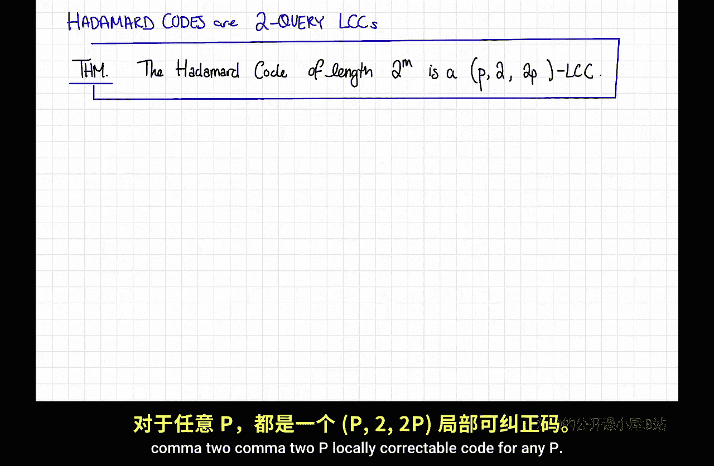

And notably， this is interesting when P is strictly less than a quarter。

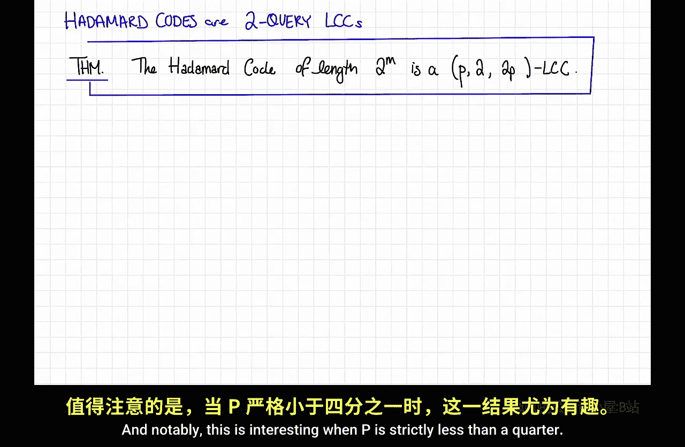

Here's an observation about our algorithm。

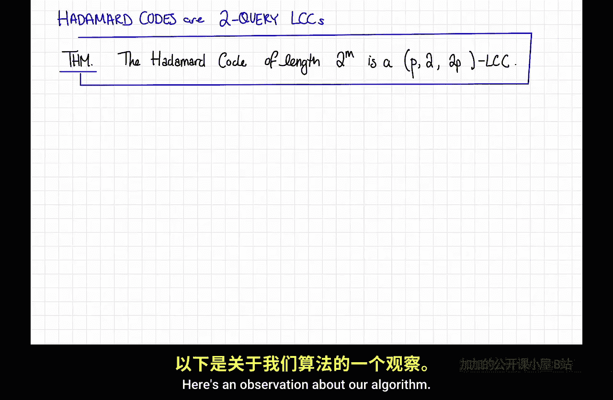

Our algorithm and the analysis sort of worked because each of the two queries looked at on their own。

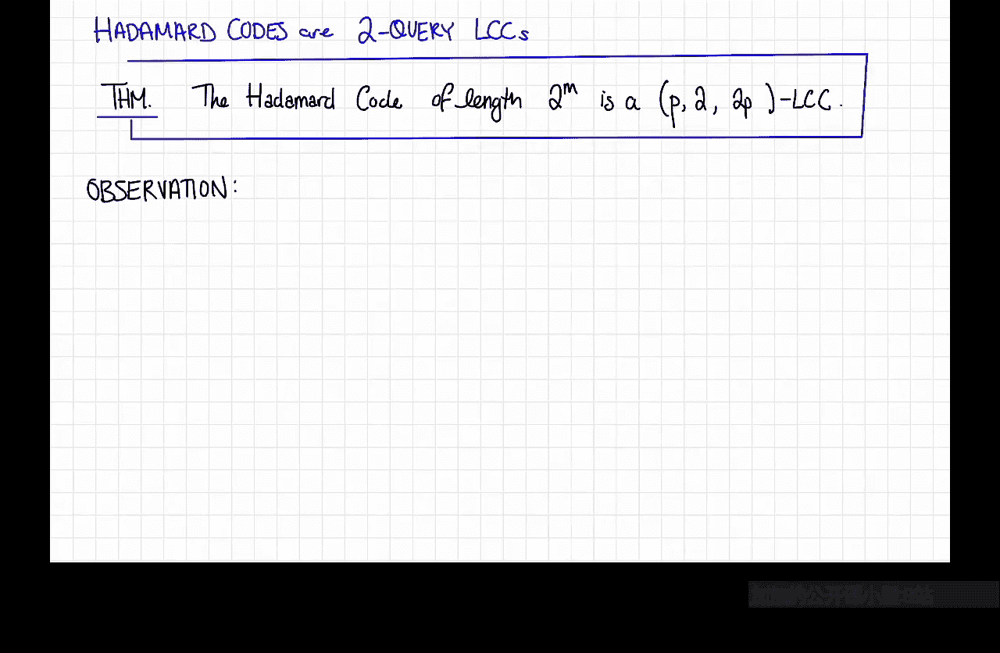

Were completely random。

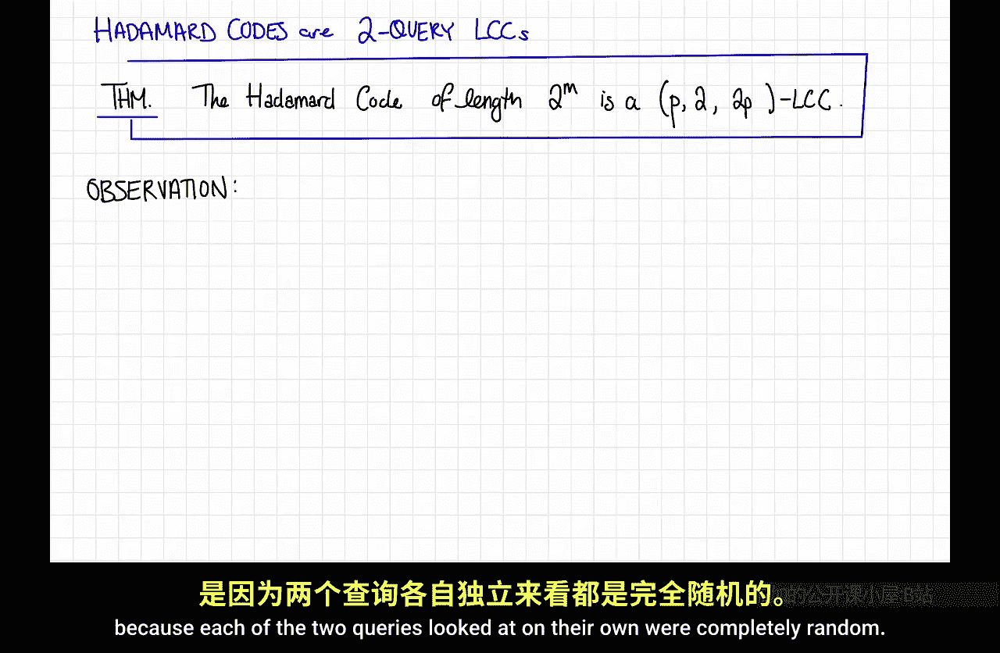

That is the marginal distribution of each query was uniform。However。

 the two queries together were not uniform， they were very correlated。

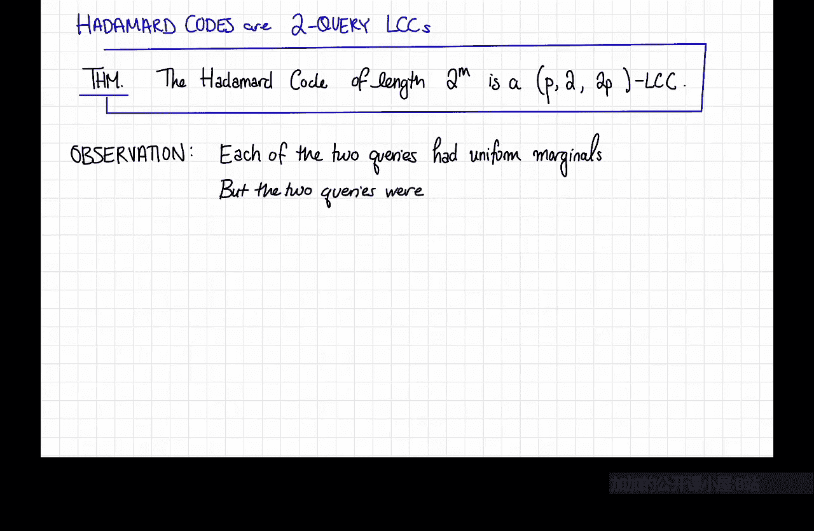

In particular， they always summed to the value alpha that we wanted to query on。

This is going to be a common theme in locally correctable codes。

Each one of the queries individually should be uniformly random or at least pretty close to uniformly random。

 because otherwise the adversary would know to mess it up。

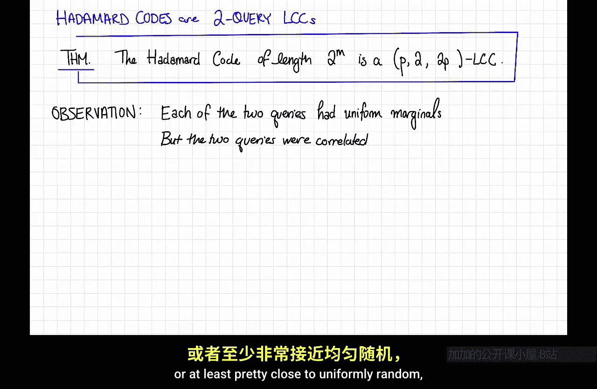

However， by constructing distributions on queries so that each individual query is uniformly random。

 but the joint distribution is not uniformly random。

 we're going to be able to fool the adversary while still getting used for information for ourselves。

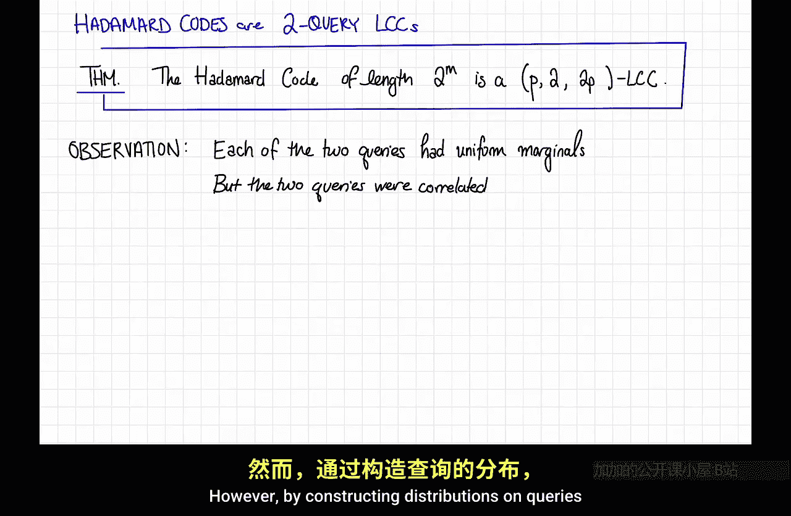

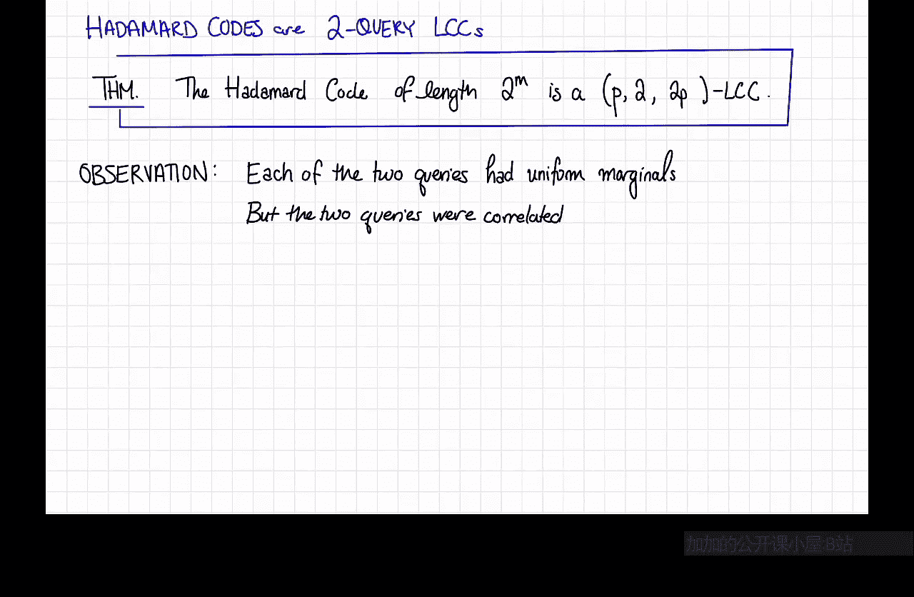

Cool。So this theorem might raise a question。Here we have a code。Which has pretty awesome locality。

 just has  query complexity， too。😊，However， as we saw earlier， the rate is really bad。We might ask。

 can we do better。That is， is there a two query， locally correctable code。

With parameter P that is some constant and failure probability gamma that is non trivial。

That does better than the Haard code in terms of rate。Namely。

 can we even get away with block length that's asymptotically less。Then2 to the message length。

This feels like not much to ask for， but it turns out that actually the answer is no with a two query locally correctable code。

 we can't really hope to do much better than this。However。

 if we allow our query complexity to be a little bit more than two。

 it turns out we will be able to do better。 And we'll see that in the next video。

