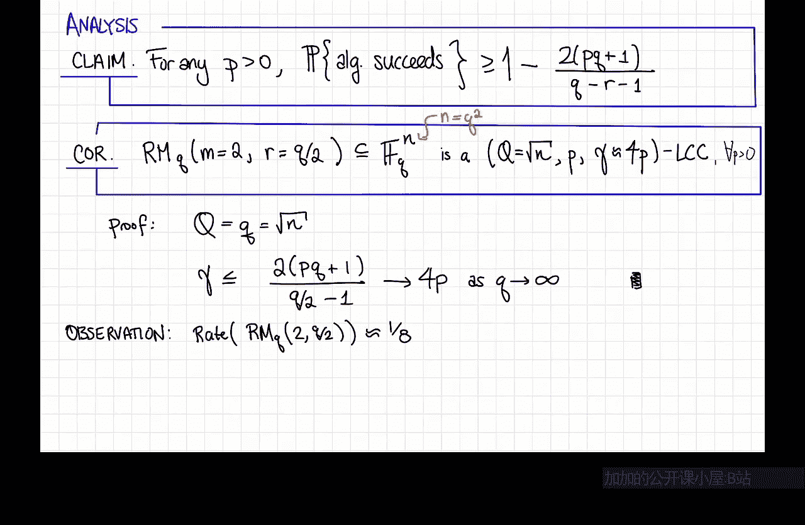
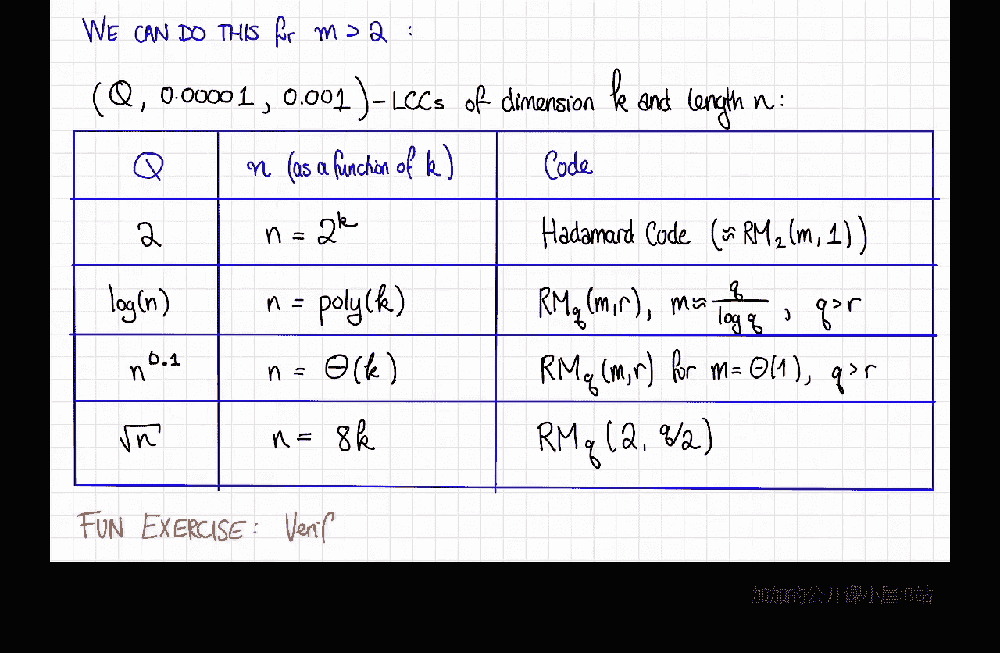

# 斯坦福大学【中英⚡代数编码导论｜Introduction to Algebraic Coding Theory】 p49 p48 14 Video 3： Locally Correcting Reed-Muller Codes -BV16sRYYTEwg_p49-

In this video， well see a local correction algorithm for read Waller codes。

Recall the definition of read Mueller codes from a previous video。Before we just define them over F2。

 but now we're going to define them over any field。The Mvari， read Mueller code。Of degree R over F Q。

Is defined as R M sub Q with parameters M comma R， And this is equal to the set of all vectors of evaluations of low degree multivariate polynomials。

That is， let's let alpha1 up through alpha Q to the M be all of the vectors in F Q to the M。

It doesn't matter what order they're in。 Just fix some order。

Then we're going to look at all Mvariate polynomials over Fq with total degree at most R。

And we're going to evaluate those polynomials on all of the points。

 Each such polynomial is going to give us a code word in our code。

So this is just like a reads salmon code， except now it's multivariate。

Let's make a few quick remarks。First， as we just mentioned。

Read Mueller codes generalize read Solomon codes。 Read Solomon codes are just the Uniivevariate version。

In more detail。The read Mueller code over F Q with one variables of degree R。

Is the same as the read Solomon code。Over Fq。With block length， N that is equal to Q。

And dimension K that is equal to R plus 1。Another remark。

Ass that the read Muer code over F 2 in M variables of degree 1 is very similar to the Haamama code that we saw in the previous video。

The difference is that the Haabard code looked at linear polynomials， with no constant term。

Whereas this read Mueller code allows itself a constant term， but that's the only difference。

So this definition generalizes two things that we have seen before。In this video。

 we will see that ReadM codes are locally correctable codes。Let's see the basic idea。

So here's the basic idea for byvari read Mueller codes。 That is when m is equal to2。In this case。

 we can view each code word kind of as a square。Each point on the square represents an evaluation point。

 so think of this as being FQ cross FQ。And each point is an evaluation point， alpha comma beta。

So the value that goes in the alpha beta position in this square is F of alpha beta for some low degree byvari polynomial F。

 With this picture in mind， let's see how we would locally correct this read Mueller code。

Suppose we want to recover F of alpha beta， where F is a low degree polynomial。In particular。

 F looks like this。It's the sum over all I and J so that I plus J is at most R of some coefficient FI J times x1 to the I times x2 to the J。

And we want to figure out what is this position。Of the corresponding coat word。However， as before。

 some adversary has gone through and messed up a P fraction of the points。

Maybe they've even messed up the point that we're after。 We don't know。

So now we want to recover this point。Given query access to this corrupted code word。To do this。

 let's consider any line that goes through this point。Maybe it looks like this。Here。

 I've drawn this line。As kind of wrapping around the square because we're over a finite field。

Formerly， we can parameterize such a line like this。That is， we can parameterize it as L of Z。

 which is equal to alpha plus sigma times Z for some sigma in F Q。

Coma beta plus tau times Z for some other tau in FQ。

Then if we go in and plug in all of the possible Z's。

 we will get all of the possible points on some line。Here。

 Sigma and Tau were giving us the slope of the line。And we can observe that if we plug in z equals 0。

 we're just going to get alpha beta。 So indeed， this line does go through alpha beta。Now。

 let's consider the restriction of this bivariate polynomial F to this line。By that， I mean。

Let's consider。F。Of L of Z。 So we're just going to plug in points that live on this line。

For the variables in F。And if we plug this into our generic form for F up here。

That's gonna to look something like this。Now this might look pretty nasty。

 but the main point here is that whatever this polynomial is。

 this is some univevariate polynomial in Z， and moreover， it has degree at most R。That is。

 it is equal to H of Z for some univariate polynomial H of degree at most R。

Now imagine that we were to query all of the points along this line。

If we ignore these errors for a moment， the points that we query would be evaluation points of some low degree univevariate polynomial。

With the occasional corruptions。This is going to be evaluation points of something that is close to some low degree Uniivariant polynomial。

This problem should sound pretty familiar。This is basically just decoding a read Solomon code we're given corrupted points of some low degree Uniivariate polynomial。

 and we want to figure out what is that polynomial。

So that's the basic idea for locally correcting read Muer codes。That is。

 we're going to query the corrupted code word along some line， in particular， a random line。

And then we're going to use a read Solomon decoder to correct any errors that we happen to hit。

So here is our local correction algorithm for the bivari read Mueller code of degree R over F Q。

 as input， we're going to get query access to a corrupted code word。

And we're going to get a point alpha beta that we want to query。In more detail。

 we'll have query access to some function G from FQ squared to FQ。

So that G agrees a lot with some low degree polynomial。So there's some polynomial F。

Of degree at most， are。And G agrees with F in at least a1 minus P fraction that places it。

 Another way to say that is that if we were to choose a random evaluation point。

 the probability that F would not agree with G on that evaluation point is it most P。

Then we're given our point alpha beta that we want to query。

 and what we're supposed to output is a guess for F of alpha beta。

 and we want to be correct with decent probability。So given that input and output。

 here's the algorithm。First， we're going to choose a random line through the point alpha beta。

To do that， we're going to choose Sigma comma tau。In FQ squared other than 0，0， uniformly at random。

This is basically picking a uniformly random slope。

Then we're going to consider the line L of z just as before。

 which is sigma z plus alpha comma tao Z plus beta。And observe that if we plug in z equals0。

 this indeed does give us alpha comma beta， so it goes through the point alpha beta。

Then we're going to query G at all of the points on the line。😡。

So we're going to query G of L of little Z for all little Z and Fq。

That will allow us to recover some function， H twiddle of Z。Which is just equal to g of L of z。Now。

 as we discussed on the previous slide， we hope that H twiddle of Z is a lightly corrupted low degree polynomial。

 So we're going to use a RE salammon decoder。To find some low degree polynomial H。

 which has degree at most are， so that the ham distance between H and H twiddle Aka， A。

 the number of points on which H and H twiddle take on different values。

Is strictly less than Q minus R divided by 2。Notice that this value here is half of the distance of the read Solomon code。

With length Q and dimension R plus 1。And so if such an H exists。Our read sallo and decoder。

 for example， the Weld Spl camp algorithm will be able to do this。

Then what we're going to do is return H of zero。😡，The reason for that is that if we succeeded and there wasn't too much corruption along this line。

Then H of z will be equal to F of L of z。 And that means that H of 0 is f of L of 0。

 but L of 0 is alpha beta。 So that will just be F of alpha beta， which is what we wanted to return。

Okay， so that's the algorithm。What's the probability that it succeeds？

Notice that it's not guaranteed to succeed If we get unlucky and we choose a line that happens to have a lot of errors on it。

Then this reads Solomon decoder will fail。So we need to do some analysis。

So I claim that for any p greater than0， the probability of this algorithm succeeds is at least one minus2 times Pq plus1。

Divided by  Q minus r-1。We'll come back to this expression in a moment and try to make some sense of it。

But for now， let's try to prove this claim。First， let's think about when our algorithm succeeds。

The algorithm succeeds as long as there are at most the floor of Q minus R divided by two errors on the line L of Z。

That's because the degree of F of L of Z is at most R， as we discussed before。

 And this is the floor of the distance -1 divided by 2 for the read Solomon code， which has degree R。

And that's the number of errors that we can correct using a read Solomon decoder。

So let's try to figure out the probability that this successful outcome occurs。First。

 let's compute the expected number of errors on a line。So in expectation。

 the number of errors on the line L。Is it most one。

 That's the one that comes from the point alphapha beta itself。

 which the adversary might know to corrupt。Plus， the sum over all z not equal to 0。

Of the probability that G of L of Z。Is not equal to F of L of Z。Here。

 I just used linearity of expectation to write the number of errors as the sum over all points on the line of the indicator random variable。

 which is one， if there is an error on that point。So we might definitely have an error in alpha beta。

 And then for all the other points， it's this。Here， this probability is over the choice of L。

Since L is random， that means that for any z not equal to 0， this point。

 L of Z is also uniformly random in F Q squared。Therefore。

 the probability that this occurs is at most P。So the expected number of errors on L is at most this。

Then we can use Markov's inequality to get some bound on the probability that there are too many errors on that line。

In particular， the probability that the number of errors on L is strictly greater than the floor of Q minus R divided by 2。

Is it most。The expectation， divided by this。Which adding some plus minus ones for slack to help us with that floor。

Is at most two times pq plus1 divided by Q minus r minus1。

 and that's exactly what we claimed up here。So that proves the claim。Check。All right。

 I'm going to erase the proof of the claim so that I can write a corollary。

The corollary is that for all P greater than 0。The read Mueller code with two variables and degree R equal to Q over 2 over F Q。

Which is a code with alphabet， F Q and block length N here。 N is equal to Q squared。

Is a locally correctable code with query complexity Q equal to the square root of n。

 error parameter P and failure probability gamma， which is approximately 4 p as n gets large。

I think I wrote P and Q in the opposite order。 Sorry about that。

Let's quickly see why this court Larry is true。Proof。Okay， so the query complexity。

 that's just the number of points on a line because in the previous algorithm。

 we queried just a line。And that's the little Q the size of the field。 Since the block length。

 n is equal to Q squared。 This is the square root of n， as claimed。

How about this failure probability。Will failure your probability。Is at most this thing， which is2。

Times P Q plus 1。Divided by Q  R -1， but R， we've chosen to be Q over 2。

 So this is just Q over 2 -1 in the denominator。And as cu gets large。This approach is four times P。

So here we think of Q as growing， since Q is the squarero root of n， and n is growing。

So as n gets large， gamma， the failure probability approaches four times p。

 And that proves the corollary。Let's notice also that the rate of this code is constant。

 as opposed to exponentially small like it was with the Haammar code。In particular。

 I claim that the rate is about1/8 to see why， let's notice that the dimension is the number of monomialles。

 x1 to the A x2 to the B， so that A plus B is at most  Q over 2。

How many such monoials are there， That is how many pairs A and B are there so that A plus B is at most  Q over 2。

Well， there are。Q over two plus2， choose two such things。And if you work this out。

 this is approximately Q squared over 8 as Q gets large。On the other hand。

 the block length of this code is Q squared。So that means that the rate is the dimension divided by the block length。

 which is about an eighth。So this is great。 This says that a bivari read Mueller code is already a non trivial locally correctable code with constant rate。

 It has query complexity root N。 Okay， that's not as small as2。

 Like when we saw in the previous video， but it is little O of N。😊，It can handle a small。

 constant fraction of errors with some small failure probability， and it has constant rate，1/8。

Moreover， this idea that we saw this algorithm doesn't just work for bivariate read Mueller codes。

As you can imagine， it works for any number of variables。

We can just choose a random line in Fq to the M and do exactly the same thing。 And when we do that。

 this is what we get。So here's a big table。 Let's step through it。

 If we want a locally correctable code。With query complexity Q。Noise parameter P。

 which is some small constant and failure probability gamma， which is some other small constant。Here。

 I just made these small constants up therere completely arbitrary。

And we wanted to have dimension K and block length N， here's what we can get。

If we want query complexity2， we've already seen this。

 we can do this with the Haamard code and block length N that is exponential in K。

Notice that the Haamard code， as we remarked before。

 is very similar to the read Mueller code with M variables of degree 1。

The other result that we just saw on the other end of the spectrum。

Is that if we want query complexity， something like the square root of N？

Then we can get that with much less blow up in the block length relative to the dimension。 So here。

 the block length just has to be like  eight times the dimension or something。

 much better than two to the dimension。And we thought that we can get that with a bivari read Moer code of degree Q over 2。

For these two intermediate results。We can get these by basically just doing this idea。

With different values of M and R。In particular， in order to get query complexity log N。

We can get away with only a polynomial blow up in the block length over the dimension。

And we can do that by choosing M the number of variables to be roughly Q divided by log Q。

If you want query complexity a little bit bigger， but not as large as the square root of n。

 let's say n to the  point1 or n to the 0。001 or something like that。

Then we can do that with n on the order of k， some constant times k where that constant is going to get bigger and bigger as this constant here gets smaller and smaller。

And we can do that by choosing M to be7 constant。

I will leave it as a fun exercise for you。To verify that you indeed get these results。

When you instantiate， read mother codes the right way。Cool。

 so this table is basically saying that we can get non trivial locally correctable codes in a variety of parameter regimes by using readmer codes or readmeller light codes。

😊，You might be wondering if we can do better than this。As previously noted for Q equals 2， in fact。

 we cannot。We have to have N basically exponential in K。For Q equals3。

 actually we do have better constructions of locally decodable codes。

 although to the best of my knowledge， not locally correctable codes。

For Q equals log n in this parameter regime， Actually。

 read Mueller codes are the best construction we know of locally correctable codes with query complexity Biggo of log N。

 It's a very interesting open question， if one can do better。😊，For this parameter regime。

So the query complexity is some polynomial in N。In fact， it is known that one can do better。That is。

 we can get rate nearly1， so we can have n equal to k times 1 plus epsilon for some tiny epsilon and still get away with query complexity Q that is like n to the point1 or n to the 。

001 or n to the  point0000001 and so on。You can check out the lecture notes for more on one way to do this。

It turns out that you can do it by just generalizing readM codes in the right way。But for now。

 let's declare success with this。We now have non trivial LCccs in a variety of parameter regimes based on this really nice simple construction where we look at random lines in readed Mueller coats。

