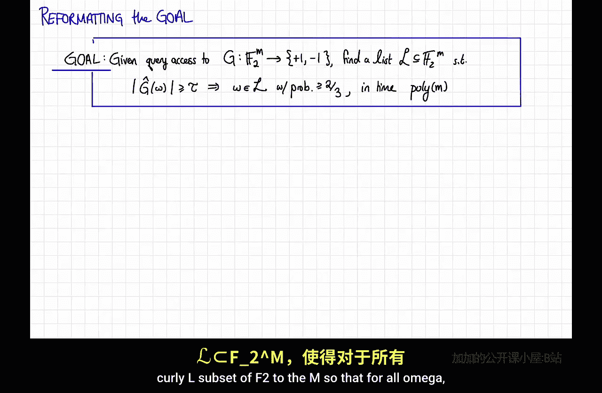
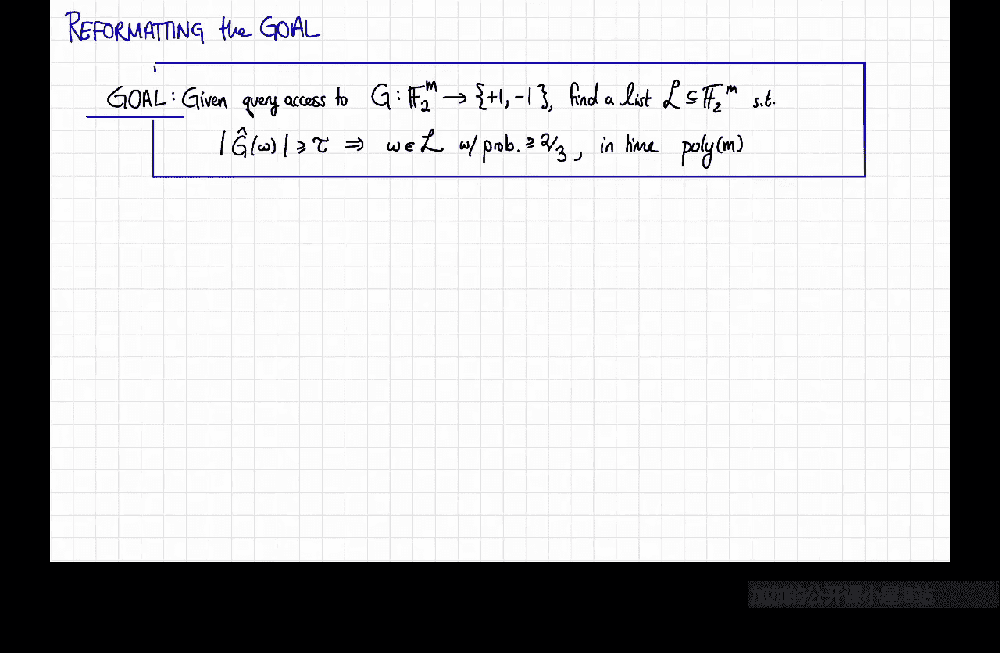
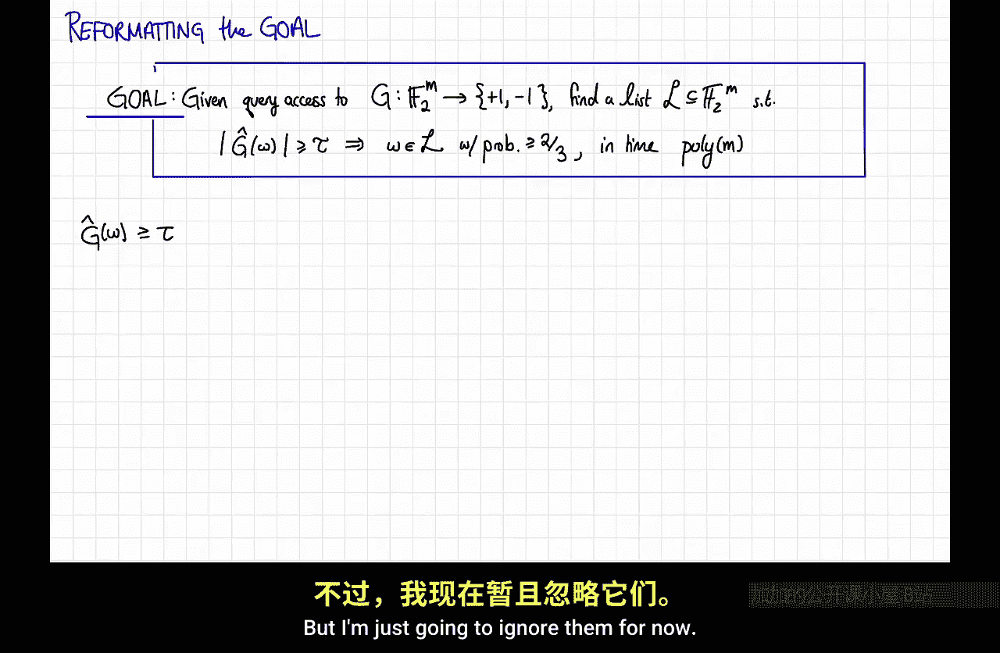
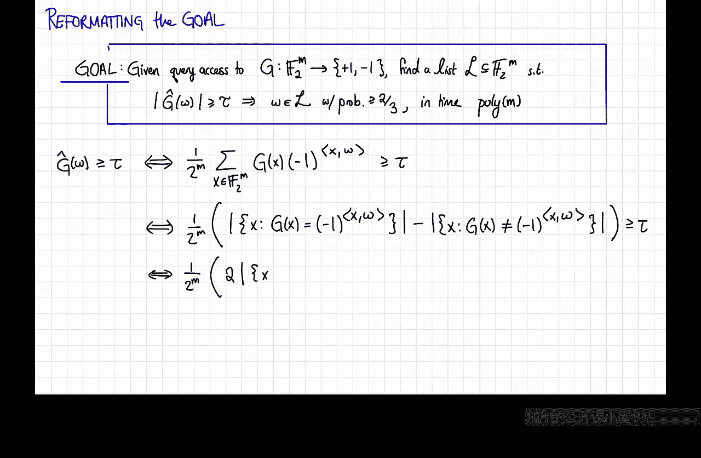
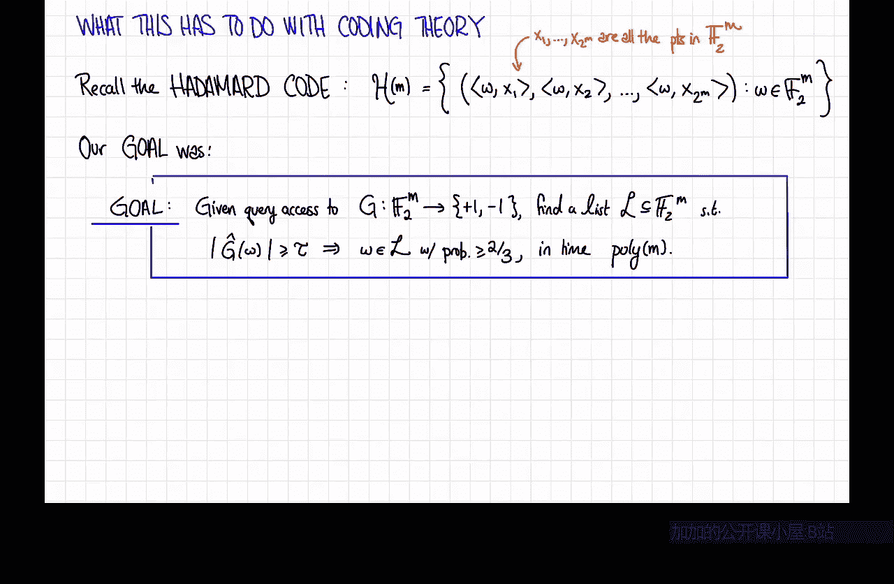

# 斯坦福大学【中英⚡代数编码导论｜Introduction to Algebraic Coding Theory】 p50 p49 15, Video 1： Some motivation： Learning Boolean Functions -BV16sRYYTEwg_p50-

In previous videos， we've seen list decoding and local decoding。

It turns out that we can combine these two notions and consider local list decoding。In this video。

 we'll motivate the problem with an application from learning Boolean functions。

So here's our motivating problem for this video。Suppose that there is some function， G。

That takes a length M vector over F2 and spits out either plus 1 or -1。

You are allowed to query G for any X you like， but you don't know G to begin with。

 And your goal is to learn G， or at least learn some approximation G twittle of it as quickly as possible。

Ideally， you'd like to do this in time polynomial in M。In particular。

 you shouldn't just query G on every single X because that would take time 2 to the M。

 which is not polynomial in M。Okay， as stated， this goal is clearly impossible。If G can be anything。

 then  querying it on some X doesn't tell me anything about what it could be on another X。

 So we really do have to ask for G on all of the X's。 So therefore。

 we need to impose some structure on G to make this possible。

One useful way to impose structure is to assume that G is sparse in the Fourier domain。

To define that more clearly， we need a few more definitions。

So here's a definition of the Fourier transform over F2 for some function capital G。

 like the one we had on the previous slide。The Fourier transform of G over F 2 denoted by G hat is another function from F2 to the M。

 But now it spits out a real number， and it's defined like this。So， G hat of omega。

Is equal to one divided by2 to the M。Of the sum over all x in F2 to the M of G of x times-1 raised to the inner product between x and omega。

Just to note here on this slide， I guess I've decided that this is an omega。

 I'm probably going to start calling in W at some point。 I'm sorry。 I'll try to be consistent。Anyway。

If you've seen the Fourier transform over the complex numbers， this might look somewhat familiar。

In particular， this looks a little bit like the discrete Fourier transform over the complex numbers if you're used to that。

 except instead of E to the negative i pi， whatever。

 we have this other thing -1 to the inner product between x and mega。

And if you've seen the Fourier transform over the complex numbers。

 it turns out that similar things hold for this definition， as hold for that definition。

 In particular， we have an inverse transform so we can write G of x as the sum。

Over omega in F2 to the M of G hat of omega times-1 to the inner product of x and omega。

These G hat of omegas are called the Fourier coefficients。And we also have Parcival's theorem。

Which says that taking Fourier transforms doesn't affect the Ltoon norm。More precisely。

 we have that this thing。1 over 2 to the M times the sum over all x in F2 to the M of G of x squared。

Which incidentally just happens to be equal to one because G of x is plus or minus-1 in this setup。

Is equal。To the sum overall omega and f2 to the M of the square of the Fourier coefficient G hatt of omega。

Okay， so that's the Fourier transform。 If you haven't seen this definition or one like it before。

 the important thing for this video is this equation。 That is， we can write G of X。

As a linear combination of these functions，-1 to the inner product of x and omega for different megas。

And the coefficients that we use are the fourier coefficients Ghat of omega。

This is nice because these functions are very simple and easy to understand。

And this allows us to write any function as a linear combination of easy to understand functions。

Okay， so let's go back to this slide。We want to learn some Boolean function G from queries。

 and as we said before， we need to impose some structure on G in order to do that。

So here's the structure we're going to impose。As on the previous slide。

 we can expand G of X as a linear combination of those nice， simple functions。

And what we're going to assume is that only a few of these coefficients are big。

 and most of them are small。That is， we're going to assume that G is a simple function in the sense that it's a linear combination of essentially not too many of these simple functions。

In that case， we can write G as approximately equal to linear combination of just those functions。

That is， we drop all of the terms here。Where G hat of omega is small。

 let's say smaller than some constant tau greater than 0。

 And we'll write this thing as approximately equal to the sum over all omega so that the Fourier coefficient G hat of omega is large。

 larger than tau in magnitude。In this case， our goal is going to be to estimate the large G hatt of omegas as quickly as possible。

Again， we'd like to do this in time， polynomial and M。In a bit more detail。

 here's our goal for this particular problem。Suppose that tau is some constant greater than zero。

Then our goal is given query access to G of X， which has this Fourier expansion so that most of the Fourier coefficients G hat to omega are small。

 I'm not going to be too precise about exactly what this means because it's not going to be particularly relevant for a coding theory application。

We want to return some list Curly L of pairs， Oomega and y of omega。 So that。

If the Fourier coefficient G hat of omega is large， larger than tau this constant， then。

Omega appears in our list。And moreover， for all omega that appear in the list， our estimate。

 y sub omega is approximately equal to the Fourier coefficient G hat of omega。 Moreover。

 we want to find our list in time polynomial in M。 Notice that this implies that the list itself cannot have size larger than polynomial in M。

 or we take longer than that to just return it。Okay， so this is our goal if we can do that。

 and if some assumption like this is satisfied， then we'll be able to estimate this expansion and in particular this function。

So are we talking about this problem， it turns out that it is related to a problem in coding theory。

 not surprisingly。So in order to transform it into something that you might recognize as a coding theory problem。

 let's start massaging this goal。 The first thing we're going to do is a simplification that stems from the following observation。

The observation is that given a fixed omega in F2 to the M。

 we can actually estimate G hat of omega fairly quickly from not too many samples。

The reason is that the definition of G hat of omega is， as an average。

Of a bunch of terms that look like this， each of which are plus or -1。

We can figure out any one of these terms by sampling G of X。

And so we can estimate the average by just taking a random subset of these and sampling them and taking the average of that。

 It turns out that you take not too many samples， Then with high probability。

 that's going to be a pretty good estimate for this average。Again。

 I'm not going to go into too much detail because our medical goal here is to get to the coding theore application fairly quickly。

 but let's just assume that we can do this。So this means that our goal can be to just find the set of omegas so that G hat of omega is large。

 because once we find that set， we can estimate each one of them fairly quickly。More precisely。

 we can modify our goal up here in the following way。 First， I no longer need to return pairs。

 Oomega and y omega。 I can just return Oomega。And I don't need to estimate Ghad of omega down here。

I'm going to additionally give myself a little bit more slack by allowing this query access to G of X to be randomized。

And asking that this requirement hold with only high probability。

Let's say for each omega whose Fourier coefficient is large。

 we'd like mega to appear in this list with probability at least two thirds or something like that。

And as usual， the two thirds here is arbitrary， if we can do it with probability 2/3s。

 we can do it with probability 0。99999 by just repeating a few times。Okay， so this is our new goal。

Let's clean it up a little bit。Alright， here's the clean version of the goal。

 Given query access to our function G from F2 to the M to plus -1。

 find a list curly L subset of F 2 to the M so that for all omega such that G hat of omega is larger than tau in absolute value。

Omega ends up in the list with probability， at least two third。And moreover。

 we want to find this list in time polynomial in M。 In particular。

 the size of the list cannot be any more than polynomial in M。

Okay。We still don't quite know what this has to do with coding theory。

 although maybe it's getting a little bit closer， we're looking for a list of things that maybe agree a lot with certain functions。

But in order to make that precise， let's massage this requirement a little bit more。For simplicity。

 I'm going to drop the absolute values。Basically， you can just do exactly the same thing that I'm about to do now。

 except with a minus sign in front。 and then both of them together。

 that'll give you the absolute values。 But I'm just going ignore them for now。 Okay。

 so let's consider this condition that G hat of omega is at least tau。

We can write out the definition of G hatd of mega。And see that this is equivalent to this big sum being greater than equal to tau。

And now， let's recall that G of x here is plus or -1。

So that means that each term in this sum is also plus or -1。

 depending on whether G of x is equal to this sine flip -1 to the inner product of x and omega。

That means that we can write this condition like this。That is。

 we can replace this sum with the number of x's so that g of x is equal to 1 to the inner product of x and omega。

 In that case， the sum n is equal to 1 minus the number of x's so that g of x is not equal to -1 to the inner product of x and omega。

 In that case， this sum n is equal to -1。Notice that this is just equal to 2 to the M minus that。

Because either of this thing is equal or it's not。So we can rewrite this condition as follows。

That is， I've just replaced this with 2 to the M minus that。

And now we can push some symbols around and get the following condition。

That is the fraction of x for which g of x is equal to minus1 to the inner product of x and omega。

Is a little bit greater than a half， greater than or equal to a half plus tau over2。Now。

 I'm going to define a new function， little G of x， which is just the 0，1 version of big G of x。

That is， little G of x is equal to 0。 If big G of x is equal to plus 1 and one。

 if big G of x is equal to -1。 with this notation， this condition is equivalent to the following。

That is it's equivalent to the fraction of x's so that little G of x is equal to the inner product of x and omega。

Is greater than a half， in particular， greater than equal to a half plus toweru over2。Okay。

 so what does this have to do with coding theory。Basically。

 this is saying that our goal is to find all of the omegas。So that the agreement between the vector。

Of evaluations， inner product of x and omega。And some function G。

 let's call it a received word G is large， a little bit bigger than a half。 A K， A。

 we want to find all of the omegas so that if I were to think of the vector of all of those inner products。

 its distance from G is not too big。That sounds a little bit like list decoding。

 And if you remember from the previous video， it may be it sounds a little bit like list decoding the Haamard code。

In more detail， let's recall the definition of the Haammar code from a previous video。H of M。

Is equal to the set of vectors。Omega inner product X1， Oomega inner product X2， dotta dot。

 Oomega inner product x2 to the M for all omega in F2 to the M， where x1。

 x 2 dotta dot up to x 2 to the M is just an enumeration of all of the points in F 2 to the M in some order。

 Does't matter what。That is， the Hadamard code is the set of all vectors that arise as all of the evaluations of some linear function over F2 to the M。

Now， we can recast this goal from the previous slide in terms of a coding theoretic goal about the Haamard code。

We saw on the previous slide that this condition。Is equivalent to this condition That is the fraction of x's so that g of x is equal to the inner product of x omega is a bit larger than a half。

 larger than equal to1 half plus toweru 2。And another way of saying that in the language of the Haamard code。

Is at the relative distance between G。We're here by G， I mean。

 the vector that you get when you evaluate G at all of the points。

And the encoding of W under the Haamard code。That is this vector here。Is a bit smaller than a half。

 less than or equal to a half minus tau over2 for some tau greater than 0。That is。

 we're given access to a received word G。 And we want to find all of the code words。

Of the form encoding of omega。So that the distance between G and the encoding of omega is at most one half minus tau over 2。

 And we want to do this in time， polynomial in M。 So our goal is to list tocode the Haamard code。

 We want to find all the code words that live within some ball of the received word。

And the key is that we want to do it locally from just a few queries。In particular。

 our time budget here。Is polynomial in M， which is subline in the block length of the code。 Remember。

 the block length of the code is 2 to the M。 So we don't even have time to look at the entire code word。

 That's why we're going to have to do it locally。 In the next video。

 we'll see how to achieve this goal。