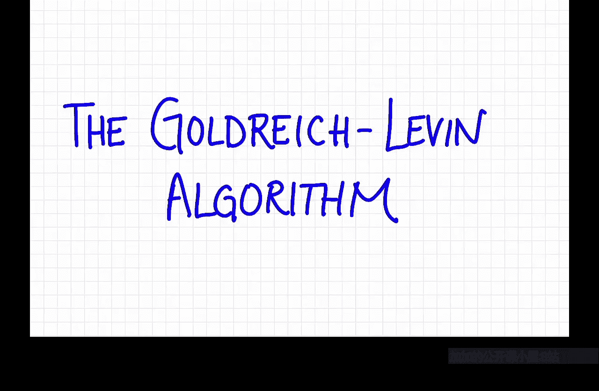
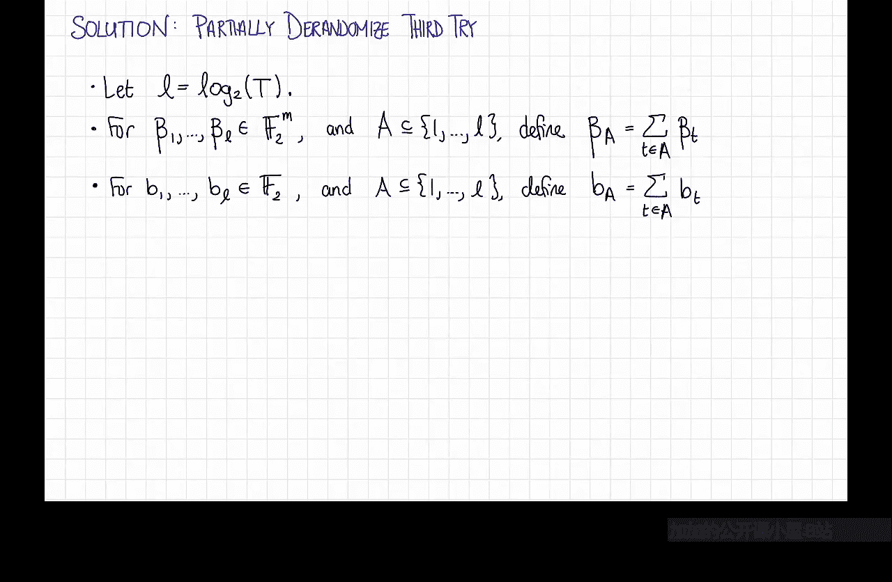
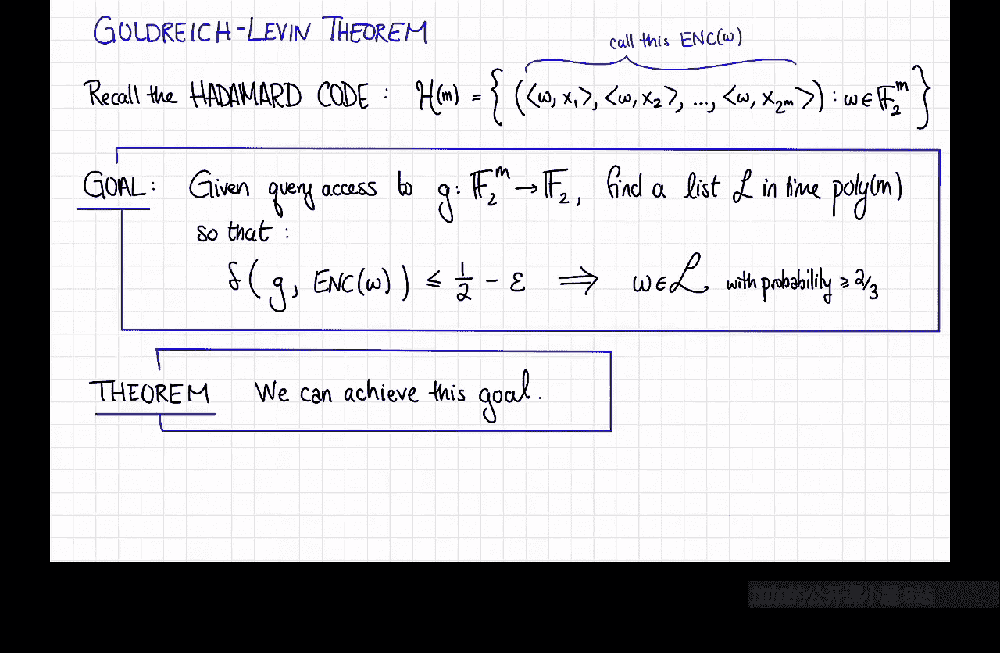

# 斯坦福大学【中英⚡代数编码导论｜Introduction to Algebraic Coding Theory】 p51 p50 15, Video 2： Goldreich-Levin algorithm -BV16sRYYTEwg_p51-

In this video， we'll see the Goldrech Levin algorithm。

 which will list tocode the Haamard code in subline time。

This will solve the problem that we posed at the end of the previous video。

Let's recall where we left off in the last video。We had recalled the definition of the Hadamard code。

Which was all vectors of evaluations of linear functions over F2 to the M。

And our goal was to list tocode it in sublineer time。

That is given query access to some function G from F2 to the M to F2。

 Our goal was to find a list curly L in time polynomial in M。 so that for any W， so that。

The distance between G and the encoding of W is small， less than equal to1 half minus epsilon。

W is going to be in our list L with probability at least two third。

Notice that we're asking to do this in sublinear time。

That's because the length of a code word of the Haammar code is 2 to the M。

 And we're supposed to find this list in time polynomial in M。

 That means that we don't even have time to look at this entire received word when we're coming up with our list。

Just to note in the previous video， I was trying to call this omega。

 That's because it's slightly more canonical for it to be an omega in the context of the Fourier transform。

 but now I'm going to switch to calling it W because we're not talking about Fourier transforms anymore。

I'm going to draw it exactly the same。😡，Okay， so how are we going to solve this problem？

You might recall that in a previous video， we saw an algorithm for locally decoding the headamard code。

So let's start there。Here's an algorithm that attempts to solve this problem using the local decoding algorithm for the headamard code that we saw in a previous video。

Here's the algorithm。So we're given query access to this function G from F2 to the M to F2。

And our goal is to find some W so that the distance between G and the encoding of W under the Haamard code is at most P for some parameter P。

For this first try， let's just say that P is strictly less than a quarter。

Remember that on the previous slide， we wanted P to look something like1 half minus epsilon for a small epsilon。

 and so this isn't going to cut it。But let's just assume this， for now。

So assuming that P is less than a quarter， here's the algorithm。We're going to draw some vectors。

 beta 1 up through beta T in F2 to the M uniformly at random here。

 capital T is some parameter that we'll choose in a moment。Now， for each I between1 and M。

We're going to do the following。First， for every single T。

 we're going to compute some estimate of W sub I。Based on our random choice， beta some T。

The way we're going to do that is according to this randomized algorithm that we saw before for locally decoding the Haamard code。

That is。W twiddle of I is supposed to be equal to W sub I。

 which is another way of saying the symbol in this encoding that is indexed by E I。

 the I standard basis factor。We saw an algorithm to do that， in a previous video。

The algorithm is to make two queries。 Let's query G at the point we want E I plus our random beta T。

 and then add that to the other query， which is just querying at this random beta T。

So this is just the two query local correction algorithm we saw in a previous video。

 and by the analysis in that previous video， we have that this estimate。

Is equal to the Ithe symbol of this encoding Aka， the inner product of W and the Ith standard basis vector EI。

 which is also known as WI。With probability at least1 minus2 times p， where p is this P here。

Now we see why we wanted P to be strictly less than a quarter。

That means that this success probability is strictly greater than a half AkaA， it's non trivial。

The reason that we are repeating this experiment， T times independently。

Is that we want to boost this success probability。 We know that it's a little bit bigger than a half。

 and we want to make it a lot bigger than a half。 And we'll do that just by taking the majority vote of all of our different trials。

More precisely， I claim that when we take the majority vote of a bunch of independent trials。

 each of which is successful with probabilitybilities strictly greater than a half。

Then the probability that our majority vote is incorrect after capital T trials is big O of one over capital T using chby Che's inequality。

Just as an aside， let's work that out。So we have that the probability that each trial is incorrect。

Is less than or equal to 2 p， which is strictly less than a half。For all T between one and capital T。

These events are independent。 Actually， all we need is pairwise independence。

 So by chvy chefev's inequality， we can write the following。

The probability that the majority is wrong。Is the same as the probability that the sum of all of these random variables。

 That is the random variables that are one。 If the teeth trial is wrong。

Is greater than or equal to t over 2。Subtracting2 times p times T from both sides， we get this event。

Now， we can use chubby chef's inequality。To say that this probability is less than or equal to the expectation of this thing squared。

 divided by that thing squared。 and using the fact that these events are pairwise independent。

 the expectation of。The square of this is the same as the sum of the expectations of that。

So altogether， this is at most。T times the expectation of any particular sumand squared。

Divided by this thing， squared。Which， if we assume that the expectation of this is exactly 2 p。

 if it's less than that really makes our lives easier， is equal to 2 p。Times 1-2 p。

Divided by t times 12 minus2 p squared。And this is big O of one over tea。

Assuming that P strictly less than a quarter is some constant。

So we're hiding the dependence on P in this big O notation here。So going back to this slide。

 that justifies why the probability that our estimate。

 which is just the majority vote of all of these trials。

 is not equal to WI is big O of1 over capital T using Cheby chipps inequality。Now。

 what we're going to do is we're going to do this for all of the different eyes。

 And then from those W Twiddle eyes， we'll assemble some estimate W twiddle。

Which is just the vector of those W twittle I。 We can take a union bound over all M values of I。

To say that the probability that W twiddle is not equal to W。Is at most big O of M divided by T。

In particular， if we choose T to be some big enough constant times M， this is going to be small。

In particular， we can make it strictly less than a third if we like。Therefore。

 provided that P is strictly less than a quarter。For any W that is within P of G。

That is so that the encoding of W under the headamard code is within relative hammer distance P of the receive4G。

This algorithm will return that W with probability at least two thirds。That's great。

 that's almost what we wanted。The problem here is that on the previous slide， in this goal。

Our value of P was supposed to be close to a half。1 half minus epsilon。Whereas here。

 we're stuck with P strictly less than a quarter。And this is why we're going to need to do list decoding。

This algorithm here is going to return a unique W。 That's because there's a unique W that's within a quarter of any received word G。

However， if we want P to be as big as a half， there's not going to be U be a unique code word within radius P of W anymore。

So we're going to have to adapt this local decoding algorithm to come up with a local list decoding algorithm。

As a warm up， here's an adaptation of the algorithm where we are assuming that we have access to a magic genie。

In more detail， the algorithm goes like this。As before。

 we are given query access to some received word G。

 And we want to find W so that the encoding of W in the Haamard code is within heming distance P or relative heming distance P of the received word G。

 Now， though， we're going to want P to be as large as a half。

Since there might be multiple different W's that satisfy this。

 let's imagine we have access to a magic genie who has one such of those W's in mind。And now。

 consider the following algorithm。We're going to do exactly the same thing as before。

 so draw our beta Ts and F2 to the M at random。And then we are going to ask our genie for B1 up through B T。

 So these are just bits in F2。 so that B little T is equal to the inner product of W and beta T。Yes。

 I know we don't have a magic genie。 And if we did， we could just ask the genie to solve the problem。

 but to bear with me for a minute。So we're going to ask the genie for this specific piece of information for the particular vector W that the genie is thinking about。

Then we're going to do exactly the same thing as before， except here。

 when we used to have G of beta T， we're now going to have what the genie told us B sub T。

And then the rest of the algorithm is exactly as before。

So let's go through the same analysis that we did before。

Suppose that W satisfies this and the genie has this W in mind。

Now I claim that this step succeeds with probability 1 minus p， whereas before it was 1 minus 2 p。

And the reason is that the probability that we fail in this step。

Is now just equal to the probability that this thing is not equal to what we wanted it to be。

 which is the inner product between W and EI plus beta T。Indeed， if this is equal to that。

And because the genie is always right， this is equal to that。Then the sum of these two things。

By linearity and the fact that we're working over F2 is just equal to the inner product of W and EI。

 also known as W I。So now this failure probability is smaller， it's only P instead of 2 P。

That means that when we do our analysis here for the majority vote。

We can replace 2 P with P everywhere。 And so instead of needing two P strictly less than a half A K。

 A P strictly less than a quarter， we're now O as long as P is strictly less than a half。

That is the probability that our estimate WI twiddle is not equal to the actual WI。

Is big O of1 over capital T as long as P is strictly less than a half。

Then we can do our final step and union bound as before。

 and the probability that we fail is as before， big O of M divided IT。

And we can make this less than a third。So this is looking pretty good。

This still runs in time polynomial and M， because we're going to choose T to be on the order of M。

 And then this is a。4 loop over M squared things total。And for any W。

 so that the encoding of W is within heming distance P of a received word G。

 We're going to return it with probability， at least two third。

And now P is allowed to be arbitrary close to a half。However。

 the obvious problem with this algorithm is that we do not have access to a genie。However。

 this is where the connection to list decoding comes in。In our next try。

 we're going to just iterate over all possible genies。

 And that's going to give us a list of possible outputs。So here's the third try。

 We're going to exhaust over all possible genies and make a list。Here's our algorithm。 Once again。

 we're given query access to our function G， and we want to find a list so that for any W。

 so that the encoding of W is within hammer distance P。Of our received word G。

W is going to appear in our list with probability， at least two third。So， here's our algorithm。

As before， we'll draw beta 1 through beta T at random。

And now we're going to initialize some list curly L to be equal to the empty set。

And now we're going to exhaust over all possible genies。

And what I mean by that is that we're going to iterate over all of the possible strings。 B1， B2。

 dot Ha dot up to B T in F2 to the T， that the genie from our second try might have output it。

Then we're just going to assume that the genie was going to say that。And run the second try。

 That is the algorithm on the previous slide， with this genie。

In order to obtain some guest W Twiddle。We'll add that W Twiddle to our list Curly L。

 and then we'll return it。Okay， so that's our algorithm。 Let's analyze it。So first。

 let's pick some W so that this holds。We want to show that W is going to end up in our list curly L with probability at least two third。

Now， there was some genie。From the previous slide， who would have answered consistently with respect to this W。

So let's suppose that that genie is the one that answers。B1， B2， dotta dot up to Bt。That is。

 there is some B1， B2 dot dot up to Bt， so that a genie thinking of this particular W would say that。

Then when we get to that particular genie in this list by the analysis that we did on the previous slide。

 as long as P is strictly less than a half。This algorithm。

Is going to be correct with probability Big O of M divided by capital T。So again。

 if we choose T to be on the order of M。We can make this greater than equal to two thirds。Therefore。

 for any such W with probability at least two third。

 it's going to end up in this list curly L that we return。And as before。

 we can take P all the way up to1 half。Or at least one half minus epsilon。Okay， so this sounds great。

 But unfortunately， this algorithm also doesn't achieve our goal。Can you spot the problem？

The problem is the running time。 This algorithm no longer runs in time， polynomial in M。

In particular， the running time is going to be 2 to the big omega of M。

 The reason is that in order for this thing to be greater than equal to two thirds。

 we need to choose T to be on the order of M。But then in this for loop。

 we're exhausting over 2 to the T things。 That's 2 to the order of M things。So we solved our problem。

 except this algorithm is prohibitively slow。 in particular。

 we could just look at the entire code word G in that time。😡，So this doesn't achieve the goal either。

However， we're almost there。The solution to this problem is that we're going to use less randomness。

 so we don't need to exhaust over quite so many things。

The key is that when we analyzed this algorithm， the second try。In particular。

 the part with chubby chef's inequality。All we actually needed was pairwise independence。

 We did not need full independence。 So what we're going to do next is replace these capital T random vectors。

With significantly fewer random vectors。And bootstrap those to come up with a much larger collection of pairwise independent vectors。

Then we're only going to have to exhaust over the smaller collection of corresponding Bisbe。

So let's see how this is going to work。Let's let little L。Be the log base2 of capital T。

 where capital T is as in the algorithm we had on the previous slide。 Now。

 for all L tuples of vectors， beta 1 through beta L in F2 to the M。

 And for some subset a of the numbers  one through L。We're going to define beta sub a。

To be the sum over all T in a of beta sub T。Similarly， for all sequences of bits， B1 through B。

 L in F2。And a set a subset of the integers one through L。

We're going to define little B sub a to be the sum over all T and a of B sub T。

The reason we're doing this is that I claim that if these beta I's are uniformly random。

Then these random variables， the beta sub A's。Are going to be pairwise independent。

Notice that there are a lot more than L beta sub A's， in particular there are2 to the L beta sub A's。

So this is allowing us to take log of T uniformly random vectors and come up with T pairwise independent vectors。

 Let's prove this claim， real quick。So what it means to be pair wise independent is that if you look at any pair。

 say beta a and beta a prime for a not equal to a prime， then those two variables are independent。

So it's fix a and a prime。Not equal to each other。We want to show that beta a and beta a prime are independent。

But this is true because we can write beta a as equal to beta a prime plus the sum over all T in the symmetric difference between a and a prime of beta T。

Because a is not equal to a prime， this symmetric difference is not empty。

That means that this sum is non empty， and this sum is going to be a uniformly random variable。

That is independent of this one。That's because none of the beta Ts that show up here have an index in a prime。

But that means that no matter what beta a prime is， or in other words， conditioning on beta a prime。

 beta A is still going to be uniformly random。Therefore， beta a and beta a prime are independent。

Okay， so now let's use this claim。To improve our third try and come up with our fourth try。

So here is our fourth triad and algorithm。 It will be the last one。Now。

 instead of exhausting over all possible genies， we're going to exhaust over all deranized genies and make a list。

The key is that there's going to be fewer derandomized gen than there are original gen。

I just noticed that。 I misspelled de randomized。That's better。Okay， so here's the algorithm。

As before， we're given access to some received word G that maps F2 to the M to F2。And for any W。

 so that the encoding of W is within relative hamming distance P of G。

We would like W to be in the list that we return with probability， at least two thirds。 As before。

 we're going to draw a bunch of random vectors beta I in F2 to the M。But now。

 instead of drawing capital T of them， we're only going to draw little L of them where little L is the log base 2 of capital T。

Now， as before， we're going to initialize a list curly L to 0。

 and now we're going to exhaust over all vectors。 B1 up through B L in F2 to the L。

 notice that this is L here instead of T。Then we're going to assume that our sort of new de randomized genie was going to say B1 of through B。

 L。 And we'll run our algorithm from the second try to obtain some W twiddle。But we'll use the genie。

That outputs the bits B sub a for all subsets， A of the integers 1 through L。

Notice that there are2 to the little L， which is equal to T， such bits， B A。 And so that type checks。

 this genie was supposed to return capital T bits， and here are capital T bits。

Then we're going to add what we get W Twiddle to our list， Curly L。

And after we've exhausted over all possible gen， we're going to return curly out。Okay。

 so this is the algorithm。 Let's analyze it。As before， let's fix some W so that this holds。Now。

 let's let B sub tea。Be equal to the inner product of W and beta T for all T less than or equal to L。

Notice that this implies that the inner product of W and beta A is equal to BA for all subsets A of the integers1 through L。

The reason is that we defined this beta a in a linear way， depending on the beta T's。

 and this is a linear function。Therefore， when we're running this second try using the genie with these B As。

That means that we might as well have been running this second try here。

 not on independent random vectors， beta 1 up through beta capital T。

 but on these pairwise independent random vectors， beta sub a。But as we remarked earlier。

 pairwise independence was all we needed for Chebyevv's inequality to work。Therefore。

 the exact same analysis goes through， and this step is correct with probability 1 minus big O of M over T。

Therefore， by the analysis that we did before， the probability that this W twiddle is not equal to the W we had in mind。

For the iteration where the beta eyes are like this。Is big O of M divided by T。Therefore。

 as before we can take capital T to be on the order of M。That will apply that， for any W。

So the encoding of W is within hemming distance P of our received word G。

 W is going to appear in our list Curly L with probability at least two third。

 And that's what we wanted。Okay， so now we know that this algorithm does what we want。

 How about the running time。Let's analyze that up here。So this algorithm， a second try。

 took time polynomial in M。And now we're going to exhaust over all vectors B1 up to B L in F2 to the L。

 This takes time 2 to the L， which is the same as 2 to the log T， which is the same as T。😡，So。

 the rain time。Is。Poly M for the inside stuff， times 2 to the L。Which is equal to poly M times。

To de tea。Which is equal to polym times T。Which is all polynomial in M。

Since we chose T to be on the order of M。So that's great。 That's what we wanted。Altogether。

 we've just proved the Goldrech Le1 theorem。So here's part of a slide we had before with the goal that we wanted。

Given query access to some received word G， find a list curly L in time polynomial in M。

 so that for any W， So that the encoding of W is within relative hamming distance 1 half minus epsilon of G for some small epsilon greater than 0。

The probability that W appears in our return list curly L is at least two/ thirds。

And what we've just seen theorem is that we can achieve this goal， Hooray。

What we've just seen is a local list decoding algorithm for the Haamard code。

I haven't actually defined a local list decoding algorithm yet， I'll do that in the next video。

For the moment， though， recall that the reason that we were interested in this goal in the first place from the previous video had to do with some application in learning Boolean functions。

What does this say for that？We will come back to that also in the next video， see there。

