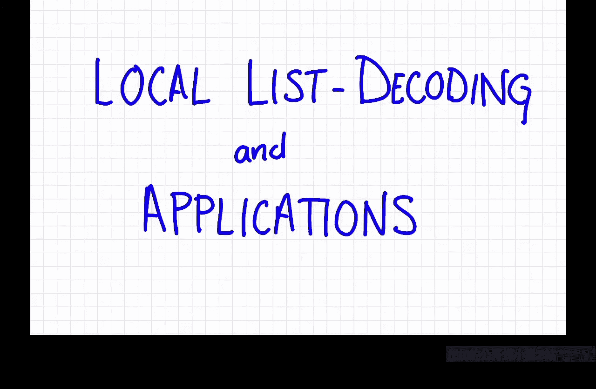
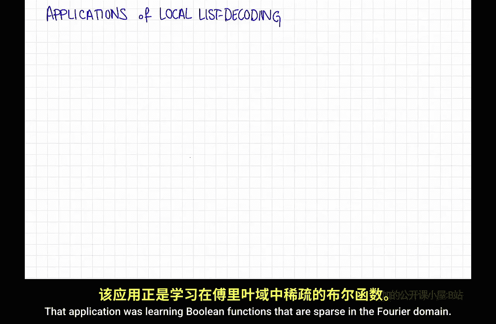
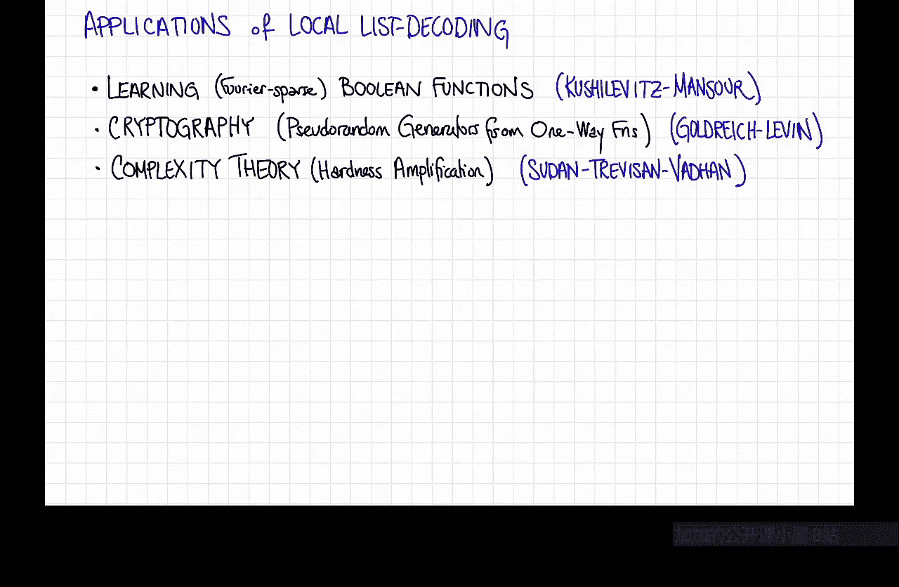

# 斯坦福大学【中英⚡代数编码导论｜Introduction to Algebraic Coding Theory】 p52 p51 15, Video 3： Local List Decoding -BV16sRYYTEwg_p52-

In this video， we'll define local list decoding and mention a few applications。In fact。

 we already saw a localist decoding algorithm and an application in a previous video。

 but now we'll formalize this a little bit。Here's the formal definition of local list decoding。

It's a bit of a mouthful or at least a bit of a slideful。

 But we'll break it down with pictures in the next slide。Let's just go through it first， though。

We say that a code C subset of signigma to the N。Is capital Q comma P。

 comma L locally list decodable。If there is a randomized algorithm， curly a。

That outputs a list of at most capital L other algorithms， Curly B1， Curly B2 up to curly B L。

So that the following holds。First， let's establish just the type of each of these algorithms curly B I。

 What do they take in， and what do they spit out。So for each I between1 and L。

The input to the algorithm， curly B， I is an integer J between one and n。

And curly B I has oracle access to a received word Z in Sigma to the N。Moreover， curly B I。

 given oracle access to Z on the input J。Is going to make at most capital Q queries to Z。

What it's going to output is a guess for the jaith symbol of some code word。More precisely。

 And here's the second bullet point。For all Z in sing to the N。And for all code words。

 C in curly C that are close to Z in relative hamming distance， in particular。

 that are within relative heming distance， P of Z。There should be one of the B I。

It is a good local decoder for that code word。More precisely， there exists an I between1 and L。

So that for all indices， J between1 and n。The probability。

That the Ithe algorithm B sub I with Oracle access to Z on input J。Outputs C sub J。

Is at least two thirds。So there's a lot of quantifiers going on in this definition。

Let's try to break this down with a picture。All right。 Here's a picture。

 We're trying to combine the definitions of a local decoding algorithm and a list decoding algorithm。

 So perhaps not surprisingly， our picture looks like the picture we had for a list decoding algorithm。

 Plus， the picture we had for a local decoding algorithm。😊，Let's walk through this definition again。

 pointing at this picture。So here's our list decoding picture。If a code is list decodable。

 we know that for any vector Z in sigma to the n。There's at most capital L code words within a handing ball of radius P of Z。

In this picture， let's say capital L is equal to 3。 So there's only three code words， C 1。

 C2 and C 3 that are close to Z。 Our local decoding algorithm picture looked something like this。

Sort of this top bit here。 Alice was sending a corrupted code word to Bob。

 Bob was interested in just one symbol of the underlying code word。

And had to make some queries to what Alice is sent in order to figure it out。

The difference now is that there's no correct code word that Alice meant to send In this picture。

 there's three of them。So we can't just have one Bob because what's he's supposed to answer。

So instead of having one bob， we're going to have capital L Bobbs or in this picture， three bobs。

Each of these bobs is going to correspond to a different correct code word。

So bobs sub 1 corresponds to C1， bobs sub 2 corresponds to C2， and bobs sub 3 corresponds to C3。

What that means is that it's bobs up one's job。When queried with the jaith symbol。

To return the Jaith symbol of C 1。That is on input J Bob sub 1 in this definition known as curly B sub 1。

Is going to make some queries to Z。Some randomized queries。

And Bobbss of one is going to return a guess for the jaith element of the first code word。Similarly。

 Bob sub 2 is responsible for the second code word。On input J。

 Bob sub 2 is going to want to recover this symbol。That is the J symbol of the second code word。

And similarly， Bobub2 will make some randomized queries to Z。

Maybe not the same as the queries that Bobbs have won would have made。

And is supposed to return this symbol with high probability。And similarly， for Bobbss of 3。So， here。

Each of these bobs correspond to the curly bee eyes in the algorithm。

They each have oracle access to the received word Z。And for each code word， C that is close to P。

 That is for each one of these。 There exists a bo associated to that code word。

That's what this says here。And then it's that Bob's job to be a good local decoding algorithm for that code word。

 That's what this says。So hopefully， that demystifies this algorithm a little bit if it was mystifying to begin with。

Okay， as we went through the definition of a locally list decodable code。

 you might have noticed that we have actually already seen a locally list decodable code。

In particular， the Goldrech Levin algorithm that we saw in the previous video had as a part of it。

 a local list decoder for the Haammar code。Here's another way of writing that algorithm in a way that looks a little bit more like the definition that we wrote on the previous slide。

So here was the algorithm。 We were given query access to some function G。

 and we wanted to recover all Ws so that the encoding of W under the Hadamard code is within P of some receive word G。

That is， for each suchW， we wanted it to be contained in the output list with probability at least two third。

Our algorithm went as follows。We drew some random variables。 We initialized a list to the empty set。

We looped over a bunch of things， B1 through BL， these bit vectors。And then we did some stuff。

 which was essentially this。If W is such that this advice be1 through B， L is consistent with W。

Then there is some genie， Curly B sub B1 through B L。Such that curly B。

 sub B1 through B L on input J was equal to the inner product of W and E J with high probability。

In the previous video， we called this a genie。 We just didn't name it curly B。

 So now let's name it Curly B。 And instead of calling it a genie， let's call it Bob。

Then once we defined this， we took this genie， this Bob， And we called it on all J from one to M。

That helped us recover each of the M bits of W， which helped us assemble W。

 Then we added W to the list。 So what we see here is that this step in blue。

Is precisely a local list decoder， as per the definition on the previous slide。

So what we actually showed in the previous video is that the Haamard code is Q comma P comma capital L locally listed codeable。

Where P， the radius， can be anything strictly less than a half Q。

 The query complexity is polynomial in M。 And L。 the list size is also polynomial in M。Pretty cool。😊。

So localistic codeability might seem like a funny definition。

 but actually it has a lot of applications。In fact， we've already seen one。

 which is how we started this whole discussion a couple of videos ago。

That application was learning Boolean functions that are sparse in the Fourier domain。

Let's recall the setup we had from a couple of videos ago。We had some function G。

 which mapped F2 to the M to plus -1。And we wrote G。In terms of its Fourier expansion， as the sum。

Over all， omega in F2 to the M of G hat of omega times this nice simple function -1 to the omega inner product X。

We said that if the Fourier spectrum of G was spiky enough， That is。

 if most of these were small and a few were large， this is approximately equal to the sum over all omega in F2 to the M。

 So that the size of the omega Fourier coefficient G had of omega is at least tau of the same thing。

 That is， we just throw away all of the small Fourier terms。

Then we saw that approximating G from queries。Was essentially the same as finding all omega。

So that the encoding of omega under the headamard code was pretty close to G in relative ham distance。

That is approximating G from queries。Was basically the same problem as finding a list of all of the omegas so that the relative heming distance between little G。

 that's just the 0，1 version of capital G。And the encoding under the headamard code of omega was less than equal to one half minus tau over 2。

 And this is precisely what our localististic codeder let us do。Notice for this application。

 we really needed both the local part and the list part。

We needed the local part since our desired running time polynomial in M is subline in 2 to the M the length of C。

We needed the list part because this radius that we were after had to go all the way up to one half。

 If we only did unique decoding， we'd only be able to go up to a fourth。

So this is one application of local list decocoding。In the context of learning Boolean functions。

 the algorithm that we saw earlier for locally list decoding the headamard code is called the Kusushevvis monsur algorithm。

But this is just one application of localist codingd。There are several others。

 I'm going to erase this discussion here so that I can list a few more。

Another application for localistic coding， and in particular， for localistic coding。

 the headamard code comes from cryptography。When we introduced the algorithm for locally list decoding the Haamer code in the previous video。

 I called it the Goldreicch Levin theorem。 Actually。

 the application the Goldrek and Levin were originally interested in came from cryptography to use some buzzwords。

😊，The Goldrech Le1 theorem says that one way functions imply pseudorandom generators。

It turns out that this statement follows from the localistic codeability of the Hadmar code。

I'm not going to talk about this any further in this video and in particular。

 I'm not going to define what these mean。But check out the lecture notes if you're curious。

Another application of localistic coding comes from complexity theory。So far。

 we've seen a localist decoding for the Haamard code， and we've seen a few places that it's useful。

But it's natural to ask if we can locally list to code other codes as well。

 One candidate that you might think of based on our previous discussion of locally correctable codes is read Mueller codes。

 It turns out that， yes， indeed， you can locally list a code read Mueller codes。

 and this has applications in complexity theory。In particular。

 Sudan Trarevisson and Vadhan showed how to locally list a code a read Mueller code and use this for something called hardness amplification。

That is they can use this to transform a function that's hard to compute on average。

 into a function that's hard to compute in the worst case。

And this has some implications in complexity theory and pseudoranness。Again。

 I'm not going to go into the details in these videos。

But you can check out this paper if you're curious to learn more。Okay。

 so that about wraps up this video。To conclude， localistic codingding might seem like a contrived notion if you just look at the definition。

 but actually， it arises naturally in a wide variety of applications and gives rise to some really cool algorithms。

😊。

