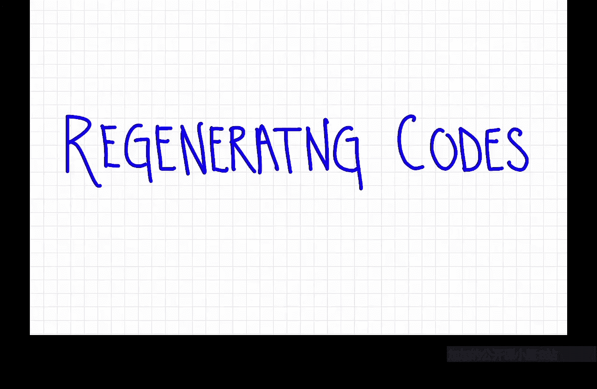
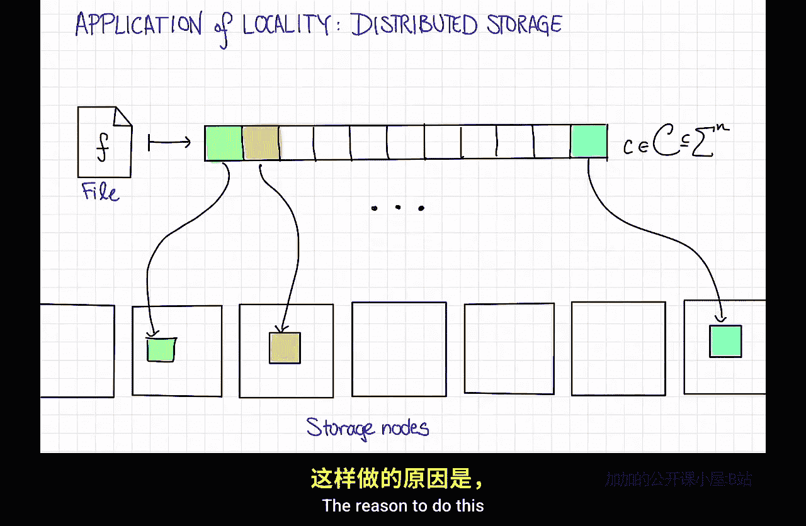

# 斯坦福大学【中英⚡代数编码导论｜Introduction to Algebraic Coding Theory】 p53 p52 16, Video 1： Regenerating Codes -BV16sRYYTEwg_p53-

In this video， we'll define regenerating codes， which are useful in distributed storage。

The application that we'll be focusing on in this video and the next few is the following stylized example of a distributed storage system。

Suppose that we have some file， F。And we want to store it on a bunch of storage nodes depicted here as black squares。

One way to do that is to first encode the file F using our favorite error correcting code。

 So we end up with some code word here。And then we're going to ship each symbol of this code word off to a different storage node。

So maybe this symbol gets stored here。The symbol gets stored here。And so on。

 all the way up to the last timble， which gets stored on some server。

The reason to do this is that now this information is robust if one of these storage nodes goes down。

So let's say， for example， that this storage node fails。

 Either it's temporarily unavailable or it bursts into flames or whatever。

What that corresponds to in our code word is an erasure of the corresponding symbol。

The point of using an error correcting code here is that as long as our error correcting code can handle。

 in this case， one erasure， we won't lose data。However。

 we can ask for a bit more than just not wanting to lose any data。

We can ask to be able to recover that data efficiently。And to do that。

 this seems like a job for locality。In more detail。

 here's that coding theoretic problem from the previous slide。We have our code word with our erasure。

 and we want to recover this information。 For example。

 maybe we want to set up a replacement storage node for the one that we lost。How might we do this。

 The first way is just to correct the error like we normally would。

That is suppose that our replacement storage note or something is down here。 and its name is Bob。

One thing that it can do is just download information from。All of these other symbols。

 which correspond to other storage nodes that have not yet gone down。

Decodeode the code and recover this missing information。

The problem with this is that in the context of distributed storage， that is a lot of communication。

Remember that each one of these symbols is stored on a different storage node。

 And so Bob basically just has to download the entire symbol。From all of the different storage nodes。

It turns out that in real life distributed storage systems， communications is often a bottleneck。

 so we'd like to reduce that。The second solution is to try to take advantage of some locality in the code。

 That is， Bob can download hopefully only a few symbols。

 make a few queries to this code word and hopefully be able to recover C， I。That is。

 maybe Bob just queries this symbol and that symbol and that symbol or something。

 Downs that information。And hopefully， if we've designed the code correctly。

 Bob is able to recover CI from this information。If he can do this。

 we say that the code exhibits locality in an informal sense。At this point， you might be wondering。

 hey， we've seen some codes with locality before。 locally correctable codes。 Can we use those here。

We can， but it turns out that for a situation like this。

 locally correctable codes are actually overkill。The reason is that locally correctable codes are designed to tolerate a constant fraction of errors。

However， in this model。First， we have erasures instead of errors。 And second。

 we also typically have a constant number of erasureers rather than a constant fraction of erasureers。

That is in real data centers， it's common， say， for example。

 one node to be down at a time or something like that。

 you don't expect 10% of your nodes to fail at the same time。😡，So in some sense。

 this question is a lot easier than that the question that locally correctable codes were trying to answer only a constant number of erasureers rather than a constant fraction of errors。

And because of that， we might hope to do better。 so we could use a locally correctable code。

 but the examples of locally correctable codes that we saw didn't have awesome rate。

So we might hope to get much， much better rate and still be able to perform this task。In more detail。

 here are some things that we might want。First， we might want the best possible trade off between rate and distance。

 That is， let's say that we want an M DS code。 M D S codes like read Solomon codes are typically used in distributed storage systems。

 So we don't want to be giving that up if we don't have to。

The second thing that we might want is good locality in the sense described on the previous slide。

 Forly， let's say that we want to be able to recover any single symbol。 So just one erasure。

From at most， say， are other symbols。In this picture。

 we were able to recover this symbol from these three other symbols。Okay。

 so if we could achieve these two desgerrata， that would be pretty cool。 The problem， though。

 is that actually， we cannot achieve both at once。 This is impossible。😊。

The reason that this is impossible is the following。For any MDS code of let's say， dimension K。

It turns out that the values for any K -1 symbol tell us nothing about the value of some k symbol。

That is， if we choose values for any K -1 symbols of a code word。Let's say these K -1。

 then the value of any other symbol。Let's say this one。Can be anything。

This statement follows from the definition of an MS code。If it's not clear why。

 pause the video now and stare at it until it becomes clear as a hint。

 you should use the fact that for an M D S code， any K by K sub matrix of the generator matrix is going to be invertible。

Okay， so given this fact then。Why are these two things impossible。Well， we wanted an M D S code。

 So this fact applies， but we also wanted good locality。 However， this fact says that， for example。

 if we wanted this symbol， we need to query at least K other symbols。

Fewer than K is not going to cut it。And at the point that we query K other symbols of an MDS code。

 we can recover the entire code word， any E K symbols determine the code word of an MDS code。

So now we're back in this wasteful setting where we are recovering all of the information only to throw most of it away。

So this isn't really local at all。So we cannot have both these things at once。

 we can't have an MDS code that has good locality in the sense that any symbol can be recovered from it most our other symbols where r is appreciably less than k。

At this point， there are two options。 We can either relax this requirement， the MD S 1。

 or we can relax this requirement。 Good locality。 Both of these options are interesting。

 But in this video， we're going to focus on relaxing this condition， relaxing the locality。😊。

The key observation is that we don't actually want to limit the number of symbols that Bob has to download。

 That was a convenient way of reducing the amount of communication。

 But are there other ways to reduce the amount of communication。

What we're going to do instead is allow ourselves or allow Bob to look at many different symbols。

 But the key is that Bob is not going to download very much from each of them。That is。

 if we're working over a large alphabet， Each of these symbols is several bits。

 Maybe each symbol is 8 bit or 128 B or something like that。

If Bob downloads only one or two of those bits， then even if he contacts a lot of symbols。

 that's still a win。This basic idea is called regenerating codes。

 A regenerating code is an M D S code。 So we're still keeping this first desire。

But instead of asking for good locality， we're going to ask for good repair bandwidth。

What that means is that， once again， we want any symbol to be recoverable with low information。

But now that's allowed to happen in a slightly different way。

Instead of contacting at most our other symbols， Bob is allowed to contact as many symbols as he likes。

 other than the one that's not available。But he can download less information from each of them。

 And we say that the repair bandwidth of the code is the total number of bits that Bob needs to download。

 So in this picture， Bob is contacting all of these other nodes。

But he's downloading apparently only one B from this one，2 bits from this one， and so on。

To be a little bit more formal here。We imagine that every symbol， every storage node。

 is allowed to do some local computation。That is， this symbol is allowed to compute some function of the data that it holds and send the output of that function to Bob。

That is， for every I and a J， There is some function， G， I J。

 which maps the alphabet sigma to some bit string of some length。

And what symbol J is going to send is G of I J evaluated on its symbol C， J。

Here I is the identity of the failed node。So it's okay if these functions depend on which node we're trying to repair。

In the distributed storage example， we imagine that this information can be broadcast cheaply。Now。

 from this information that he receives， Bob is supposed to learn the missing symbol CI。

So that at least informally is the definition of a regenerating code。

 a regenerating code is an MDS code so that low bandwidth repair of any one symbol is possible。

So how do we get a regenerating code in the next few videos。

 we'll see that our old favorite code read Solomon codes will do the trick。😊。

