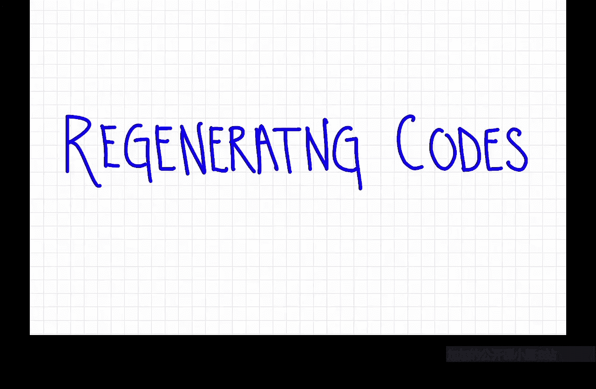
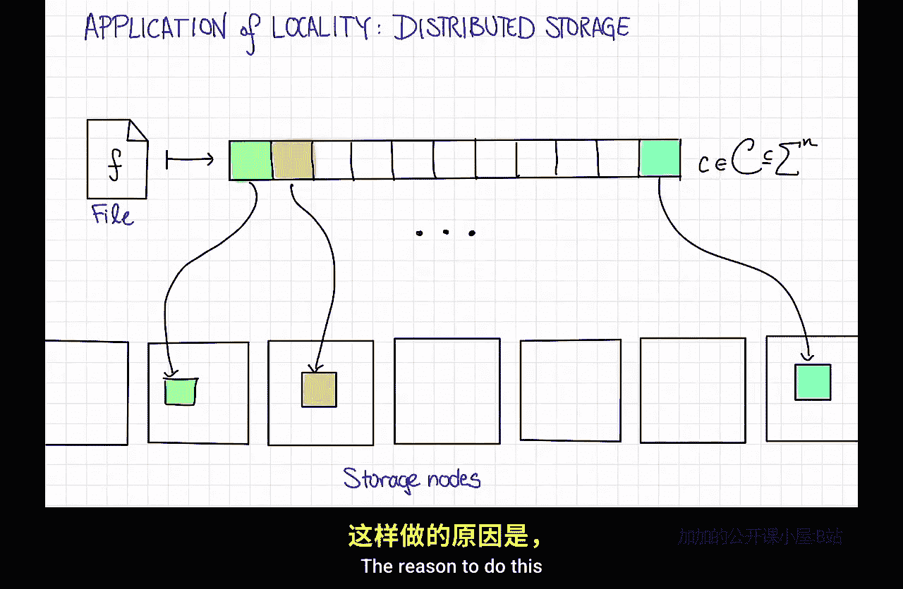

# 代数编码导论：16：再生码

在本节课程中，我们将定义再生码，这是一种在分布式存储中非常有用的编码。

我们将聚焦于一个典型的分布式存储系统示例。假设我们有一个文件 **F**，我们希望将其存储在一系列存储节点上，图中用黑色方块表示。

一种方法是首先使用我们喜欢的纠错码对文件 **F** 进行编码。这样我们得到一个码字。然后，我们将这个码字的每个符号分别发送到不同的存储节点。例如，这个符号存储在这里，那个符号存储在那里，依此类推，直到最后一个符号存储在某个服务器上。

这样做的好处是，当其中一个存储节点出现故障时，信息依然具有鲁棒性。

例如，假设这个存储节点失效了。它可能是暂时不可用，或者完全损坏了。这对应于我们码字中相应符号的擦除。

在这里使用纠错码的意义在于，只要我们的纠错码能够处理（在本例中）一个擦除，我们就不会丢失数据。然而，我们可以要求比“不丢失数据”更多一点，即能够高效地恢复数据。这似乎是局部性的用武之地。

更具体地说，这是上一张幻灯片中的编码理论问题。我们有一个带有擦除的码字，我们想要恢复这个信息。例如，我们可能想为丢失的存储节点建立一个替代节点。我们该如何做呢？

第一种方法是像通常那样纠正错误。假设我们的替代存储节点（或某个节点）在这里，我们称它为 Bob。Bob 可以做的第一件事是从所有其他未失效的存储节点对应的符号下载信息，解码整个码，并恢复丢失的信息。

这种方法的问题在于，在分布式存储的背景下，这需要大量的通信。请记住，每个符号都存储在不同的存储节点上。因此，Bob 基本上需要从所有不同的存储节点下载整个文件。在现实世界的分布式存储系统中，通信常常是瓶颈，所以我们希望减少通信量。

第二种解决方案是尝试利用码中的一些局部性。也就是说，Bob 可以只下载少数几个符号，向这个码字发出少量查询，并希望能恢复 **C_i**。例如，Bob 可能只查询这个符号、那个符号和另一个符号，下载这些信息。如果我们设计得当，Bob 应该能从这些信息中恢复 **C_i**。如果他能做到这一点，我们非正式地说这个码展现了局部性。

此时，你可能会想，嘿，我们之前见过一些具有局部性的码，比如局部可纠正码。我们能在这里使用它们吗？可以，但事实证明，对于像这样的情况，局部可纠正码实际上是大材小用。原因是局部可纠正码被设计用来容忍恒定比例的**错误**。然而，在这个模型中，首先，我们处理的是**擦除**而不是错误；其次，我们通常只有恒定**数量**的擦除，而不是恒定**比例**的擦除。也就是说，在真实的数据中心中，通常一次只有一个节点宕机，你不会期望 10% 的节点同时失效。😡

因此，从某种意义上说，这个问题比局部可纠正码试图回答的问题要容易得多——只有恒定数量的擦除，而不是恒定比例的错误。正因为如此，我们可能希望做得更好。我们可以使用局部可纠正码，但我们之前看到的局部可纠正码例子并没有很高的码率。因此，我们可能希望获得高得多的码率，同时仍然能够执行此任务。

更详细地说，以下是我们可能希望的一些特性：
1.  我们可能希望在码率和距离之间取得最佳权衡。也就是说，假设我们想要一个 MDS 码。像里德-所罗门码这样的 MDS 码通常用于分布式存储系统。所以，除非不得已，我们不想放弃这一点。
2.  我们可能希望有好的局部性，即能够从最多 **r** 个其他符号中恢复任何单个符号（一个擦除）。在图中，我们能够从这三个其他符号中恢复这个符号。

如果我们能同时实现这两个目标，那将非常棒。但问题是，实际上我们无法同时实现两者。这是不可能的。😊

之所以不可能，原因如下：对于任何维度为 **k** 的 MDS 码，事实证明，任何 **k-1** 个符号的值都无法告诉我们第 **k** 个符号的值。也就是说，如果我们为一个码字的任意 **k-1** 个符号选择值（比如这 **k-1** 个），那么任何其他符号（比如这个）的值可以是任何值。这个陈述源于 MDS 码的定义。如果不清楚为什么，现在可以暂停视频思考一下。提示：你应该利用这样一个事实：对于 MDS 码，生成矩阵的任何 **k × k** 子矩阵都是可逆的。

那么，基于这个事实，为什么这两个目标不可能同时实现呢？我们想要一个 MDS 码，所以这个事实适用。但我们也想要好的局部性。然而，这个事实表明，例如，如果我们想要恢复这个符号，我们需要查询至少 **k** 个其他符号。少于 **k** 个是不行的。而当我们查询一个 MDS 码的 **k** 个其他符号时，我们就可以恢复整个码字（MDS 码的任何 **k** 个符号决定了整个码字）。所以现在我们又回到了这种浪费的场景：我们恢复了所有信息，却只为了丢弃其中的大部分。这根本不是局部性。因此，我们无法同时拥有这两者：我们无法拥有一个 MDS 码，同时又具有良好的局部性（即任何符号可以从远少于 **k** 个的其他符号中恢复）。

此时，有两个选择：我们可以放宽第一个要求（MDS 条件），或者放宽第二个要求（良好的局部性）。这两个选择都很有趣。但在本视频中，我们将专注于放宽第二个条件，即放宽对局部性的严格限制。😊

关键的观察是：我们实际上并不想限制 Bob 必须下载的符号**数量**。那只是减少通信量的一种便捷方式。但是，有没有其他方法可以减少通信量呢？

我们将要做的是允许 Bob 查看许多不同的符号，但关键在于 Bob 不会从每个符号下载很多信息。也就是说，如果我们在一个大字母表上工作，每个符号由多个比特组成（也许每个符号是 8 比特或 128 比特）。如果 Bob 只下载这些比特中的一两个，那么即使他联系了很多符号，这仍然是一种胜利。

这个基本思想被称为**再生码**。再生码是一种 MDS 码（所以我们仍然保留第一个目标）。但是，我们不要求良好的局部性，而是要求良好的**修复带宽**。这意味着，我们再次希望任何符号都能以低信息量恢复，但现在允许以稍微不同的方式发生。

Bob 被允许联系除失效节点之外的任意多个其他符号，但他可以从每个符号下载较少的信息。我们说码的**修复带宽**是 Bob 需要下载的总比特数。在图中，Bob 联系了所有这些其他节点，但他显然只从这个节点下载 1 比特，从那个节点下载 2 比特，等等。

为了更正式一点，我们假设每个符号（每个存储节点）都可以进行一些本地计算。也就是说，这个符号可以计算其持有数据的某个函数，并将该函数的输出发送给 Bob。即，对于每个 **i** 和 **j**，存在某个函数 **g_{i, j}**，它将字母表 **Σ** 映射到某个长度的比特串。符号 **j** 将要发送的是 **g_{i, j}(c_j)**，其中 **i** 是失效节点的标识。所以，这些函数可以依赖于我们试图修复的节点，这是可以的。

在分布式存储示例中，我们假设这些信息可以廉价地广播。现在，Bob 应该从他收到的这些信息中学习到丢失的符号 **c_i**。

因此，非正式地说，这就是再生码的定义：**再生码是一种 MDS 码，使得任何单个符号都能以低带宽修复**。

那么，我们如何获得再生码呢？在接下来的几个视频中，我们将看到我们的老朋友——里德-所罗门码——可以胜任这个任务。😊

---

**本节课总结**：我们一起学习了再生码的基本概念。我们了解到，在分布式存储中，为了高效修复单个节点故障，传统的 MDS 码（如里德-所罗门码）虽然能保证数据不丢失，但在修复时需要下载大量数据（高带宽）。再生码通过放宽对“局部查询符号数量”的限制，转而要求从多个节点各下载少量数据（低修复带宽），从而在保持 MDS 码高码率优势的同时，实现了高效的节点修复。这是一种在通信效率和存储效率之间取得平衡的重要编码方案。