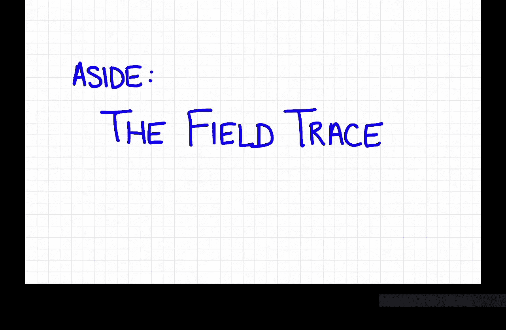
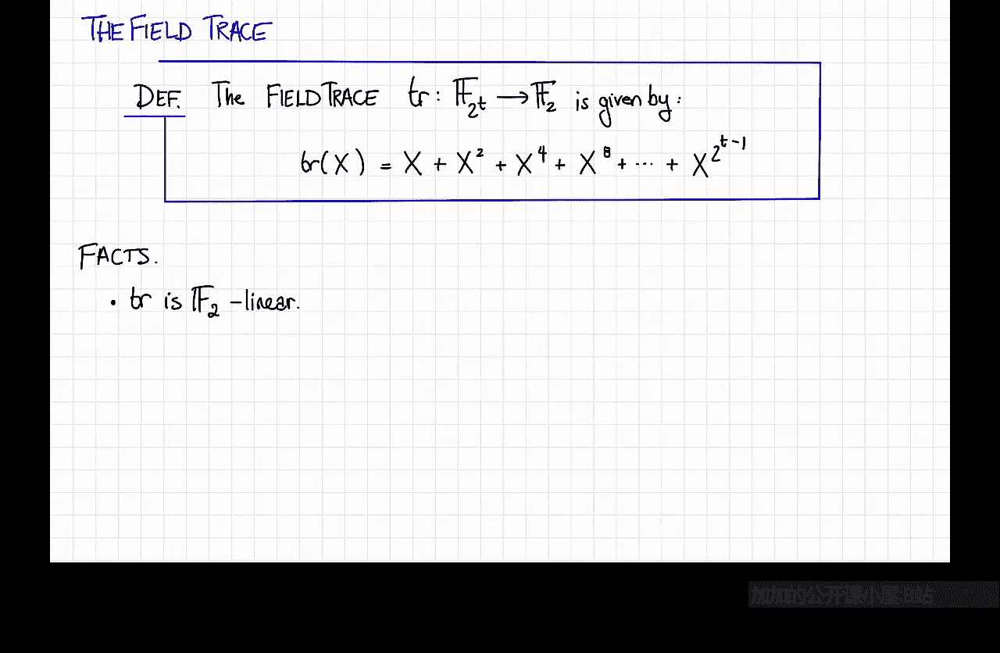
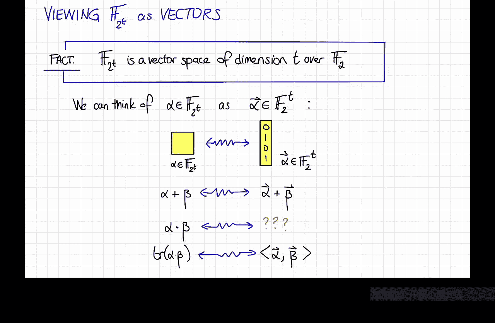

# 斯坦福大学【中英⚡代数编码导论｜Introduction to Algebraic Coding Theory】 p54 p53 16, Video 2： The Field Trace -BV16sRYYTEwg_p54-

In this video， we'll take a quick aside to introduce the field trace。

 which will be useful when we show that read Solomon codes are good regenerating codes。😊。

To motivate the definition of the field trace， or at least to motivate how we'll be using it。

We're going to need the fact that F2 to the T is a vector space of dimension t over F2。

What that means for us is that we can think of an element alpha of F2 to the T。As a little vector。

 which I'll denote by alpha with a little vector sign on it。Over F2 of length T。

What this squiggly line here means is that the additive structure of F2 to the T is the same as the additive structure of F2 to the T。

That means that there is a way to realize this squiggle squ here so that alpha plus beta in F 2 to the T corresponds to the vector version of alpha plus the vector version of beta in F 2。

To the tea。However， this little squiggly arrow does not preserve the multiplative structure。That is。

 if I want to multiply two elements， alpha and beta in F2 to the T。

 it's not clear what operation that corresponds to for the vector versions of alpha and beta in F2 to the T。

However， there is one thing that we might want to do。

 which is kind of smells like multiplication for vectors in F2 to the T。

 And that's taken in our product。And at least at the moment。

 it's not clear what that corresponds to back in F2 to the T land。With that preamble out of the way。

 we can now define and somewhat interpret the field trace。

 So here's the definition of the field trace from F 2 to the T to F 2。

So this is a function which I'm going to denote by T R。

 which is given by the trace of x is equal to x plus x squared plus x to the fourth plus x to the eighth plus dotta dot plus x to the 2 to the t -1。

So this is just some polynomial， but it has some really nice properties。

 Here are some facts about the field trace。First， the trace is F2 linear。

What that means is that for any alpha in beta in f to the T。

 the trace of alpha plus beta is equal to the trace of alpha plus the trace of beta。

To see why this is true， we can use the fact that we've seen before that alpha plus beta squared is equal to alpha squared plus beta squared in a field of characteristic 2。

Then we can use the fact that all of the exponents that appear here are conveniently powers of two。

 And just apply this a bunch of times。Another useful fact about the field trace is that its image lives in F2。

That is， the trace of alpha is just a bit 0 or one for any alpha in the big field F2 to the T。

 Here's a quick proof。Consider the trace of alpha squared。Using this fact again。

 the square goes inside all of the terms in this expression。 And so this is equal。

2 alpha squared plus alpha to the fourth plus dotta dot plus alpha to the 2 to the t -1 plus alpha to the2 to the T。

 And you might remember that in F 2 to the T， anything to the two to the T is just equal to itself。

 So this last alpha to the2 to the T here just turns into an alpha。

 And now we just have the trace of alpha again， we've just shifted all of the terms around cyclically。

This means that for any alpha， the trace of alpha squared is equal to itself。

But there are only two values so that they are equal to their own square。

 and those two values are 0 and 1。 Therefore， the trace of alpha must be either 0 or 1。 Aka。

 it lives in F2。A third useful fact。Is that the trace， in some sense。

 captures all functions that have these properties。

 That is all F2 linear functions from F to to the T down to F2。That is all F 2 linear functions。

 phi from F 2 to the T down to F 2 R of the form phi of x is equal to the trace of alpha times x for some alpha in F 2 to the T。

This might look familiar with an analogy from F2 to the T to F2 to the T。That is。

 you probably know that all F 2 linear functions from the vector space F2 to the T down to F 2 look like an inner product。

 That is there of the form phi of some vector X are equal to the inner product。

Between some vector alpha。And that vector x for some vector alpha in F2 to the T。

This suggests that one way to think about the trace is kind of as an inner product。

So if we go back to this slide， we actually now do have an analog over here。

We should think at the inner product between alpha and beta。

As being essentially the trace of alpha times beta。

 it turns out that there's actually always a way to pick a basis of F 2 to the T that is to pick some correspondence between F 2 to the T and F 2 to the T。

So that this squiggly squiggly line here is actually inequality。Okay。

 so that's a quick intro to the field trace。We're going to use the field trace in the next video to view read Solomon codes as regenerating codes。

And in particular， this view。As kind of a proxy for an inner product of vectors will be useful to keep in mind。

