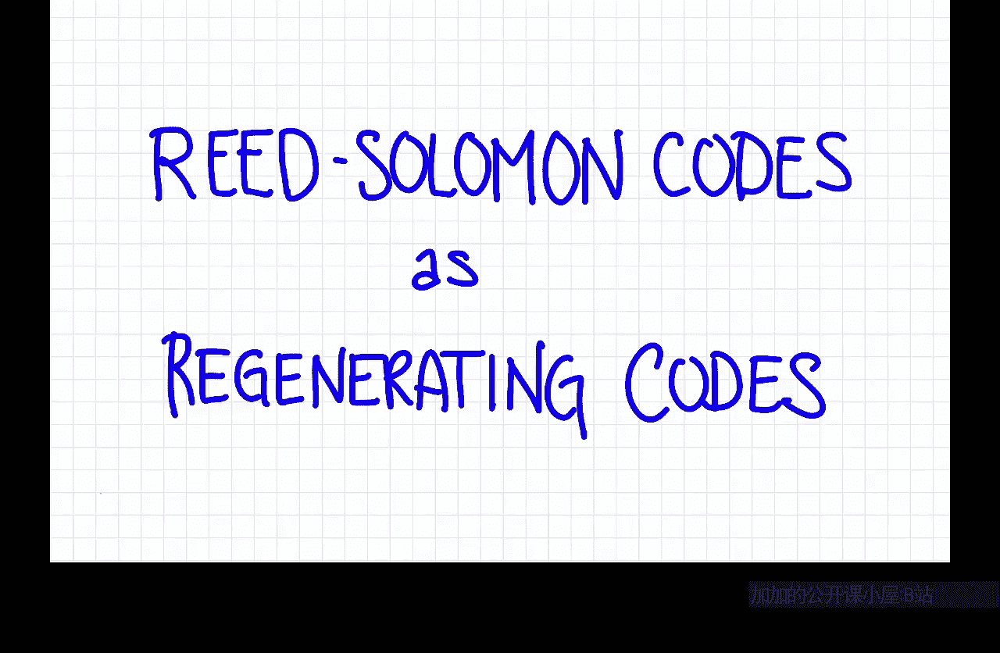
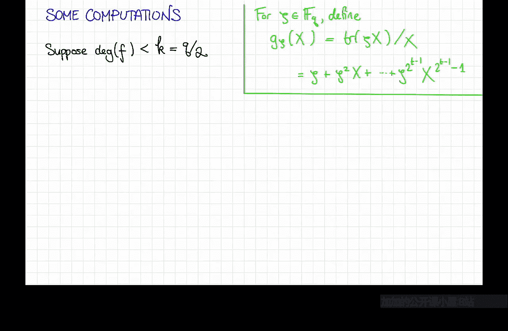
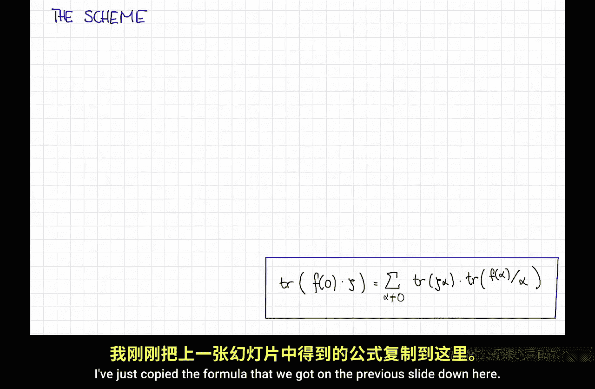
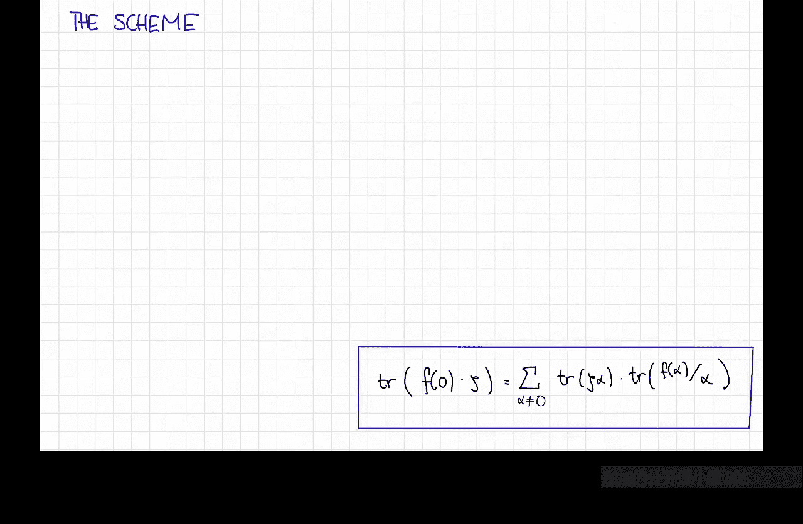
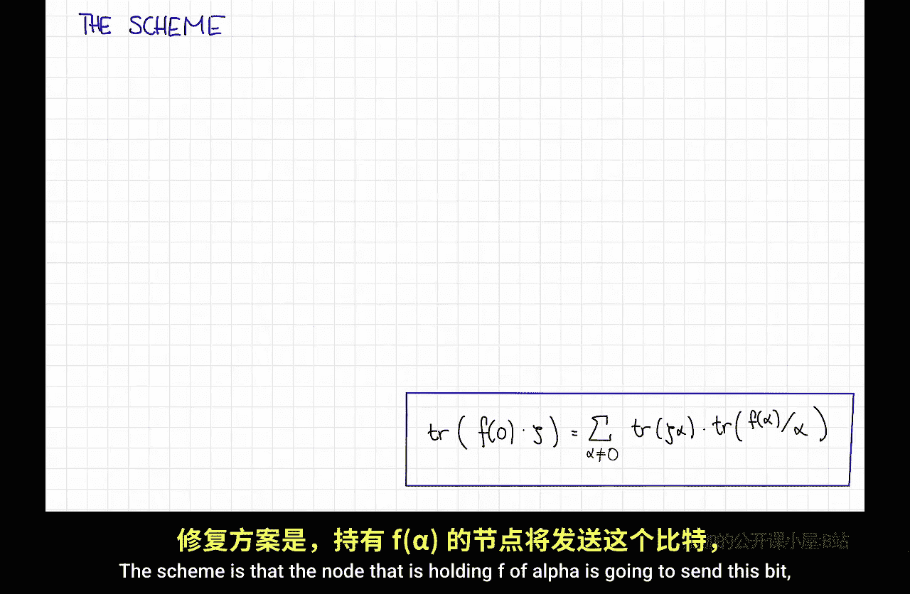
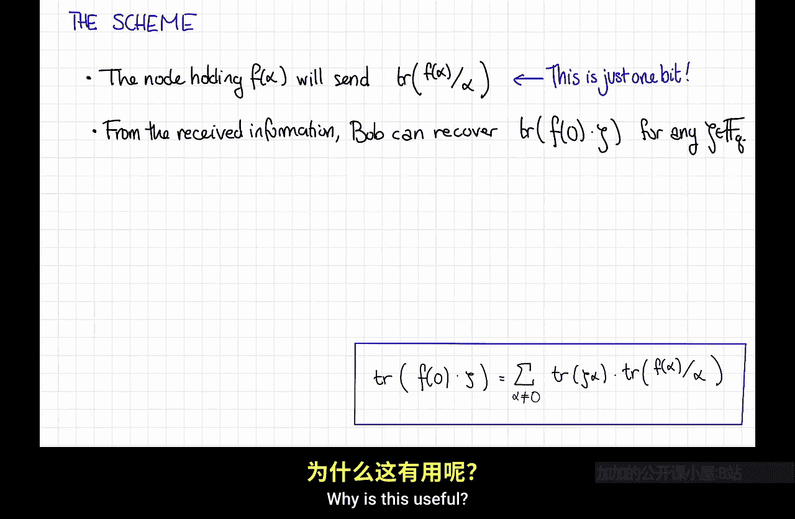

# 斯坦福大学【中英⚡代数编码导论｜Introduction to Algebraic Coding Theory】 p55 p54 16, Video 3： RS codes as regenerating codes -BV16sRYYTEwg_p55-

In this video， we'll show how to use read Solomon codes as regenerating codes。

Here is our goal for this video。 This is what we're going to show。

Let's imagine that our data is stored using a read Solomon code。Of block length n。

 which is equal to Q， which is equal to 2 to the T。And dimension K， which is equal to n over 2。

 which is equal to 2 to the t -1。We're going to show the following。

Suppose we have our data stored with our read Solomon code like this。And one node fails。

Then Bob or our replacement server is supposed to be able to recover the data that was on this failed node。

 ideally with as little communication as possible from the remaining nodes。

What we're going to see in this video is how Bob can do it by downloading just a single bit from each of the surviving notes。

So how good is this scheme？Well， the repair bandwidth is just n-1。 Bob downloads n-1 Bs。

And is this good or bad。Well， let's compare to the naive scheme。

 What the naive scheme would do is just to say， okay。

 so this is a read Solomon code of dimension n over 2。

 So I'm just going to contact N over two of these different nodes。

 I will download all of the information on them。And then I will do polynomial interpolation to recover the polynomial F。

 and then I'll recover all of the data。For this。The bandwidth is K times T。

Because we contact K different nodes and we download T bits from each of them。

 That's because each one of these servers is storing a field element in F2 to the T。

 and it takes T bits to write down such a field element。In this case， K is equal to n over 2。

And T is equal to log n。So what we're going to do with this scheme here。

Is to download n -1 bits instead of and log n over 2 bits。

So that's a savings of a factor of log n divided by  two。As N gets large， this can be significant。

This basic scheme that we'll see is pretty flexible。

 actually gives rise to a whole family of schemes。 It can work for Ks other than n over2。

 and it can work for different amounts of download other than a single bit。

But let's focus on just this setup here for simplicity so that you can get the basic idea。Okay。

 so how are we going to achieve this？First， let us state some useful facts。Here are two useful facts。

 the second one we have already seen in the previous video。The first useful fact。

Is that for any polynomial， F and G。Over F Q。 so that the degree of F and G are each strictly less than  Q over 2。

Thenhan the sum over all alpha and F Q of F of alpha times G of alpha is equal to 0。

 So why is this fact true。So this follows from the following fact that we've also seen it in an earlier video。

The fact that we've seen before is that for all I strictly less than  Q-1。

 the sum over alpha and F Q。Of alpha to the I is equal to 0。 Now， this just follows from that fact。

By observing that F times G is a polynomial of degrees strictly less than  Q -1。

 because both of these have degrees strictly less than  Q over 2。

And then we can break up each term linearly and apply this fact。Okay。

 so that's the proof idea for this fact。The second useful fact。

 which we've already seen is that the trace， which we defined in the previous video maps F2 to the T down to F2 and is F2 linear。

Okay， so given these two useful facts， lets us do some computations。First。

 I'm going to define some polynomial called G subzeta。More precisely forzeta in Fq。

 we're going to define g sub zeta of x to be equal to the trace of zeta x divided by x。

And if you remember the definition of the trace， trace of y is just y plus y squared plus y to the fourth plus dot ta dot。

This thing is just equal to this polynomial。 Zeta pluszeta squared x pluszeta the fourth x cubed plus dotta dot pluszeta to the two to the t -1 times x to the two to the t -1-1。

 Why did I define this polynomial。 For now， it is a mystery。 You will see in a moment。But meanwhile。

 let's suppose that F has degree strictly less than  Q over 2。

And let's remember that in this example， Q over  two is equal to k。

 the dimension of the read Solomon code。

Therefore， F is a legitimate polynomial that might be a message in our read Solomon code， then。

I claim that F of 0 times gzeta of 0 is equal to the sum of all alpha in F Q other than 0。

Of F of alpha times G theta of alpha。That follows from our first useful fact back here。

Because both F and G have degrees strictly less than  Q over 2 in this example。

Where G is equal to gzeta。And because we're working over a field of characteristic， too。

 I can move the zero term in this sum over to the other side。

And I don't need to put in a minus sign because minus is equal to plus。Okay， so we have this。

 that's a true fact。Now， let's replace G of Zeta with its definition。

So we have f of 0 times g Zeta of 0。 Well we can see from here that g Zeta of 0 is just equal to zeta。

So f of0 timeszeta。Is equal to the sum over all alpha not equal to 0。Of F of alpha times。 Now。

 I'm going to plug in this definition of  Zeta。 the trace of  Zeta times alpha divided by alpha。Okay。

 great。 so far， so good。 The next thing that I'm going to do is to take the trace of both sides of this equation。

And now， remember that the trace is F2 linear。 That was one of our useful facts。

 So that means that this trace can come inside this sum。Now。

 we're going to use the fact that the trace is F 2 linear again to say that this thing。

 which is just 0 or 1。 So it's a scalar in F 2， can come outside of the trace。Okay， great。

So I claim that at this point， we actually already have a scheme to do the repair that I pictured on the first slide of this video。

😡，Can you see what it is？Okay， so here's the scheme。

 I've just copied the formula that we got on the previous slide down here。

The scheme is that the node that is holding F of alpha is going to send this bit。

 the trace of F of alpha divided by alpha。

Notice that that's just one bit because the trace maps F2 to the T down to F2。

And I claim that from this information， we can now recover trace of F of 0 times zeta for any zeta that we like。

The reason is that this thing here。Does not depend on Zeta。 So all of the servers send this thing。

 And then Bob can take the linear combination of those things with these coefficients。

 Those do depend on  Zeta and come up with the trace of F 0 times Zeta。Why is this useful。

Well， let's recall our view from the previous video of the trace as kind of like an inner product on vectors。

That is， we can view the trace of F of 0 times Zeta。

As the inner product of some vector version of F of0。 So that's a little vector in F2 to the T。

With the vector version of Zeta。In particular， if Bob can get this inner product for any Izeda he likes。

 then he can quite easily recover the vector version of F of 0 from which he can recover F of 0。

Concretely， Bob can recover the inner product of F with some basis。 Let's say the standard basis E1。

 E2 up to E T for F 2 to the T over F 2。And that will give him every single coordinate of the vector version of F of 0。

 And then he can translate that back to the field element， F of 0。That's a little bit hand wavy。

 especially with the precise details of this sququiiggle sququiiggle。

 but it turns out that this can be made precise and can even be done quite efficiently。

So this gives us a scheme to do this that I claimed at the beginning for this particular parameter regime。

Bob can recover F of0 by downloading just one bit from each of the surviving notes。

It turns out that you can pretty easily modify the scheme that I just showed in order to recover F of1。

 if that failed or F of gamma squared， if that failed or whatever。And as I mentioned before。

 you can also play around with the scheme and play around with the parameters。

You can make K something different than n over2， for example。

 and that essentially boils down to picking different polynomials G subzeta。However， hopefully。

 this example， just in this particular parameter the， is a nice proof of concept。

 It shows that read solomon codes can be good for generating codes。And in fact。

 in many parameter regimes， including this one， it turns out that read Solomon codes are optimal regenerating codes。

 at least among linear MS codes。So far， we've been phrasing this whole discussion in terms of regenerating codes and distributed storage and so on。

 But you could also view this result as just another algorithm to do polynomial interpolation or low bandwidth polynomial interpolation。

 if you will。 And independently of coding theory， I think that's kind of a neat punch fine on its own。

