# 斯坦福大学【中英⚡代数编码导论｜Introduction to Algebraic Coding Theory】 p56 p55 -the last one-, Video -the last one-： The End -BV16sRYYTEwg_p56-

Hi， everyone。 Now that we've come to the end of these videos， let's quickly recap what we've learned。

😊，First， we learned about the basics of error correcting codes。

 We learned that a code is just a set of points in sigma to the end。

And we saw that if a code has good distance， that is the minimum hamming distance between any two points and good rate。

 That is， if there are lots of these red dots， then Alice and Bob can use it to communicate efficiently in the presence of noise。

We also talked about linear codes， and we saw the concepts of generator matrices。

And parodity check matrices。Both of which were really useful when thinking about these codes and thinking about algorithms for manipulating them。

We also talked about the fundamental trade offs between rate and distance of a code。

And we saw lots of bounds， like the hamming bound。The plot can bound。And the singleleton bound。

Which were all impossibility results。And we saw some possibility results， like the G V bound。

And the Zablooff bound。Altogether， this told us a lot。

About the best trade offs between the rate and distance for different codes。However。

 the question for binary codes， what is that best trade off is still open。For large alphabets。

 though， that is growing with the block length N， we do know codes that meet the optimal trade off between rate and distance。

 and those codes are read Solomon codes。By拜拜拜。🎼。

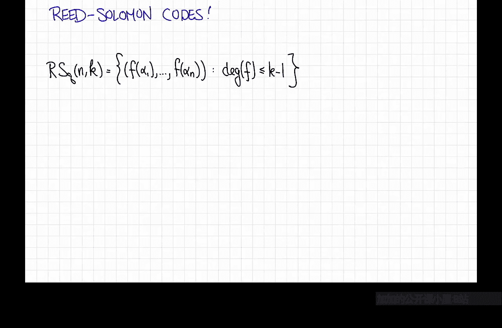

Read Solomon codes are defined as vectors of evaluations of low degree polynomials。

And the reason that they have such a good trade off between rate and distance is the fact that we have used repeatedly throughout this course。

 All right， Mo polynomials don't have too many roots。Yes， thank you， Polly。Also， we made a friend。

 Polly， the polynomial interpolation parrot。Moreover。

 reads Solomon codes have efficient decoding algorithms。 We saw the Burlec Welsh algorithm。

 And the reason that that algorithm worked was， right。 Mo polynomials don't have too many roots。 Yes。

 thank you， Polly。

We also saw several more codes that we could get， along with efficient algorithms。

 by building on or manipulating read Solomon codes。 For example， we saw B C H codes。

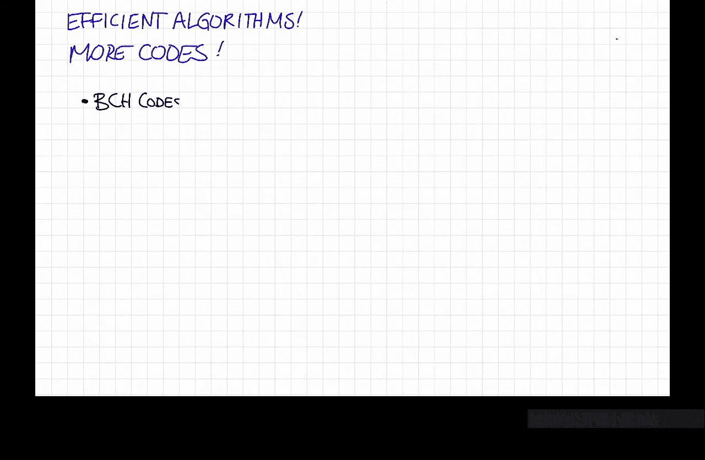

Which were just what happened when you took a read Solomon code and restricted it to all of the binary code words。

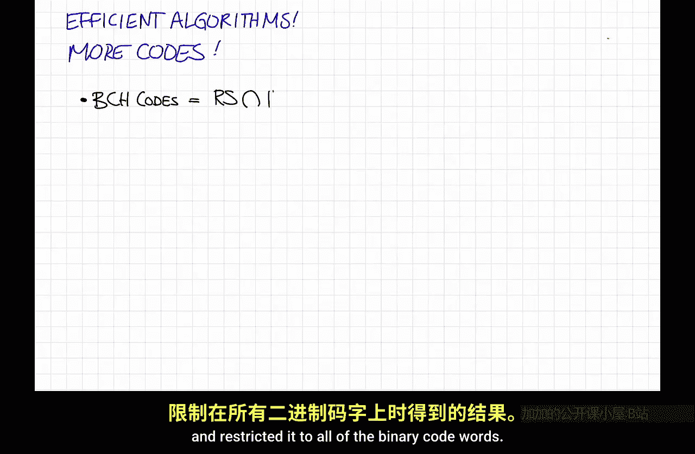

We saw read Mueller codes。Which were sort of the multivariate extension of read Solomon codes。

We saw concatenated codes。Which allowed us to take a code over a large alphabet。

 like a read Solomon code and concatenate it down to get a code over a smaller alphabet。

The picture looked like this。That is， we start out with a read Solomon code word。

 Treat that as a bunch of bits， and then encode each chunk from that code word with some inner binary code to end up with a big binary code word。

And we saw a couple of cool algorithms to decode such concatenated codes。

 both from random errors and from worst case errors。

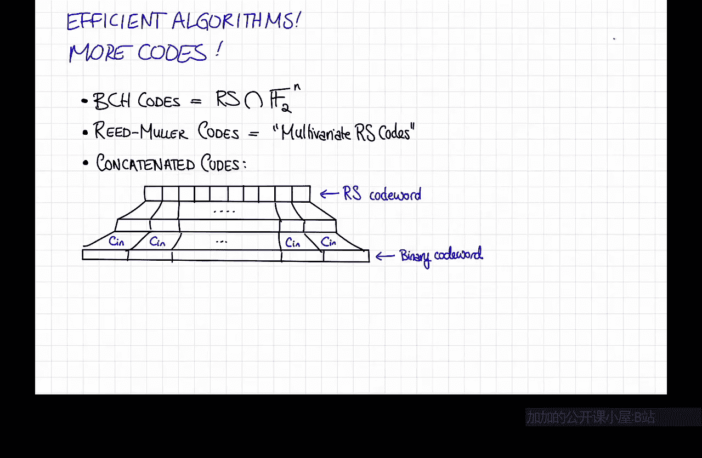

We also saw folded read Solomon codes。Which turn read Solomon codes into a code over an even larger alphabet。

 but that has better list decoding capabilities。Speaking of list decoding。

 another thing that we saw in this course was a whole bunch of other notions of decoding。For example。

 list decoding is the problem to find all code words close to the received word。

 even if there might be more than one of them。The picture looked something like this。

 so we wanted to return all of these code wordss。We saw a few algorithms for doing this like the Gorowami Sudan algorithm and the algorithm for listtic codingding folded read Solomon codes。

 both of which worked because， All right， Mo polynomials don't have too many roots。 Yeah， thanks。

 Polly。😊，We also saw local decoding in which Bob wants to find something about Alice's message in subline time。

 even the presence of worst case errors。

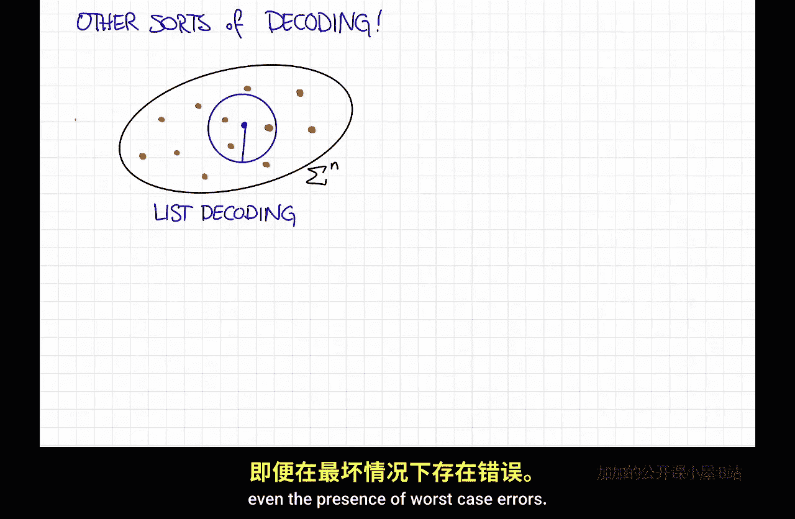

That is， some adversary corrupts the code word in a bunch of places。

And now Bob has to make queries to the code word to figure out whatever it is he wants to figure out。

For example， maybe just one bit of Alice's message。So that was local decoding。

We saw that the Haamard code and read Mueller codes support local decoding。

Then we combine these notions of local decoding and list decoding to get local list decoding。

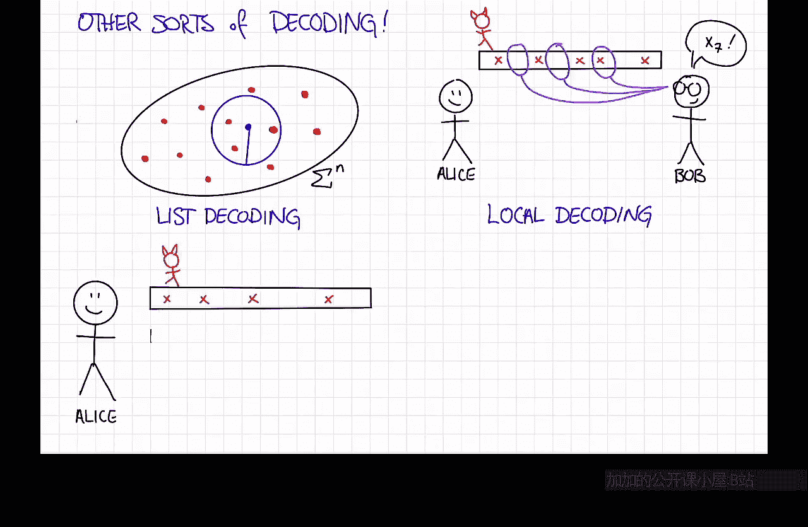

In localist decoding， we have the same picture as in local decoding。

 except that there are several bobs because there might be multiple code words close to the received word。

We saw an algorithm for localist decoding the Haamard code。

We also talked about a different version of locality called a regenerating code。

In a regenerating code， just one symbol is missing。

And Bob's job is to recover the missing symbol using as little downloaded information as possible from the rest of the codeword。

We saw that read Solomon codes themselves are actually pretty awesome regenerating codes。

Throughout these videos， we've also seen several applications of error correcting codes。

There's our original motivating application in communication。

And another natural application in storage。Regenerating codes in particular were designed for distributed storage。

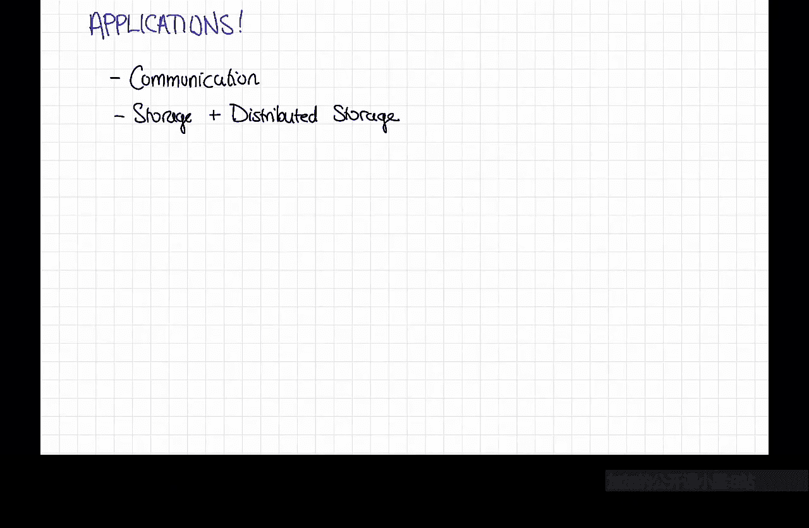

But we also saw applications beyond communication and storage， like applications in cryptography。

We talked about the Mielese crypto system。We also mentioned some applications in compressed sensing。

And we saw applications to streaming algorithms like the He hitters problem。In particular。

 we saw two ways to use Read Solomon codes to get faster algorithms for heavy hitters。

We also saw applications in group testing。We saw how to use Read Solomon codes to get good group testing schemes。

We saw applications in learning theory。That is， we saw how our algorithm for locally list decoding the headam mark code gave us an algorithm for learning Fourier sparse Boolean functions from queries。

Plus， there are tons of other applications we didn't have time to get to in these videos。

So what's the moral of the story？One moral is that errorreing codes show up all over the place。

They're extremely useful in communication and storage。

 but they're just really useful combinatorial and algorithmic objects in general for lots and lots of applications。

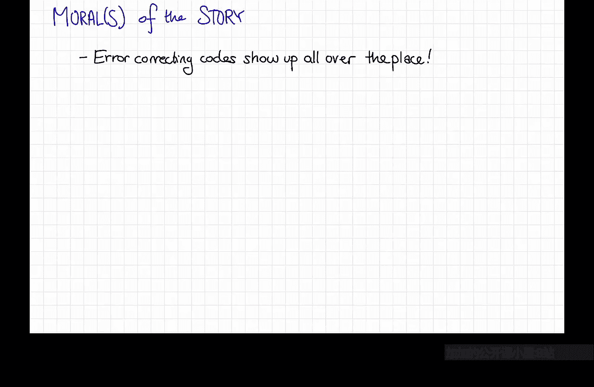

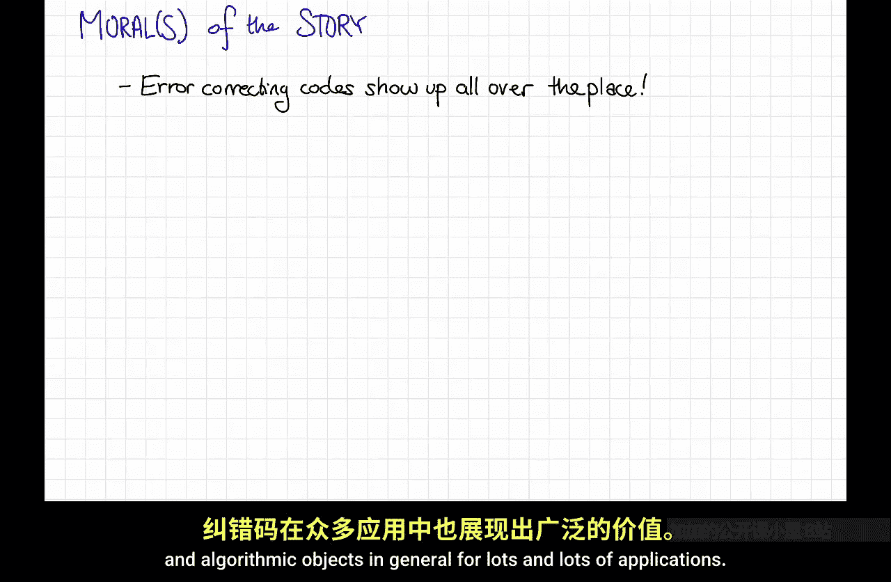

Another moral of the story that perhaps you might have picked up on is that， right。

 Mo polynomials don't have too many roots。 Yes， thank you， Polly。

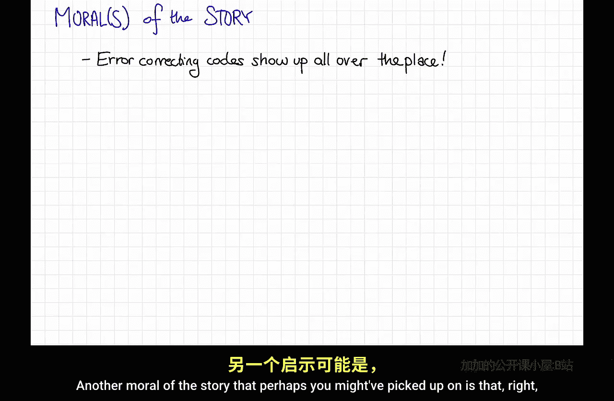

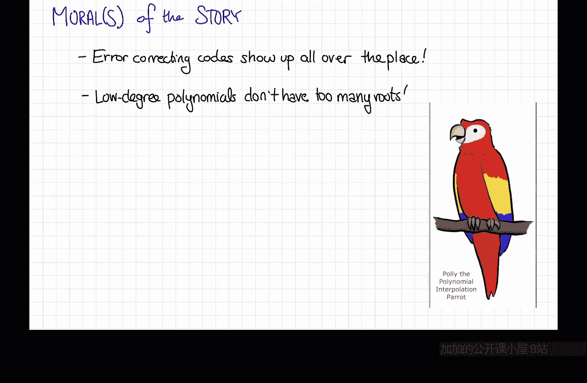

Low degree polynomials don't have too many roots， and this fact is stupidly useful in a wide variety of applications。

There's probably a lot more takeaways I could list here， but let's leave it with these two for now。

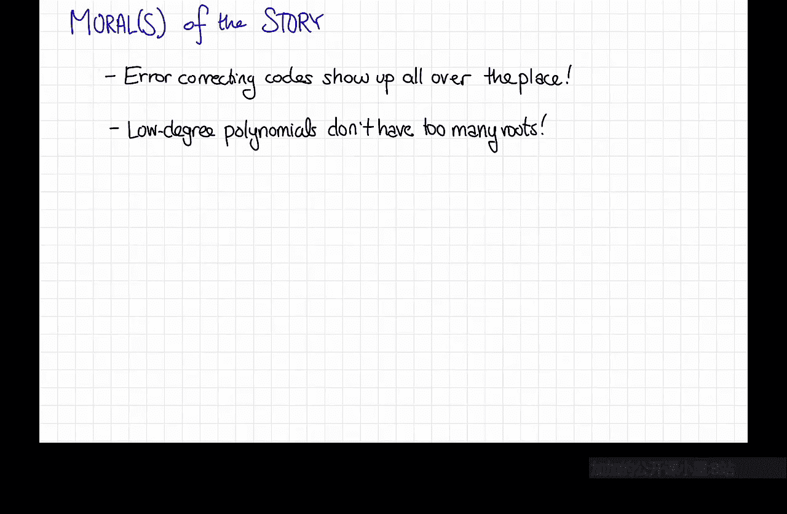

Okay， so thanks for watching these videos。 I hope that you've enjoyed them and that you've learned something and that you are inspired to either keep learning more about error correcting codes or to use error correcting codes in your own work or ideally both。

😊。

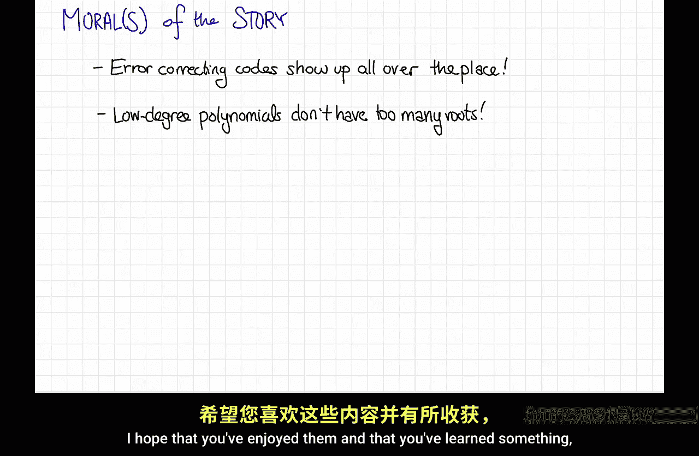

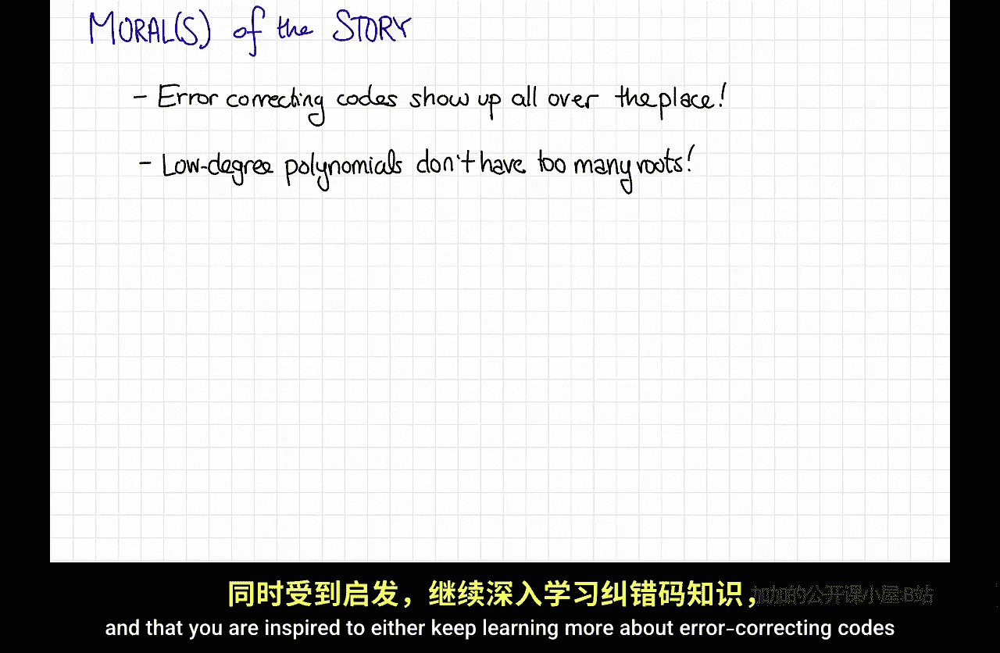

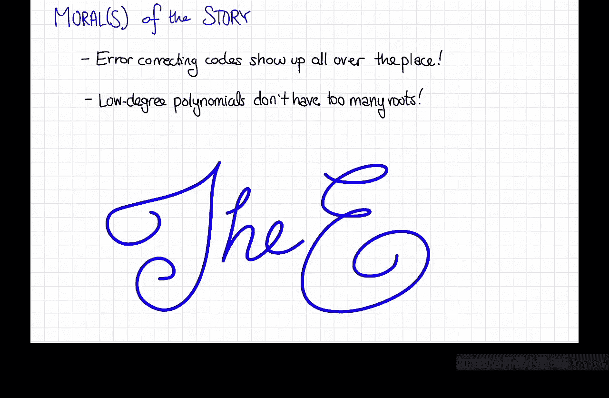

Right right， yeah， I think they get it， Polly。