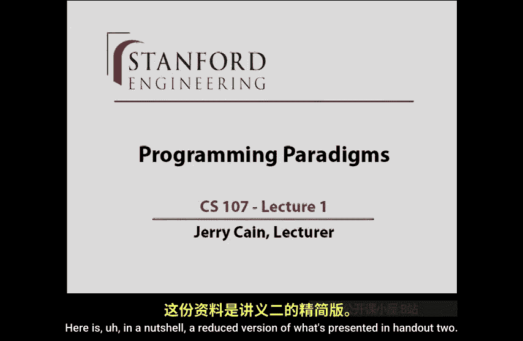
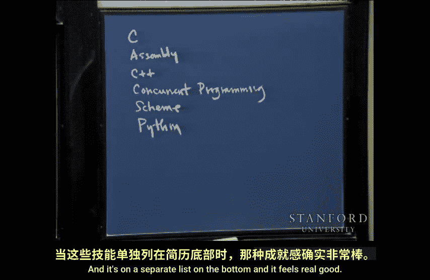

# 001：课程概述与编程范式介绍 🚀

在本节课中，我们将学习斯坦福大学CS107课程的核心内容，了解编程范式的概念，并概览课程中将涉及的不同编程语言及其背后的思维方式。

## 课程大纲 📋

本课程将涵盖多种编程语言和一个核心概念。以下是课程中将要学习的内容列表：

*   C语言
*   汇编语言
*   C++语言
*   并发编程（一种范式，而非特定语言）
*   Scheme语言
*   Python语言

学习这些语言的核心价值，不在于仅仅将它们列在简历上，而在于深入理解它们所代表的**编程范式**。接下来，我们将解释什么是编程范式。

## 理解编程范式 🤔

上一节我们列出了课程涵盖的语言，本节中我们来看看什么是编程范式。简单来说，使用C或C++编程时，你的思维过程与使用Scheme或Python时是不同的。你们已经掌握了足够的C++知识，并且可能没有意识到，你们其实已经了解了很多C语言的知识——将C++中的面向对象特性去掉，剩下的基本上就是C语言了。

### 过程式/命令式范式

当你使用纯C语言编程（没有类）时，你的思维是**过程导向**的。你将主函数视为一个高层纲要，可能调用五个顶层函数，而这些顶层函数又包含子函数，子函数又包含更小的函数，以此类推。这就像历史课的提纲笔记，有罗马数字I、II、III作为主要部分，下面又有A、B和小写的i、ii等细节。

这种范式也被称为**命令式范式**。它是**动词导向**的，因为你通常在语句中首先看到的是一个函数调用，而函数名通常包含一个强烈的动词，这让你对函数要完成什么功能有所了解。

### 面向对象范式

当你学习C++时，情况发生了变化。你不再是通过调用“做这个”函数并传递某个对象的地址，而是使用 `myObject->doThis()` 这样的语法。这时，你在一行代码中首先看到的是被操作的数据或对象。正因为首先看到的是对象，所以它被称为**面向对象**，而不是过程导向。

许多C++程序员实际上是用C的风格在编程，只是顺便使用了可用的对象和类，这是一种完全合理的编程方式。大多数人在工业界仍然非常精通C语言，尽管有无数更新的、在某些方面更好的语言，他们仍然坚持使用所熟悉的工具，这也是C和C++至今仍然非常流行的原因。

纯粹用C编程没有任何问题，如果你非常精通并能写出清晰可读的代码的话。只是，在C语言中更容易出现内存错误，因为一切对程序员都是暴露的，并且几乎没有错误检查。C++在这方面稍好一些。

## 汇编语言的作用 🔧

在C和C++之间，我们提到了汇编语言。教授这门课的目的，主要不是教你如何用汇编语言编程，而是将其作为一个工具，向你展示C和C++程序是如何编译成 `.o` 目标文件、二进制文件，并最终成为可执行文件的。

我们将了解像 `i = 7`、`j++` 或函数调用 `foo(x, y)` 这样的代码行，是如何被翻译成汇编代码的。你们知道，当你编写C++代码并执行程序时，它已经不再是C++了，它变成了汇编代码，最终都是0和1。我希望让你们深入了解C是如何被翻译成汇编代码的，你们所有的变量、函数和对象最终是如何被归结为一串0和1的集合。

对于C++，我们也会做类似的事情。尽管C++和C代表了不同的范式，但它们最终都被编译成0和1。通过足够的学习，你们将能够看着C代码，推断出其对应的汇编代码会是什么样子。你们将会发现，就底层的0和1而言，C++和C看起来几乎像是同一种语言。我们将把用于从C到汇编的编译模型进行扩展，以适应C++中引入的引用、类、模板等新特性。

在课程的前五周之后，你们将对C和C++的工作原理有一个非常深入的理解。这将使你们成为更出色的C/C++程序员。我们将揭开指针的神秘面纱。你们将能够理解像 `*p = 7` 这样的语句的确切含义。虽然这需要一些努力，但你们会看到，类型转换、`&` 和 `*` 的操作看似随意，但只要它能编译，就意味着它有某种含义；当它运行时，它确实会做某件事。如果你的代码中有很多 `*` 和 `&`，这可能不是好迹象，但至少你能理解它为什么会崩溃，而不仅仅是知道它崩溃了。

## 并发编程范式 ⚡

接下来，我们将花相当多的精力讨论并发编程。目前，我们实际上是用C语言来进行这类编程的。你们在过去两个季度（如果你们刚上完斯坦福的106A和106B或106X课程）所写的所有程序，在接触CS107之前，都是**顺序程序**。这意味着，无论是面向对象还是命令式编程，你们都遵循一个按部就班的步骤大纲，所有事情一个接一个地发生，没有并行或流水线操作，一切都是在一个清晰的指令流中完成的。

而**并发编程**是关于在一个单一程序中，试图让两个函数**看似同时**运行。如果可以做到让两个函数看似同时运行，那么就可以扩展到让10个、20个甚至更多函数同时（或看似同时）运行。我之所以说“看似”，是因为从技术上讲，它们并不在同一时刻运行。

当我讲解汇编代码时，你们可以凭直觉理解汇编代码是什么样的。如果你只关心一个函数的执行（比如我的左手代表一个函数），那么你可以只想着读取并执行它的代码以产生效果。但在处理并发编程时，你有两个或更多的函数（比如我的两只手代表两个函数），它们看起来是同时运行的。实际上发生的情况，就像同时看两部电影：因为大多数机器只有一个处理器，它们并不是真正像这样并行运行，而是像这样来回切换，在两个函数之间快速交替。只是切换速度极快（远超每秒24帧，可能达到每秒百万次），以至于你无法察觉区别。这在理论上可以很好地扩展到3个、5个、10个甚至100个函数。

在很多情况下，并发编程并不是非常有用，但在某些场景下，特别是涉及网络时，并发编程实际上非常有用。处理并发编程时，会出现一些你可能未曾想到的问题。

我经常在开学第一天举的例子是使用两台富国银行的ATM机。假设你有一个富国银行的支票账户，里面有100美元。你和你的好朋友共享了密码，然后你们走到相邻的两台ATM机前，尽可能快地操作，试图取出那100美元。然后你们数到三，同时按下确认键，试图总共取出200美元。这个例子并非毫无意义，因为这两台机器本质上是简单的计算机，最终都需要访问同一个主账户余额，以确认有100美元可用。以这种“事务性”的方式（这个词在金钱和并发编程中都有意义），你必须确保被识别为账户余额的这100美元，其操作具有某种“原子性”，这样如果两个人同时试图取出100美元，只有一个人能成功。这100美元的账户余额就是两个不同进程可以访问的**共享资源**。

## 总结 📝

本节课我们一起学习了编程范式的核心概念。我们了解到，不同的编程语言（如C、C++、Scheme、Python）代表了不同的思维方式或“范式”，例如过程式、面向对象式。我们还预览了本课程将如何通过汇编语言来揭示高级语言（C/C++）到机器代码的编译过程，从而加深对程序底层运行机制的理解。最后，我们引入了并发编程范式，探讨了让多个任务看似同时执行所带来的机遇与挑战（如资源共享问题）。在接下来的课程中，我们将深入这些主题，逐步揭开编程语言和计算机系统的神秘面纱。