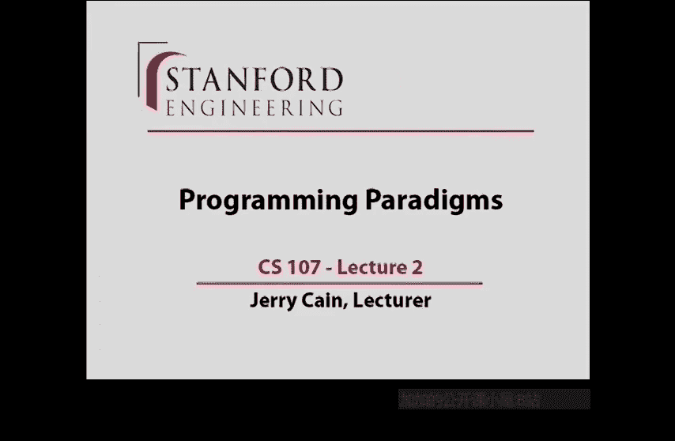
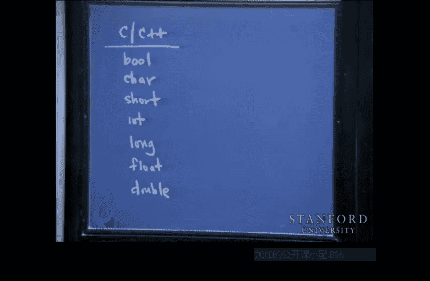
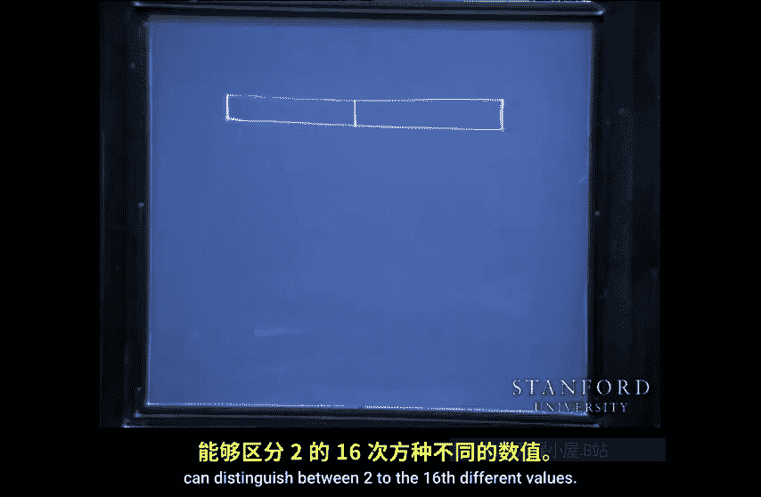

# 002：内存中的数据类型表示

本演示由斯坦福大学职业发展中心提供。

在本节课中，我们将学习数据在内存中的底层表示机制。理解像布尔值、整数、浮点数和结构体这样简单的数据是如何在内存中表示的，这非常有趣。理解一切如何最终被表示为0和1的集合，以及如何每次都能被准确地解释为一个大写字母A、数字7、π或一个表示分数的结构体，将使你成为一名更优秀的C/C++程序员。目前，C和C++对我来说是相同的语言。

首先，让我们回顾一下你可能处理过的所有数据类型。你可能处理过布尔值（`bool`）。你肯定处理过字符（`char`）。你可能没有处理过短整型（`short`），但我还是会把它列出来。你肯定处理过整型（`int`）。你可能也见过长整型（`long`）。你很可能见过浮点数（`float`）和双精度浮点数（`double`）。这些数据类型足以让我们讨论前10分钟的内容。

这些数据类型中，`bool`、`char`和`short`、`int`、`long`是相关的。`bool`表示真或假。`char`在我们的世界中表示256个不同字符中的一个。`short`、`int`、`long`都旨在表示标量数字。`float`和`double`则试图表示任意精度的数字。

`char`在内存中通常是1字节。`short`通常是2字节。`int`实际上可以是2到4字节，但在本课程中我们假设它总是4字节。`long`目前是4字节内存。还有一种不常见的数据类型叫`long long`，它提供8字节内存来表示非常大的十进制数，我们稍后会讨论。`float`是4字节。它试图用4字节内存来表示一个任意精度的数字。`double`在一些系统上是10或12字节，但我们假设它是8字节。

这是你可能见过的最无聊的表格。但我的动机是揭示字节的构成，以及4个字节如何能表示大量数字，8个字节如何能表示非常大量的数字，并足够精确地满足我们的需求。

现在暂时忘记浮点数。我稍后会回到布尔值，因为它与字符占用的内存量有关。但我目前感兴趣的是一个通常被称为二进制数字的东西。

你听说过它，它被称为**位**（bit）。电气工程专业的学生和喜欢电子学的人从晶体管和电压（高电压、低电压）的角度来思考二进制数字。计算机科学家不需要这样看。他们只需要认识到，位是一个很小的内存单元，可以区分两个不同的值。电气工程师会说是高电压、低电压。我们则假设单个位可以存储一个0或一个1。

从技术上讲，一个布尔值可以只映射到内存中的一个位。但事实证明这样做不切实际。不过，如果你真的想用单个位来表示一个布尔变量，你可以设计编译器来实现。

当位被分组时，它们变得更有趣。如果我在这里放下8位，我甚至不指定是0还是1，只是画出来。这不是分数，这是我画的8位。让我在旁边画一个，这样我有一些空间，并以这种二分查找的方式给每个位画一个小框。

这个图最有趣的一点是，这个小框可以采用两个值中的一个，独立于其他框选择采用什么值。实际上，每个位都有2个独立的选择。这意味着，作为一个分组，一个具有8个独立位的字节内存，可以区分 **2^8** 或 **256** 个不同的值。这就是ASCII表如此之大的原因。

例如，65到65+25代表字母表。我不记得小写a从哪里开始。但打印到屏幕或文件的每个字符都由某个数字支持。当你在内存中查看大写字母A的表示方式时，你实际上会看到一个1在这里和一个1在那里。我稍后会画出来解释为什么是这样，因为大写A由数字65支持。

我们在内存中不以十进制形式存放数据，而是以**二进制**（base 2）形式存放。因为在面向位的系统中，这是最容易表示的形式。所以，如果我说大写字母A等于65，你必须停止将其视为65，而应将其视为2的完美幂次之和。65实际上是 **64 + 1**。1是 **2^0**，64是 **2^6**。

在这样一个框中表示时，如果你去检查所有晶体管，即构成单个字符字节的8个并排放置的位，它看起来会是这样。为了恢复实际的十进制等效值，你确实需要进行幂级数展开，你说因为它在从右数第6位（从0开始计数），所以贡献了 **2^6**；第0位贡献了 **2^0**。你可以将其视为第1位、第3位和第7位的贡献被0加权，而不是1。

这对字符来说已经足够了。让我们升级到短整型（`short`）。有些人在使用短整型时非常聪明。很多时候，如果你知道要存储很多数字并且它们都很小，你会选择短整型数组或向量，因为知道以后确实会节省一些内存。

短整型是2字节，仅仅意味着内存中两个相邻的字节会被放置下来。目前这两个字节会被放置下来，并且该空间中可用的 **2^16** 种不同模式可以区分 **2^16** 个不同的值。

所以我就这样编造。我会在这里放很多0。除非我在这里放一个1。

---

**本节课总结**：在本节课中，我们一起学习了数据在内存中的底层表示。我们从基本数据类型（如`bool`、`char`、`int`、`float`）的内存占用开始，深入探讨了**位**（bit）作为最小的信息单元，以及如何将多个位组合成**字节**（byte）来表示更多的值（例如，1字节可表示 **2^8=256** 个值）。我们了解了字符（如‘A’）在内存中实际上由其对应的ASCII码值（如65）的二进制形式（**64 + 1 = 2^6 + 2^0**）表示。最后，我们看到了更大的数据类型（如`short`，占2字节）如何利用更多位（**2^16**种组合）来表示更大范围的数字。理解这些基础是成为优秀程序员的关键。