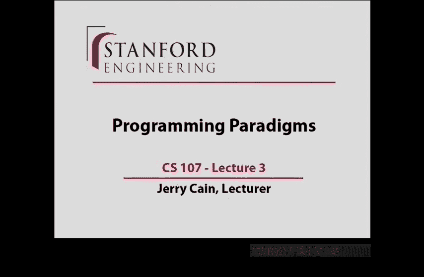
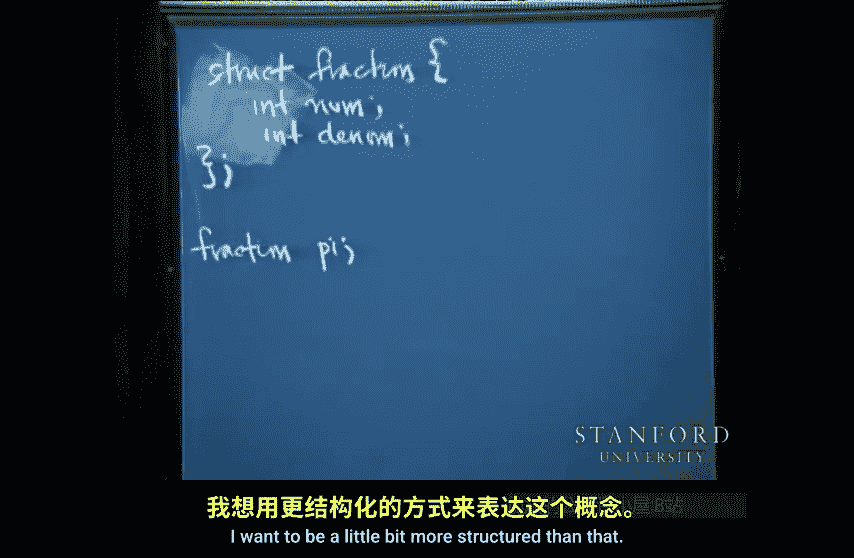

# 003：指针、内存布局与结构体




在本节课中，我们将深入学习指针操作、内存布局以及C语言中结构体的基本概念。我们将通过具体的代码示例，理解数据在内存中的存储方式以及如何通过指针进行访问和操作。

上一节我们介绍了指针和取地址运算符的基本用法，本节中我们来看看更复杂的类型转换和结构体的内存布局。

## 类型转换与内存解释

考虑以下代码：
```c
double d = 3.1416;
char ch = *(char*)&d;
```
变量 `d` 在内存中占据8个字节，存储着 `3.1416` 的二进制表示。表达式 `&d` 获取变量 `d` 的起始地址。`(char*)&d` 将这个地址强制解释为一个指向字符（1字节）的指针。最后，`*(char*)&d` 解引用这个指针，读取内存起始地址处的第一个字节。无论这个字节原本是什么比特模式，在此刻它都被当作一个 `char` 类型的值赋给了变量 `ch`。

接下来看一个更复杂的例子：
```c
short s = 45;
double d = *(double*)&s;
```
变量 `s` 是一个2字节的短整型，存储着数字45。`&s` 获取其地址，`(double*)&s` 将这个地址强行解释为指向一个8字节 `double` 类型的指针。解引用这个指针时，程序会尝试从 `s` 的地址开始读取8个字节。这非常危险，因为 `s` 之后的内存可能不属于当前变量，可能导致内存访问错误。如果侥幸没有崩溃，那么这8个字节的比特模式将被解释为一个 `double` 类型的值并赋给 `d`。

## 字节序（Endianness）

字节序指的是多字节数据在内存中的存储顺序。主要有两种：

*   **大端序**：最高有效字节存储在最低的内存地址。
*   **小端序**：最低有效字节存储在最低的内存地址。

例如，对于短整型数字 `1`（十六进制 `0x0001`）：
*   在大端序机器上，内存布局可能是：`0x00`（高地址）| `0x01`（低地址）。
*   在小端序机器上，内存布局可能是：`0x01`（低地址）| `0x00`（高地址）。

如果直接将内存字节从一个机器复制到另一个机器，而不考虑字节序，解释出的数值就会错误。在我们的课程中，大部分情况下无需担心此问题，但需要知道其存在。

## 结构体（Struct）的内存布局

现在让我们转向结构体。结构体允许我们将不同的数据类型组合成一个新的复合类型。

考虑以下结构体定义：
```c
struct fraction {
    int num;
    int denom;
};
```
这个结构体包含两个整型字段：`num`（分子）和 `denom`（分母）。

当我们声明一个变量时：
```c
struct fraction pi;
```
内存中会分配足够容纳两个 `int` 的空间（通常是8字节，假设 `int` 为4字节）。这些字节在内存中是连续、紧密排列的。

以下是其内存布局的可视化表示：



整个结构体的地址（`&pi`）与它的第一个字段 `num` 的地址（`&pi.num`）是相同的。字段 `denom` 紧接着存储在 `num` 之后的高地址处。


当我们通过指针操作结构体时，例如 `&pi`，这个地址指向的就是结构体起始位置，也就是字段 `num` 的开始。

本节课中我们一起学习了指针的强制类型转换及其风险、字节序的概念，以及C语言结构体的基本内存布局。理解数据在内存中的实际存储方式是掌握底层编程和调试复杂问题的关键。下一节我们将探讨数组以及结构体与数组的结合使用。