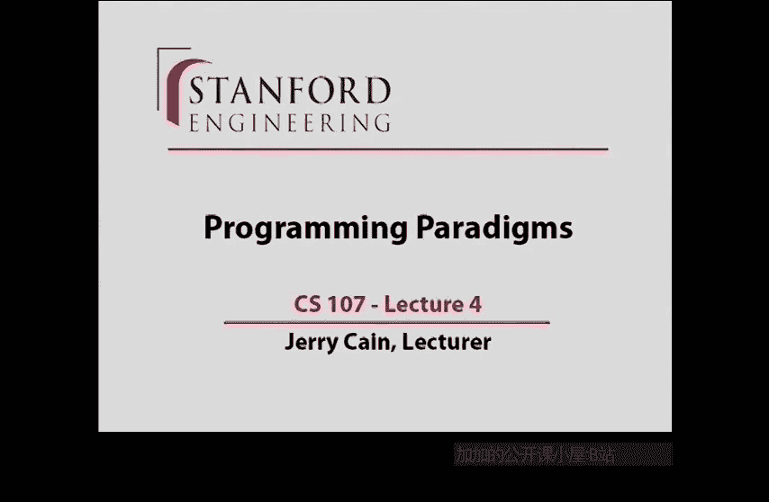
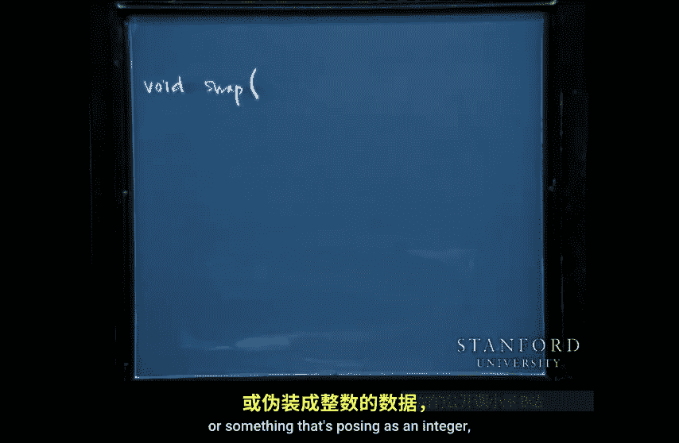

# 004：通用交换函数




在本节课中，我们将学习如何编写一个通用的交换函数，它能够交换任意类型的数据，而不仅仅是整数。我们将从回顾一个特定于整数的交换函数开始，然后探讨如何将其通用化，使用C语言中的`void*`指针和`memcpy`函数来实现。

上一节我们介绍了如何使用指针交换两个整数。本节中我们来看看如何将这个函数通用化，使其能够交换任意大小的数据。

## 回顾整数交换

以下是之前实现的整数交换函数代码：
```c
void swap(int* ap, int* bp) {
    int temp = *ap;
    *ap = *bp;
    *bp = temp;
}
```

这个函数通过指针`ap`和`bp`接收两个整数的地址。算法上，它交换了这两个地址所指向的整数。从表示层面看，它交换了这两个整数的位模式。

这个实现隐含地知道正在移动的字节数，因为`int`类型在编译时被理解为4字节的数据。如果我们想用这个函数交换`double`类型、`struct`或`class`，将无法实现。



## 通用交换函数的目标

我们希望编写一个版本的`swap`函数，能够交换两个任意大小的数据。这两个数据本身大小相同，但我们不希望将其限制为4字节。

在纯C语言中，实现这一目标的方法是使用通用指针类型`void*`。`void*`并不意味着它不指向任何东西，而是意味着它指向一个没有任何类型信息的东西。

函数原型如下：
```c
void swap(void* vp1, void* vp2, int size);
```
参数`vp1`和`vp2`指向内存中某些数据的起始地址。我们用“L”形而不是矩形来表示它们，因为我们不知道它们有多宽。`size`参数应明确指定为构成被交换数据的字节数。

## 实现通用交换

以下是通用交换函数的实现尝试，但存在一些问题：
```c
void swap(void* vp1, void* vp2, int size) {
    void temp = *vp1; // 错误：不能声明void类型的变量
    *vp1 = *vp2;      // 错误：不能解引用void*指针
    *vp2 = temp;
}
```
这里有两个问题：
1.  不能声明一个类型为`void`的变量`temp`。`void`仅用作函数的返回类型，表示没有返回值。
2.  不允许解引用`void*`指针。原因是它没有任何关于所指向数据大小的类型信息，不知道是处理1字节、2字节还是4字节的数据。

## 正确的实现方法

正确的实现需要利用一个临时缓冲区，并使用内存复制函数`memcpy`。`memcpy`函数可以按字节复制内存，而不关心数据内容。

以下是正确的实现代码：
```c
void swap(void* vp1, void* vp2, int size) {
    char buffer[size]; // 声明一个大小为`size`的字符缓冲区
    memcpy(buffer, vp1, size); // 将vp1指向的size字节复制到buffer
    memcpy(vp1, vp2, size);    // 将vp2指向的size字节复制到vp1
    memcpy(vp2, buffer, size); // 将buffer中的size字节复制到vp2
}
```
`char buffer[size];`声明了一个大小为`size`字节的字符数组，用作临时存储空间。`memcpy`函数将指定数量的字节从一个内存位置复制到另一个位置。

假设我们有一个8字节的数据。`memcpy(buffer, vp1, size);`会将`vp1`地址处的8字节位模式，逐字节地复制到`buffer`中。随后的`memcpy`调用则完成位模式的交换。

## 总结

本节课中我们一起学习了如何实现一个通用的数据交换函数。我们回顾了特定类型的交换函数的局限性，引入了`void*`通用指针和`size`参数来处理未知大小的数据。通过使用`memcpy`函数和临时缓冲区，我们成功地实现了一个能够交换任意大小、任意类型数据的通用`swap`函数。这种方法的核心思想是交换数据的底层位模式，而不关心其具体的类型含义。