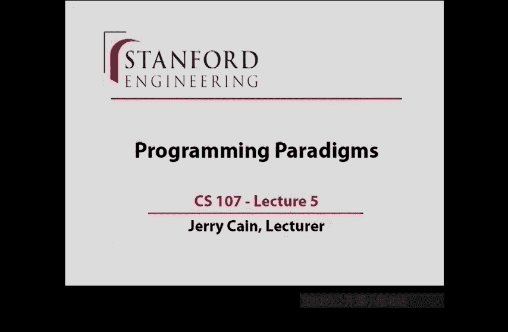
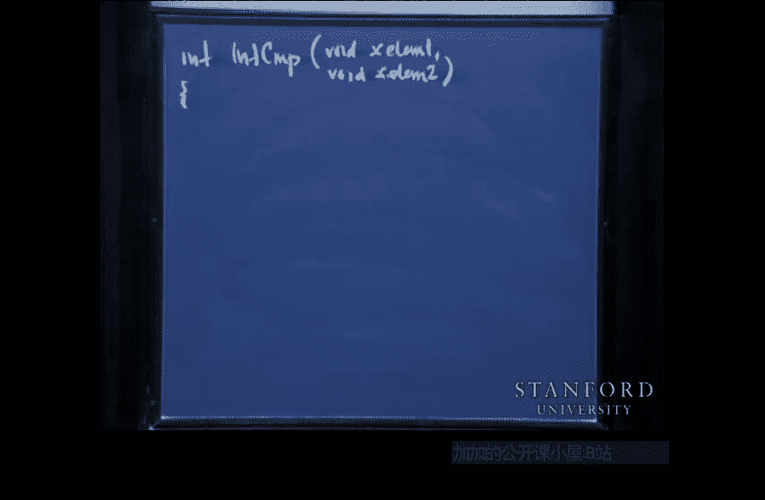

# 005：通用线性搜索实现




在本节课中，我们将学习如何用C语言实现一个通用的线性搜索函数。这个函数不依赖于任何特定的数据类型，可以用于搜索任何类型的数组。我们将重点理解如何通过指针运算和回调函数来实现这种通用性。


上一节我们讨论了从特定类型（如整数）的搜索转向通用搜索的需求。本节中我们来看看如何具体实现这个通用的 `lsearch` 函数。

## 函数原型与参数

`lsearch` 函数需要以下参数来执行通用搜索：
*   `void *key`: 指向要搜索的键值的指针。
*   `void *base`: 指向数组起始位置的指针。
*   `int n`: 数组中元素的数量。
*   `int elemSize`: 数组中每个元素的大小（以字节为单位）。
*   `int (*cmpFn)(void *, void *)`: 一个指向比较函数的指针。该函数接收两个 `void*` 参数并返回一个整数（0表示相等）。

## 核心算法实现

线性搜索从前到后遍历数组的基本算法不变。关键在于我们需要一种不关心具体数据类型的方式来访问和比较元素。

以下是 `lsearch` 函数的核心实现逻辑：

```c
void *lsearch(void *key, void *base, int n, int elemSize, int (*cmpFn)(void *, void *)) {
    for (int i = 0; i < n; i++) {
        // 计算第 i 个元素的地址
        void *elemAddr = (char *)base + i * elemSize;
        // 使用客户端提供的比较函数进行比较
        if (cmpFn(key, elemAddr) == 0) {
            return elemAddr; // 找到匹配项，返回其地址
        }
    }
    return NULL; // 未找到匹配项
}
```

**代码解析**：
1.  **地址计算**：`(char *)base + i * elemSize` 是关键的指针运算。由于 `void*` 指针不能直接进行算术运算，我们将其临时转换为 `char*` 类型。`char` 的大小为1字节，因此 `(char *)base` 移动 `i * elemSize` 个字节后，就精确地指向了数组中的第 `i` 个元素。
2.  **通用比较**：我们不再使用 `==` 运算符直接比较，而是调用客户端传入的 `cmpFn` 函数。这确保了无论数组存储的是什么类型的数据，都能用正确的方式进行比较。

## 如何使用通用搜索函数

理解代码实现后，使用它作为客户端同样重要。我们需要准备数据并提供一个正确的比较函数。

假设我们有一个整数数组，并想在其中搜索数字 `7`。

以下是调用 `lsearch` 的步骤：

```c
int array[] = {4, 2, 9, 7, 1, 7};
int key = 7;
int n = 6;

// 调用 lsearch 进行搜索
int *found = (int *)lsearch(&key,        // 要搜索的值的地址
                            array,       // 数组起始地址
                            n,           // 元素个数
                            sizeof(int), // 每个元素的大小
                            intCmp);     // 整数比较函数

if (found == NULL) {
    printf("未找到。\n");
} else {
    printf("找到值：%d\n", *found);
}
```

## 编写比较函数

`lsearch` 的第五个参数需要一个特定原型的函数：`int (*)(void *, void *)`。我们必须提供一个匹配此原型的函数。

以下是用于比较两个整数的 `intCmp` 函数实现：

```c
int intCmp(void *vp1, void *vp2) {
    // 1. 将 void* 指针转换为 int* 指针
    int *ip1 = (int *)vp1;
    int *ip2 = (int *)vp2;
    // 2. 解引用指针，获取实际的整数值
    // 3. 使用整数减法来实现比较（返回0表示相等）
    return *ip1 - *ip2;
}
```

**函数解析**：
*   参数是两个 `void*` 指针，它们分别指向要比较的两个值（例如，搜索键 `key` 和数组中的某个元素 `elemAddr`）。
*   在函数内部，我们首先将通用的 `void*` 指针转换回我们知道的具体类型指针 `int*`。
*   然后，通过解引用（`*` 操作符）获取指针所指向的实际整数值。
*   最后，返回两个整数的差。按照约定，如果差值为 `0`，则两个值相等，`lsearch` 函数即认为找到了匹配项。

---

本节课中我们一起学习了如何实现和使用一个通用的线性搜索函数。我们掌握了几个核心概念：
1.  使用 `void*` 指针来编写不依赖特定数据类型的通用代码。
2.  通过将 `void*` 转换为 `char*` 并结合元素大小（`elemSize`）进行指针运算，来访问数组中的任意元素。
3.  利用**回调函数**（`cmpFn`）将数据比较的逻辑从通用算法中分离出来，交由客户端提供。这是实现通用性的关键。
4.  作为客户端，需要正确传递数据地址、元素大小，并实现一个符合 `int (*)(void *, void *)` 原型的比较函数。



通过这种方式，同一个 `lsearch` 函数可以用于搜索整数数组、字符串数组、结构体数组等任何数据类型，只要提供相应的比较函数即可。