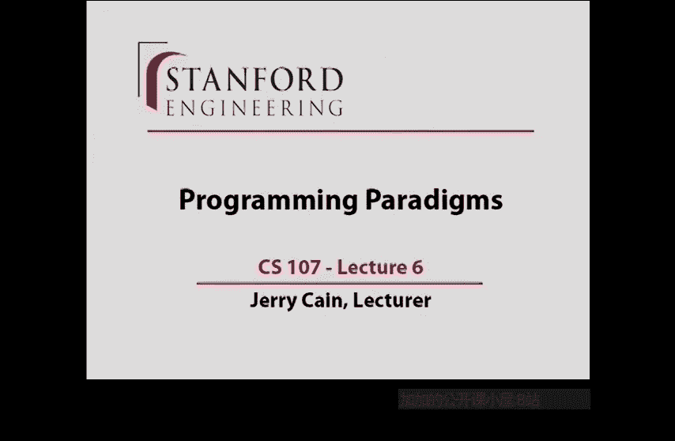
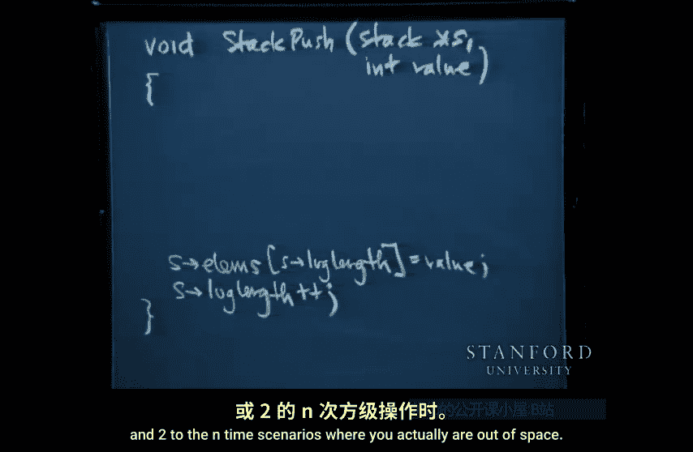

# 006：C语言栈实现详解




在本节课中，我们将学习如何使用纯C语言实现一个整数栈。我们将从栈的基本结构开始，逐步实现其初始化、销毁、压入和弹出操作，并重点关注动态内存管理。

## 栈结构定义与接口

上一节我们介绍了栈的基本概念，本节中我们来看看如何在C语言中定义栈的结构和操作接口。

在C语言中，我们没有类的概念，因此通过结构体和一组操作函数来模拟对象。栈的接口定义在头文件中，结构体的所有成员都是公开的。

```c
typedef struct {
    int *elems;          // 指向动态数组的指针
    int logicalLength;   // 栈中当前元素数量
    int allocatedLength; // 数组已分配的空间大小
} stack;
```

以下是栈的操作函数原型：
*   `stackNew`：初始化一个栈结构。
*   `stackDispose`：销毁一个栈，释放其占用的内存。
*   `stackPush`：将一个整数压入栈顶。
*   `stackPop`：从栈顶弹出一个整数。

## 栈的初始化与销毁

现在，我们开始实现栈的初始化和销毁函数。

### 栈初始化 (`stackNew`)

`stackNew` 函数负责将一个已分配内存的 `stack` 结构体初始化为一个空栈。

```c
void stackNew(stack *s) {
    s->logicalLength = 0;                 // 栈初始为空
    s->allocatedLength = 4;               // 初始分配4个整数的空间
    s->elems = (int*)malloc(4 * sizeof(int)); // 分配内存
    assert(s->elems != NULL);              // 确保内存分配成功
}
```

代码解析：
1.  `logicalLength` 设置为0，表示栈为空。
2.  `allocatedLength` 初始化为4，这是我们为栈元素数组预分配的大小。
3.  调用 `malloc` 动态分配足够容纳4个整数的内存块，并将返回的地址赋给 `elems` 指针。
4.  使用 `assert` 宏检查 `malloc` 是否成功，若失败（返回 `NULL`）则程序终止并报错。

### 栈销毁 (`stackDispose`)

`stackDispose` 函数负责清理栈占用的资源，主要是释放动态分配的数组内存。

```c
void stackDispose(stack *s) {
    free(s->elems); // 释放存储栈元素的数组
}
```

重要说明：
*   我们只释放 `s->elems` 指向的内存，而不释放 `s` 本身。因为 `stackNew` 并不负责分配 `stack` 结构体的内存，它只是初始化一个由调用者提供的现有结构体。这个结构体可能是在栈上分配的局部变量，也可能是动态分配的。
*   对于当前存储整数的栈，我们只需释放数组。但如果栈存储的是指向动态内存的指针（例如字符串），则需要在释放数组前，先遍历并释放其中每个元素指向的内存，以避免内存泄漏。当我们后续实现通用栈时，会考虑这一点。

## 栈的压入操作

接下来，我们实现栈的核心操作之一——压入 (`stackPush`)。这个函数的有趣之处不仅在于添加元素，更在于当数组空间不足时如何动态扩展。

### 基本压入逻辑

当栈的当前逻辑长度小于已分配长度时，压入操作很简单。

```c
void stackPush(stack *s, int value) {
    // 检查空间是否足够，若不够则扩展内存（代码见下一部分）
    // ...
    // 空间足够时，执行压入
    s->elems[s->logicalLength] = value;
    s->logicalLength++;
}
```

代码解析：
1.  `logicalLength` 既表示栈的当前深度，也指示了下一个元素应该插入的数组索引位置。
2.  将 `value` 存入数组的 `logicalLength` 索引处。
3.  将 `logicalLength` 加1，为下一次压入做准备。

### 动态数组扩容策略

当尝试压入元素但数组已满时（即 `logicalLength == allocatedLength`），我们需要分配一个更大的数组。



以下是处理扩容的步骤：
1.  将 `allocatedLength` 加倍（这是一种常用策略，并非唯一选择）。
2.  使用 `malloc` 分配一个大小为 `newAllocatedLength * sizeof(int)` 的新数组。
3.  将旧数组中的所有元素复制到新数组中。
4.  释放旧数组占用的内存。
5.  更新栈的 `elems` 指针，使其指向新数组。
6.  更新 `allocatedLength` 为新的大小。

```c
if (s->logicalLength == s->allocatedLength) {
    // 空间不足，需要扩容
    s->allocatedLength *= 2; // 分配长度加倍
    int *newElems = (int*)malloc(s->allocatedLength * sizeof(int));
    assert(newElems != NULL);

    // 复制旧数据
    for (int i = 0; i < s->logicalLength; i++) {
        newElems[i] = s->elems[i];
    }

    // 释放旧数组，更新指针
    free(s->elems);
    s->elems = newElems;
}
// 然后执行压入操作...
```

## 总结

本节课中我们一起学习了如何使用纯C语言实现一个整数栈。我们定义了栈的结构体，并实现了四个关键函数：`stackNew` 用于初始化栈，`stackDispose` 用于清理资源，`stackPush` 用于压入元素并处理数组的动态扩容。我们重点理解了C语言中手动管理内存的方式，包括使用 `malloc` 分配和 `free` 释放内存，以及通过 `assert` 进行错误检查。这个实现为后续学习更通用的、可存储任意数据类型的栈打下了基础。