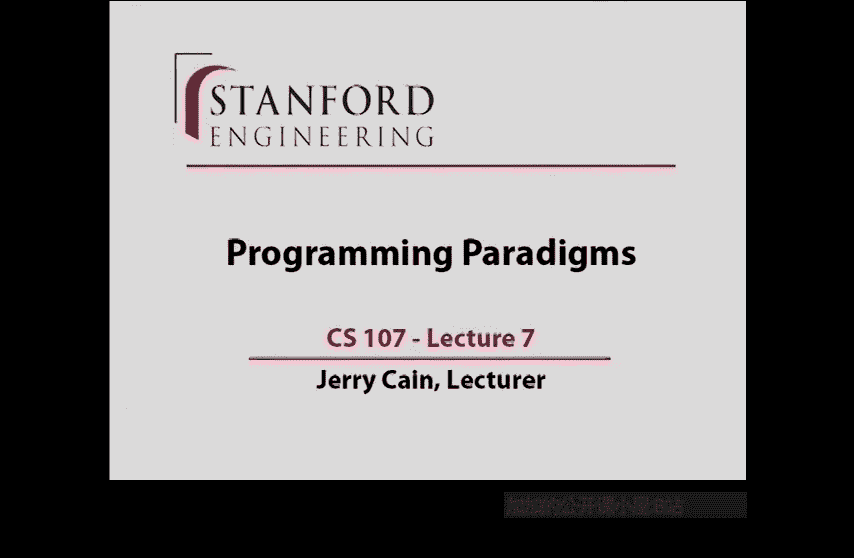
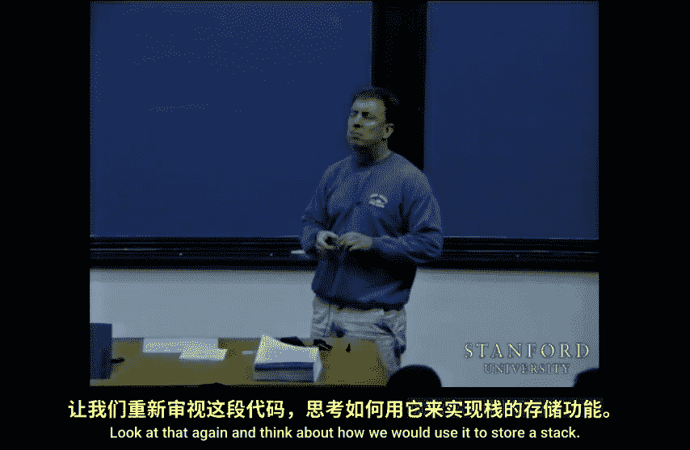
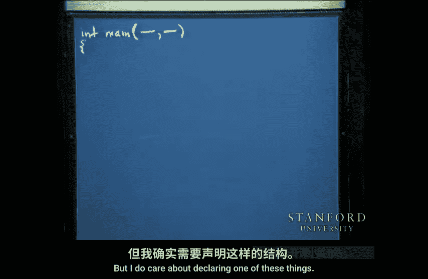
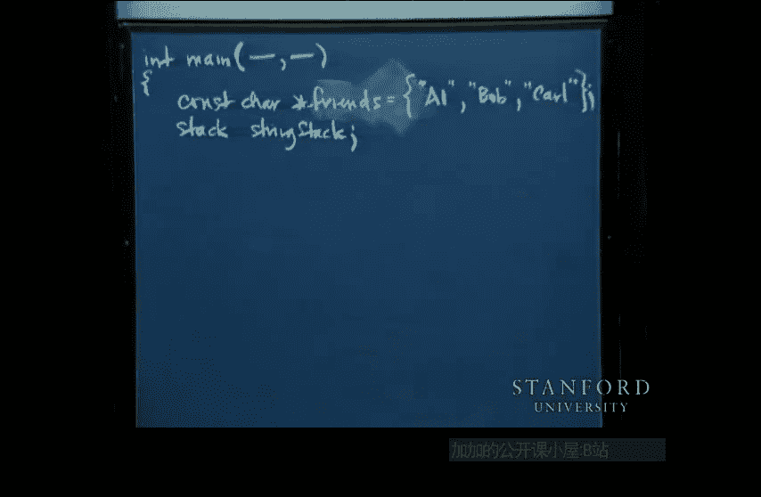
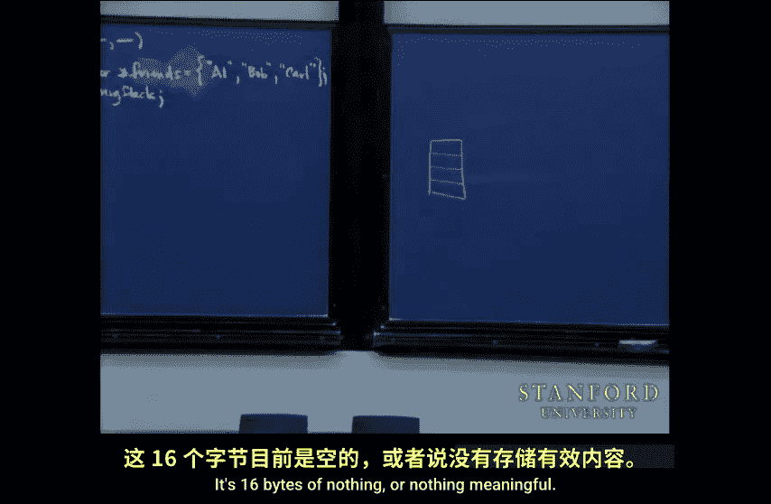
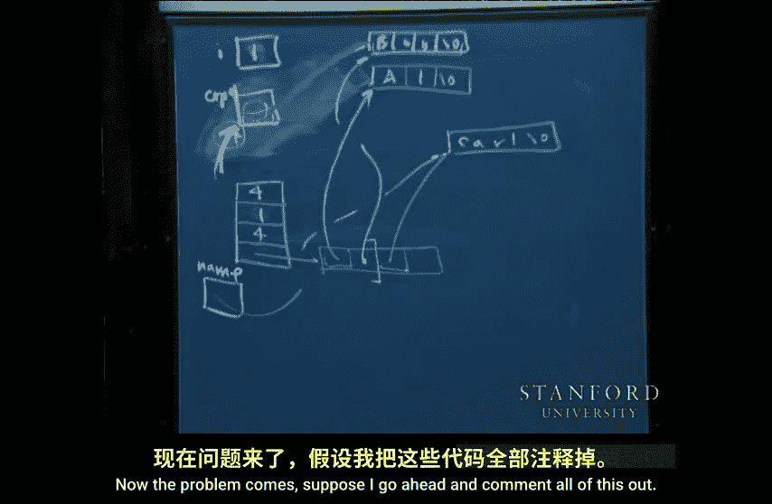

# 007：通用栈与C字符串操作



本课程由斯坦福大学专业发展中心提供。


大家好。今天有一份讲义发给大家，是第三次作业。这份作业在下周四晚上截止。你们将在下周三收到第四次作业，它将在再下一个周四晚上截止。此外，几周后的周三会有一份书面习题集，不需要提交，但会为接下来的周三晚上的期中考试提供一系列需要掌握的书面问题。届时我会在发放时详细说明。

上一节我们介绍了通用栈的完整实现。为了简化，我们当时主要关注了存储`int`、`double`、`char`和`bool`类型。现在，我们将暂时搁置实现细节约10到15分钟，重新审视它，并思考如何使用这个通用栈来存储一组字符串，并以相反的顺序打印它们。

接下来要展示的代码本质上只是逆序打印一个数组，但其目的是为了演示在存储C风格字符串时，使用那四个栈操作函数（`new`、`push`、`pop`、`dispose`）的机制。这在后续处理C字符串时非常重要，因此我们现在进行这个练习。

假设这是你的`main`函数。我们不关心`argc`和`argv`，但需要声明一个栈。



我将强调这是一个字符串栈。





我的目标是压入这四个字符串的深拷贝。定义`const char*`数组，我们称之为`friends`，并初始化为以下值。

```c
const char* friends[] = {"Al", "Bob", "Carl"};
```

接下来，声明一个栈。根据之前的类型定义，此时栈的图示并不复杂。






它只是一个16字节的空（或无意义）内存块。然后，我们调用`StackNew`。

```c
StackNew(&stringStack, sizeof(char*));
```

这里传入`sizeof(char*)`。现在情况变得有点复杂了。我们要求栈跟踪动态分配的C字符串的地址。所以，栈初始化后，我们得到这样的结构：它指向一个16字节的内存块，栈深度为0，但为元素预留了空间。这里的`4`实际上就是`sizeof(char*)`。

现在，我们用一个`for`循环来创建每个字符串的拷贝。

```c
for (int i = 0; i < 3; i++) {
    char* copy = strdup(friends[i]);
    // ...
}
```

`copy`是一个足够重要的变量，值得画图说明。在第一次迭代（`i = 0`）时，`copy`被设置为指向堆中`friends[0]`（即`"Al"`）的一个深拷贝。

当我们向栈中压入一个元素时，**所有权从我们转移到了栈**。基于此，我们这样调用`StackPush`：

```c
StackPush(&stringStack, &copy);
```

这里存在一些争议：下一个参数应该是什么？由于我们存储的是`char*`，这意味着栈需要保存这些4字节的字符指针。因此，我们必须传入一个`char*`的地址，这样栈才知道去那个地址复制4字节的内容到栈内存中。这能理解吗？

传入`&copy`后，栈会复制`copy`变量中的内容（即那个地址），将其存入栈中，并将栈深度计数器加1。

在第二次迭代中，`copy`被重新声明和初始化，指向`"Bob"`。我们再次传入`&copy`，栈复制其中的地址值。这个过程就像循环吹起了三个分别写着Al、Bob、Carl名字的气球，然后栈在幕后通过`memcpy`复制了这些“气球线”（即字符串地址）。我们正在将这三个动态分配的字符串拷贝的所有权转移给栈。

接下来，我们想打印这些字符串，这需要从栈中取回所有权。

```c
for (int i = 0; i < 3; i++) {
    char* name;
    StackPop(&stringStack, &name);
    printf("%s\n", name);
    free(name);
}
```

我们希望栈将最近压入的字符串地址放回`name`变量所指向的空间。第一次`pop`时，`name`会指向`"Carl"`，同时栈的逻辑长度减为2。理解了吗？

然后我们可以用`printf`打印这个字符串，并用`free`释放`name`指向的内存，将其归还给堆。

为了保持代码整洁，最后我们调用：

```c
StackDispose(&stringStack);
```

传入`&stringStack`。至此完成。

这里`StackPush`和`StackPop`调用中的`&`（取地址符）通常不会让人意外，因为`stringStack`是函数栈帧上的一个直接分配的变量，我们需要传递它的地址。

但是，`&copy`和`&name`这里的`&`常常让人困惑。如果省略它们，基于之前例子的同样原因，代码可能仍能编译运行。但如果你向`StackPush`提供了`copy`的地址（`&copy`），那么你就做对了。如果你省略了`&`，直接传入`copy`的值，栈会去复制`"Bob\0"`这些字符本身，仿佛它们是一个地址，并将其复制到栈内存中。这显然不是我们想要的。理解了吗？

现在，问题来了。



假设我注释掉所有代码，或者把循环条件改为`i < 2`之类的。在某个时刻，我...

（注：原文在此处中断，教程内容结束）

---

**本节课总结**


本节课我们一起学习了如何利用之前实现的通用栈来存储C风格字符串。我们通过一个逆序打印字符串数组的例子，详细演示了栈的四个核心操作（`new`、`push`、`pop`、`dispose`）在处理指针类型（如`char*`）时的具体用法，特别是**所有权转移**的概念以及传递变量地址（`&`操作符）的重要性。理解这些机制是后续高效、安全地操作C字符串和动态内存的基础。