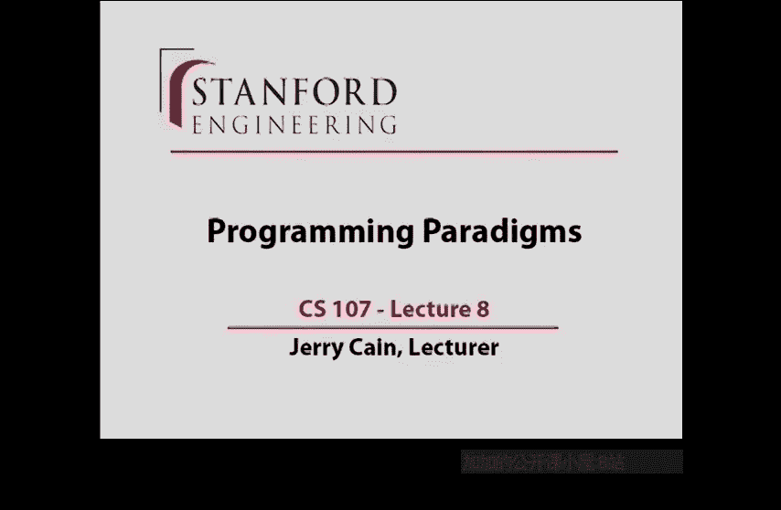
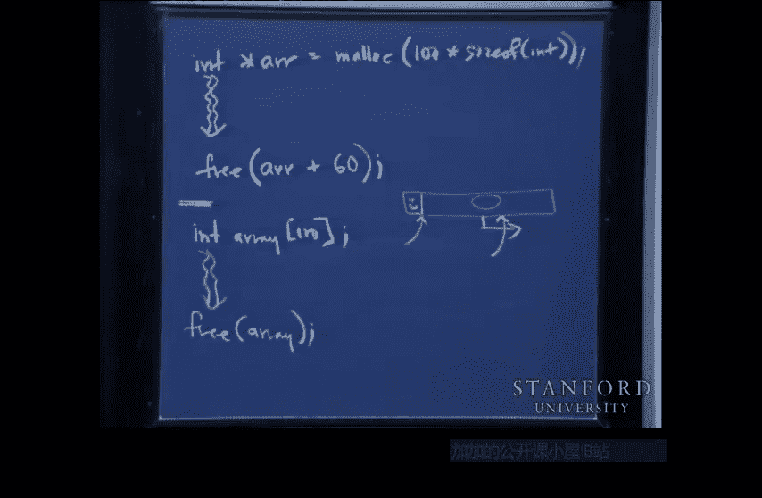

# 008：堆内存管理




## 概述
在本节课中，我们将要学习C语言中堆内存的管理机制。我们将深入探讨`malloc`、`free`和`realloc`函数在幕后是如何工作的，特别是它们如何通过一个“头部”结构来记录内存块的大小，以及为什么某些看似合理的操作会导致未定义行为。


## 内存布局与堆段

上一节我们介绍了内存的不同分段。本节中我们来看看堆段的具体管理方式。

每个应用程序在运行时都表现得好像它拥有全部内存。实际上，堆的起始和结束地址会在程序加载时告知一个库，这个库负责实现`malloc`、`free`和`realloc`。

堆本质上是一个字节的“沙盒”。`malloc`负责分配地址。在幕后，它会记录每个分配块的实际大小，这样当`free`被调用并传入一个指针时，它就知道应该将多少内存归还给堆。

## 内存分配的幕后机制

因为堆是由软件管理的，所以`malloc`和`free`的实现者可以使用任何他们认为能使其运行得更快、更高效、更正确的启发式算法。

你一直以来的印象是，当你写下这样的代码时：
```c
int *arr = malloc(40 * sizeof(int));
```
你认为你恰好得到了160字节。但事实并非如此。系统实际上为你预留了超过160字节的空间。

假设这是堆，`malloc`会找到一个足够大的节点来满足这个请求。我们可能认为它恰好是160字节，但实际上返回给你的地址指向的节点更大。

## 内存块头部

在你获得指针之前，如果你请求160字节，系统通常会预留164或168字节。这是因为它会在完整节点的**开头**预留一小块空间（例如4、8、16或32字节），作为**头部**，用于记录该节点的大小信息。

例如，如果实际数据是160字节，头部是4字节，那么系统可能会在这4字节中写入数字`164`。

当你获得一个指针时，你得到的并不是整个节点起始处的指针，而是从起始处偏移了4或8字节的地址。这意味着你似乎可以访问从该指针开始的所有空间。

当你将这个指针传回给`free`时，`free`会假设这是一个它之前分配出去的指针。它会将这个指针转换为`int*`或`long*`等类型，以便优雅地向回移动4或8字节，读取它之前写入头部的信息（比如数字`164`），从而知道需要将多少字节的内存重新整合回堆中。

## 常见错误与未定义行为

理解了上述机制后，我们来看看几个问题，并理解它们为何无法正常工作。

**场景一：释放部分数组**
```c
int *arr = malloc(100 * sizeof(int));
// ... 使用数组，假设只用了前60个元素 ...
free(arr + 60); // 错误！
```
如果你尝试释放`arr + 60`，`free`会盲目地向回移动4或8字节，将`arr[58]`和`arr[59]`所在位置的内存位模式解释为头部信息（比如大小）。如果那里恰好存储着数字`29000`，`free`就会尝试将一个29000字节的块整合回堆，这完全破坏了堆的数据结构。因此，你不能这样做。

**场景二：释放静态数组**
```c
int arr[100];
// ... 使用数组 ...
free(arr); // 错误！
```
如果你静态分配了一个数组（不涉及堆），然后尝试`free`它，`free`同样不会进行错误检查来确认这个地址是否在堆段内。它会走到你静态数组的基地址，向回移动4或8字节，将那里碰巧存在的位模式解释为某个节点的大小，并尝试将其整合到空闲节点集合中。这必然导致程序崩溃或数据损坏。

## 实现策略与错误检查

最好的（或者说最快的）实现通常不进行错误检查，它们使用启发式算法来确保尽可能快地运行。有些实现可能会维护一个已分配指针的集合，并在调试模式下检查传入`free`的指针是否在该集合中，如果不在则报错。但在非调试模式下，为了速度，它们可能不做此类检查。



## 总结
本节课中我们一起学习了C语言堆内存管理的核心机制。我们了解到：
*   `malloc`分配的内存块包含一个记录大小的**头部**。
*   返回给用户的指针指向头部之后的数据区。
*   `free`通过回退指针并读取头部信息来确定要释放的内存大小。
*   **不能**释放非`malloc`/`realloc`返回的指针（如静态数组地址）。
*   **不能**释放指向分配块内部的指针（如`arr + 60`）。
*   许多`malloc`/`free`的实现为了追求速度，默认不进行严格的错误检查，因此程序员必须确保正确使用这些函数。