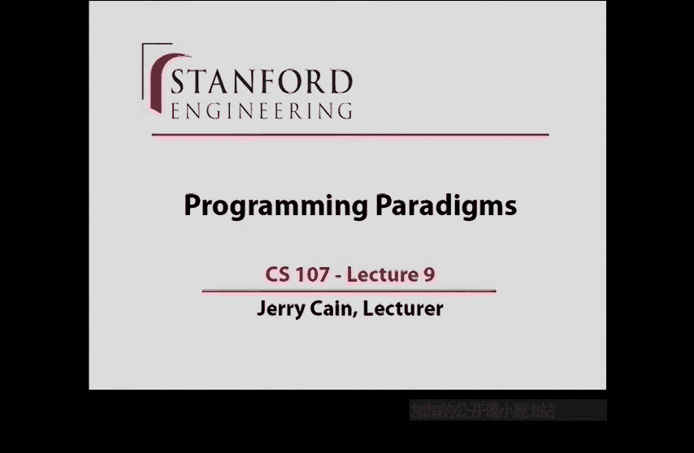
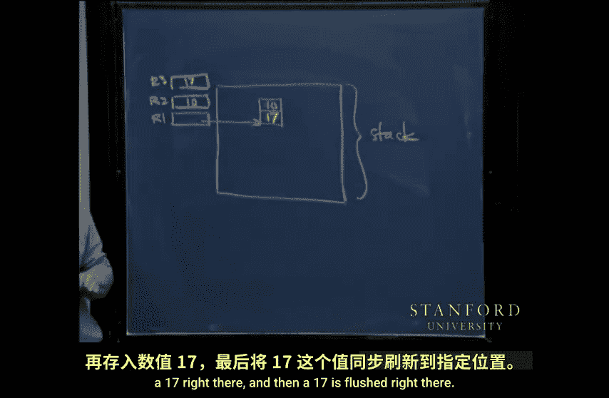

# 009：斯坦福大学【中英⚡编程范式｜CS107 Programming Paradigms】 p09 P9 ) -BV1aJ1EBHEoN_p9-





本演示由斯坦福大学专业发展中心提供。


在本节课中，我们将学习计算机体系结构和汇编语言的基础知识。我们将探讨C/C++代码片段如何编译为汇编代码，理解内存模型，并了解函数调用和返回的工作原理。我们将使用一个为CS107课程设计的模拟汇编语言来展示加法、乘法、除法、函数调用、返回和指针等操作在硬件层面是如何实现的。

上一节我们介绍了栈段和活动记录的概念。本节中，我们来看看如何通过汇编指令来操作活动记录中的变量。

这里有一段简单的C代码块：
```c
int i;
int j;
i = 10;
j = i + 7;
j++;
```

我们假设 `i` 和 `j` 被打包在一个8字节的活动记录中，并位于栈段的某个位置。寄存器 `R1` 存储着这个活动记录的基地址。

为了将值 `10` 存入变量 `i` 的位置，我们不需要直接处理 `i` 的绝对地址，而是使用相对于基地址 `R1` 的偏移量。在我们的模拟汇编语言中，对应的指令是：
```
M[R1 + 4] = 10
```
这条指令是一个**存储**操作。`M` 代表整个内存（RAM），可以将其视为一个巨大的字节数组。`R1 + 4` 计算出了变量 `i` 在内存中的确切地址，并将值 `10` 存入该地址。

接下来，我们需要执行 `j = i + 7`。最稳健的方法是先获取 `i` 的值，在寄存器中完成加法，再将结果写回 `j` 的位置。这涉及以下步骤：

首先，我们需要将 `i` 的值从内存加载到寄存器中。这是一个**加载**操作：
```
R2 = M[R1 + 4]
```
执行后，寄存器 `R2` 中包含了变量 `i` 的4字节位模式（即值 `10`）。

然后，我们在寄存器中执行加法运算。这是一个**算术逻辑单元**操作：
```
R3 = R2 + 7
```
这条指令将寄存器 `R2` 中的值与立即数常量 `7` 相加，并将结果存入寄存器 `R3`。现在 `R3` 中存储着值 `17`。

最后，我们需要将结果 `17` 存储到变量 `j` 的位置。这又是一个**存储**操作：
```
M[R1 + 8] = R3
```
这里，`R1 + 8` 是变量 `j` 相对于基地址的偏移量。



至此，我们完成了 `j = i + 7` 的汇编实现。这个“加载-运算-存储”的指令序列在C/C++的赋值语句编译中非常常见。

对于最后一行代码 `j++`，其本质是 `j = j + 1`。其汇编实现结构与上面类似：
```
R2 = M[R1 + 8]
R2 = R2 + 1
M[R1 + 8] = R2
```
我们首先将 `j` 的值加载到寄存器 `R2`，然后将其加1，最后将新值存回 `j` 的内存位置。在这个过程中，我们可以复用寄存器，只要不再需要旧值即可。

关于这些指令，有几点需要注意：默认情况下，所有的加载、存储和ALU操作都处理4字节的量。这是因为在C/C++编程中，指针和整型是最常见的原子类型，硬件默认优化了对4字节数据的处理。当然，我们也可以处理字符、短整型、双精度浮点数或整个结构体，但本节课我们主要关注4字节的操作。

你可能会问，为什么我们不直接写成 `R3 = 10 + 7` 呢？原因是，我们希望生成的汇编代码是上下文无关且健壮的。上面展示的三条指令块能够正确工作，即使我们改变了源代码中 `i` 的初始值（例如将 `i = 10` 改为 `i = 20`），汇编代码也无需修改就能正确计算出 `j` 的新值。这种生成方式保证了代码的通用性。

本节课中，我们一起学习了如何将简单的C语言赋值语句翻译成底层的汇编指令。我们了解了**加载**、**存储**和**ALU运算**这三种基本操作，并通过一个具体例子看到了“加载-运算-存储”这一通用模式是如何实现变量赋值和计算的。我们还理解了使用基地址加偏移量的方式来访问局部变量，以及生成上下文无关的汇编代码的重要性。这些是理解程序如何在硬件层面运行的基础。