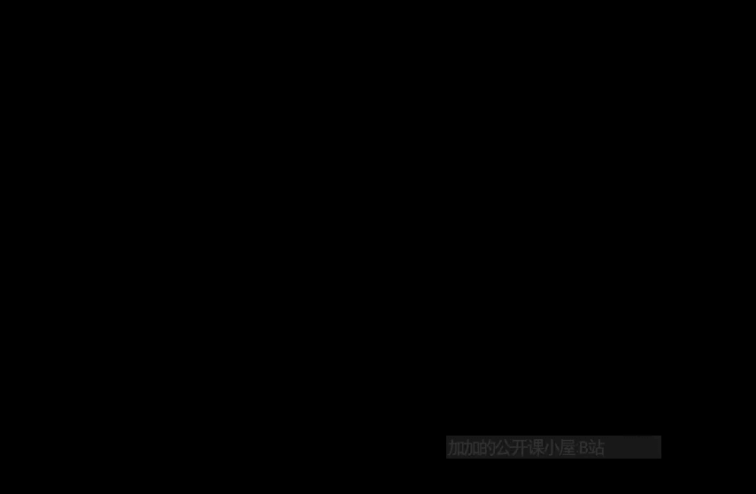
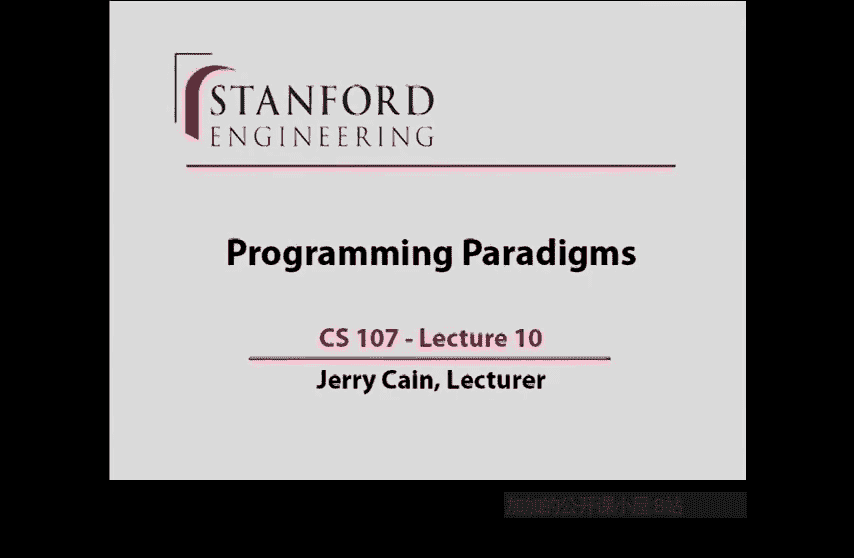
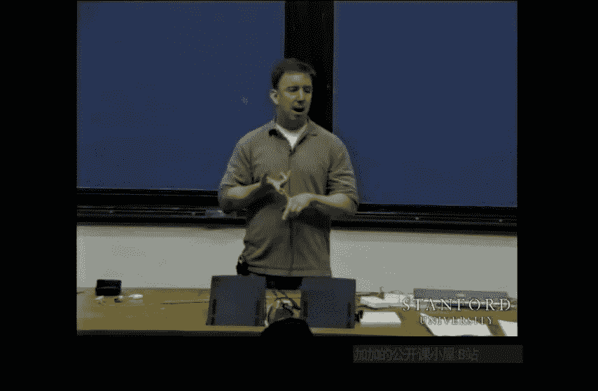
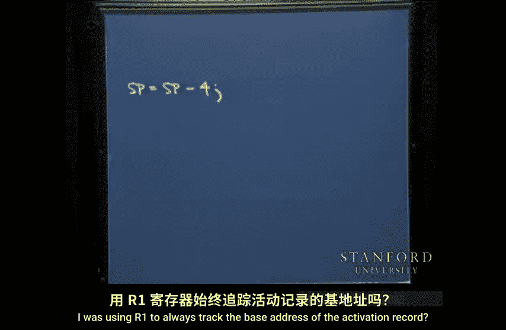

# 010：第10讲 - 函数调用与栈帧详解 🖥️





在本节课中，我们将深入学习函数调用时栈内存的具体布局，特别是栈帧（或称活动记录）的构成。我们将通过一个具体的C语言函数示例，详细拆解参数、局部变量以及关键控制信息在内存中的排列方式。

上一节我们介绍了栈内存的基本概念和局部变量的存储。本节中我们来看看当一个函数被调用时，其完整的栈帧是如何构建的。

## 栈帧的完整结构



考虑以下函数原型：
```c
void foo(int bar, int *baz) {
    char qux[4];
    short *quux;
    // ... 函数体代码
}
```
函数 `foo` 接收一个整型参数 `bar` 和一个整型指针参数 `baz`，并在内部声明了一个4字节的字符数组 `qux` 和一个指向短整型的指针 `quux`。

这个函数的栈帧在内存中的布局并非随意。其完整结构如下图所示（地址从下往上增长）：

```
高地址
+-------------------+
|  返回地址 (PC)    |  // 调用者下一条指令地址
+-------------------+
|       baz         |  // 第二个参数
+-------------------+
|       bar         |  // 第一个参数
+-------------------+
|       ...         |  // 可能的其他空间
+-------------------+
|      *quux        |  // 局部变量：指针
+-------------------+
|    qux[0..3]      |  // 局部变量：字符数组
+-------------------+
低地址  <-- 栈指针 (SP)
```

关于此布局，有几个关键点需要注意：
*   参数（`bar`, `baz`）被压入调用者的栈帧顶部，顺序是从右向左。即最后一个参数（`baz`）先入栈（位于较低地址），第一个参数（`bar`）后入栈（位于较高地址）。
*   局部变量（`qux`, `quux`）在函数被调用后，在自身的栈帧内分配空间，位于参数的下方（更低地址处）。
*   在参数和局部变量之间，存在一个保存的**程序计数器（PC）值**，通常称为“返回地址”。它记录了当 `foo` 函数执行完毕后，应该跳转回调用者（例如 `main` 函数）的哪条指令继续执行。

## 栈帧的构建过程

现在，我们通过一个调用示例来看栈帧是如何在运行时动态构建的。假设 `main` 函数如下：

```c
int main(int argc, char *argv[]) {
    int i = 4;
    foo(i, &i);
    return 0;
}
```

当 `main` 函数开始执行时，它已经拥有一个部分构建的栈帧，其中包含了传入的参数 `argc` 和 `argv`。当执行到 `foo(i, &i)` 这一行时，会发生以下步骤：

1.  **参数压栈**：调用者（`main`）负责将参数按从右到左的顺序压入当前栈顶。首先计算 `&i` 的地址并压栈，然后将 `i` 的值（4）压栈。
2.  **调用指令**：执行 `call foo` 指令。该指令会做两件事：首先将**下一条指令的地址（返回地址）**压入栈中，然后跳转到 `foo` 函数的代码起始处。
3.  **分配局部变量空间**：进入 `foo` 函数后，函数序言代码会通过移动**栈指针（SP）** 来为局部变量分配空间。例如，为 `qux` 数组和 `quux` 指针分配总共8字节空间（假设4字节对齐），指令类似于 `SP = SP - 8`。
4.  **栈指针与帧指针**：在之前的简化模型中，我们使用一个通用寄存器（如R1）指向栈帧基址。在实际架构中，通常有一个专用寄存器**帧指针（FP或BP）** 来稳定地指向当前栈帧的起始处（即保存的返回地址附近），而**栈指针（SP）** 则总是指向栈的当前最低地址（即最后一个分配的局部变量处）。

通过以上步骤，`foo` 函数的完整栈帧就在内存中构建完毕了。函数执行期间，通过帧指针的固定偏移可以访问参数和局部变量。函数返回时，过程相反：释放局部变量空间、弹出返回地址并跳转、由调用者清理参数栈空间。



本节课中我们一起学习了函数栈帧的详细内存布局和构建过程。我们明确了参数从右向左压栈的规则，理解了返回地址的关键作用，并跟踪了从函数调用到分配局部变量的完整步骤。掌握这些细节对于理解程序底层执行机制、调试内存问题至关重要。下一讲我们将继续利用这些知识，深入探讨更复杂的控制流和数据结构在栈上的表现。