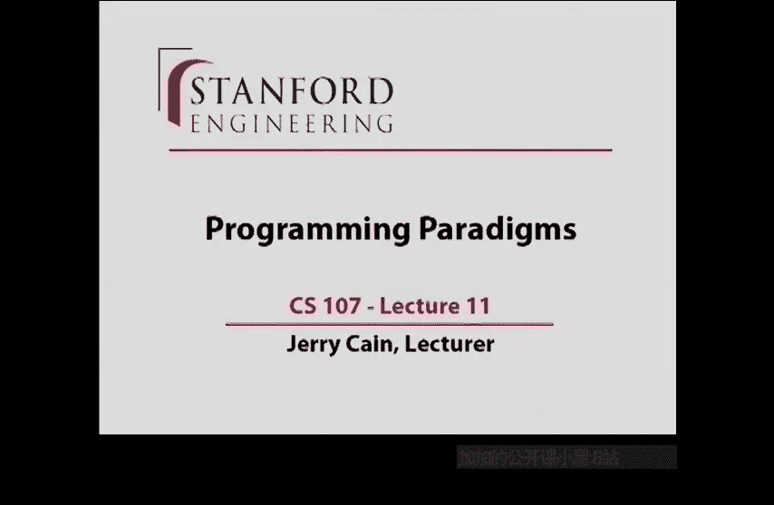
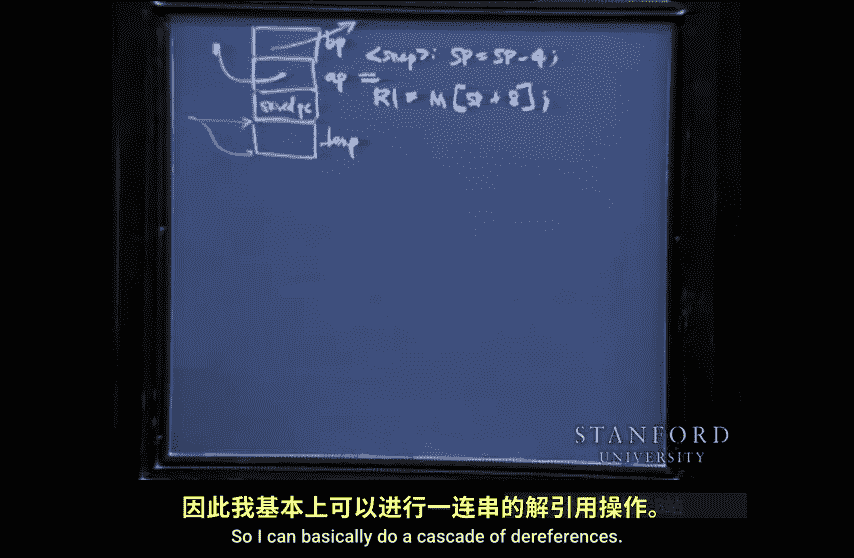

# 011：函数调用与栈帧管理




本课程由斯坦福大学专业发展中心提供。


## 概述
在本节课中，我们将学习函数调用在汇编层面的实现机制，特别是栈帧的构建与销毁过程。我们将通过一个简单的 `swap` 函数示例，对比C语言指针版本和C++引用版本在汇编层面的异同，并详细分析其栈帧布局。

## 函数 `foo` 的栈帧构建
上一节我们介绍了函数调用的一般原理。本节中，我们来看看一个具体函数 `foo` 的栈帧是如何构建的。

我们首先定义一个 `void foo()` 函数，它分配两个局部变量 `x` 和 `y`，并调用 `swap` 函数。

```c
void foo() {
    int x = 11;
    int y = 17;
    swap(&x, &y);
}
```

当 `foo` 被调用时，栈指针（SP）指向调用者保存的返回地址（PC）。函数 `foo` 需要为它的两个局部变量分配空间。

以下是 `foo` 函数开始执行时栈帧的初始状态和操作步骤：

1.  **保存返回地址**：栈顶（SP指向的位置）保存着调用 `foo` 的指令的下一条指令地址。
2.  **分配局部变量空间**：栈指针向下移动，为 `x` 和 `y` 分配空间。假设每个 `int` 为4字节，则总共需要8字节。
3.  **初始化局部变量**：将值 `11` 和 `17` 存入为 `x` 和 `y` 预留的栈位置。
    *   `M[SP + 4] = 11` // 假设 `x` 在较高地址
    *   `M[SP] = 17`    // 假设 `y` 在较低地址
4.  **准备调用 `swap` 的参数**：计算 `&x` 和 `&y` 的地址，并将它们压入栈中，为调用 `swap` 做准备。
    *   `R1 = SP + 4` // `R1` 保存 `&x`
    *   `R2 = SP`     // `R2` 保存 `&y`
    *   栈指针再次下移8字节（为两个指针参数腾出空间）。
    *   `M[SP] = R2`     // 第一个参数（`&y`）入栈
    *   `M[SP + 4] = R1` // 第二个参数（`&x`）入栈
5.  **调用 `swap`**：执行 `call swap` 指令。这会将当前的程序计数器（PC）值（即 `call` 指令后的下一条指令地址）压栈，并跳转到 `swap` 函数的代码。

在调用 `swap` 之前，栈帧布局如下（地址从高到低增长）：
```
... (调用者的栈帧) ...
返回地址 (调用foo后的下一条指令)
x = 11
y = 17
&y (swap的第一个参数)
&x (swap的第二个参数) <-- SP 指向这里
```

## `swap` 函数的栈帧与操作
现在，我们进入被调用的 `swap` 函数，看看它是如何工作的。

`swap` 函数使用指针实现变量值交换：
```c
void swap(int* a, int* b) {
    int temp = *a;
    *a = *b;
    *b = temp;
}
```

当 `swap` 开始执行时，栈指针（SP）指向保存的返回地址（即 `foo` 中 `call swap` 之后的那条指令地址）。根据约定，它的参数 `a` 和 `b` 分别位于 `SP+4` 和 `SP+8` 的位置。

以下是 `swap` 函数的执行步骤：

1.  **分配局部变量空间**：栈指针下移，为局部变量 `temp` 分配4字节空间。
    *   `SP = SP - 4`
2.  **访问参数并取值**：通过参数指针获取待交换的值。
    *   `R3 = M[SP + 8]` // 加载参数 `a` 的值（即 `&x` 的地址）到寄存器 `R3`
    *   `R4 = M[R3]`     // 解引用，获取 `*a` 的值（即 `x` 的值 `11`）到寄存器 `R4`
    *   `M[SP] = R4`     // 将 `*a` 的值存入 `temp` 的空间
3.  **执行交换**：
    *   `R5 = M[SP + 4]` // 加载参数 `b` 的值（即 `&y` 的地址）到寄存器 `R5`
    *   `R6 = M[R5]`     // 解引用，获取 `*b` 的值（即 `y` 的值 `17`）到寄存器 `R6`
    *   `M[R3] = R6`     // 将 `*b` 的值（17）写入 `a` 指向的地址（即 `x` 现在为17）
    *   `R7 = M[SP]`     // 从 `temp` 中加载之前保存的 `*a` 的值（11）
    *   `M[R5] = R7`     // 将 `temp` 的值（11）写入 `b` 指向的地址（即 `y` 现在为11）
4.  **清理栈帧并返回**：
    *   `SP = SP + 4`    // 释放局部变量 `temp` 的空间
    *   `ret`            // 从栈顶弹出返回地址并跳转回去

此时，`swap` 函数栈帧的典型布局如下：
```
... (foo的栈帧) ...
返回地址 (call swap后的下一条指令)
temp (用于交换的临时变量) <-- SP 最初指向这里，执行后上移
参数 b (&y) 位于 M[SP+4] (相对swap开始时的SP)
参数 a (&x) 位于 M[SP+8] (相对swap开始时的SP)
```

## 返回 `foo` 与栈帧清理
当 `swap` 函数返回后，控制流回到 `foo` 函数中 `call swap` 指令之后。根据协议，`swap` 的返回指令已经将栈指针恢复到了调用前的状态（即指向参数 `&x` 的位置）。

`foo` 函数需要负责清理为调用 `swap` 而压入的参数：

1.  **清理参数空间**：栈指针上移8字节，丢弃两个指针参数。
    *   `SP = SP + 8`
2.  **函数返回**：由于 `x` 和 `y` 的值已通过指针被 `swap` 修改，且 `foo` 没有其他操作，因此可以直接执行 `ret` 指令返回。`ret` 指令会从栈顶弹出返回地址并跳转。

最终，整个调用过程中栈指针的变化是平衡的：分配了多少空间，就释放了多少空间。

## 关于C++引用版本的说明
一个关键点是，如果 `swap` 函数使用C++的引用参数来实现：
```cpp
void swap(int& a, int& b) {
    int temp = a;
    a = b;
    b = temp;
}
```
并在 `foo` 中调用 `swap(x, y)`，其生成的汇编代码与上述指针版本**完全相同**。编译器在底层将引用视为自动解引用的指针。参数传递时，传递的仍然是 `x` 和 `y` 的地址；函数内部操作时，也是通过地址进行间接访问和修改。这展示了高级语言特性在底层实现上的一致性。




## 总结
本节课我们一起学习了函数调用中栈帧管理的完整过程。我们详细分析了调用者（`foo`）如何构建栈帧、传递参数，以及被调用者（`swap`）如何访问参数和局部变量、执行操作，并在返回后双方如何协作清理栈空间。重要的是，我们了解到C语言的指针和C++的引用在机器码层面实现方式是相同的，它们都是通过传递内存地址来实现对实参的间接访问和修改。理解这些底层机制对于掌握编程范式和调试复杂程序至关重要。