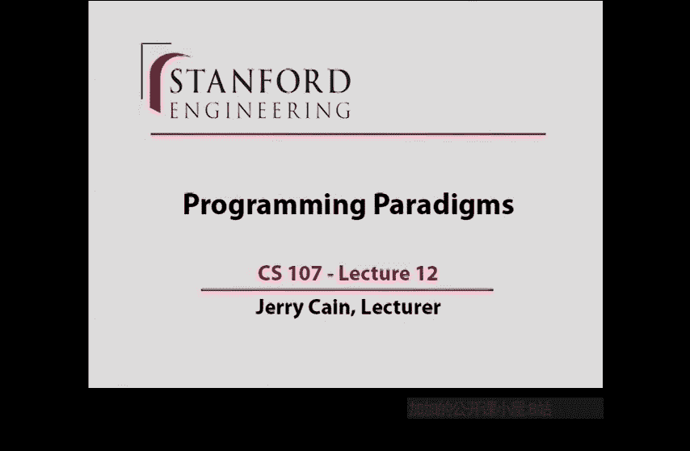
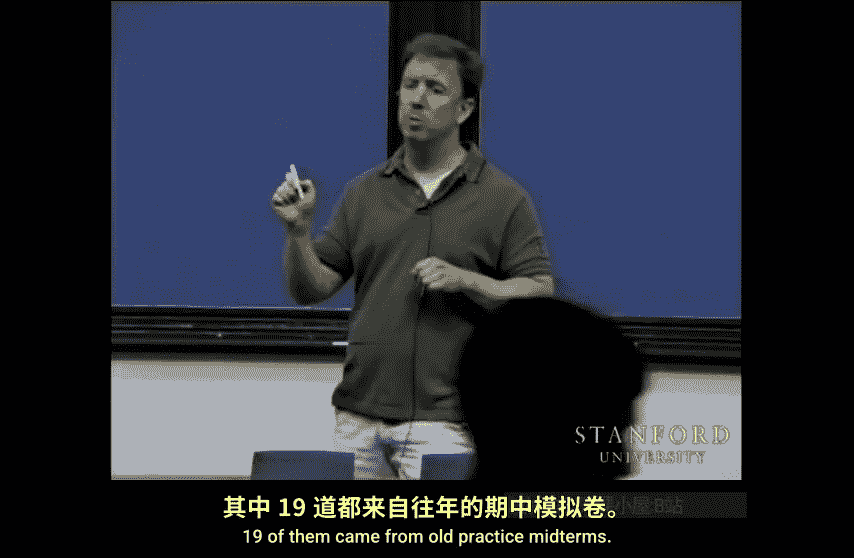
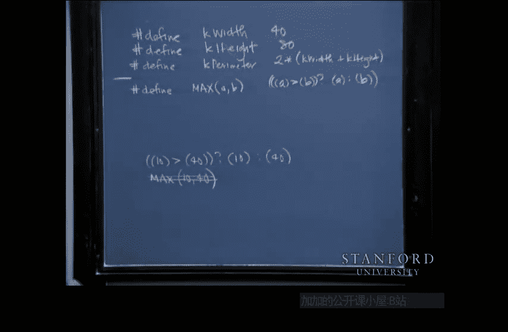

# 012：预处理、编译与链接





本演示由斯坦福大学专业发展中心提供。


大家好。今天有两份讲义要发给大家，一份是明天讨论课的讲义，其内容主要围绕我上周一、周三和周五讨论的汇编代码生成。另一份是作业5。我原计划周三发，但决定提前发，以便大家有更灵活的时间来处理这些问题。作业5不需要提交，它是一个书面习题集，没有任何编程练习，主要是大量关于代码生成的练习。这些内容在明天的讨论课中会涉及，并且也肯定会出现在下周三晚上的期中考试中。作业5的唯一要求是大家完成习题，并确保答案与我的答案思路一致。期中考试将于下周三晚上7点举行，具体地点我将在接下来两天内确定。本周三，我会发一份模拟试题及其答案，供大家在未来一周练习。讨论课讲义上的习题，如果有20道，其中19道都来自过去的模拟试题，所以务必理解它们。考试时，可以携带任何课堂笔记、作业打印稿等，也可以带教材，但我认为必要性不大，因为所有考核内容都已涵盖在课堂或讲义中。作业4将于本周四截止，这可能是本学期迄今为止最难的一次作业，建议大家尽早开始。



上一节我们介绍了C预处理器的基础概念。本节中，我们来看看预处理、编译和链接这三个阶段的区别。在之前的课程中，你可能习惯于将它们视为一个整体操作。实际上，这三个步骤是按顺序在后台执行的，但通常不会明确告知是哪个阶段出了问题。因此，了解每个阶段的具体职责非常重要。

上次结束时，我刚刚引入了 `#define` 的概念。它本质上就是一种高级的查找和替换操作，将这个标记替换为那段文本。例如：

```c
#define WIDTH 40
#define HEIGHT 80
```

在这两行之后，任何出现 `WIDTH` 和 `HEIGHT` 的地方（字符串常量内部除外），都会被替换为 `40` 和 `80`。这种替换甚至会发生在后续的 `#define` 中。例如：

```c
#define PERIMETER 2 * (WIDTH + HEIGHT)
```

那么，`PERIMETER` 在预处理后，看到的不是 `WIDTH` 和 `HEIGHT` 这两个标记，而是已经被替换为 `40` 和 `80` 的文本流，即 `2 * (40 + 80)`。预处理器并不计算这个表达式，它只是进行文本替换。`#define` 在纯C语言中主要用于整合那些“魔数”和字符串常量，并赋予它们有意义的名称。

关于 `#define`，你可能不知道的是，它可以被扩展，并且可以像函数一样接受参数。它们不叫函数，而被称为宏。例如，我可以这样定义一个求最大值的宏：

```c
#define MAX(A, B) ((A) > (B) ? (A) : (B))
```



只要在宏名 `MAX` 和左括号 `(` 之间没有空格，它就被明确理解为一个带参数的宏定义。为了确保运算顺序和求值没有歧义，通常会在参数和整个表达式周围加上大量括号。这样，当这个宏在代码中后续被展开时，就不会因为运算顺序而产生混淆。

例如，如果在代码中写下 `MAX(10, 40)`，预处理器会将其替换为 `((10) > (40) ? (10) : (40))`。虽然这是一种判断40大于10的曲折方式，但这正是文本替换的结果。

所以，它就像一个 `#define`，是一种快速、直接的内联功能的方式，比编写一个完整的函数更简洁。当然，你也可以使用函数。但从上周看到的关于函数调用和返回的汇编代码可知，调用函数需要花费大量时间设置参数、跳转、返回并清理参数。虽然工作量不大，可能就10条汇编指令，但使用宏可能只需要三到四条指令。因此，使用传统函数调用来求最大值，大约70%的时间都花在了函数调用和返回上。使用 `#define` 宏，则可以在每个使用 `MAX` 的地方高效地展开这段代码。

宏并不要求参数 `A` 和 `B` 必须是整数。从代码上看，它们应该是，但预处理器只进行模板化的查找和替换。如果我错误地写下 `MAX(40, "hello")`，预处理器只会将 `A` 替换为 `40`，`B` 替换为 `"hello"`。只有在编译阶段，当编译器读到展开后的代码 `((40) > ("hello") ? (40) : ("hello"))` 时，才会报错，比如不允许用 `>` 比较整数和字符串。所以错误是在编译时发现的，而不是预处理时。

关于这种用法是好是坏，我认为只要使用得当，并没有太大问题。我会在作业3的示例中展示两个 `#define` 宏的用法，其中一个你可能已经在不知不觉中使用了，另一个则在我的解决方案中。这个例子只是为了说明预处理仍然是文本替换，可能导致后续问题，这些问题可能在编译时被发现，也可能在运行时导致段错误。

关于这个 `MAX` 宏是否有返回值的问题：它本身不返回，但它是一个表达式，其求值结果要么是 `A` 的值，要么是 `B` 的值。所以在我划掉的那个错误例子之前，表达式会求值为数字 `40`。

本节课中我们一起学习了C语言中预处理、编译和链接三个阶段的基本区别，重点探讨了 `#define` 宏的工作原理及其与函数调用的效率对比。理解这些底层过程，有助于我们编写更高效、更清晰的代码，并更好地诊断程序构建过程中可能出现的问题。