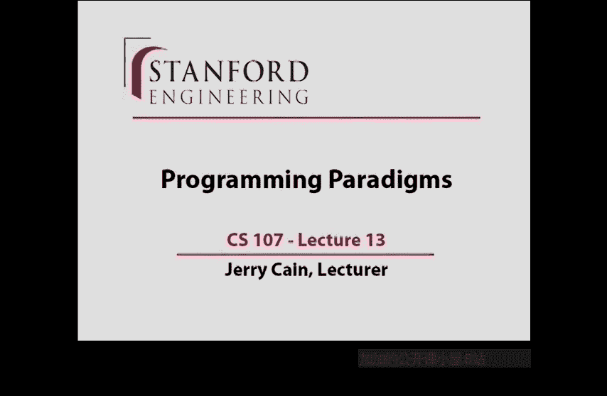
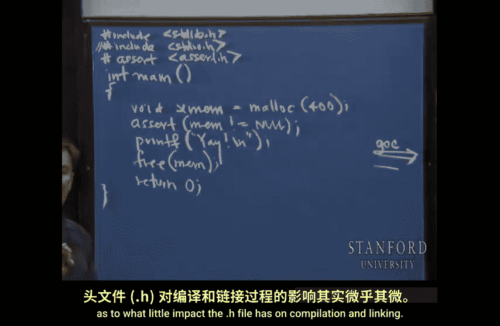

# 013：编译与链接详解





在本节课中，我们将深入探讨C语言程序的编译和链接过程。我们将通过一个具体的代码示例，分析预处理、编译、汇编和链接各个阶段的作用，并理解头文件、函数声明以及标准库是如何被整合到最终的可执行文件中的。

## 概述

上一节我们介绍了程序执行的内存模型和函数调用栈。本节中，我们来看看一个C语言程序是如何从源代码转变为可执行文件的。我们将重点关注`gcc`编译器的工作流程，并解释当缺少必要的头文件时会发生什么。

## 编译与链接过程

考虑以下简单的C程序：

```c
#include <stdio.h>
#include <stdlib.h>
int main() {
    void* memory = malloc(400);
    assert(memory != NULL);
    printf("Yay!\n");
    free(memory);
    return 0;
}
```

这个程序完成了以下工作：
*   调用`malloc`分配400字节内存。
*   使用`assert`确保分配成功。
*   调用`printf`打印信息。
*   调用`free`释放内存。
*   返回0。

当我们使用`gcc`编译此程序时，例如执行`gcc program.c -o program`，编译器会默认执行一系列步骤来生成可执行文件。

### 编译阶段

在编译阶段，`gcc`会将`program.c`这个**翻译单元**处理成一个`.o`（目标）文件。这个目标文件包含了对应的汇编代码。

对于我们的程序，生成的汇编代码中会包含：
*   `call malloc`指令
*   `call printf`指令
*   `call free`指令
*   `mov $0, %eax`（对应`return 0;`）
*   管理栈指针的指令（如`sub $4, %esp`和`add $4, %esp`），用于处理局部变量和函数调用。

此时，这些函数调用（如`malloc`, `printf`）只是**未解析的符号引用**。编译器知道需要调用它们，但还不知道它们的实际代码在哪里。

### 链接阶段

链接器的工作是将一个或多个`.o`文件与所需的库（如C标准库）合并，生成最终的可执行文件。

以下是链接器执行的关键步骤：
1.  它收集我们的`program.o`文件。
2.  它从编译器自带的库中（如`libc.a`）找到`malloc`、`printf`、`free`等函数的已编译代码（它们本身也是`.o`文件格式）。
3.  它将所有必要的代码“拼接”在一起，形成一个完整的程序映像。
4.  它会解析所有符号引用，将代码中的`call malloc`地址替换为实际`malloc`函数在内存中的地址。
5.  通常，链接器会进行“死代码消除”，移除程序中从未被调用的函数代码，以减小可执行文件体积。

最终，生成的可执行文件包含了运行所需的所有机器指令。

## 头文件的作用

现在，让我们探讨头文件在编译过程中的实际作用。如果我们注释掉`#include <stdio.h>`这一行。

```c
// #include <stdio.h>
#include <stdlib.h>
int main() {
    void* memory = malloc(400);
    assert(memory != NULL);
    printf("Yay!\n"); // 编译器此时没有看到printf的声明
    free(memory);
    return 0;
}
```

许多编译器会因此报错，因为它们对函数调用的检查非常严格，要求在使用前必须看到函数原型。然而，`gcc`的行为有所不同。

当`gcc`在编译时看到一个函数调用（如`printf(“Yay!\n”)`），但没有找到该函数的显式声明（原型）时，它会尝试根据函数调用的方式**推断一个隐式声明**。

推断的规则通常是：假设该函数返回`int`类型，并接受给定的参数。但这非常危险，因为如果推断错误（例如`printf`实际返回的是`int`，但假设正确；如果是一个返回`double`的函数，假设就错了），就会导致未定义行为。

**核心概念**：头文件（`.h`）在编译阶段的主要作用是向编译器提供**类型信息**（函数原型、结构体定义、宏等），确保编译器能正确检查代码的语法和类型安全性。它本身并不包含函数的具体实现代码。实现代码在库文件（`.a`或`.so`）中，由链接器在链接阶段处理。



## 总结

本节课我们一起学习了C程序构建过程中的编译与链接阶段。
*   **编译**将单个源文件转换为包含机器码和目标格式的目标文件（`.o`），其中外部函数调用仍是未解析的引用。
*   **链接**将一个或多个目标文件与库文件合并，解析所有符号引用，分配最终的内存地址，生成可执行文件。
*   **头文件**在编译时提供类型声明，确保编译器能进行类型检查，但其本身不包含实现代码。
*   像`gcc`这样的编译器在缺少函数声明时可能会进行隐式声明推断，但这是一种不安全的做法，应始终包含正确的头文件。

理解这些步骤有助于我们诊断复杂的构建错误，并理解诸如“未定义的引用”和“多重定义”等链接器错误的根本原因。