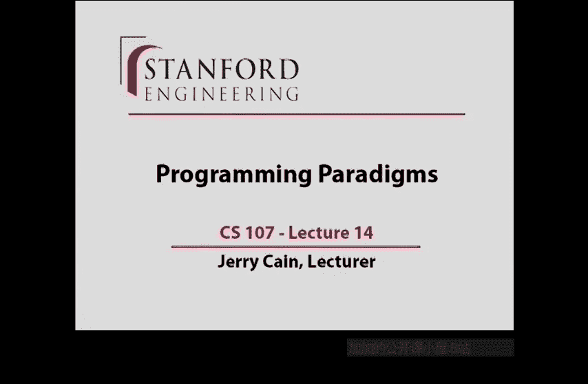
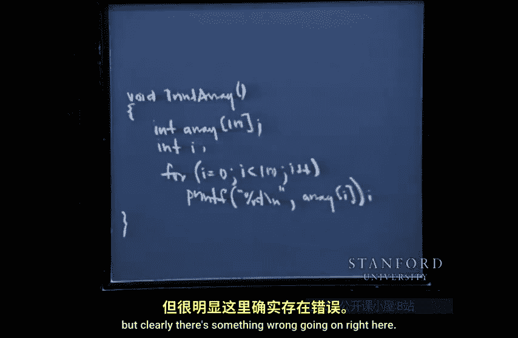

# 014：内存模型与函数调用




在本节课中，我们将深入探讨C语言中的内存模型，特别是函数调用时栈帧（激活记录）的行为。我们将通过具体的代码示例，理解局部变量的存储方式、数组越界操作的后果，以及函数调用之间栈内存的“残留”现象。这些知识对于理解程序运行机制和调试复杂问题至关重要。

---

## 栈帧与局部变量

上一节我们介绍了函数调用时栈帧的构成。本节中，我们来看看一个具体的例子，它展示了局部变量在栈上的布局以及不当操作可能带来的问题。

考虑以下代码片段：
```c
void f() {
    int array[4];
    int i;
    for (i = 0; i <= 4; i++) {
        array[i] -= 4;
    }
}
```
在这段代码中，我们声明了一个长度为4的整型数组`array`和一个循环变量`i`。循环试图对数组的每个元素减去4。

然而，循环条件`i <= 4`是一个错误，它会导致数组越界访问。当`i`等于4时，`array[4]`的赋值操作实际上会修改到栈上紧邻数组之后的内存位置。

在我们的简化内存模型中，栈帧的布局如下：
1.  数组`array`（占用4个`int`的空间）。
2.  变量`i`。
3.  保存的返回地址（Saved PC）。

当执行`array[4] -= 4;`时，程序错误地修改了保存的返回地址，使其指向了前一条指令。因此，当函数`f`返回时，它不会正常返回到调用者，而是跳回到函数内部的某个位置，导致程序陷入无限循环。这是一种伪装巧妙的无限递归形式。

---

## 栈内存的“残留”效应

理解了栈帧的基本操作后，我们来看一个更微妙的例子，它展示了连续函数调用之间栈内存的“残留”数据。

假设一个初学者编写了如下程序：
```c
int main() {
    declareAndInitArray();
    printArray();
    return 0;
}

void declareAndInitArray() {
    int array[100];
    for (int i = 0; i < 100; i++) {
        array[i] = i;
    }
}

void printArray() {
    int array[100];
    for (int i = 0; i < 100; i++) {
        printf("%d\n", array[i]);
    }
}
```
程序员可能错误地认为，只要在两个函数中使用相同的数组名`array`，它们就会自动共享数据。但实际上，`array`是两个函数中独立的局部变量。

以下是程序能够“意外”正确打印0到99的原因：
1.  `declareAndInitArray`被调用，其栈帧被创建，数组`array`被初始化。
2.  函数返回后，其栈帧被释放（栈指针上移），但栈内存中的数据**并未被清除**。
3.  紧接着，`printArray`被调用。它创建了一个**大小完全相同**的栈帧，恰好覆盖了前一个函数栈帧的同一块内存区域。
4.  因此，`printArray`中的`array`读取到的，正是`declareAndInitArray`留在栈上的“残留”数据。

这个例子说明，函数返回后，其栈帧内存并不会被主动清零，后续函数调用可能会意外地读取到之前留下的数据。

---

## 实际应用场景



虽然上述例子看起来像是编程错误，但这种栈内存的“残留”特性在某些特定场景下可以被有意利用。

例如，在十多年前编写声卡驱动程序时，开发者可能会遇到这种情况：硬件中断处理程序每次执行的时间很短，且任务量不均衡。有时任务很轻，有时则需要在下一个中断到来前完成大量准备工作。

一种优化策略是：
*   在本次中断处理中，提前将下一次中断需要的数据计算好。
*   将这些数据精确地放置在栈上某个已知的位置。
*   当下一个中断触发，新的中断处理函数被调用时，它的栈帧会覆盖同一块内存，从而可以直接读取预先准备好的数据，而无需在时间紧迫的中断处理过程中重新计算。

这可以被看作是一种在栈上模拟“全局变量”或参数传递的非常规但高效的方法。

---

## 总结

本节课中我们一起学习了：
1.  **栈帧的精确布局**：理解了局部变量（如数组）和返回地址在栈上的相邻关系。
2.  **数组越界的严重后果**：通过`array[i] -= 4`的例子，看到修改返回地址如何导致程序行为完全失控（如无限循环）。
3.  **栈内存的持久性**：函数返回后，其栈帧数据不会被清除，可能被后续函数调用意外读取，如`declareAndInitArray`和`printArray`的例子。
4.  **特性的实际应用**：在像低级硬件驱动这样的特定领域，可以利用栈内存残留的特性进行高效的数据预置和传递。

掌握这些底层内存模型的知识，有助于你深入理解程序运行的本质，并能够分析和调试那些看似诡异的内存相关错误。