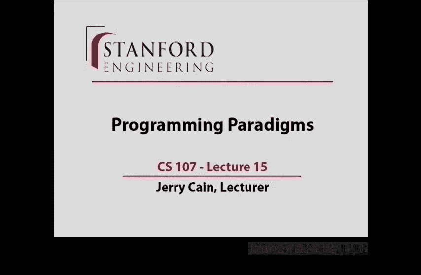
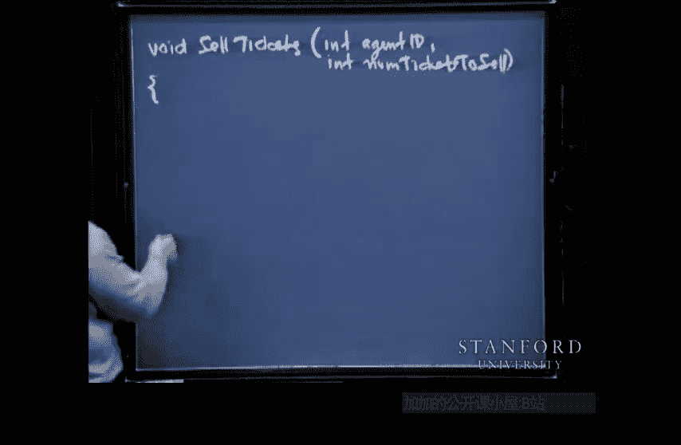

# 015：线程与并发编程




在本节课中，我们将学习如何使用线程来模拟多个任务同时执行，以解决顺序执行程序无法真实模拟现实场景的问题。我们将从一个简单的顺序售票程序开始，分析其局限性，并逐步将其改造为并发执行的程序。

## 概述

上一节我们介绍了一个简单的顺序售票程序，它无法真实模拟多个售票员同时工作的场景。本节中，我们来看看如何使用线程来实现并发执行，使多个售票员能够同时售票。

## 顺序售票程序的问题

我上次编写了一个极其简单的程序，旨在模拟单次航班上150张机票的销售。

程序如下：
```c
int numTickets = 150;
int numAgents = 10;

for (int agent = 1; agent <= numAgents; agent++) {
    sellTickets(agent, numTickets / numAgents);
}
```

`sellTickets`函数的实现如下：
```c
void sellTickets(int agentID, int numTicketsToSell) {
    while (numTicketsToSell > 0) {
        printf("Agent %d sells a ticket.\n", agentID);
        numTicketsToSell--;
    }
    printf("Agent %d: All done!\n", agentID);
}
```

从代码角度看，它非常简单。我并非要重新讨论`for`循环和`while`循环，我更感兴趣的是弄清楚为什么这个程序作为一个模拟并不理想，因为它没有真实地模拟实际会发生的情况。

这种设置方式显然是顺序执行的。售票员1会在他/她的15张票全部售出后，售票员2才开始工作。因此，这个程序的输出会先全是售票员1的160行记录（每个售票员16行），然后是“完成”提示，接着才是售票员2的记录，依此类推。



我并不喜欢这样。如果我们真的想模拟一个真实的航空公司售票厅，我们希望看到所有这些售票员同时运行和工作，不是竞争，而是协作地同时售出所有150张票。我将稍微简化问题，让所有售票员都去销售15张票，因为根据代码的写法，如果每个人都售出15张票，那么所有150张票就都售出了。但这是顺序执行的。我不想顺序执行，我想设置成所有售票员遵循相同的售票函数和步骤，但看起来是同时运行的。

## 引入线程

为了实现这一点，我们必须使用一个线程包。线程是“单一线程执行”的简称。当我谈论线程时，我指的是某个正在运行的函数，并且它很可能与其他线程同时运行。

我想这样设置，让15个售票员像赛狗场的狗一样运作。我真正想做的就是打开闸门，与其说它们是彼此竞争，不如说是一场冲向终点的比赛。所有这15个“线程”都将遵循完成函数所需的步骤，当它们全部完成时，你就知道所有工作都完成了。

我将保持`sellTickets`函数不变，至少短期内不变。我将在这里使用一个不同的`for`循环。

## 使用线程库

为了使用线程库，在我们的系统上，你必须告诉可执行文件你将这样做。这只是一个初始化例程，在你调用我将要教的这个库中的任何其他函数之前，它必须始终就位。

以下是使用线程库的初始化步骤：
```c
initThreadPackage(false);
```

## 创建并运行线程

现在，我将创建一个线程数组，并为每个售票员启动一个线程。

以下是创建和启动线程的步骤：
1.  声明一个线程数组。
2.  为每个售票员创建一个新线程，并指定其要执行的函数和参数。
3.  启动所有线程。
4.  等待所有线程完成。

```c
Thread threads[numAgents];
for (int agent = 1; agent <= numAgents; agent++) {
    char name[32];
    sprintf(name, "Agent %d", agent);
    threads[agent-1] = createThread(sellTickets, name, numTickets / numAgents);
}
for (int i = 0; i < numAgents; i++) {
    joinThread(threads[i]);
}
```

## 线程函数详解

`sellTickets`函数现在将在多个线程中并发执行。每个线程都有自己的执行流，它们可以同时运行，模拟多个售票员同时售票的场景。

`sellTickets`函数内部逻辑不变，但现在是并发执行的：
```c
void sellTickets(int agentID, int numTicketsToSell) {
    while (numTicketsToSell > 0) {
        printf("Agent %d sells a ticket.\n", agentID);
        numTicketsToSell--;
    }
    printf("Agent %d: All done!\n", agentID);
}
```

## 总结

本节课中我们一起学习了如何将顺序执行的程序改造为并发执行的程序。我们首先分析了顺序售票程序的局限性，然后引入了线程的概念。通过使用线程库，我们创建了多个线程来模拟多个售票员同时工作，从而更真实地模拟了现实场景。线程允许我们同时执行多个任务，提高了程序的效率和真实性。