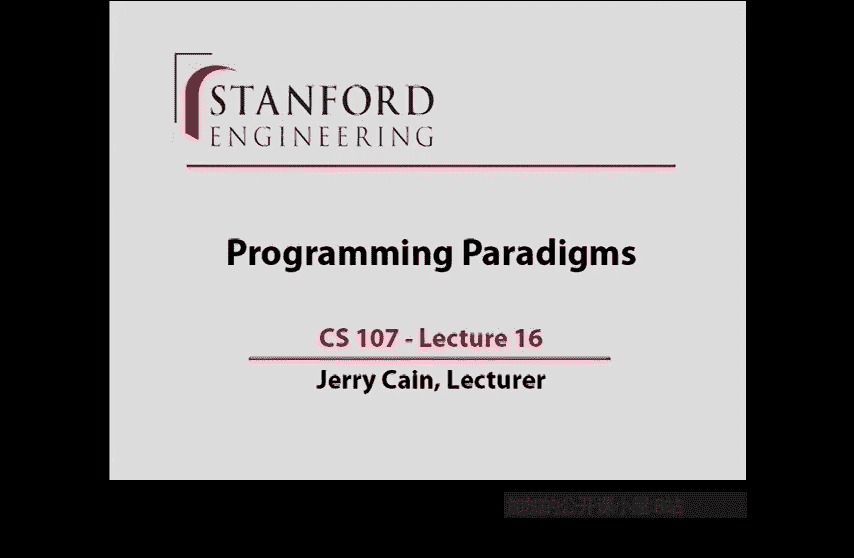

# 016：多线程与信号量




## 概述
在本节课中，我们将深入学习多线程编程中的关键概念——信号量。我们将回顾如何使用信号量来保护临界区，确保多线程环境下共享数据的安全访问。课程将详细解释信号量的工作原理，并通过代码示例展示其具体应用。

---

## 信号量回顾：保护临界区

上一节我们介绍了多线程编程的基本概念，并初步接触了信号量。本节中，我们来看看信号量如何作为一个同步工具，精确控制线程对共享资源的访问。

信号量本质上是一个**同步计数器**，其值始终大于或等于0。我们可以通过特定的函数来原子性地增减这个计数器的值。

### 信号量的核心操作
以下是信号量的两个基本操作：

*   **`semaphore_wait(sem_t *s)`**：此函数尝试将信号量的值减1。如果减1后值不会变为负数，则操作成功，线程继续执行。如果减1会导致值为负，则调用线程会被阻塞，直到其他线程增加信号量的值。
*   **`semaphore_signal(sem_t *s)`**：此函数将信号量的值加1。如果有其他线程正因等待此信号量而被阻塞，其中一个将被唤醒。

在代码中，初始化一个值为1的信号量，可以将其用作一个**互斥锁**（Mutex）。线程通过 `semaphore_wait` 获取锁，通过 `semaphore_signal` 释放锁。

```c
sem_t lock;
sem_init(&lock, 0, 1); // 初始化信号量，初始值为1

// 线程函数中
semaphore_wait(&lock);   // 进入临界区前，获取锁
// ... 临界区代码 ...
semaphore_signal(&lock); // 离开临界区后，释放锁
```

---

## 售票示例详解

让我们通过一个具体的多线程售票示例，来理解信号量如何保护共享变量。

假设有多个售票代理（线程）同时出售一定数量的票（共享变量 `numTickets`）。如果不加保护，可能会出现多个线程卖出同一张票的竞态条件。

### 线程函数结构
以下是保护了临界区的线程函数伪代码：


```c
void sellTickets(int agent, int *numTickets, sem_t *lock) {
    while (1) { // 循环尝试售票
        semaphore_wait(lock); // 尝试获取锁，进入临界区

        if (*numTickets == 0) { // 检查是否还有票
            semaphore_signal(lock); // 释放锁并退出
            break;
        }

        (*numTickets)--; // 售出一张票
        printf("Agent %d sold a ticket. %d tickets left.\n", agent, *numTickets);

        semaphore_signal(lock); // 完成操作，释放锁
        sleep(0.1); // 模拟其他工作
    }
}
```

### 临界区保护逻辑
1.  **进入检查**：线程首先调用 `semaphore_wait(&lock)`。如果 `lock` 的值为1，则将其减为0，线程进入临界区。如果值为0，线程被阻塞。
2.  **安全操作**：在临界区内，线程可以安全地检查 `numTickets` 并对其进行减1操作，因为此时其他线程无法进入此区域。
3.  **退出释放**：操作完成后，线程调用 `semaphore_signal(&lock)`，将 `lock` 的值加回1，释放锁，允许其他线程进入。

### 关于线程调度的重要说明
即使一个线程获得了锁（进入了临界区），操作系统仍然可能在其完成所有操作前将其切换出处理器。此时，锁（信号量值仍为0）仍被该线程持有。其他试图进入临界区的线程会在 `semaphore_wait` 处被阻塞，从而保证了数据的一致性。

---

## 设计最佳实践

在使用信号量和锁时，遵循一些最佳实践可以使程序更高效、更健壮。

### 保持临界区短小
临界区应尽可能只包含必须互斥执行的代码。将非关键操作（如日志打印、复杂计算）放在锁外执行，可以最大程度地减少线程阻塞，提高程序并发性能。

```c
// 不佳实践：将非关键操作也放在锁内
semaphore_wait(&lock);
complexCalculation(); // 耗时操作
updateSharedData();   // 关键操作
printf("Log...");     // 非关键操作
semaphore_signal(&lock);

// 更佳实践：只保护关键操作
complexCalculation(); // 在锁外执行
semaphore_wait(&lock);
updateSharedData();   // 关键操作在锁内
semaphore_signal(&lock);
printf("Log...");     // 在锁外执行
```

---

## 总结
本节课中我们一起学习了多线程编程中信号量的核心作用。我们明确了信号量作为一个同步计数器，通过 `wait` 和 `signal` 操作来实现对临界区的互斥访问。通过售票示例，我们详细分析了如何使用值为1的信号量作为互斥锁，来保护共享变量 `numTickets`，避免竞态条件。最后，我们强调了保持临界区短小的重要性，这是编写高效并发程序的关键原则。掌握这些概念，是构建正确、健壮的多线程应用程序的基础。