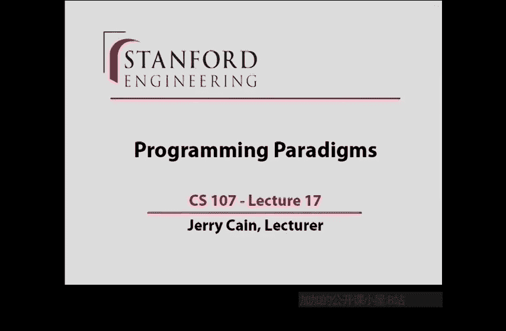
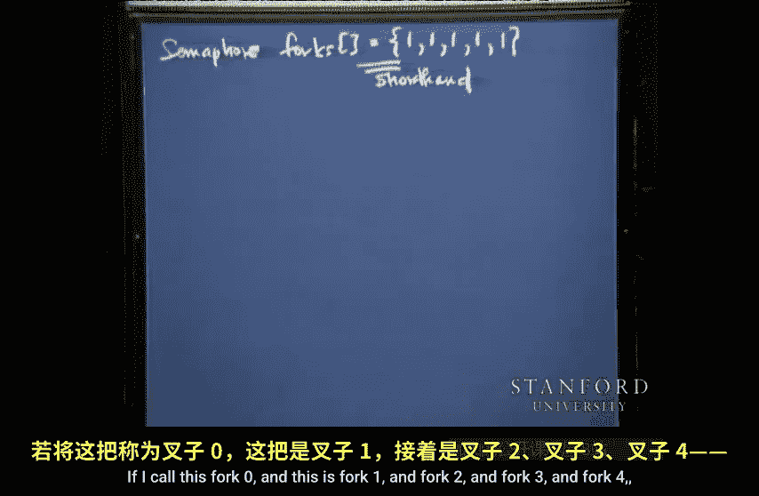
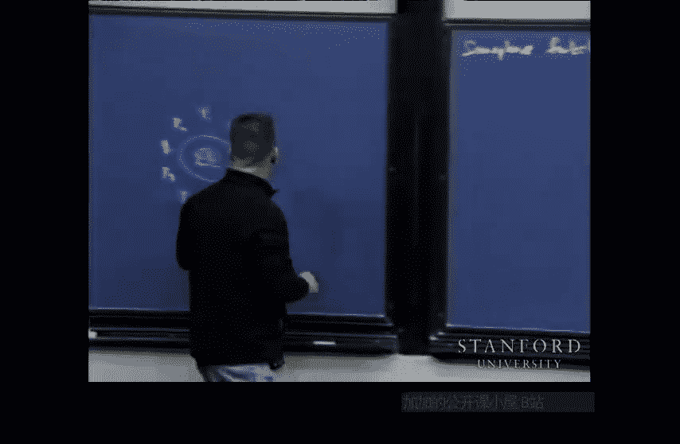
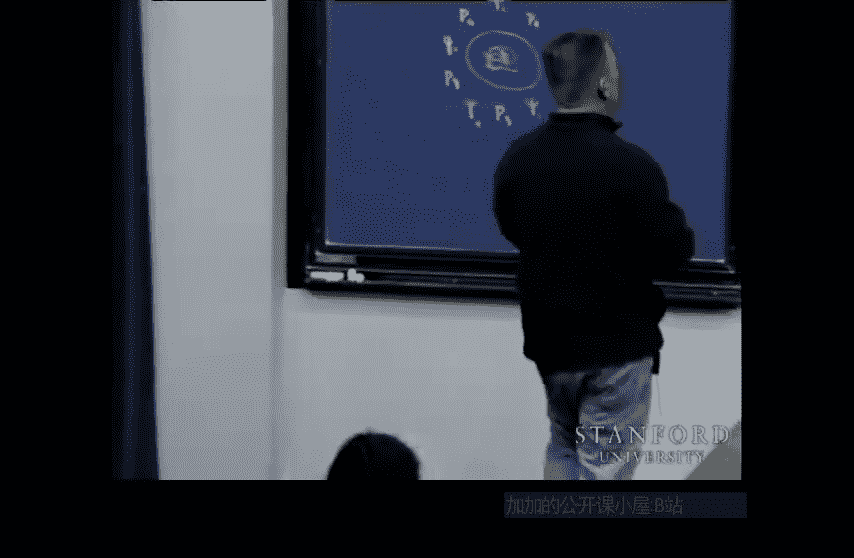

# 017：哲学家就餐问题与死锁避免




在本节课中，我们将继续深入探讨并发编程中的经典问题——哲学家就餐问题。我们将回顾问题的基本设定，分析其潜在的死锁风险，并学习一种通过引入额外信号量来避免死锁的解决方案。

上一节我们介绍了哲学家就餐问题的基本模型，本节中我们来看看如何通过限制并发进餐的哲学家数量来避免死锁。

## 问题回顾

设想一个圆桌，中央有一大盘意大利面，周围坐着五位哲学家。每两位哲学家之间摆放着一把叉子，总共五把叉子。每位哲学家的一生（即一个线程的生命周期）遵循“思考-进食-思考-进食”的循环，最终结束。

我们用五个初始值为1的信号量（`semaphore`）数组来表示五把叉子的可用状态。值为1表示叉子可用。

```c
semaphore forks[5] = {1, 1, 1, 1, 1};
```





每位哲学家（线程）根据其编号 `id` 来决定获取哪两把叉子。通常，哲学家会先尝试获取右侧的叉子（`forks[id]`），然后获取左侧的叉子（`forks[(id+1)%5]`）。进食完成后，再按顺序释放这两把叉子。

## 死锁风险

上述简单实现存在一个严重的并发问题：死锁。

考虑这样一种执行顺序：所有五位哲学家同时开始行动，并且都成功地获取了自己右侧的叉子。此时，所有叉子都已被拿起，信号量值均变为0。接下来，当每位哲学家尝试获取左侧的叉子时，都会因为该叉子已被邻居持有而无限期等待。这就形成了循环等待，即死锁。



## 解决方案：限制并发进餐者

要解决这个问题，核心思路是确保不会出现所有哲学家都持有一把叉子并等待另一把的局面。一个有效的方法是限制同时尝试进餐的哲学家数量。

我们观察到，由于只有五把叉子，且每位进餐者需要两把，因此**最多只能有两位哲学家同时进餐**。基于此，我们可以引入一个额外的“通行证”信号量。

```c
semaphore num_allowed_to_eat = 4; // 关键：初始值设为4
```

以下是修改后的哲学家线程逻辑：

1.  在尝试获取叉子**之前**，哲学家必须首先等待（`wait`）`num_allowed_to_eat` 信号量，以获得“进餐许可”。
2.  获得许可后，再按顺序获取左右两把叉子。
3.  进食。
4.  按顺序释放两把叉子。
5.  进食完成后，释放（`signal`）`num_allowed_to_eat` 信号量，归还“进餐许可”，以便其他等待的哲学家可以获取。
6.  继续思考。

**为什么初始值设为4？**
虽然理论上最多允许2人同时进餐，但将信号量初始值设为4（而非2）是更优选择。这确保了至少有一位哲学家总是能够顺利获得两把叉子并开始进餐，从而打破可能的全局等待僵局。如果设为5，则该信号量将不起任何限制作用；如果设为2，则限制过于严格，可能不必要的降低了并发度。设为4是在避免死锁和保持并发效率之间的一个平衡点。

这个新增的信号量创建了一个“临界区”，但这个临界区限制的是“正在尝试或正在进行拿叉子和进食动作”的哲学家数量，而非传统的“仅允许一个线程访问”的临界区。

## 总结

本节课中我们一起学习了哲学家就餐问题及其死锁场景。我们了解到，通过引入一个全局信号量来限制同时可以竞争叉子的哲学家数量，可以有效预防死锁。关键在于将信号量的初始值设置为哲学家总数减一（本例中为4），这既能保证至少一人可以进餐以推动系统前进，又避免了所有哲学家同时持有单把叉子的死锁局面。这是并发编程中利用信号量解决资源竞争和死锁问题的经典范例。