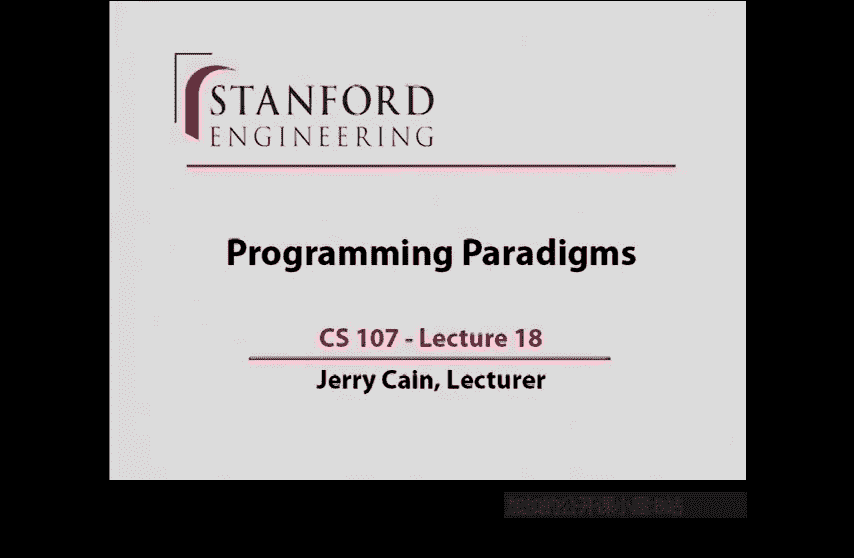
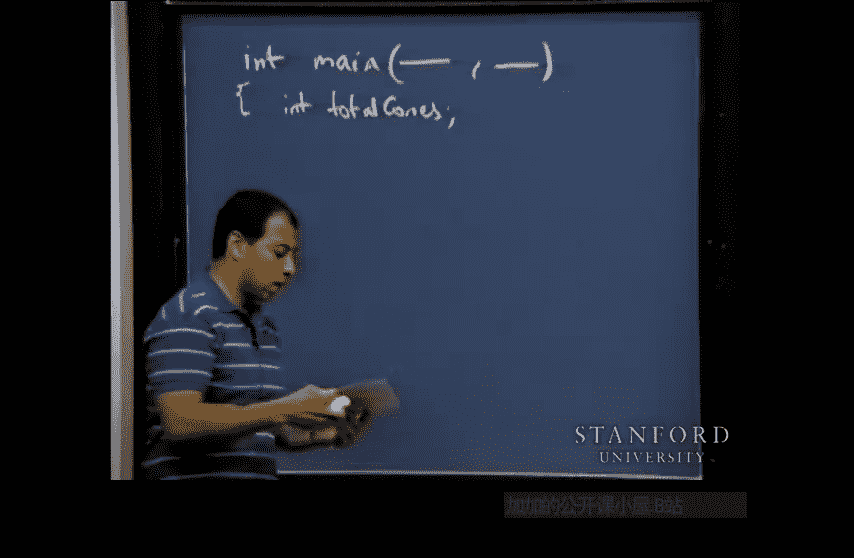

# 018：冰淇淋店模拟问题详解




在本节课中，我们将详细解析斯坦福大学CS107课程中一个复杂的线程同步问题——冰淇淋店模拟。我们将逐步分析问题中的各个角色、它们之间的交互以及所需的同步机制。

上一节我们介绍了多线程编程的基本概念，本节中我们来看看一个综合性的应用案例。

## 问题概述

模拟场景中有四个主要角色：
*   **收银员**：负责处理结账，仅有一位。
*   **顾客**：共有10位，每位会随机点1到4个冰淇淋甜筒。
*   **店员**：负责制作甜筒。每位顾客点的每个甜筒都会分配一个店员线程来制作，因此店员线程总数在10到40个之间。
*   **经理**：负责检查每个制作完成的甜筒，仅有一位。

核心交互规则如下：
1.  顾客点单后，会为每个甜筒“派遣”一个店员线程。
2.  店员制作完甜筒后，必须获得经理的检查批准。
3.  经理办公室一次只能容纳一位店员，即不能有两个店员同时请求检查。
4.  如果经理检查不通过，店员必须重做甜筒并再次请求检查。
5.  顾客必须等到所有他点的甜筒都制作完成并获得批准后，才能去收银台排队结账。
6.  收银台前的队伍必须遵循先到先服务的顺序。

## 线程间通信分析

以下是各角色间的主要通信模式：

*   **顾客与店员**：一对多通信。顾客需要等待其派遣的所有店员线程完成任务。
*   **店员与经理**：一对一、带互斥的通信。店员请求检查，经理返回结果。经理办公室需要加锁，确保同一时间只有一位店员。
*   **顾客与收银员**：一对一通信。顾客排队，收银员依次服务。

## 主函数结构

主函数负责初始化并启动所有线程。以下是其核心逻辑的伪代码表示：

```c
int totalCones = 0; // 总甜筒数

int main() {
    // 初始化必要的信号量等同步原语（后续介绍）

    // 生成10位顾客线程
    for (int i = 0; i < 10; i++) {
        int numCones = RandomInteger(1, 4); // 为每位顾客生成随机甜筒数
        ThreadNew("Customer", CustomerFunction, 1, numCones);
        totalCones += numCones; // 累加总甜筒数
    }

    // 生成收银员线程
    ThreadNew("Cashier", CashierFunction, 0);

    // 生成经理线程，并传入总甜筒数
    ThreadNew("Manager", ManagerFunction, 1, totalCones);

    // 运行所有线程
    RunAllThreads();
}
```



**代码解释**：
*   `totalCones` 变量用于记录所有顾客点的甜筒总数，这个信息需要传递给经理，因为经理必须检查完所有甜筒后才能结束工作。
*   顾客线程函数 `CustomerFunction` 接收一个参数：该顾客要点的甜筒数量 `numCones`。
*   经理线程函数 `ManagerFunction` 接收一个参数：需要检查的甜筒总数 `totalCones`。

## 关键同步点

基于以上分析，我们可以识别出几个需要同步控制的关键点：
1.  **经理办公室互斥**：需要一个**互斥锁（Mutex）** 或一个初始值为1的**信号量（Semaphore）**，以确保任何时候最多只有一位店员在请求检查。
2.  **顾客等待店员**：每位顾客需要等待其所有店员完成工作。这可以通过一个**计数信号量**或**连接（Join）** 操作来实现，计数初始值为该顾客的甜筒数，每完成一个甜筒计数减一，减到零时顾客才能继续。
3.  **店员与经理的会合**：店员请求检查后需等待经理的批准结果。这通常涉及一对**信号量**来实现双向等待（即“会合”模式）。
4.  **收银台队列**：顾客需要按到达顺序在收银台前排队。这需要一个**队列数据结构**配合信号量来实现，确保先到的顾客先被服务。

本节课中我们一起学习了冰淇淋店模拟问题的完整场景、角色交互和初步的线程设计。我们分析了主线程如何创建所有参与者，并识别出了实现正确同步所需的关键控制点。在接下来的课程中，我们将深入每个角色的具体实现，并编写完整的同步代码。