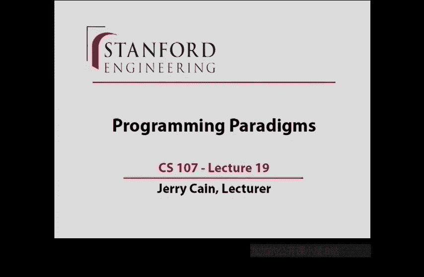
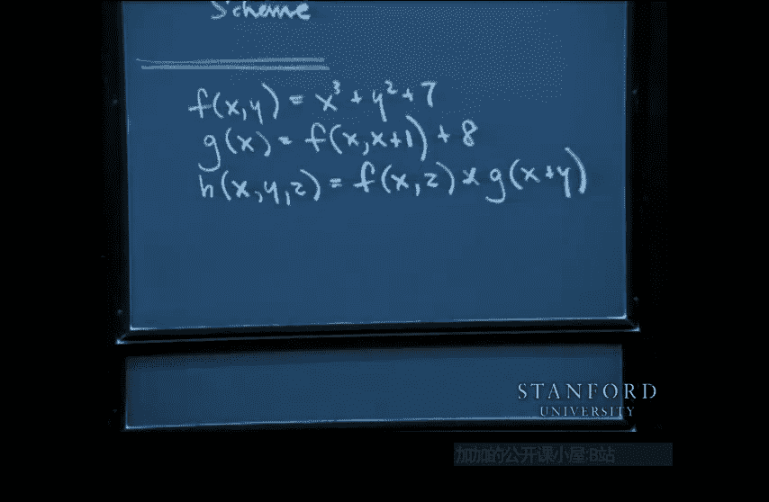

# 019：函数式编程范式介绍




在本节课中，我们将学习一种全新的编程范式——函数式编程。我们将通过介绍Scheme语言来理解这种范式的核心思想，并与之前学过的命令式、面向对象范式进行对比。

---

## 课程概述

上一节我们讨论了期中考试和评分标准。本节中，我们将告别命令式和面向对象范式，开始探索函数式编程的世界。函数式编程的核心是围绕函数的**返回值**来组织和思考程序，这与我们之前熟悉的围绕“动作”或“对象”的思维方式有本质不同。

---

## 编程范式回顾

在深入新内容之前，我们先简要回顾已学的两种主要范式。

**命令式/过程式范式**
我们使用C语言作为代表。这种范式专注于解决方案描述中的“动词”。典型的C程序`main`函数会先声明数据，然后调用一系列高级函数（如`initialize`、`doit`、`terminate`）来完成任务。语句的开头通常是即将被调用以执行某部分程序的函数名。

**面向对象范式**
我们使用C++作为代表。这种范式则围绕被操作的“数据”或“对象”来组织。在C++中，你首先声明一个对象（例如`vector<int> v;`），后续的语句通常以这个对象开头，并调用其方法（例如`v.push_back(4);`或`v.erase(v.begin());`）。语句的首要焦点是数据本身。

你可能认为编程方式不过如此，但即使是顺序编程与并发编程之间也存在思维范式的转换。在编写多线程程序时，你需要同时考虑多个执行流的交互，这与编写线性单线程程序的思维方式截然不同。

---

## 引入函数式范式

现在，让我们暂时放下过程和对象，回到顺序编程的语境，开始探讨什么是函数式范式。

过程和函数听起来相似，但严格来说，“过程”指的是一段被调用但不关心返回值的代码块（例如返回类型为`void`的函数）。而当我们谈论“函数式”时，我们虽然也讨论过程和函数，但我们的核心是围绕**函数的返回值**。

我们将学习一门非常有趣的语言——Scheme。Scheme语言本身有其特点，但我希望你们投入更多精力去理解**函数式范式本身**，而不仅仅是这门语言。因为范式的特性才是本课程更重要的收获。即使你们中90%的人以后不会再使用Scheme，理解函数式编程的思想也至关重要。

函数式范式深深植根于数学中的函数概念。请看以下数学表达式：

```
f(x, y) = x^3 + y^2 + 7
```

在纯粹的数学中，函数`f`接受两个参数`x`和`y`，并“求值”或“返回”一个结果。如果我们代入具体值，例如`f(5, 11)`，我们清楚地知道如何计算它。

现在，考虑函数的组合。我们可以定义另一个函数`g`：

```
g(x) = f(x, x) + 8
```

函数`g`接受一个参数`x`，将其同时作为两个参数传递给`f`，然后将`f`的结果加上8。这完全基于返回值进行定义。

更进一步，我们可以定义更复杂的函数`h`：

```
h(x, y, z) = f(x, z) * g(x + y)
```

函数`h`通过组合`f`和`g`的返回值来定义自己。这只是一系列基于返回值的关联关系。

**函数式编程方法所做的，正是将这种数学函数的求值和组合思想，直接应用到编程中。** 程序由一系列函数定义和函数应用（调用）构成，计算过程被视为表达式的求值，而程序设计的核心是思考如何通过组合已有函数来构造新的函数，以得到期望的返回值。

---

## 本节总结



本节课我们一起学习了函数式编程范式的核心思想。我们回顾了命令式与面向对象范式的特点，并引入了以Scheme语言为代表的函数式范式。函数式编程将计算视为数学函数的求值，并强调通过函数的组合与返回值来构建程序，这与我们之前学习的范式有根本性的不同。在接下来的课程中，我们将通过具体的Scheme代码来深入实践这一范式。