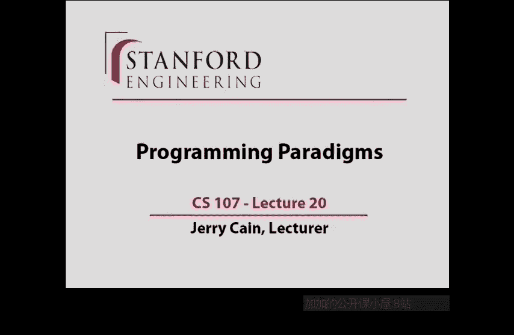
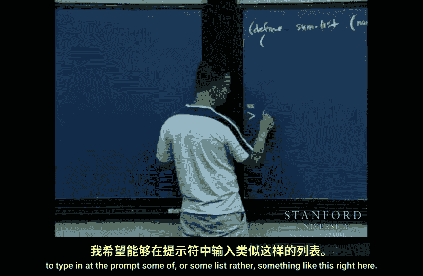
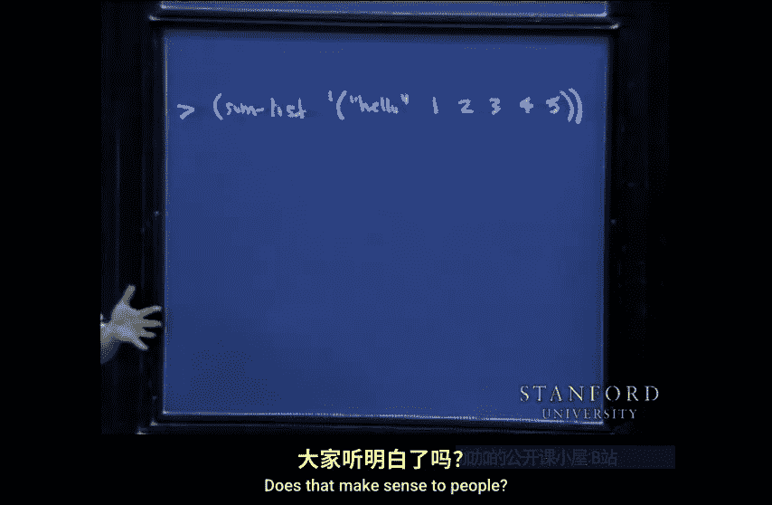
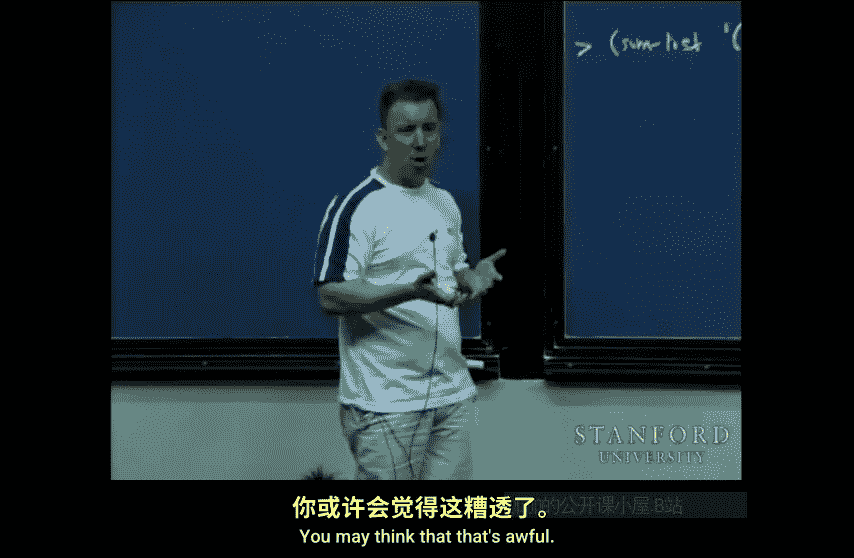
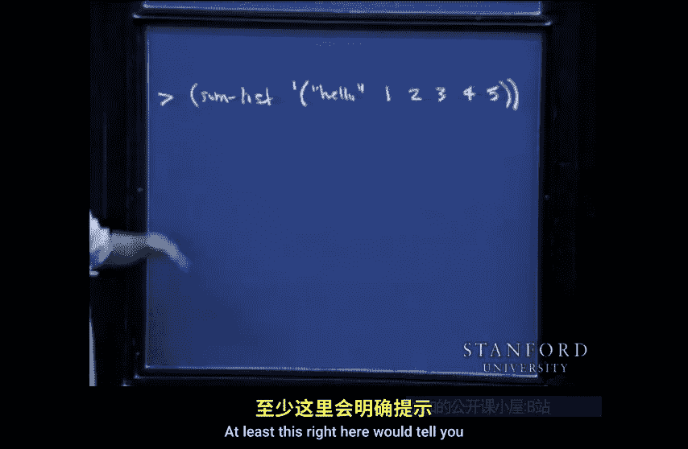
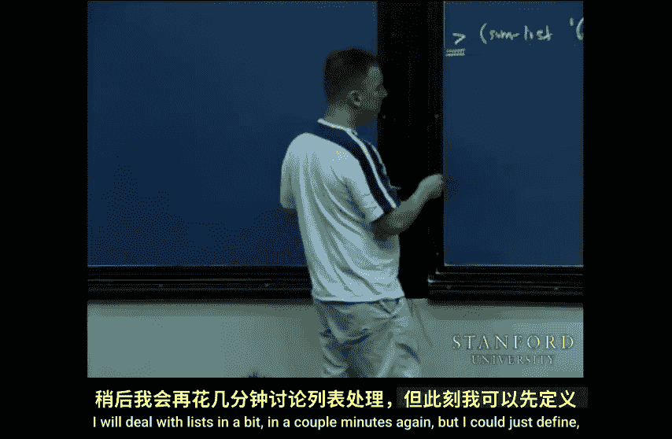
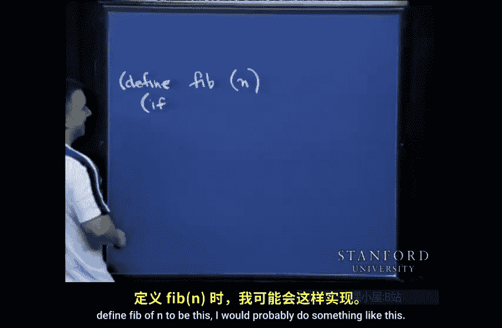

# 020：Scheme递归编程入门




在本节课中，我们将学习Scheme语言中的递归编程。我们将通过实现一个列表求和函数和一个斐波那契数列函数来理解递归的基本概念和Scheme的执行模型。课程将重点讲解如何利用`car`、`cdr`和`null?`等基本操作，以纯函数式和递归的方式解决问题。

## 列表求和函数



上一节我们介绍了Scheme中的基本原子操作。本节中，我们来看看如何利用这些操作实现一个递归的列表求和函数。

我们首先定义一个名为`sum-list`的函数，它接收一个数字列表作为参数。其核心思想是：整个列表的和等于列表的第一个元素（`car`）加上剩余列表（`cdr`）的和。

以下是`sum-list`函数的实现代码：

```scheme
(define (sum-list num-list)
  (if (null? num-list)
      0
      (+ (car num-list) (sum-list (cdr num-list)))
  )
)
```

该函数的执行逻辑如下：
*   首先，检查列表`num-list`是否为空（`null?`）。
*   如果列表为空，则函数返回`0`。
*   如果列表不为空，则函数返回 **`(car num-list)`** 与 **`(sum-list (cdr num-list))`** 的递归调用结果之和。

例如，调用`(sum-list '(1 2 3 4 5))`将返回`15`。调用`(sum-list '())`将返回`0`。

## Scheme的类型检查与执行模型

现在，让我们深入探讨Scheme语言的一个关键特性：动态类型检查。

如果我们尝试对一个包含非数字元素的列表求和，例如`(sum-list '(hello 1 2 3 4 5))`，程序并不会在解析代码时就报错。相反，它会忠实地开始执行递归过程。

它会递归地计算出后面四个数字的和（`10`），然后在最后一步尝试执行 **`(+ "hello" 10)`** 时，才会因为类型不匹配而抛出运行时错误。



这一点突显了Scheme（以及许多Lisp方言）作为动态类型语言的特点：**类型检查发生在运行时，而非编译时**。编译器的工作主要是语法解析（例如检查括号是否匹配），而所有类型信息都作为标签与数据一同存储在内存中，直到程序执行时才进行验证。



这与C语言中使用`void*`实现异构列表有些类似，但Scheme的错误信息通常更明确，会直接指出是字符串和整数之间无法进行`+`操作。

## 斐波那契数列函数



递归不仅限于处理列表。接下来，我们看看如何实现一个计算斐波那契数列的递归函数。

我们定义一个名为`fib`的函数，它接收一个整数`n`作为参数。斐波那契数列的定义是：`F(0) = 0`, `F(1) = 1`, 且对于`n > 1`，有`F(n) = F(n-1) + F(n-2)`。



以下是`fib`函数的一种实现方式：

```scheme
(define (fib n)
  (if (or (= n 0) (= n 1))
      n
      (+ (fib (- n 1)) (fib (- n 2)))
  )
)
```

该函数的执行逻辑如下：
*   首先，检查`n`是否为`0`或`1`。这里使用`or`操作符来组合两个基础条件。
*   如果`n`是`0`或`1`，则函数直接返回`n`。
*   否则，函数返回 **`(fib (- n 1))`** 与 **`(fib (- n 2))`** 的递归调用结果之和。

这种实现清晰地将两个基础情况合并，并展示了递归函数处理数值计算的典型模式。



## 总结

本节课中我们一起学习了Scheme语言中的递归编程。我们通过`sum-list`函数掌握了如何递归处理列表，并理解了Scheme动态类型检查的运行时特性。随后，我们通过`fib`函数了解了递归在数值计算中的应用。这两个例子都体现了函数式编程中“将问题分解为更小的自相似问题”的核心思想。记住，在编写递归函数时，明确的基础情况和向基础情况收敛的递归步骤是至关重要的。