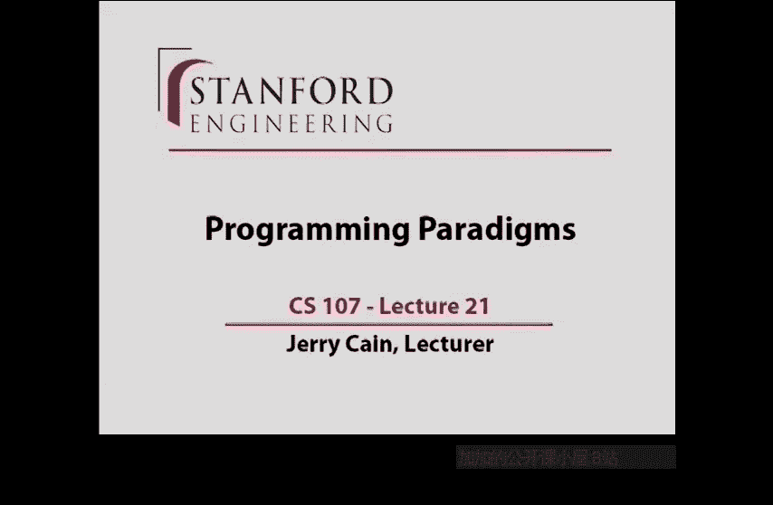
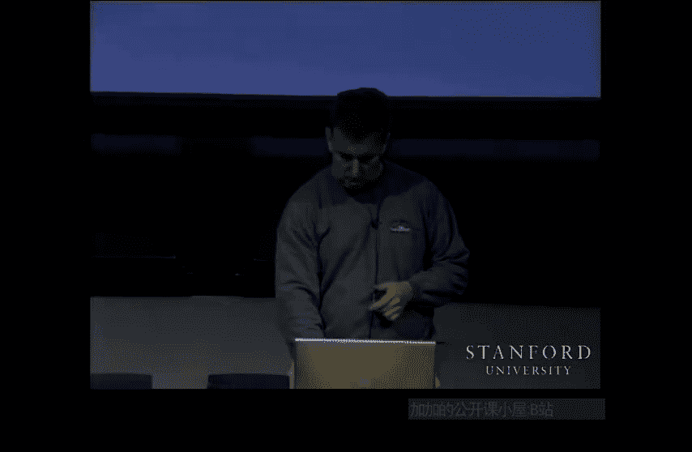
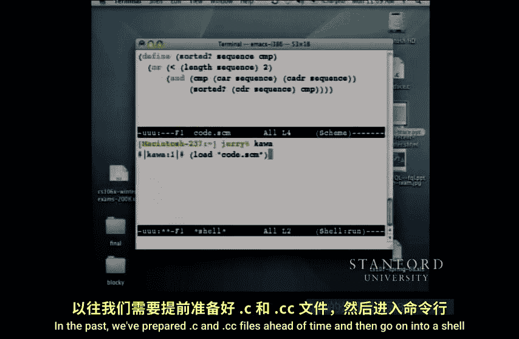
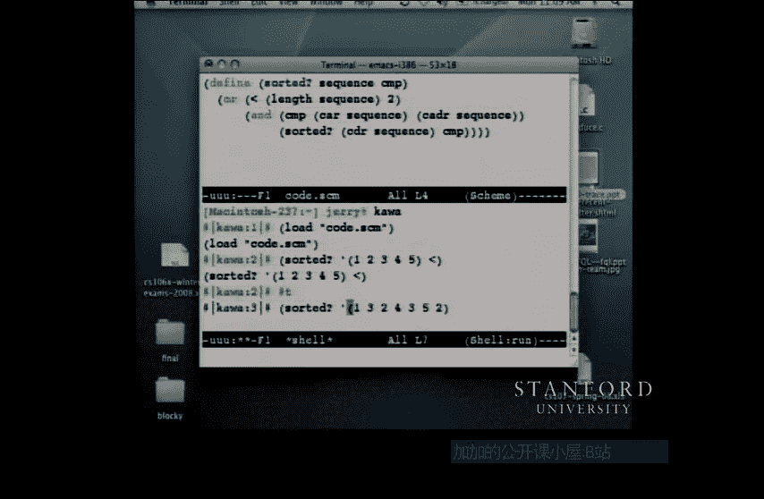
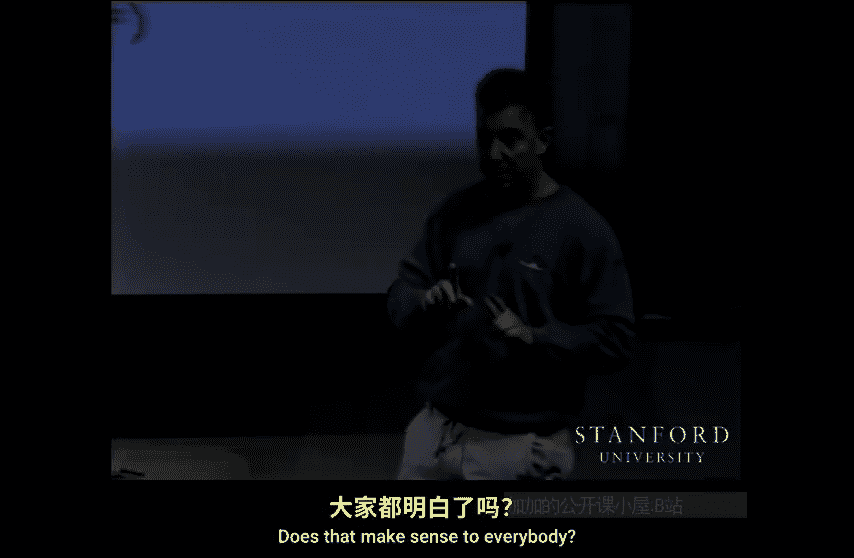
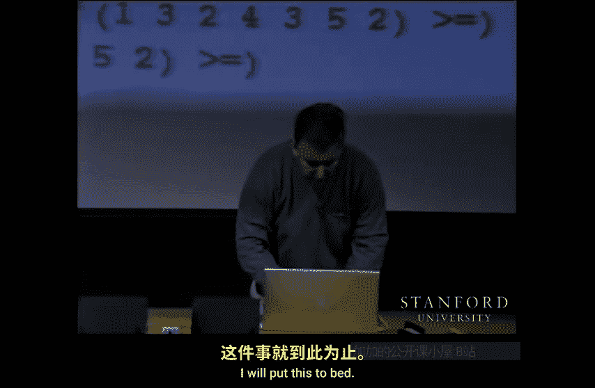
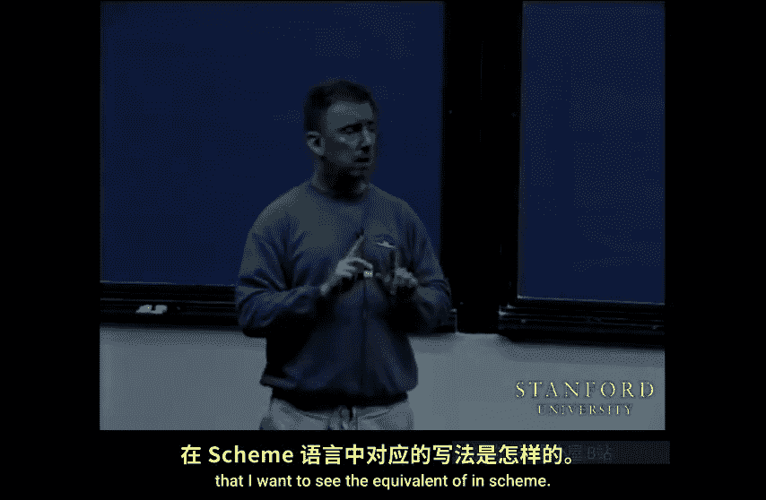
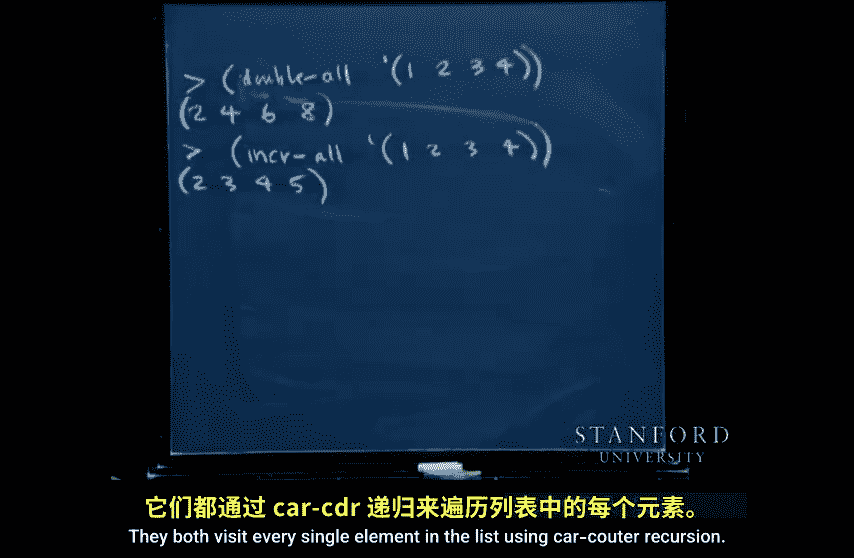

# 021：Scheme开发环境与高阶函数




## 概述
在本节课中，我们将学习Scheme编程语言的开发环境使用方法，并深入探讨高阶函数的概念。我们将通过实际操作演示如何编写、加载和测试Scheme代码，并理解如何将函数作为参数传递以实现通用算法。

## 开发环境介绍
上一节我们介绍了Scheme语言的基本概念，本节中我们来看看如何在实际开发环境中使用它。

Scheme开发环境通常包含一个交互式解释器（REPL）。你可以直接输入表达式并立即看到结果。例如，输入 `(+ 3 4)` 会返回 `7`。然而，对于更复杂的程序，我们通常将代码保存在文件中。

以下是使用Kawa（一种Scheme实现）进行开发的基本步骤：
1.  在文本编辑器中编写Scheme代码，并保存为 `.scm` 文件。
2.  在Kawa解释器中，使用 `(load “文件名.scm”)` 命令加载该文件。
3.  加载后，即可在解释器中调用文件中定义的函数。




## 代码示例：通用排序函数
现在，让我们回顾并深入理解上节课结束时提到的通用排序函数 `sorted?`。

这个函数的设计目标是能够判断任何类型的列表是否已排序。它不关心列表元素的具体类型（整数、字符串等），而是依赖一个外部传入的比较函数来进行判断。

其核心逻辑可以用以下伪代码描述：
```
函数 sorted? (列表 lst, 比较函数 cmp)
    如果 lst 为空或只有一个元素
        返回 #t (真)
    否则
        如果 (cmp (第一个元素 lst) (第二个元素 lst)) 为真
            则递归调用 sorted? (剩余列表 lst, cmp)
        否则
            返回 #f (假)
```

在Scheme中，其实现代码如下：
```scheme
(define (sorted? lst cmp)
  (or (null? lst)
      (null? (cdr lst))
      (and (cmp (car lst) (cadr lst))
           (sorted? (cdr lst) cmp))))
```

我们可以这样使用它：
*   `(sorted? ‘(1 2 3 4) <)` 会返回 `#t`，因为列表按升序排列。
*   `(sorted? ‘(1 3 2 4) <)` 会返回 `#f`，因为顺序不对。

这个例子展示了Scheme中“函数作为一等公民”的思想，我们可以像传递数据一样传递函数（`cmp`）。

## 高阶函数模式：map
理解了函数作为参数后，我们来看看一个常见的编程模式。在C++中，我们可能用过迭代器和 `std::transform`；在之前的作业中，你们实现过 `vector_map`。在Scheme中，对应的概念是 `map`。

考虑两个简单的操作：
1.  **加倍**：将一个列表 `(1 2 3 4)` 中的每个元素乘以2，得到 `(2 4 6 8)`。
2.  **递增**：将一个列表 `(1 2 3 4)` 中的每个元素加1，得到 `(2 3 4 5)`。






这两个操作在算法上高度相似：
*   它们都遍历列表中的每一个元素。
*   它们都对每个元素应用一个特定的转换规则（加倍或递增）。
*   它们都收集结果并形成一个新列表。

在Scheme中，我们可以使用内置的 `map` 函数来抽象这个模式，而不是为每个操作都写一个遍历循环。`map` 接受一个函数和一个列表，将该函数应用到列表的每个元素上，并返回结果列表。





例如：
*   `(map (lambda (x) (* 2 x)) ‘(1 2 3 4))` 实现加倍操作。
*   `(map (lambda (x) (+ 1 x)) ‘(1 2 3 4))` 实现递增操作。




`map` 是“高阶函数”的典型代表，它本身不处理具体数据，而是通过接收一个处理数据的函数来定义行为，这使得代码极其通用和灵活。



## 总结
本节课我们一起学习了Scheme开发环境的基本工作流程，包括编写 `.scm` 文件和使用 `load` 命令。我们重点分析了高阶函数的概念，通过 `sorted?` 函数理解了如何将函数作为参数传递以实现通用逻辑。最后，我们引入了 `map` 函数，它体现了函数式编程中强大的抽象能力，能够将“遍历”和“操作”分离开来。掌握这些概念对于完成接下来的作业和深入理解函数式编程范式至关重要。