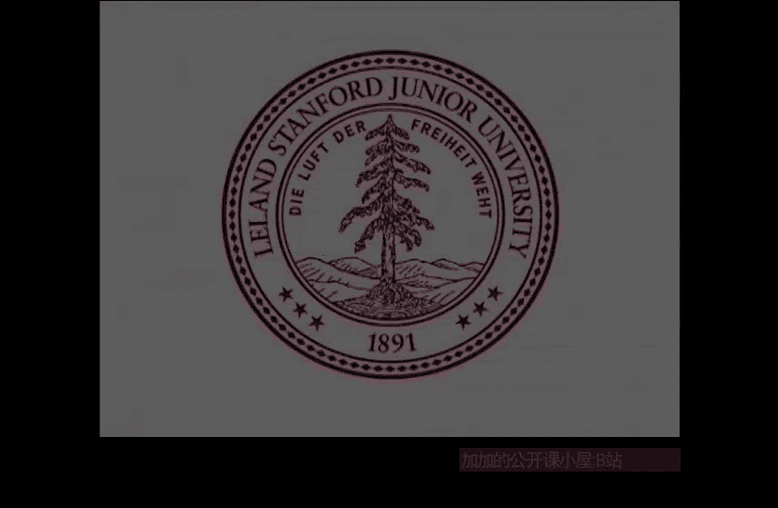
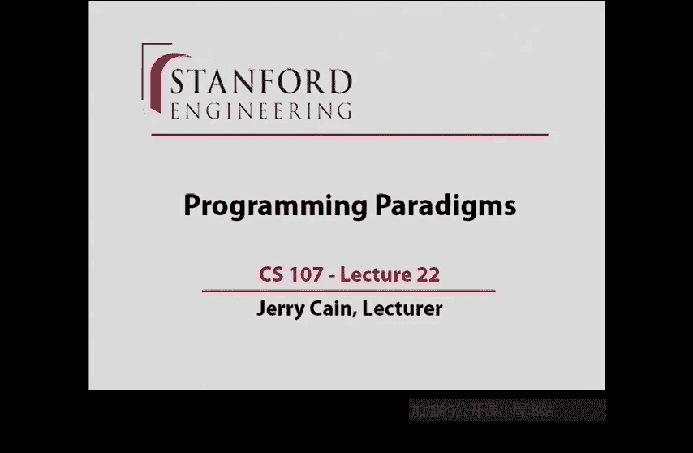
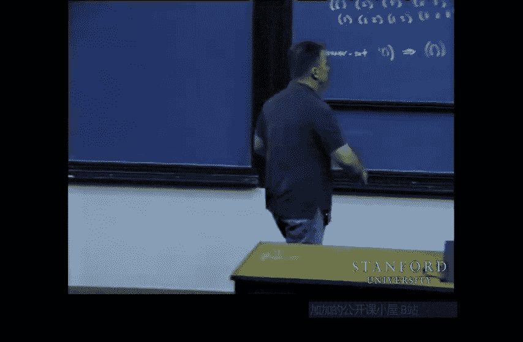
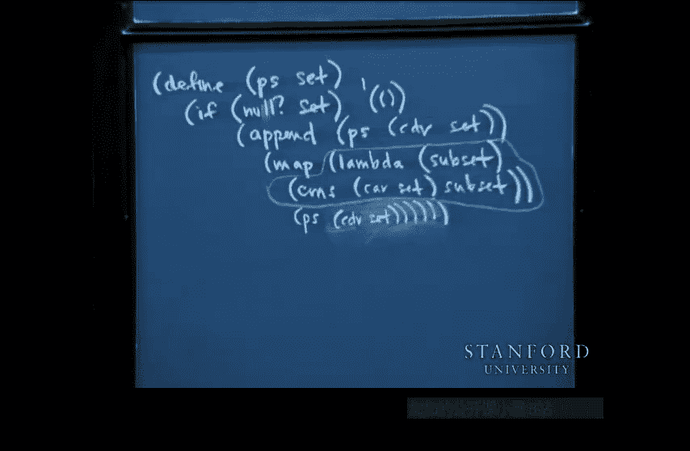

# 022：Scheme中的幂集与Lambda函数






在本节课中，我们将学习如何使用Scheme语言解决一个离散数学问题——计算一个集合的幂集。我们将深入探讨递归思想，并重点介绍如何使用`lambda`函数和`map`操作来构建简洁而强大的函数式编程解决方案。

---

上一节我们介绍了幂集的基本概念，本节中我们来看看如何在Scheme中实现它。

幂集是一个包含原集合所有子集的集合。例如，对于集合 `{1, 2, 3}`，其幂集包含8个子集，包括空集和它自身。

为了递归地构建幂集，我们可以利用一个关键观察：一个集合的幂集，可以看作由两部分组成：
1.  不包含第一个元素（`car`）的所有子集。
2.  包含第一个元素的所有子集，这等价于将第一个元素添加到第一部分中的每一个子集之前。



以下是实现这个逻辑的Scheme代码：

```scheme
(define (power-set set)
  (if (null? set)
      '(())
      (let ((ps-rest (power-set (cdr set))))
        (append ps-rest
                (map (lambda (subset) (cons (car set) subset))
                     ps-rest)))))
```

**代码解释**：
*   **基础情况**：如果输入集合`set`为空（`null?`），则幂集是只包含空列表`'()`的列表，即`'（（））`。
*   **递归步骤**：
    1.  `(ps-rest (power-set (cdr set)))`：递归计算除去第一个元素后剩余集合（`(cdr set)`）的幂集，并将结果绑定到变量`ps-rest`。
    2.  `(append ps-rest ...)`：将两部分结果拼接。
    3.  `(map (lambda (subset) (cons (car set) subset)) ps-rest)`：这是核心。我们使用`map`函数对`ps-rest`中的每一个子集（`subset`）应用一个操作。这个操作由一个`lambda`函数定义：它将原集合的第一个元素（`(car set)`）通过`cons`添加到子集`subset`的前面。这样就生成了所有包含第一个元素的子集。

这个实现巧妙地运用了递归和`map`-`lambda`组合，避免了显式循环，是函数式编程思想的典型体现。

---



本节课中我们一起学习了如何使用Scheme计算集合的幂集。我们掌握了如何将问题分解为递归结构，并利用`lambda`创建匿名函数，结合`map`将其应用于列表，从而优雅地生成结果。这个例子展示了函数式编程在表达复杂逻辑时的简洁性和强大能力。