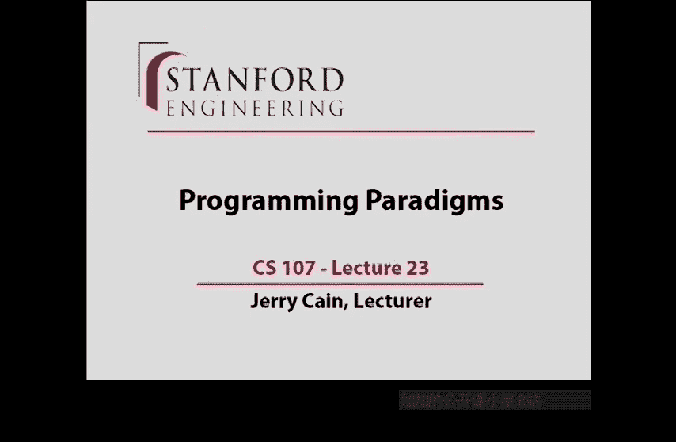

# 023：Scheme内存模型与列表操作

在本节课中，我们将深入学习Scheme语言的内存模型，理解列表在内存中是如何构建和表示的。我们将通过具体的代码示例和内存图示，清晰地展示`cons`、`car`、`cdr`等操作背后的原理，并解释为何在Scheme中别名问题不像在C语言中那样危险。

## 课程概述与澄清

本演示由斯坦福大学专业发展中心提供。

关于课程安排，有几点需要澄清。首先，作业提交日期有误，正确的截止日期是周三晚上（28日），而非29日。这为大家留出了充足的时间完成作业。

其次，下周三将发布最后一项作业，仅包含一个问题。课程将开始介绍Python语言。进入Scheme部分后，课程节奏会稍作调整，重点不再是掌握语言的所有新特性，而是着重介绍Python中命令式、面向对象和函数式编程的特点。本季度的剩余课程将以此方式进行。

今天的重点是Scheme语言。课程内容分为两部分，完成后大家可以提前下课。

## 回顾Scheme内存模型

上一节我们重点讨论了内存模型。现在，我们将用五分钟时间回顾一下，以便大家确切理解如何轻松实现一个Scheme解释器。

当你在解释器中输入 `(1 2 3)` 并按下回车时，这实际上是一个指令，它会在幕后合成一个链表，并将其地址与链表的头节点关联起来。

虽然上次我画得很仔细，但这就是输入该表达式并得到响应后，内存中发生的情况。随后，打印功能会作用于这个地址，最终输出类似下图的结构：

概念上，这就是内存中存在的东西。`print`函数可以通过强类型重载或检查对象本身，来判断它打印的是一个独立的数字、字符串，还是一个列表的开头括号等。

## 变量定义与符号表

当你执行类似 `(define seq (1 2 3))` 的语句时，会发生非常相似的事情。系统会为该语句构造类似的结构。

因为`define`语句是我们目前学过的少数（实际上是唯一）具有副作用的操作，它会在某个全局符号表中关联一个名为`seq`的条目。这个条目会被放入一个全局映射中，这样，任何引用`seq`的地方，如果发现它不是局部变量，就会在这个全局映射中查找与之关联的数据。

大家都理解了吗？

## 列表共享与不可变性

接下来，我要明确说明列表是如何共享的，以及为什么由于我们不允许更新列表，别名问题不会像在C语言中那样危险。

如果我执行 `(car seq)`，它会求值为指向`1`的箭头。`car`操作本质上是一个请求，要求返回箭头所指的内容。打印功能作用于那个箭头（或其基地址），检测到它是一个整数类型，与列表无关，因此直接打印出独立的`1`。

当我执行 `(cdr seq)` 时，它只是请求去获取箭头所指的下一个部分，而它本身也是一个列表（只是节点更少），所以打印出 `(2 3)`。

## Cons操作详解

`cons`指令更有趣。如果我执行 `(cons (1 2 3) (4 5 6))`，我将在这里详尽地画出过程。

首先，列表 `(1 2 3)` 被合成，指向一个节点，节点包含`1`，并指向下一个包含`2`的节点，依此类推直到`3`和空值`()`。列表 `(4 5 6)` 也被类似地合成。

然后，`cons`语句实际上是一个请求，要求构建一个新的节点。它将第一个参数（无论是`1`还是一个列表）的地址放入新节点的`car`域，将第二个参数的地址放入新节点的`cdr`域。

因此，当整个语句求值产生这个新节点的地址时，其副作用就是构造了这个节点。打印结果 `((1 2 3) 4 5 6)` 的原因就很明显了：`car`是一个列表，所以那样打印；`cdr`也以列表形式打印。

大家明白了吗？

## 点对（Dotted Pairs）说明

有一个问题：`cdr`总是指向一个列表吗？至少在我们学习的Scheme子集中，`cdr`总是指向一个列表。但在真实的Scheme中，情况并非如此，你可以构造所谓的“点对”。

我提到这一点只是因为有人问起，但通常没有理由这样做。例如，`(cons 1 2)` 会打破我过去三天一直在推行的列表范式，但它是合法的。这会生成一个点对，其中的点是为了强调`5`不是列表的一部分，而是一个独立的、存放在`cdr`域中的整数。如果没有这个点，就意味着`cdr`指向一个包含`5`的列表。

我并不是说这不重要，只是我们只花五六节课讲Scheme，而不是十二节。Scheme中存在的一些数据结构（如关联映射）实际上在幕后将所有对存储为点对。如果值本身是列表，那么序列化或打印出来就像普通列表一样。但如果你将整数映射到整数，那么映射存储的就是这种点对结构。

Scheme实际上也有向量（相当于数组）和映射（内部使用了一些哈希技术）。明白了吗？

## 两种列表构造方式对比

现在，我想强调几点，并用两种不同的方式构造同一个列表。

第一种是明显的方式：`(cons 1 (cons 2 ()))`。这个例子与上面的情况基本一致，但我想画出内存图，以强调当我用第二种方式书写时，内存图是如何变化的。

第二种方式是：`(cons 1 2)`。这里有一个关键区别。对于第一种方式，内存中会有多个链表节点。对于第二种方式 `(cons 1 2)`，它会创建一个点对，其`car`是`1`，`cdr`是`2`，而不是一个以`2`开头、以空列表结尾的列表。

如果我序列化并打印 `(cons 1 2)` 的结果，它会显示为 `(1 . 2)`，明确表示这是一个点对。

## 课程总结

本节课中，我们一起深入探讨了Scheme的内存模型。我们了解了列表和点对在内存中的表示方式，以及`cons`、`car`、`cdr`等操作如何与这些结构交互。关键要点在于，由于Scheme列表的不可变性，数据的共享（别名）不会导致意外修改，这简化了推理过程。我们还简要接触了Scheme中更丰富的数据类型，如向量和映射，为后续学习奠定了基础。理解这些底层机制，对于掌握函数式编程范式和编写可靠的Scheme程序至关重要。