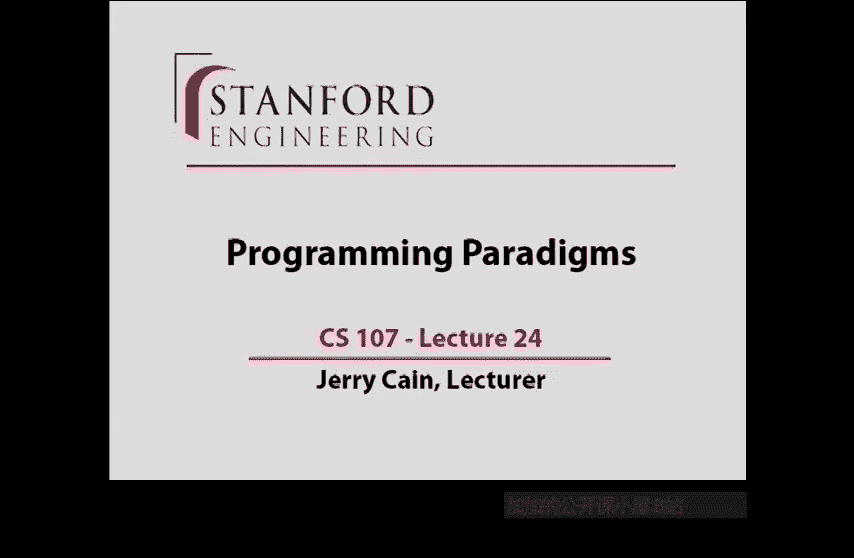
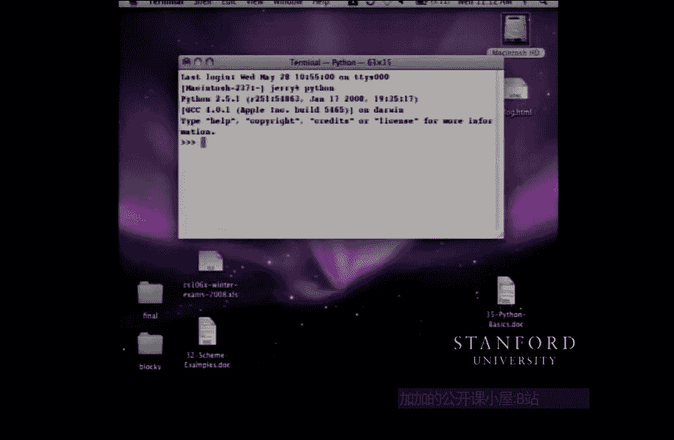

# 024：Python语言简介 🐍

在本节课中，我们将学习Python语言的基础知识。Python是一种多范式语言，它融合了脚本语言、面向对象和函数式编程的特点。我们将从Python的基本环境开始，逐步了解其语法和核心概念。

## 概述 📋

Python是一种动态类型的脚本语言，它强调代码的可读性和简洁性。与C、C++和Java等语言不同，Python使用缩进来定义代码块，而不是大括号。本节我们将通过交互式环境来初步认识Python。

## Python环境与基本交互 💻

上一节我们介绍了Python的多范式特性，本节中我们来看看如何启动Python并与之进行基本交互。

启动Python解释器后，我们可以直接输入表达式并立即看到结果。这与Scheme的交互式环境类似。

以下是几个基本交互示例：

*   `>>> 1 + 2 + 3 + 4` 将计算并返回结果 `10`。
*   `>>> “hello”` 将直接返回字符串 `‘hello’`。
*   `>>> True and False` 将进行布尔运算并返回结果 `False`。

## Python的核心特性 ✨

了解了基本交互后，我们来深入探讨Python的几个核心特性。

Python主要被视为一种**脚本语言**。脚本语言的执行方式类似于戏剧排练时演员手持剧本念台词，Python解释器逐行读取并执行代码，同时立即产生相应的副作用。

Python支持**多种编程范式**：
*   **命令式编程**：像C语言一样，侧重于通过一系列顺序执行的语句和赋值来完成任务。
*   **面向对象编程**：像C++一样，一切围绕对象和类来组织数据。
*   **函数式编程**：像Scheme一样，支持Lambda表达式、`map`函数和`eval`语句等。

Python是**动态类型**语言。与Scheme类似，Python在运行时为每个数据维护类型信息，并且可以查询数据的类型。这与C/C++等静态类型语言在编译时确定所有类型信息的方式截然不同。

Python的语法**非常简洁**。它通过**缩进（空格和制表符）** 来定义代码块，而不是依赖大括号`{}`或大量的括号`()`。对于初学者来说，这可能需要一些时间来适应。

## Python的应用场景 🌐

由于其丰富的库和简洁的语法，Python被广泛应用于多个领域。

虽然许多程序员以命令式风格使用Python，将其用于自动化任务和批处理脚本，但Python的能力远不止于此。

以下是Python的一些常见应用：
*   **网络服务**：许多公司使用Python构建服务器端应用，因为它拥有强大的网络库，原生支持HTTP、HTTPS等协议。
*   **大型软件**：除了脚本，Python也用于开发游戏、编译器组件等规模更大的软件项目。

## 总结 🎯

本节课中我们一起学习了Python语言的入门知识。我们了解到Python是一种多范式的动态脚本语言，它语法简洁，使用缩进定义结构，并广泛应用于从脚本自动化到大型网络服务的各种场景。通过交互式环境，我们初步体验了Python的执行方式。在接下来的课程中，我们将深入学习Python的函数、类等具体语法。