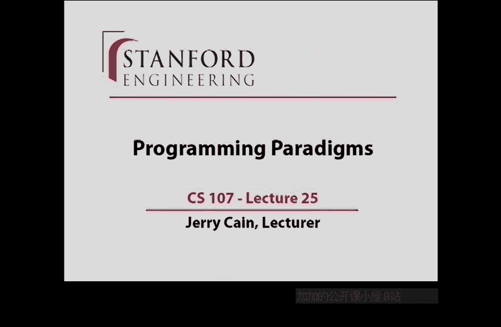

# 025：Python中的字典、对象与RG程序重写





本次演示由斯坦福大学专业发展中心提供。


## 概述

在本节课中，我们将深入学习Python中的字典数据结构，并通过一个具体示例——用Python重写作业1中的随机句子生成器（RG）程序——来展示其实际应用。我们将编写一个非常简洁的程序，其中融合了命令式、面向对象和函数式编程范式。此外，我们还将介绍Python中的lambda表达式，并探讨Python的对象模型，理解其与C++等语言在实现上的差异。

## 字典：Python的核心数据结构

上一节我们提到了Python中字典的重要性。本节中，我们将更详细地探讨它。

字典本质上是哈希表的一个简单语法层。其键可以是任何可哈希的对象，且不必是同一类型。值可以是任意类型，字典内部的数据类型可以非常异构，这与Scheme语言中列表的特性类似。

与C和C++不同，Python允许我们以文本形式直接初始化复杂的数据结构。在C++中，你无法像下面这样直接初始化一个容器：

```python
# 在Python中，你可以这样写：
my_dict = {'key1': 'value1', 'key2': [1, 2, 3]}
```

但在C++中，对于`std::map`或`std::vector`这类容器，没有对应的“对象字面量”语法来直接初始化包含多个值的数据结构。

## 示例：重写RG程序

现在，让我们来看一个具体的例子，将作业1中的RG程序用Python重写。我不会写出完整的语法，但会创建一个用于随机句子生成的语法文件格式。

以下是语法的字典表示：

```python
grammar = {
    '<start>': [['The', '<object>', 'is', 'here', '.']],
    '<object>': [['computer'], ['car'], ['assignment']]
}
```

在这个字典中：
*   键是字符串，代表非终结符（如`<start>`， `<object>`）。
*   值是一个列表，代表该非终结符的所有可能展开式。
*   每个展开式本身也是一个列表，包含一系列终结符（如`'The'`）或非终结符（如`'<object>'`）。

这个结构使得`grammar`成为一个内存中的字典对象，它有两个键，每个键映射到一个列表的列表。

## 实现展开函数

我们的目标是递归地展开起始符号以生成随机句子。假设`grammar`是一个全局变量，我们定义一个`expand`函数。

函数逻辑如下：
1.  判断传入的`symbol`是终结符还是非终结符。
2.  如果是非终结符（以`'<'`开头），则从`grammar`中获取其定义列表，并随机选择其中一个展开式。
3.  然后，按顺序递归展开该展开式中的每一个符号。
4.  如果是终结符，则直接打印它。

以下是`expand`函数的核心代码框架：

```python
import random

def expand(symbol):
    if symbol.startswith('<'):  # 判断是否为非终结符
        definitions = grammar[symbol]  # 获取该非终结符的所有可能展开式
        expansion = random.choice(definitions)  # 随机选择一个展开式
        for sym in expansion:  # 遍历展开式中的每个符号
            expand(sym)  # 递归展开
    else:  # 如果是终结符
        print(symbol, end=' ')  # 直接打印
```

这里使用了Python内置的`random.choice`函数，它可以从一个列表中随机均匀地选择一个元素，正好满足我们的需求。

## Python中的对象模型

在像CS107这样的课程中，我们通常会深入底层了解对象的实现机制。这可能会给人一种印象，认为所有语言中对象的实现方式都相同。但事实并非如此。

Python的对象模型有其独特之处。它非常动态和灵活，允许在运行时修改对象的结构。这与C++或Java中更静态、编译时确定的类结构有很大不同。理解这种差异对于掌握Python的面向对象编程至关重要。

## Lambda表达式

Python也支持lambda表达式，它提供了一种创建匿名函数的简洁方式。这与我们在Scheme中学到的lambda概念本质相同，只是语法不同。

例如，一个简单的lambda表达式：
```python
f = lambda x: x * 2
print(f(5))  # 输出 10
```

## 总结

本节课中，我们一起学习了：
1.  **Python字典**：作为核心的哈希表数据结构，支持异构键值对和直观的字面量初始化。
2.  **实践示例**：用极简的Python代码重写了RG程序，融合了多范式编程。
3.  **递归应用**：使用递归来展开语法生成句子，模仿了函数式编程的风格。
4.  **对象模型**：认识到不同语言（如Python与C++）在实现对象和类时的差异。
5.  **Lambda表达式**：了解了Python中创建匿名函数的方法。

通过这个例子，你可以看到Python如何利用其强大的内置数据结构和简洁的语法，优雅地解决实际问题。