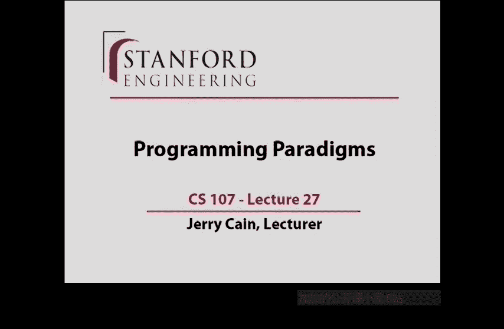
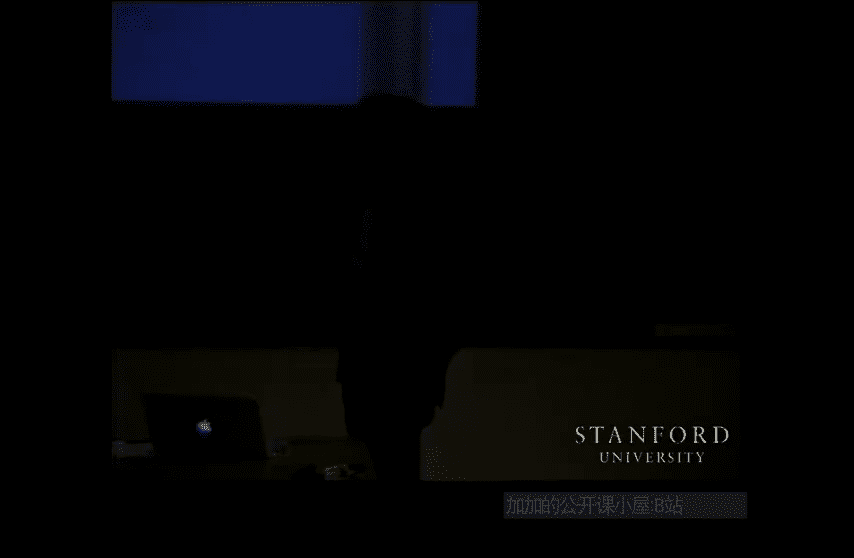
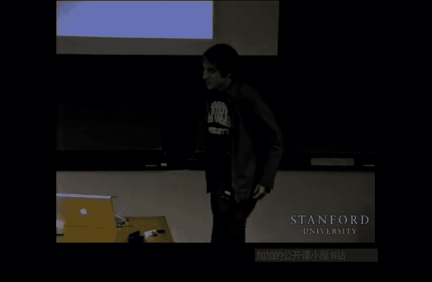
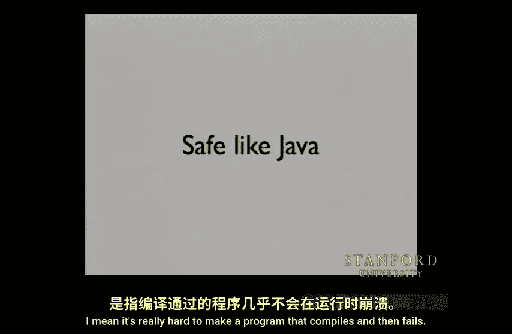
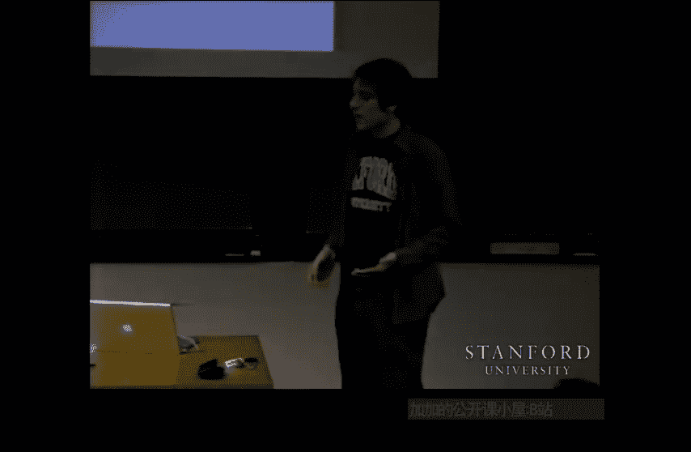
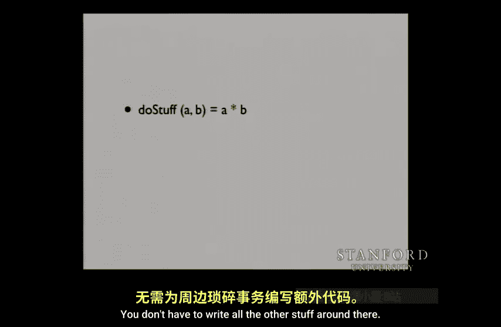

# 027：Haskell 语言简介 🎼

在本节课中，我们将学习一种名为 Haskell 的函数式编程语言。Haskell 以其强大的类型系统、函数式编程范式和独特的“惰性求值”特性而闻名。我们将了解它的历史、核心特性以及它与我们已学语言（如 C、Scheme、Python）的区别。

本次讲座由斯坦福大学职业发展中心提供。

---

大家好，欢迎。今天没有新的讲义发给大家。你们应该已经完成了所有讲义。昨天课程的解答尚未发布到网上，但 Ryan 会马上处理。下次见面将是周一上午 8:30 或周一下午 3:30。请记住，你们可以在任意一个时间参加期末考试，无需提前告知我选择哪个时间。但只能参加一次。我将在周一下午 3:30 将试卷作为讲义发布。因此，正在观看录像的 SCPD 学生，请计划好下载试卷。我对你们的考试时间要求更灵活一些，因为我知道你们需要工作。但我需要在周二下午 5 点前收到你们传真回来的试卷，我们将在周二晚上开始批改。

你们明晚有一项作业要提交。你们可以使用任意多的延期天数。这项作业的设计初衷并非让你们用掉 5 天延期，但如果你们有 5 天延期并想在期末考试后提交，这也不是问题，因为我们反正要等到之后才能批改。如果你们还没有收到作业 4 的批改结果，请告诉我，因为你们应该已经收到了。我已经看到所有成绩通过邮件发给我了。作业 6 正在批改中，我要求助教们必须在周末前将作业发还给你们，以便你们确保理解了我将要测试的线程相关知识。作业 7，我认为你们在期末考试前可能收不到批改结果。但那是关于 Scheme 的历史性作业。如果班上有 200 人，大约 195 人能得 A 或 A-，因为你们都能让它运行起来，而且这是一种新语言，所以我们对代码风格的要求并不严格。如果你们的程序能运行，很可能就没问题。因此，你们不会对那项作业的反馈感到意外。

好的，我上次已经讲解了足够的 Python 知识来完成作业。我邀请了一位来自 Facebook 的同事，他负责……不，我邀请了一位同事。实际上，在我入职 Facebook 的头六、七周里，他算是我的上司。他也是一位编程语言爱好者。他精通两种我不太了解的语言，叫做 Haskell 和 ML。我请他来讲讲其中一种，Haskell。所以，我现在就把讲台交给他，让他向你们介绍一种如果只有我教课你们可能不会接触到的语言。好的，让我们在这里切换一下麦克风。这位是 Sasha Rush。我将让他来讲。嗯。

---

好的，今天我要讲的是 Haskell，这有点像一种前卫的编程语言。如今你们不会在很多公司看到使用它。如果想找工作，你应该成为一名优秀的 C 程序员。如果想编程未来，你应该多学学 Haskell。可以把它看作是编程语言界的勋伯格。

以下是 Haskell 的一点历史。它和 Lisp、Scheme 属于同一家族。它是一种函数式语言，这意味着不鼓励修改变量，通过大量使用函数来完成所有事情。它有类似 Scheme 中的 `map` 函数，但括号少得多，这很好。

然后，它发展到了称为 ML 的语言。还有一种叫 OCaml 的语言，是 ML 的现代版本，相当流行。这些语言吸收了 Scheme，并以一种有趣的方式与 C 融合，即它们是静态类型的。因此，你有真正的整数类型，如果尝试将整数与字符串一起使用，程序会报错。这很好，因为它为程序增加了速度，但在 C 语言中这很烦人，因为你必须在各处声明类型。ML 背后的绝妙想法是，你编写的代码看起来像 Python 代码，但编译器会为你推断类型，因此它会抛出错误，而你无需写下任何类型定义。这个 30 年前发明的绝妙想法至今未被广泛使用，但我认为未来它会变得越来越标准。最新版本的 C# 和未来版本的 JavaScript 可能会包含这类特性。

后来出现了一种叫 Miranda 的语言，它是一种专有语言，但它有一个非常巧妙的想法，我们稍后会讨论，那就是“惰性求值”。惰性求值在除了 Haskell 之外的几乎所有语言中都看不到。原因是所有研究这个问题的人聚在一起说：“嘿，让我们创建一个开源的、惰性求值的、标准的 Miranda 版本，这样我们都可以一起研究。”所以，如果你想让研究人员关注你的语言，不要让它成为专有语言。

这一切在 Haskell 98 中汇聚成型，顾名思义，它于 2003 年发布。这可以说是 Haskell 的现代版本。自 2003 年发布以来，它在一小群非常专注的人群中极其受欢迎，他们在过去五年里一直非常努力地改进它，现在已经达到了相当出色的程度。

好的，那么 Haskell 有什么特别之处呢？首先，它像 Java 一样安全。这里说的“安全”，是指很难写出一个编译通过但运行失败的程序。

这意味着，如果你尝试将一个字符串和一个整数相加，程序会失败。`:` 语法有点像 Scheme 中的 `cons` 操作符，意思是将元素添加到列表的开头。所以，如果你尝试将一个字符串放入一个数字列表中，程序也会失败。这又与 Scheme 不同，因为 Scheme 不是静态类型的。Scheme 允许你在列表中放入任何类型的东西，而 Haskell 中，一个列表中的所有元素必须是相同类型的。

所以，它像 Java，但更安全。Java 中有很多有趣的问题。这里有一个例子：我有一个名为 `temp` 的对象，并将其设为 `null`。然后我尝试运行一个本应是对象的方法。理论上它应该被保证是一个对象，但它可能失败，因为 `temp` 是 `null`。这是命令式语言中常见的现象，但它是一个大问题。存在许多你没有防范的潜在运行时错误。

另一个例子：我们有一个名为 `Tt` 的对象，我试图将其转换为 `String`，这在 Java 中是允许的（我认为这叫向下转型），允许从父类转到子类。但这有很大的失败可能性，因为在这个例子中，它不是 `String`，你不能假装它是。

其次，它像 Scheme 一样富有表现力。正如之前所说，它有 `map` 函数。方括号表示一个列表，类似于 Python 中的列表字面量。你可以在上面运行匿名函数，所以这个函数将列表中的每个数字加一，并返回一个新列表。另一个例子是 `sortBy` 函数，它接受一个比较函数并用该函数进行排序。这里的例子只是按标准顺序对列表进行排序。

第三，它像 C 一样快。虽然没有 C 那么快，但正在接近。大概在一个数量级上。这里有一些统计数据（来自计算机语言基准测试游戏）。这并非衡量语言速度的最佳方式，但可以让我们有个直观了解。关键区别在于：类型不仅保证了安全性，还允许语言运行得更快。当你看到一个加号时，你知道你将要把两个整数相加，而不需要检查失败的情况，这使得语言看起来快得多。

最重要的是，它很有趣。我说的“有趣”是指，如果你想写一个乘法函数，你只需写一个乘法函数，而不必写周围所有的其他东西。