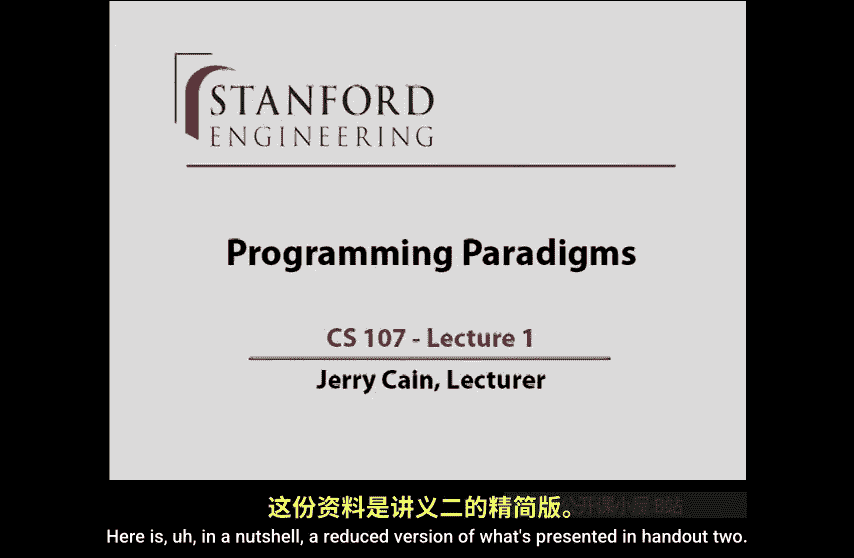
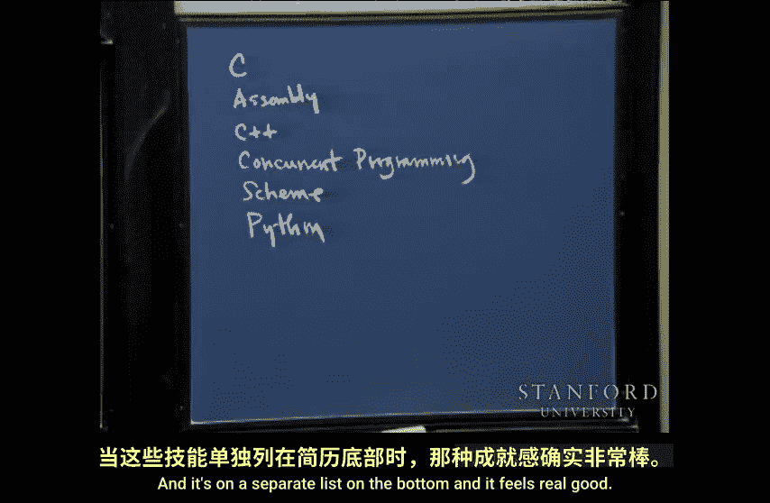

# 斯坦福大学【中英⚡编程范式｜CS107 Programming Paradigms】 p01 P1 ) -BV1aJ1EBHEoN_p1-

Okay。🎼，🎼，This presentation is delivered by the Stanford Center for Professional Development。

Okay。Here is in a nutshell， a reduced version of what's presented in in handout 2。

 And this is the syllabus。I have。Several languages I'm going to put on the board and just and one concept。

 C。Assembly。C plus plus。Concurrent。Programming， that's not a language that's just a paradigm。嗯。

Scheme。And then it is official， I'm actually going to cover Python from now on and 107。嗯。

People look at this and they go， wow， I'm gonna be able to legitimately put all of these languages on my resume。

Okay and it's kinda separate list at the bottom， and it feels really good。

 It isn't so much about that。 Certainly we want to give you some mileage in some very relevant languages that are very good for both research and for industry。

 but the real intellectual value in learning all of these languages is to really study the paradigms that they represent。

 and I'll explain what that means in a second。 But to program in C or C plus+。

 it's actually almost a different thought you're following a different thought process than you are when you program in scheme or in Python you all know enough C plus+ and believe it or not。

 you know a lot of C already just take out the object orientation from C plus+ and you're more or less left with C。

 when you program in C， pure C and you have no classes。

Your very procedure， procedure oriented。 you think about the main function as being a high level outline of maybe five top level functions to call。

 And those five functions， each have sub functionss and those sub functionss have sub sub functionss。

 etc。 it makes sense。 It's like a bit like it's like like outlined for history outlined notes for history class。

 where you have Roman number1 and main and Roman number2 in main and Roman number3 and main and you have small A and B and little I and things like that。

 You understand what I'm getting at。 Okay， you're oriented around the procedures。 Okay。

 you program with side effects， you pass around references and pointers with the idea of updating shared data。

 Okay， you do that both in C and C plus plus。 But as far as C is concerned。 This represents。

What's called the procedural paradigm。 You also hear it called the imperative paradigm。

 It is verb oriented in the sense that the first thing you ever see or you typically see with a statement is the function call Okay。

 where the function name is usually has some strong verb in it。

 So it gives you some idea as to what the function is supposed to accomplish。 Okay。

 does that make sense to people。When you studied C plus plus and all of a sudden。

 rather than calling， do this and passing the address of some object， you do my object arrow。

 do this。 does that make sense。 Okay， then all of a sudden。

 the first thing you see on that line is the data or the object that's being manipulated。

 And because the first thing you see is the object。

 That's why it's object oriented as opposed to procedural procedurally oriented。 Okay。

 that makes sense to people。Okay。I think a lot of C++ programmers really program in C and just incidentally use the objects in the classes that are available to them。

 Okay， which is a perfectly reasonable way to program。 Most people learn how to program in C。

 Most people I know in industry， no C very， very well。

 And in spite of the fact that there's 50 million newer languages that are better in many regards。

 They still stick with what they know。 And that's why C and C++ are still such popular languages。

 theres nothing wrong at all with programming in C。 if you really know it very well。

 And you write clean readable code。 It's just more difficult。 I'm sorry， let's say this way。

 it's much easier to make memory errors in C because everything is exposed and there's very little error checking going on。

 C plus+ is a little bit better about it。In between here， I have this thing called assembly。

 I haven't decided whether I'm going to go with what I've gone with for the past seven or eight years。

 which is this mock assembly language， or I'm going to really take a step and teach you a real I don't want to say it is a real assembly language although you don't see it's in use very much。

 but this assembly language called MIps， which is very easy as far as assembly languages go to learn。

 I don't really care so much about teaching you how to program and assembly。

 I use it as a vehicle for showing you how c and C plus plus programs compile to dot o and object files into binaries and eventually become executables and show you how a line like I equals 7 or j plus plus or fo of x and y as a function call。

 how that'll translates to assembly code does that makes sense I mean you know that when you write c plus code when you execute the program it's not c plus anymore。

 it's assembly code。 It's all zeros and ones eventually I want to give you some insight as to how C is translated。

To assembly code， how all your variables and your functions and your object and all of that eventually get boiled down and hash down to a collection of zeros and ones。

 And I want to do a little bit of the same thing for C plus plus。

It turns out that while C++ and C represent different paradigms that they really all compiled the zeros and ones And after you get enough experience with this assembly and the manual compilation process that we're going to learn about is how to look at C code and figure out what the assembly code would look like。

 you're really going to see that C++ and see almost look like the same language as far as the zeros and ones are concerned we're really just going to extend the compilation model we use for going from C to assembly to accommodate C plus plus references and classes and templates and things like that that are new to the language compared to C。

 And you have an I think a very， very good understanding of how C and c++ work。

 after the first five weeks of the course。 and it makes you so much better of a C and+ program where we're going to demystify this whole pointer thing。

 I'm going to be able to do something like P equals 7。

 and you're gonna know exactly what it means And so it takes a little bit of work。

 and it's almost laughable how arbitrary you can be with。

y casts and your ampersands and your asterisks， but if it compiles， it means something。

 so when it runs， it actually does something， it's probably not good if you have a lot of asterisks and ampersands。

 but nonetheless you can have some idea as to why it's crashing， not just that it is crashing okay。

I spend a good amount of energy talking about concurrent programming。 We actually， at the moment。

 do that type of programming in C。 But all the programs you've written in the past two quarters。

 if you've just taken the 106 A and 106 B courses here or 106 x。

 all the programs you've written at Stanford prior to 10，7 have been sequential programs。

 which means that there is whether it's object oriented or imperative proally learned。

 you have this outline of steps that happened one after another。 Okay。

 nothing's done in parallel or pipeline or done side by side。

 everything happens in one clean stream of instructions。 Okay， well。

 what concurrent programming programming is about is within a single program。

Trying to get two functions to seemingly run simultaneously。 Okay。

 and if you can get two functions to seemingly run simultaneously。

 then you can extend that and get 10 functions to run simultaneously or 20 functions to run simultaneously or seemingly simultaneously。

 I say it that way because technically， they don't run at the same time。😊。

When I go over assembly code， and I think you can intuit enough about what assembly code is like。

 But if you have this one function， Okay， my hand is a function， this hand is another function。 Okay。

 and you concern yourself with the execution of one of them。 Then when I do this。

 you can just think about it reading the code and executing it for side effects。

That makes sense to people。When you deal with concurrent programming， you have two or more functions。

 just two right here because I don't only have two hands to do this。

 And they both seemingly run at the same time。 Okay but what really happens is it's like watching two movies at the same time where because there's only one processor around most machines。

 it doesn't really run like this。 It runs like this。

And switches back and forth between the two functions。

 But it's happened so fast that you just can't see the difference。 Okay。

 it's more than 24 frame per second。 It's like a million。 Okay。

 and you're watching two movies at the same time。 Okay。

 and that extends just fine to 3 to 5 to 10 to 100 in theory， okay。There are。

 are a lot of situations where concurrent programming is really not very useful。

 but there are several situations， particularly networking， whenever that's involved。

 where concurrent programming is actually very useful。

There are some problems that come up when you deal with concurrent programming that you might not think about。

The example I always go over the first day of class is just， it uses two Wells Fargo ATM machines。

 Okay， Think about， you have a Wells Fargo checking account。

We may not have think about it because you probably do。

 So just imagine your checking account is in danger because two people are using ATM machines and you have $100 in it Okay and you share your pin with your best friend and you go up to neighboring ATM machines and you make as much progress as possible to withdraw that $100 and then you both on the count of three press okay to try and get $200 collectively。

 does that make sense。That is not a nonsensical example because both of those machines are basically very simple computers that ultimately need access the same master account balance to confirm that $100 is available and in this transactional way。

 transactional makes sense both in terms of money and also in the sense of concurrent programming。

 you have to make sure that the $100 being identified as the account balance is maintained with some some atomic flavor so that if if you have two people trying to withdraw $100 at the same time that only  one person gets away with it。

 that $100 account balance is the shared resource that two different processes have access to。

