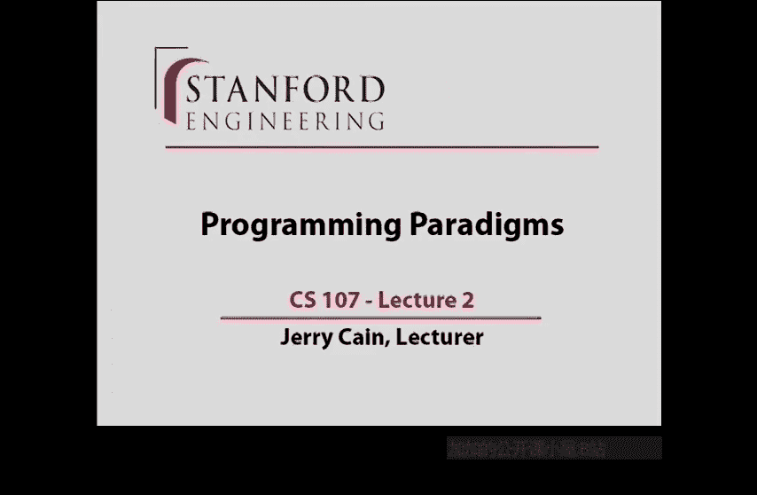
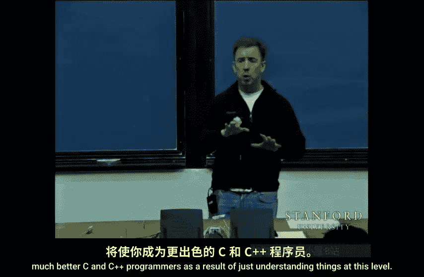
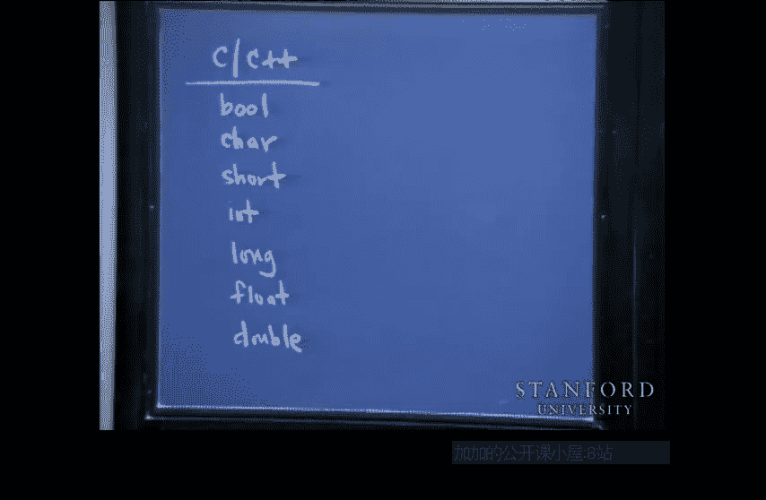
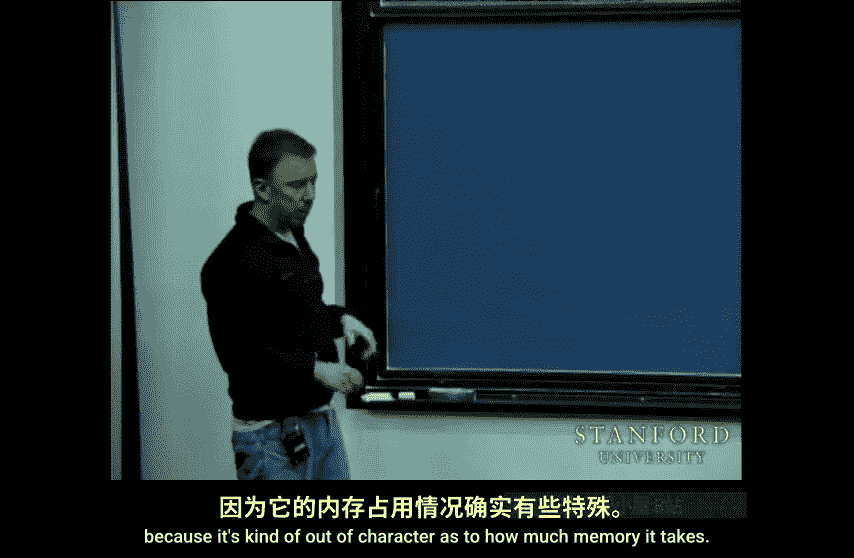
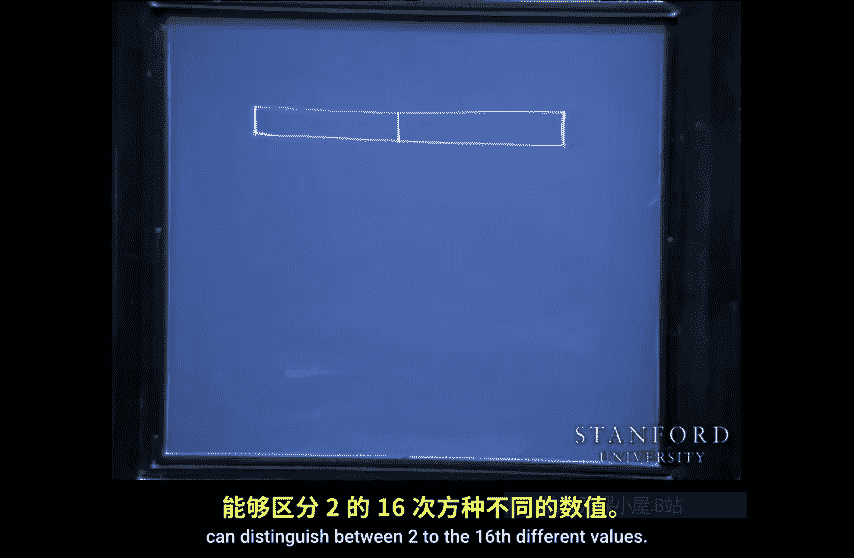
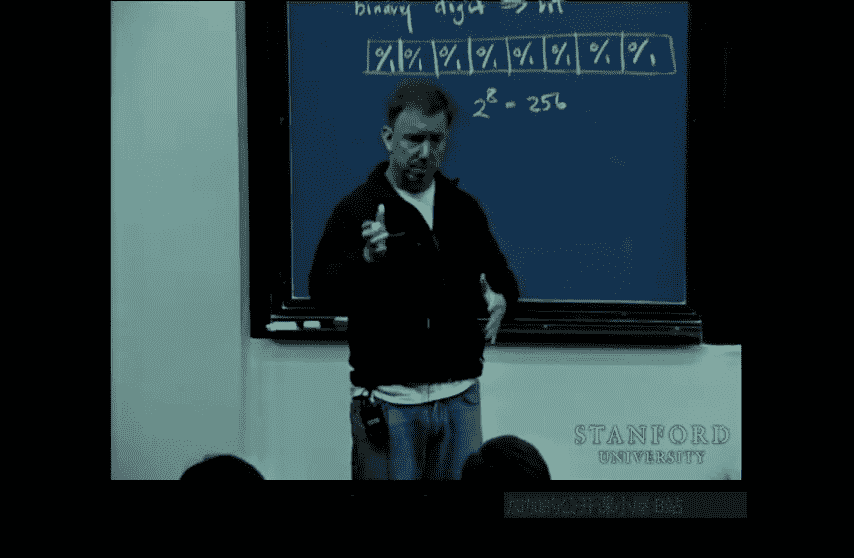

# 斯坦福大学【中英⚡编程范式｜CS107 Programming Paradigms】 p02 P2 ) -BV1aJ1EBHEoN_p2-

🎼，🎼，This presentation is delivered by the Stanford Center for Professional Development。

Hey everyone， welcome。 I have four super handouts for you today。 If you haven't gotten them yet。

 feel free to just sit down。 We're gonna probably make it a point because there's so many people in the class to just hand them out while I start lecturing this way we don't have this big bottleneck of people trying to get in by 11 o'clock the four handouts are posted to the web page。

 the mailing list were created last night。 and I just look at it this morning and there were 245 email addresses on it。

 So it looks like it's working。 I haven't sent anything to the email list yet。

 but I will just contrive a message later this afternoon and send it to everybody。

 And if you don't get that by Monday morning。 when I make an announcement say if you didn't get that message。

 let me know I'll investigate as to why you're not on it。

 SPD students I'm not sure that you're actually on the mailing list yet。

 that system runs a little bit differently。 and usually they push your email addresses onto the mailing list a little bit later。

 I'm not sure why。 but so if you don't get an email over the course of the weekend then just let me know。

I'll see what I can do to fix it。 I'll also post announcements to the web page so that you at least can get them。

 What I want to do is I want to start talking about the low-level memory mechanics so that you understand how data things as simple as booles and integers and floating point numbers andstructs in classes are all represented in memory it's very interesting。

 I think to understand how everything ultimately gets represented as a collection of zeros and ones and how it's faithfully interpreted every single time to be that capital A or that number seven or pi or somestruct with that represents a fraction。

 things like that and will just become much， much better CN plus plus programmers as a result of just understanding things at this level level a level so。

For the， for the moment， CNC plus plus are the same language to me。 So let's just talk about this。

 Let me just put a little grid up here of all the data types that you've probably dealt with。

 You've probably dealt with Bo。You've probably dealt with car， I'm sure you have。

 You may not have dealt with the short。But I'll put it up there anyway。

 you've certainly dealt with the int。You've certainly well maybe not dealt with the along。

 but let's just pretend you have。You've probably seen our floats。You've probably seen doubles。

And that'll be enough for me， enough fodder for the first 10 minutes here。

嗯。啊。These three things， I'm sorry。 these three things right there are certainly related。

 They're all intended to represent scalar numbers。 Obviously， this represents a true or false。

 This represents in our world， one of 256 different characters。

 We usually pay attention to about 75 of them。 but nonetheless。

 there are 256 different characters that can be represented here。 These are all numeric。

 These take a stab at trying to represent arbitrarily precise numbers。 okay。

The character is usually 1 B in memory。 At least it is in all CNC plus plus programmers。

 program compilers that I know of。 This is typically2 B。

The ins can actually be anywhere between 2 and 4 Bs。

But we're gonna pretend in this class that it's always 4 B。 Okay， the long for the time being。

Is 4 B of memory。 There is another data type， which isn't really common enough to deserve to be put on a blackboard called the long long。

 which gives you 8 B of memory to represent really， really large decimal numbers。

 They'll come up later on， but I'll talk about them if I ever need to。 The float。Is 4 B。

 It somehow tries to take 4 B of memory and represent an arbitrarily precise number to the degree that it can。

 given that it's using a finite amount finite amount of memory to represent a number that requires an infinite amount of precision sometimes。

 and a double， I've seen them 10 and 12 B on some systems。 but we're just going to assume。

Back there eight pointss。 Now， that's the most boring spreadsheet you could possibly introduce a class with。

 But my motivation is that I want to uncover what the bite is all about and how4 bys can represent a large frame of numbers。

 how 8 bys can represent a very large set of numbers and and actually do a pretty good job at representing numbers precisely enough for our purposes。

😊，So forget about fights for a moment。NowI'll go back to the bull in a second because it's kind of about a character as to。

 how much memory it takes。 But I'm interested at the moment in what is less commonly called the binary digit。

But you've heard it。Called the bit。And doubleE students and those who enjoy electronics think of the binary digit in in terms of transistors and voltages。

 high and low voltages。 computer scientists don't need to view it that way。

 They just need to recognize that a bit is a very small unit of memory that can distinguish between two different values。

 doubleE would say high voltage， low voltage。 We don't。

 We actually just assume that a single bit can store a0 or a one。Technically。

 a boolean could just be mapped to a single bit in memory。

 It turns out it's not practical to do that。 But if you really wanted to use a single bit to represent a boolean variable。

 you could engineer your compiler to do that， okay。

Bits are more interesting when they're taken in groups。 If I put down 8 Bs here。

I'm not even going to commit to a0 or a1， but I'm going to draw。This。

 this isn't zero over one is a fraction。 This is me drawing 8 bits。Let me just draw one over here。

 so I have some room and put a little box around each one of them in this binary search way。Okay。

 and I have this big exploded picture of what willll draw several times to represent a single bite in memory。

 Now， the most interesting thing to take take away from this drawing is that this little box right here can adopt one of two values independently of whatever value this box chooses to adopt。

 etc ceter。 In fact， there are 8 independent choices for each of the bits。

 I'm assuming that makes sense to everybody。 okay。😊，That means that this as a grouping。

 a bite of memory with its 8 bits that can independently take on zeros and ones can distinguish between 2 to the 8 or 256 different values。

 Okay， and that's why the askI table is as big as it is。

 okay65 through 65 plus 25 represents the alphabet。 I forget where lowercase A starts。

 But every single character that's ever printed to the screen or printed to a file is backed by some number。

 I know you know that。When you look in memory to see how the capital A is represented。

 you would actually see a one right there。 I'm sorry I forget where it is actually a one right there and a one right there。

 I'll draw it out and explain why that's the case because capital A is back by the number 65。

 we don't put things down in decimal in memory。 we put them down in base 2。 Okay。

 because that's what that's the easiest thing to represent in a bit oriented system。 Okay。

 that makes sense to people。 Okay， so if I say that the capital A。Is equal to 65。

 You have to stop thinking about as 65。 You have to think about it as some sum of perfect powers of  two。

 So it isn't。64， I it isn't 65， rather。 it's actually 64 plus  one。1。Is two to the zeroth。

2 is2 to the first。 There's none of that。4 is 2 to the second。8 is 2 to the third，16 is 4，32 is 5。

64 is 6。 This is actually 2 to the  sixth。Plus two to the zero makes sense。

As far as the representation in a box like this， if you went down and actually examined all the transistors。

 Okay， the8 that are laid side by side in a single character but bite of memory。

 it would look like this。And in order to recover the， the actual decimal equivalent。

 you really do do， you really do the the power series expansion where you say there's a contribution of two to the  sixth because it's in the  sixth。

Counting from 0 from the right， the sixth position from from the end of the by， this contributes。

2 to the 0。 you can look at that look at it as having contributions of  two to the first and  two to the third and2 to the7 that are weighted by a 0 as opposed to a1。

 Okay， that makes sense to people。Okay， so that's good enough for characters。Let's graduate to Schtz。

Some people are very clever in when they use shorts。

 A lot of times if you know that you're gonna store a lot of numbers and they're all gonna be small。

 they'll go with an array of shorts or or a vector of shorts。

 knowing that there really will be some memory savings later on。

The short being two bys just means that two neighboring bites in memory would be laid down。

Those are the two bytes at the moment would be laid down。

 and the two to the 16th different patterns that are available to be placed in that space can be can distinguish between two to the 16th different values。

 that makes sense to people， okay。

So I'll just make this up。 I'll put lots of zeros over here。Socept if I'll put one right there。

