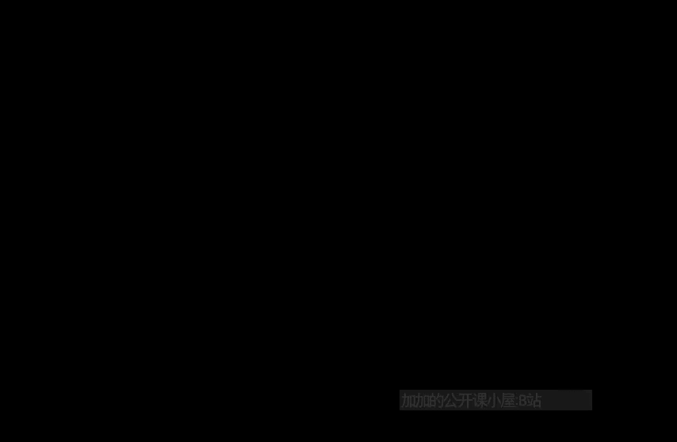
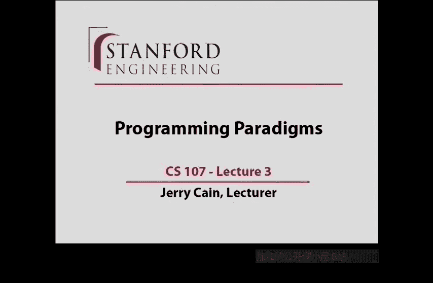
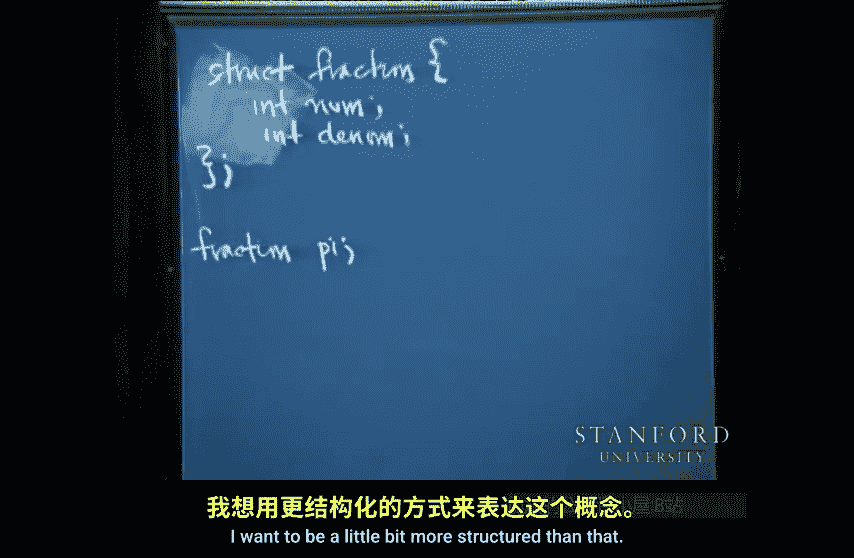

# 斯坦福大学【中英⚡编程范式｜CS107 Programming Paradigms】 p03 P3 ) -BV1aJ1EBHEoN_p3-

Yeah。🎼，🎼，This presentation is delivered by the Stanford Center for Professional Development。

Hey， everyone， welcome。 I have one handed for you today。

 you don't have it in your hands because we're going pass it around。 It's really one。

 I'm gonna have Ts pass it around during the lecture。I sent out an email on Saturday。

 does anyone not get that email？Probably a handful。 Oh wow， nobody， everybody got it。 That's great。

 Okay， you did not get the email。 Okay， well， if you can like email me directly at class so I can figure out what the deal is。

 the reason I say that is because I just realized over the weekend。

 This is totally my fault that the section room。😊，For tomorrow， scaling 193 seats 48 people。

 and I'm telling everybody to go to it。 So I have some I have to figure something out there。

 normally that's gonna be fine because most of you will just watch it on TV and get in the habit of doing that。

 But tomorrow I kind of want you to go So I'm working on one of two solutions。

 I'm either going try and get a bigger room just for tomorrow for 415 or I'm going get a huge room at 315 still have the 415 section and try and push everybody to go to the earlier one if they have any flexibility。

 So I will make a decision as based on what rooms are available to me later today and I will send an email。

 which is why I'm asking about the email Okay so definitely stay tuned for a CS17 email later today。

When I left you one question right there。 Tuesday at 4，15 or the normal sections。 I may have one。

 May is the operative verb there。 I may have one tomorrow at 3。

15 just tomorrow to accommodate the sheer number of people I expect to show up。 Okay。

 when I left you last time， I was doing a little asterisk and ampersanrics。😊，Let me do another one。

I have a。Now， double。D that I said equal to 3。1416。 and as a result。I actually get。

A fairly large figure in memory。 that's populated。With pi， we'll decorate this with the D variable。

 And if I go ahead and I do the following。嗯， car。CH is equal to。Asteric。Car star。Ampersand of D。

 There was a little bit of confusion about this because of that ampersand operation right there。

The actual bit pattern that resides in the 8 B figure that we're calling D。

 the bit pattern is actually irrelevant。This is an expression on the address of D。

 It doesn't have to look inside the8 boxes to figure out what's important here。

 It has to evaluate that address because that's there。

 It's seduced into thinking that it's actually storing the address。

 I'm sorry that it's an address of a single character。 So when it dereences this right here。 it goes。

 and it embraces that single bite right there。 Whatever bit pattern happened to reside there before is now pretending to be a character for the lifetime of this statement right here。

 Does that make sense to people。 So if this happened to be， I don't know what it is。

 but suppose it's this。Bit pattern right there。 Okay， this variable called C， H。

We'll get that very bit pattern。 And if I go ahead and do C out less than less than C。

 H less than less than E And D L， whatever this corresponds to gets printed to the console。Okay。

 that makes sense to people。 Okay， let me do one more little tricky thing here。If I declare short。嗯。

Oops。And I said it equal to 45。I get a two bike figure。That has a 45 in it。 It's stored in in binary。

 but I'm just gonna to write 45 because it's easier to look at that。 And I do this。

This is where you get into a little bit of danger。Double star， I'm sorry， double D。

Is equal to asterisk。Of double。Star。Andm percent events。

 most of what I've said prior applies here as well。

 This is one scenario where things are a little bit mysterious。

This right here evaluates to the ampersand of S。 That's the address associated with that arrow。

 the number associated with that arrow。 And this is a brute force reinterpretation of that address。

 So what's going to happen is it's going to say， oh， wow， that arrow now。

 it never pointed to a short。 It actually points to an 8 B double。

So it will go and not only include those two bytes right there。This explains that follow it。 Okay。

 whatever bid pattern happens to reside there， providedvi there's no memory crash。

 And that'll explain why that could happen in a second。As long as it gets away with it。

 it's going go and embrace all8 by of those8 by of information there。

 interpret it as an 8 byte double and then assign it to this thing called D。 So if this is a 45。

 followed by。That is a bite pattern。Then。D would get 45 with this。It's amic pattern。

 and when I print that out， it's going to print out whatever number happens to be associated with that representation。

Does that make sense to people？Okay， now I could do these for days。 Okay。

 and show every little combination between asterisks and ampersands and double asterisks and whatnot。

 I want to move on and start talking about a raisinginstructs first。

 I think you'll just get more practice there。 We'll start learning some more material。

 There's a question right here。Example is going to behave differently on a little Indian Certainly yeah。

 well， as far as the bit copying is concerned。No， this ampersand right here is always the address of the lowest bite。

 But as far as how the。EndD in this has to do more with interpretation and placement of bitetes relative to one another。

As far as's those are these phrases in the handout， I kind of deemphasize what they're there。

 and since you're asking， I'll talk about it。Little Indian。If I were to write down a two by short。

Like that。 And if I were to store the number one in that short， you would just say， oh， well。

 the one just goes right here。 and it's preceded by 15 zeros。 Does that make sense to people。 Okay。

 that is true on about half of the systems in existence at the moment。 This right here。

 not only is a representation for positive one is a two by short。

 It happens to be stored in what's called big and D in format。

 and the the best way to remember that it's kind of arbitrary as to what big versus little means in this context。

I just remember it as the lowest byte stores the bits that correspond to the largest contributions of magnitude。

 Does that make sense。 Okay， And since one is such a small number。

 that's why you have all these ones over here。On some machines， in particular。

 the Linux machines that you're probably working on。It would store this。

With the bytes in the reverse order。 Okay， it would actually have the one right there proceeded by 7 zeros。

Followed by 8 zeros right there。 And it's just when it goes and interprets that as as a 2 by short。

 it actually assumes that these are bits 0 through 7， and these are bits 8 through 15。

 Does that make sense。So if you actually were to， if you could do this if you wanted to。

 if you were to copy a2 by short from a Linux machine to a solarlaris machine and just do it on a by copy level。

 you wouldn't get the same numbers on different machines。 Okay， you would get。

1 on a big N D machine here。 you get 256。 I'm sorry， Yeah，256 on a little N D machine。

 Does that make sense to people。 Okay， for the most part。

 you don't have to worry about ending in this at all。

 There's one aspect in assignment 2 that happens to deal with it。

 but I'm more or less insulate you from it。 Okay， just something to be sensitive to。

What I want to talk about now arestructs， how they work， how arrays work， how arrays ofstructs。

structs with a arrays inside all work， given what we know already。Let's。Kill this。

Let me go ahead and declare this as a struct right here。 Very simple。Strt。Fraction。8。没有吗？And。Denom。

That right there， That's the seaway。I'll assume more' in C++ for the moment。

 that's enough to declare fraction standalone as a new type。If I do this。Fraction。

 let's say Pi has a variable name。As a result of that。

 I obviously get enough memory to store a fraction in 106 B and 106 x。 maybe 106 A as well。

 you drew them as these somewhat loose rectangles around two boxes。

 I want to be a little bit more structured than that。

 I want to recognize that the amount of memory that's set aside for the structure fraction。

 not surprisingly is8 bytes。 Okay， It's basically the sum sum of its parts。

 and it actually packs all of those bytes as tightly as possible。

I'm going to draw this as 8 Bs。I'm going to emphasize that the fact that it's really four bys stacked on top of four more bytes。

The address of the entire struct is always coincident with the address of the first field。

 So looking at this and assuming that that's a picture of one of these things。

 you know that this is the noon field。In this， in this case。

 it'll be pi dot nom because that's the way I declared it right there And stacked on top of that。

4 by above the base address of the entire thing。Would Pi dot Dino。O。

So when I draw that arrow right there。Unless I give you some context。

 you don't know whether it's an instar pointing to the address of the noon field， I'm sorry。

 storing the address of the new field。