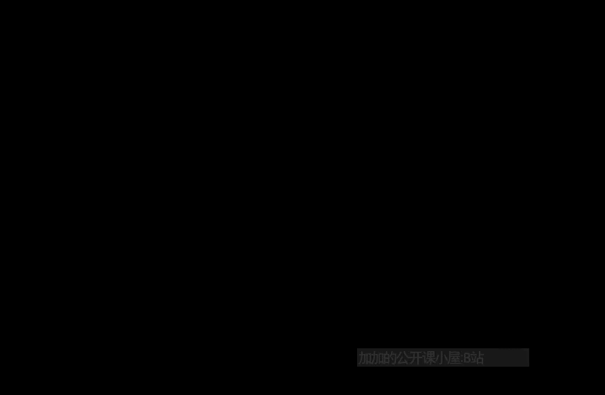
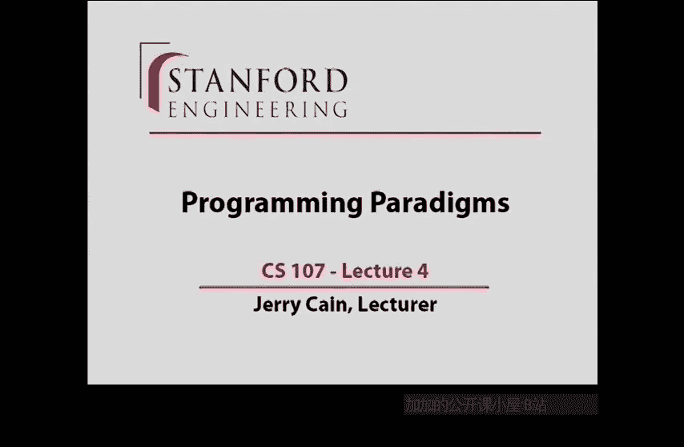
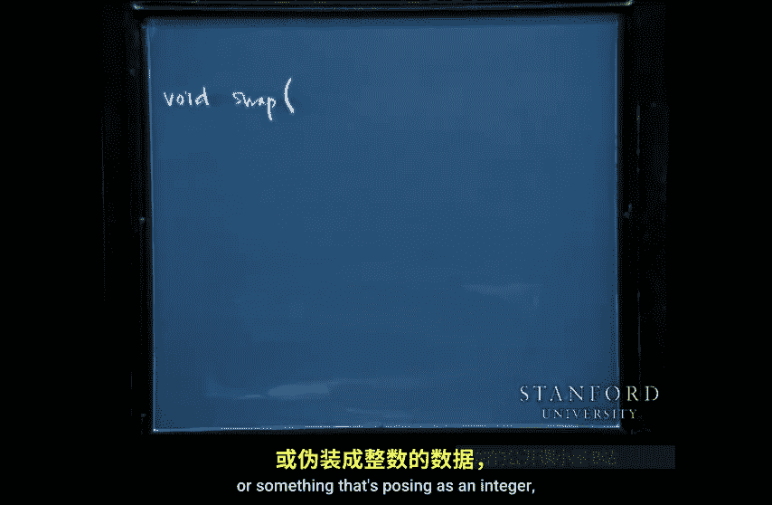

# 斯坦福大学【中英⚡编程范式｜CS107 Programming Paradigms】 p04 P4 ) -BV1aJ1EBHEoN_p4-

Okay。🎼，🎼，This presentation is delivered by the Stanford Center for Professional Development。

Hey， hey everyone， welcome。You made it through a week of 107。 I have two handouts for you today。

 although I only really have one。 I have one fresh handout。

 and I also have hard copies of the discussion section handout from yesterday。

 which I know not everybody can go。 So if you need a hard copy of that and don't want to print it out yourself then come grab a copy before you leave when I left you last time I had gotten through the implementation of swap that was specific to ints。

 So I want to make a few points about that and then go generic on you by implementing the C version of what we would do and C plus plus using templates。

 this is more or less the code I wrote for you last time， the idea being that A。And Vp。Actually。

 address in some mysterious space。 They know the addresses of it。

 They don't know what the source of it is， whether it's the heat or some function color or whatever。

 But algorithmically， what happens。Is that the two integers in those two boxes are effectively exchanged。

 Now， the 10，6 A or 10，6 B way of saying this， In spite of the fact that it uses pointers is that it actually rotates the integers。

The 10，7 spin on this， which I think is more helpful for the code we're going to write in a second。

 is that， oh， I don't really care that theirre integers as long as I exchange the representations for those things。

 The 4 by representations for these two integers。 Then when we go back to the code that calls this。

 it will notice that two of its integer variables。 whether they're embedded inside arrays or struct or their two standalone integers。

 their bit patterns will have been exchanged， the representations being exchanged so that when they look at those。

 they'll be each other's integers。 Okay， does that make sense to people。Yes， no。Okay。

 it did nod or did。 You got a nod。Okay， the reason I say this is because the implementation here。

 and I'm going to frame this with with a 107 bent on it。This declares a4bte figure。

And this assignment replicates the four bytes held by this box in that box right there。

 It knows that we're dealing with a4 byte figure because this and this and temp are all typed in a way that's related to an integer。

Okay， this does the same thing， takes a bit pattern right here and replicates it in the space addressed by A P。

 And then finally remembers what used to be pointed by A P and puts that in what's pointed to by B P。

 Okay， so it's really a bit pattern rotation。 Theres an implicit knowledge of the number of bytes that are being moved around because ints are just understood。

 even a compile time to be 4 byte figures。If I want to use this function to swap。Doubles。

 I'm not going to be able to do it。 Okay， if I want to be able to swap twostructs or two classes。

 I'm not going to be able to do it。What I want to do is I want to write a version of swap。

That can exchange， I'm going to design it to exchange two arbitrarily sized figures。 I'm sorry。

 the two figures themselves will be the same size， but I don't want to constrain it to be four bytes。

So what I want to do is I want to write this as a function。Vvoid， swap。

Rather than rather than accepting an instar and requiring that I get the address of an integer or something that's posing as an integer。

I want to be able to pass in an arbitrary address here。

 and I don't want I don't want to constrain it a point to any one type。

 The way you do that in pure C and even in C plus plus technically。

 but in pure C is to write down a generic pointer type。 That is of type void star。Now。

 that doesn't mean that it points to nothing。 It just means that it points to something that it doesn't have any type information about。

 Okay， and I'll put down V P1。The second argument。Well， V V P2。

 the setup here is that V P 1 and V P2。Are addressing some things that begin at the the addresses that are stored there。

 Now， I draw them as Ls as opposed to rectangles， because I don't know how wide they are。

Does that make sense to people， Okay， if it's really a generic address。

 it's just an arbitrary location in memory。 There may be a character。 There may be a short。

 There may be a boolean。 There may be an unsigned along。

 There may be a struck fraction or a struck student。 We just don't know。

Let me make the mistake of closing this off and showing you what problems we run into。

If you try to do this。咁兵。I'm not trying to be funny here， but if you try to do something like this。

Your heart's in the right place， but this is just plagued with issues。

There's one quite clear problem with this， and there's one slightly more subtle problem with this。

 You cannot declare a variable。Called temp to be of type of void。 Okay。

 that's just a return type for functions that just states that there's nothing to be returned。

 You can pass in void as a loan argument to a function or a method to say that we're not expecting anything。

 or you can use void in the context of void star to mean generic pointer。

 You cannot declare temp to be a void。 Okay， The more subtle problem here is that you're not allowed to de referenceence a void star。

And you may be like， well， why not。 The answer is， it doesn't know how many Bs to go out and embrace as part of the identification process。

 Okay， do I go out and do I deal with a 1 by figure or a 2 by figure or a 4 B figure。

 Theres no type information about this。 So it doesn't know whether it's 4 or 16 or 128 B。

 does that make sense to people。 has no size information about the thing being addressed at all。

So the official thing to do。Recognizing that we still want to rotate bit patterns。

Is to expect a third argument。Ant。Called size。Where sizes。

Supposed to be explicitly stated as the number of bytes making up the figures being swapped。 Okay。

 so at least it has more information than it had before。

It actually doesn't really care whether they're 4 by integers or 4 B floats。 Okay。

 or two a struct with two shortrks inside。 As long as I exchange the 4 by bit patterns。

 I'm effectively swapping the values。 Okay， this is how you do it。Car。Buffffer。Size。

Our version of Gcc and G plus+ allows you to declare a rays with a size that depends on a parameter。

 Okay， so this might seem weird that I'm declaring a character buffer。

 but it isn't really a character bufferer in the the C string or the C string sense。

 I'm really just setting aside enough space to hold size bys。

 So we can function as temp does in that block of code up there。 Okay。

 I don't care to interpret buffer as a string。 I just want it to be this little storage unit where I can copy something。

 okay。Remember how last time I went over this function called St copy S T R CP PY that knew how to copy bytes from one location to another location。

 And it kept on copying until it found the backslash0 and it copied the backslash0 as well。

There is a more generic version of that that's not dedicated to characters。

 There is a function called mem。靠病。What that's taken to do is's like store copy。

 except it doesn't pay attention to backlash0s。 You have to explicitly tell it how many bytes to copy to a memory location。

If I write。Buffffer there。 And I write V P1 there。That's an instruction to keep copying bys。

 You can think about it copying bytes1 by one。 Okay，1 bite after another。

 to the space addressed by this right here。Okay。This is the source of those bytes。

 It doesn't care about 0 bys。 Okay， you may be copying 20 B of zeros。

This is why you need the size parameter to be passed in。

 So you know exactly how many bytes should be copied。Okay， so before I finish this。

 let me just give you a sense as to what's happening here。 Suppose this is， in fact， an8 byte figure。

And this is。The bit pattern that's right there。This declare something。That's as wide as that。

 It's not drawn to scale， but I'll just emphasize the fact that it's all characters。

This right here says， please copy stuff from that address into this address right here。

 And it just doesn't bite bite bite it。 It doesn't matter that they're not really characters。

 They're just bit patterns that that are taken or digested one bite at a time。

 And the full bit pattern。That's right there is replicated in that perfectly sized space。

Does that make sense， Okay， I question right there。Not only in Java that it does。

 it doesn't in CNC+ plus， it's only one by yeah。嗯。The mem copyright here basically does the equivalent of that first line up there。

 It just took two lines here。Then what I can do is I can do a mem copy。

Into the space addressed by VP1。From the space that's addressed by BP2 and copy the same number of bytes。

That takes。That right there。 And as a bit pattern， replicates it over this space。

