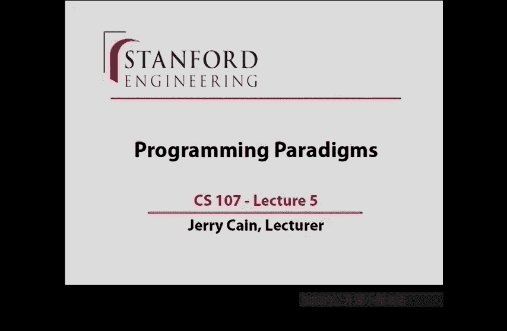
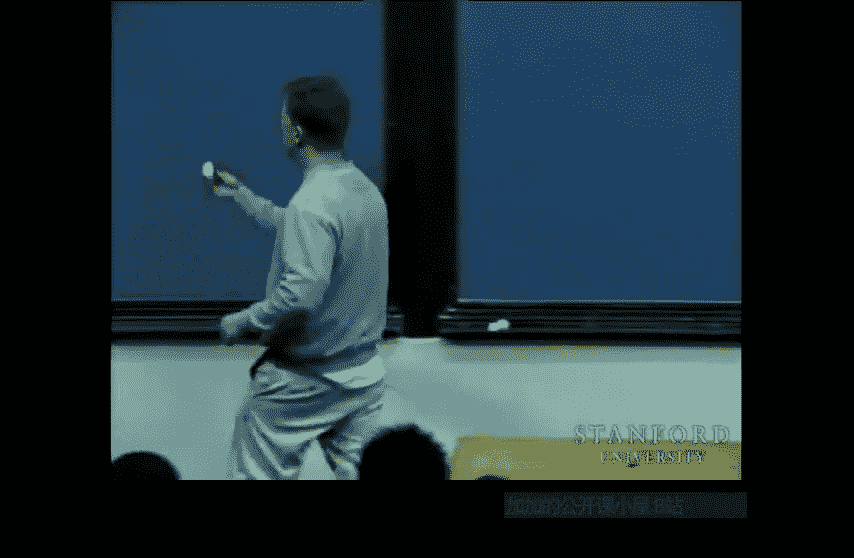
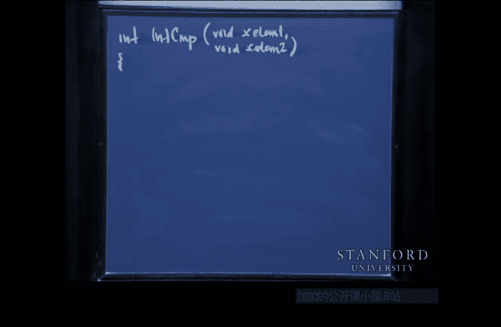

# 斯坦福大学【中英⚡编程范式｜CS107 Programming Paradigms】 p05 P5 ) -BV1aJ1EBHEoN_p5-

🎼，🎼，This presentation is delivered by the Stanford Center for Professional Development。

你要啥。Hey everyone， welcome， I don't have any handouts for you today。

 So you were all cranking on assignment1， which is intended to be very short to Sunday night。

 The first real assignment went out Wednesday that's due next Thursday evening。

 and at least until the midterm I'm going to establish this Wednesday to next Thursday scheduled with all the assignment。

 So there's some reliability is how the workload ebbs and flows when I left you last time I was probably about 60% of the way through my L search implementation。

 I'm trying to go from Type Pacific to general， but I'm generic。

 but I'm trying to do that in the C language。 So this is what I wrote last time。

Boyd star。L search。And let's see if I can write the parameters out a little bit more neatly this time。

 voidd star。K。Vod star。Base。In。M is the length of that array。Ant a size。Is the size of the elements。

 and that's technically all the implementation of L searchRTs needs in order to figure out where the boundaries are between neighboring elements。

The fifth parameters， what I want to focus on for the next 20 minutes。

 it has to have this as a prototype。 I like the asterisk。 We don't need it right there。

 but I like to keep it there。 oops， wrong way。And then I take two void stars。

I don't need to provide parameter names here because I'm not implementing this function here。Okay。

The basic algorithm for a linear search from front to back， that doesn't change。

 It's just the fact that we're trying to present an implementation that doesn't care about any specific one data type。

So。I want to do this。For antit I。Is equal to zero， i less than n。Hi， plus plus。With each iteration。

 I want to manually compute the address of the I element。

 I can certainly do that in terms of base a sizes the quantum distance to move with each top。

 And then I obviously tells me which element I'm interested in。 internally， I want to do this。

 Vo star。😊，A lemon address。This is the thing that's going to be compared against that key right there to figure out whether or not we have a match。

 This is equal to。Nummerically， base plus I times OM size。

But we mentioned last time that this is strictly pointer arithmetic against a typeless pointer。

 Okay now I'm sorry that the pointer has a data type。 It's a type void star。

 So it doesn't know what it's pointing to。 Several people have suggested or asked why they just didn't make a default to normal math when this is a void star。

 the specification of C just said， I don't want to allow pointer arithmetic by default against a void star because there's a clear rule for what pointer arithmetic means when this is strongly typed。

 Okay， when it's weak type with a void star， very generic。

 I'm just pointing to anything And I have no idea what。You can't do this， the hack。

And it really is a hack。But it's a well known hack。

Sedates base into behaving like a character pointer just long enough to actually get a number out of this expression。

Drug the base here say you're pointing to characters。

Do technically pointer arithmetic against the character pointer。 Okay。

 this as an expression is an integer。 It's technically multiplied by size of car， but that's one。

 Okay， so this ends up being a car star that happens to point to a boundary between the I minus-1 and I and the I elements。

I assign it to a void star。 You do not have to cast the overall all thing to avoid star if you don't want to。

 because this is a more general pointer it's willing to take on any pointer type。

If after you do this。You use the comparison function written by the client that knows how to compare the things that reside at these addresses。

 Pass in key。Pass in a lemon address。And if that comes back with a match of 0。

Then go ahead and return， I want to return the pointer， so go ahead and return a line address。

 this ends the entire for loop。I get to the end and I have nothing to return。

 I'll just return null as a Sentinel that nothing worked out。Okay。

This replaces the double equals that sit in between two integers。From the integer version。

 we wrote the middle of last lecture。 Okay， double equals between two strong types that are atomic。

 It knows how to do the comparison In almost all cases。

 it just does a bit wise comparison and can come out come out with a negative one or a positive one or a0。

When you go generic on the C compiler， you have to say that I know how to compare the elements because I know。

 even though this is generic code， I know what type of array I'm searching。 Okay， this code does not。

 So you have to pass in a little bit of a callback or a hook to tell the implementation how it should be comparing your elements。

Okay。This is easy to understand。 It's easy to just look at this and understand what's going on because you know what linear your search is。

 That's not the hard part。 The hard part is getting all the pointer math。

 correct the carstar trick and actually aligning these things up properly and invoking the comparison function properly。

 usingsing this as a client is at least as difficult as understanding this code。If I want to go。

Just think in terms of the int domain and I have the following， I have int。Aray。

Is equal to this is a shorthand way。嗯。Of initializing an array。Int size。

Is equal to hard coded to six。If I want to search for the number seven。Okay。I actually have to。

Do the following。Number。Is equal to 7。Okay， I have to set aside space for the key that I'm interested in。

 because I have to pass the address of that thing as the very first element of the L search call。

 Okay， does that make sense。You know that this is laid out。As an array of length 6。

 the7 resides there。 I'm passing that。And that width。And 6 to the the L search routine， I'm hoping。

That it returns that right there。Okay， I want to find the place where the very first7 in the array resides。

 okay。Instar。Found。Is equal to。This is how I would call L search。L search。Ampers sands of number。

Aray， no am percent is needed that there's an implicit ampersand because it's really am percent of array of zero。

Passing six。Pass and size event。That at compile time evaluates to four， at least in our world。Okay。

 and then I have to provide a comparison function。 I want to write a comparison function that's dedicated to comparing integers。

So I'm going to write that right now。Compare now this going have to be defined as a function before I call this code right here。

 but I'm happy to implementing it afterwards， okay。If it's the case。But found。Eals equals no。

Then you're sad， otherwise。You're happy。Okay。Does that make sense to people？

Let me write the comparison function and so we can understand why it has to take the form that it is。

IN TCP， if it's going to actually compile and max this as a prototype。

 it absolutely has to take two void stars and return an integer。 Okay。

 that is the class of function that's accepted as the fifth parameter right there。You may ask， well。

 can I just actually write a comparison function that takes to instar and returns an int Okay and the answer is。

 you know， you could， but you'd have to cast it to be this type right here。

 turns out that it's all pointers of the same size。

 You would pass them in as instar and they would be absorbed as void stars。

 but it's just a much better thing to do is to actually write the comparison function to match that prototype exactly。

 okay。The implementation of that is a little clunky。But it doesn't surprise you。

 It just has a lot of asterisks involved。Bod star。O M1。Vid star。A M2。嗯。Just because。

 just because some。Let's write the7 right here。 This is the thing called number。

On an arbitrary iteration， it may pass this in as the first argument to the comparison function。

 This right here is being invoked right there。 Okay。

 it's going to pass in the address of that one isolated 7 right there every single time。Okay。

The second。