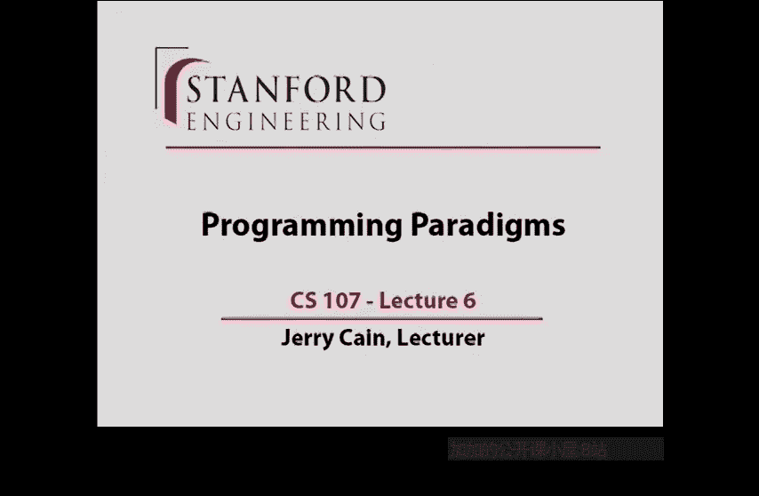
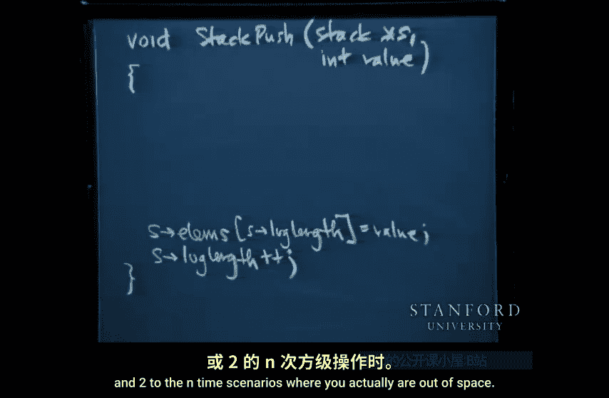

# 斯坦福大学【中英⚡编程范式｜CS107 Programming Paradigms】 p06 P6 ) -BV1aJ1EBHEoN_p6-

Okay。🎼，🎼，This presentation is delivered by the Stanford Center for Professional Development。

Hey， everyone， welcome。 I have one very short hand up for you today。 It is the。😊。

Handout that has two problems that we will be going over during tomorrow afternoon's discussion section。

 remember we don't have it at 315。 That was just last week to accommodate what I assumed would be a large audience。

 It's at 415， it's actually permanently in the room down the hall in Gates B3 so I'm not teaching the section Sam So I think is here was handing out the handout。

 So look for that guy tomorrow 415。 Both of these are are old exam problems。

 So there're certainly good problems to understand the answers to。

 And if you're not gonna watch section or 10， just make sure you at least read the handouts。

 you may very well be able to do the problems yourself。 And if set of them that's fine。 But if not。

 make sure you watch the discussion section at some point， okay。When I left you on Friday。

 I was quarter away， third away through the implementation of an int specific stack。

 So there's nothing technically C， S 10，7 level about this。

 except for the fact that we're being careful to write it in pure C as opposed to C plus plus。 Now。

 if you remember the details from Friday about the interface file。 The functions are。 I mean。

 I'll talk about those in a second。 We actually expose。The fullstruct， there are no classes。

 So and there's no public and no private。 So everything is implicitly public in the dot H。

 that's a little weird。 C plus plus when you learned about classes and objects。

 it was all about encapsulation and privacy of whatever could be private。

 We can't technically do that and C， although we can certainly write tons and tons of documentation。

 saying just pay attention to the type， use these functions to manipulated and pretend that these are invisible to you。

 Okay you more or less operate as if this is a destructor， I'm sorry， a constructor。

 a destructor and methods， but they happen to come in pure top level function form where you pass in the object or the other the right word。

 the structure being manipulated。 So stack new is supposed to take the struct one of these things addressed by S and take it from a 12 byte block of question marks to be logically representing a stack of depth 0。

 This is supposed to kill a stack at that address。This is supposed to increase its depth。

 This is supposed to pop something off。 Okay， I wrote stack new and stack dispose。 I。

 I certainly wrote stack new。 I'm forgetting about Sta dispose。

 but I'll write them really quickly right now。This is the dot C file。Stacked out sea。Boid stack。没有。

Stack。put it down。I have these three things， stack lodge length。Is equal to 0。

's because the stack is empty。 I'm going to make space。For four elements。

And then I'm going to go ahead and allocate space for four elements。

Using C's raw dynamic memory allocator called the Malic。

 It doesn't take anything related to a data type。 at least it doesn't know that anything related to a data type is coming in as an argument。

You have to pass on the wrong number of bitetes that are needed。For your four integers。

 and that's how you do this。All that Malik feels is an incoming 16。

 It goes through the heap and finds a figure that that's that big， puts a little halo around it。

 saying it's in use and then returns the base address of it。 Okay。

 I told you to get in the habit of using this assert macro that was mentioned in a little bit in assignment 1。

 just to confirm。Be lambs。Is not equal to know if Malck fails for some reason。

 it rarely will fail because it runs out of memory。

 It's more likely to fail because you called free on something you shouldn't have called free Don。

 So you've messed up the whole memory allocated behind the scenes。

That's a good thing to do right there， because it very clearly tells you where there's a problem。

 as opposed to with just segvaulting or bus erroring or crashing in some anonymous way。

 And you have no idea how to back trace to figure out where the problem started， okay。As far as。

Stack dispose is concerned。 This is trivial。Although there's one thing I want to say about it。

Actually two things I could think of， I want to go ahead and。Do the opposite of malic。

 This is this is this corresponds to operator delete from C plus plus。 I want to free。

S arrow Ls so that it knows that whatever figure is identified by that address right there should be donated back to the heat。

 That's just what I mean when I talk about free right here。

Some people question whether or not I should go and actually free S itself。They ask whether or not。

That should happen。The answer is no。Nowhere during stack new。

 did you actually allocate space for a stack， You assumed that space for the stack had been set aside already and that the address of it had been identified to the stack new function。

 Does that make sense to people。Okay， so you don't even know that it was dynamically allocated。

 And in fact， the sample code I wrote last time declared a stack called S as a local variable。

 So it isn't dynamically allocated at all。 So you definitely， in this case， do not want to do this。

The other thing I want to mention is that。Regardless of whether or not the stack。

 at the moment this thing is called is of depth 0 or of depth 4500。

The actual ints that are held inside the dynamically allocated rectangle of bytes。

There's no reason to zero them out or and there's certainly no freeing needs held by those integers。

 Okay， I say that because just imagine this not being an inst， but。

 but imagine it being a car star stack where I'm storing dynamically allocated sea strings。

 friendss and Wilmas and things like that， okay。If I did have that in the case of the car star。

 I would have to forop over all the strings that are still held by the stack at the time it's being disposed and make sure I properly dispose of all of those strings。

 Since I make sense to people。 Okay， I don't have any of that with the in specificific version。

 But the reason I'm saying this is because we're gonna have to accommodate that very scenario when we go generic on this thing and just deal with blobs as opposed to integers。

 okay。The most interesting。Of the four functions。Is the stack push。

 And it's interesting not because of the algorithm to put an integer at the end of the array。

 but the algorithm that's in place to manage the extension of what's been allocated to be that much bigger because you've saturated what's already there。

 I chose an initial allocated length of 4。 So I'm certainly able to push four integers onto the stack and not had any be any resistance whatsoever。

 But if I try to press a fifth in on the stack。 It has to react and say。

 I don't have space for five integers。 I better go and allocate space for some more copy over whatever's been pushed and dispose of the old array to make it look like I had space for 8 or 16 or 1024 or whatever。

 Okay So the implementation， assuming I do have enough space。Would be this simple stack push。

Pushing on what stack， the one that's addressed by this variable called S。

 what number am I pushing on？The one that comes in via the value parameter。

Let me leave some space here。嗯。For what I'll inline as the， the reallocation part。

 But if there's enough memory or I can down here， I can assume that there's definitely enough memory。

 I can do this。Sarrow， Ls。Of S Ar Lodge length。Equals this value。

 think about the scenario where the stack is empty。 the lodge length happens to be zero。

 which happens to be the index， the first the index where you should insert the next element， okay。

Once I do this for the next time， I have to go ahead and say， you know what。

 The lodge length just increased by one。Not only does it tell me how deep a stack is。

 It also tells me the insertion index for the very next push call。 Okay， It isn't that simple。

80% of the code that gets written here has to deal with the one in two to the end time scenarios where you actually are out of space。

 okay。

If it is the case。But Sarrow， Lodge length。Double equals。Sarrow， Aec length。

Then as an implementation， you're unhappy。Because you're dealing with。A stack。And a value。

Where the value has no home in the stack at the moment。 I'm trying to press on a 7。

 Let's say that S points to。This right here。And the logical length and the allocated length are both four。

And I pushed。These。Four numbers on there。The client doesn't have to know that there's a temporary emergency。

 So right here， I'm just going to react by saying， you know what the4 wasn't big enough。

 I want to go ahead， and I want to， without writing code yet。

 I want to basically reallocate this array， okay。Now I say reallocate because there really is a function related to that word in the standard C library。

In C++， you'd have to go ahead。And allocate an array that's bigger。

 You don't have to use a doubling strategy。 I'm just using that as you heard。

