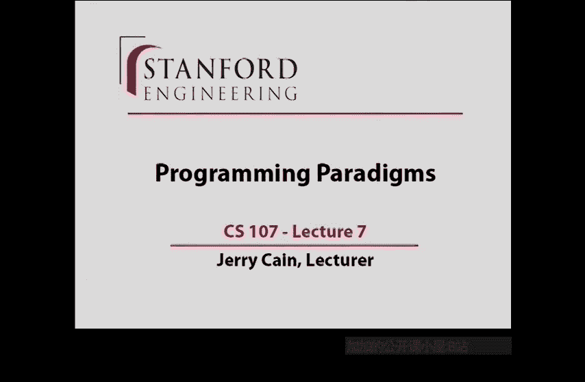
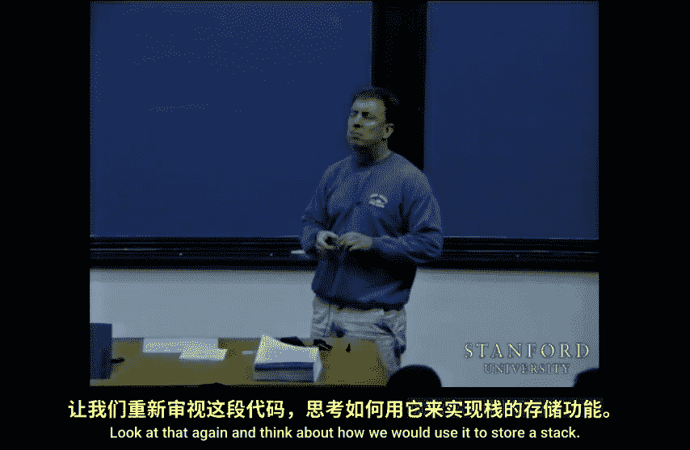
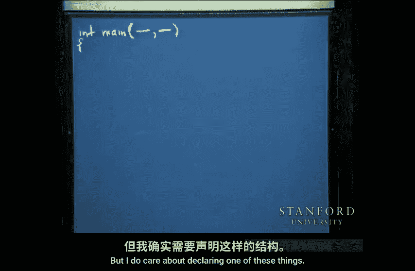
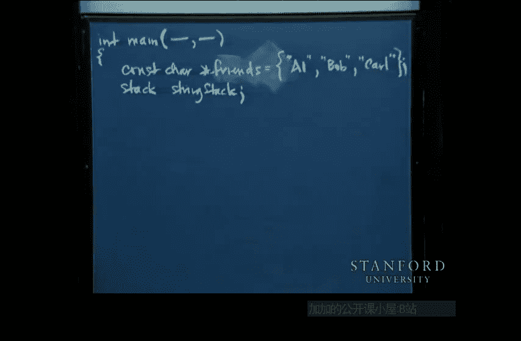
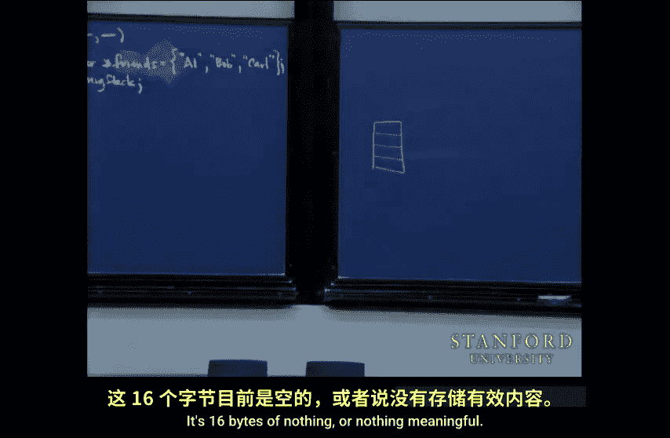
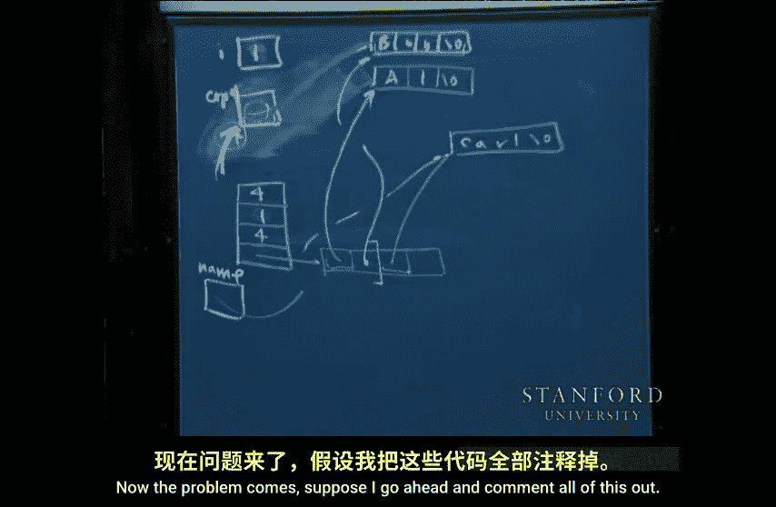

# 斯坦福大学【中英⚡编程范式｜CS107 Programming Paradigms】 p07 P7 ) -BV1aJ1EBHEoN_p7-

。Yeah。🎼，🎼，This presentation is delivered by the Stanford Center for Professional Development。

Hey， everyone， welcome。 I have one handout for you today。 It is assignment 3。

 It is due next Thursday evening。 You'll get assignment4 next Wednesday。

 It'll be due the following Thursday evening。 You'll get a written problem set。

A few Wednesdays from now， it won't need to be turned in。

 I'll talk about that more when I actually give it out。

 but it'll provide a collection of written problems that you'll be responsible for for the midterm come the following Wednesday night。

When I left you on Monday， I had really just gotten through what at the moment was the full implementation over generic stack。

 I've actually made parts of it easier than it really needs to be because we focused on storing ints and doubles in characters and booleans。

 what I want to do now is，Put off the implementation for about 10 or 15 minutes。

Look at that again and think about how we would use it to store a stack。 I'm sorry。

 use a stack or generic stack right there to store a collection of strings and print the mountain reverse order。

 Now， the nonsense code I'm going to put on the board is effectively going to just print out the reverse of an array。

 but it's really in place to illustrate the mechanics I using those four functions when you're storing C strings。

 That's going to become a very important come with Simon Ford to manipulate C strings。

 So that's why I want to do this。 So just imagine this right here。

Being your main function。I don't care about Arg C and R V。But I do care。

About declaring one of these things。

And I'll emphasize the fact that it is a string stack。

And what I want to do is I want to press on four deep copies of these strings right here。

Const car star。I'll just say letters。Is equal to actually， you know what。

 let me not call them letters。嗯。We't just say friends。And I'll set it equal to this array。Now。Bob。

Carl。And that'll be enough。So what I want to do is I want to declare one of these stacks。

 This picture I get right here， according to that type up over there， isn't very sophisticated。

It's 16 by of nothing or nothing meaningful。 Okay， but I rely on。

Stack new。Amperand of stringt。Where I pass in size of。Car star。

And all of a sudden now it's getting a little complicated。

I'm going to ask the stack to basically keep track of the addresses of dynamically allocated sea strings。

So what I want to do is I just got this picture， this points to a 16 by blob。啊。Four bytes。

 there's no the depth of the stack is zero， but I have space before elements。

This four right here is really size of car star。What I want to do is I want a for loop。

From I is equal to  zero， I less than three。Because I want to go ahead and I want to make a copy。

Of each one of those strengths。I do this car star。嗯。I'll call it copy is equal to Sturduop。

Of friends。Of I。Okay， this is an important enough variable that I actually want to draw it。Copy。

On the very first iteration， when I is equal to 0， it is set to point to。

A deep copy of o back slice zero in the heat。What I want to do。

 and I think this is the best way to phrase it， is that when you push an element。Onto the stack。

 you transfer ownership from mu to the stack。And the way you do that based on this right here is for me to do stack。

嗯。Push which stack， the string stack that I've just initialized。

Theres some drama and controversy over what the next argument should be。

 since I am storing car stars， that means that these things， even though the stack doesn't know it。

 that they have to hold as material， these 4 by character pointers。 Okay， that means。

That I have to pass in the address of a car star so it knows to go to that address and copy the4 bys into the stack。

Does that make sense to people？Okay， because I'm putting the a sand here。

It knows to go and replicate that material right there so that it points。

There increments this tool a1。On the very next iteration， I reuse。I。

 and I actually destroy and redelar copy to no longer point to。Al。

But as it's redeeclared and reinitialized。It's set to point up to Bob。

This is copy on the second iteration， I pass that in。

 it replicates the material that's in there because it has the address of that size of Car star figure so that it can replicate that address right here。

And so it's almost like this as a for loop。Blows up three balloons。 Okay。

 with Al Bob and Carl's name on it。 and then。Knowingly， mem copies the。

 the end of the string or the tail of the string and actually copies it to the stack behind the scenes。

 Do you understand what I mean when I say that。Okay。

 so I'm really transferring ownership of these three dynamically allocated copies over to the stack。

What I want to do now is I want to go ahead and I want to print these things out。

 I really want to ask for ownership back。So I'm going to do this car star。Nin。还能。4。An I。

Is equal to zero， i less than3，5 plus plus。What I want to do is I want to ask for the stack。パパ。

String stack。And I wanted to place the most recently pressed or pushed kite string back into the space that's right here。

 Okay， so I wanted to this would have been set up to point2。Carl。I wanted to replicate this space。

In my local variable called name， So this。It ends up pointing to Carll and the logical length of entire stacking is decremented to two。

Okay， does that make sense？The way I do that。Is like this。Then I can do this。

 this is the equivalent in C。Of。See out。Prenter。Where this is the string percent as is a placeholder for the string to be printed。

 and then I can go ahead and free。没。Okay， that means that it basically passes the end of the kite string。

Or the end of the balloon string to the dealator。 So it goes to the car address or the al address or the Bob address and actually donates that memory back to the heap。

I want to be clean about it。I do stack dispose。At the end。

And I just pass an am percent of string stack。And that is that。Okay。Now， these apersans。Right here。

Typically， don't surprise people。Because I'm dealing with a direct allocation on the stack frame of this function。

 thing called string stack。 And I have to pass the location of it around， okay。These ampersands。

Right there。Very often surprise people。 If you did not put them there for many of the same reasons we saw in previous examples。

 it would still compile and run。 But if you provide this address。To stack push。Then you're getting。

 then you're getting it right。 But if you actually don't include the ampersand right there and you pass in that value right there。

It's going to go ahead and replicate B O B Y。 I'm sorry。

 B O B backslash zero as if it's an address and copy that into the stack frame。Okay。

 that's not what you want。 Okay， does that make sense。Okay， very good。嗯。Now， the problem comes。

Suppose I go ahead and comment all of this out。Or I set this equal to I less than 2 or something。

 Supp at the time I。