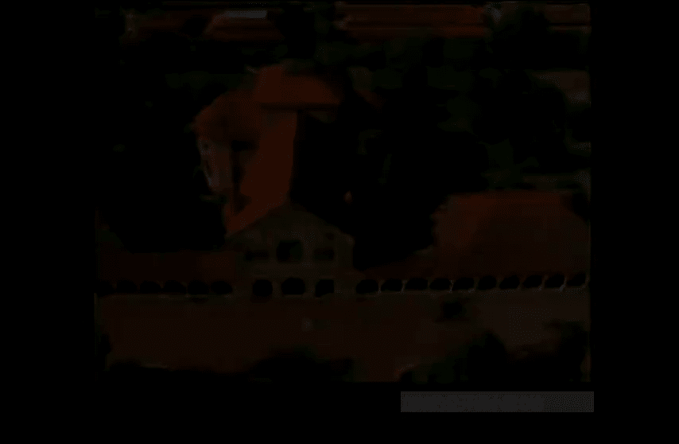
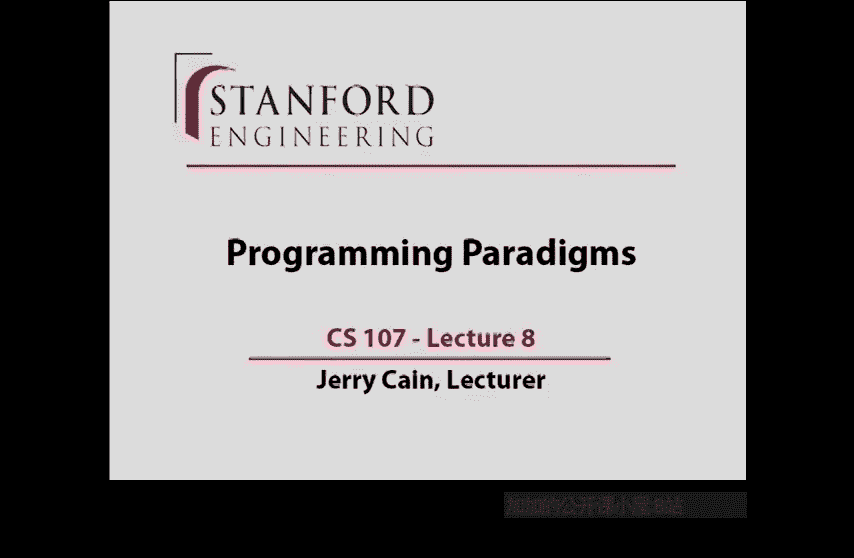
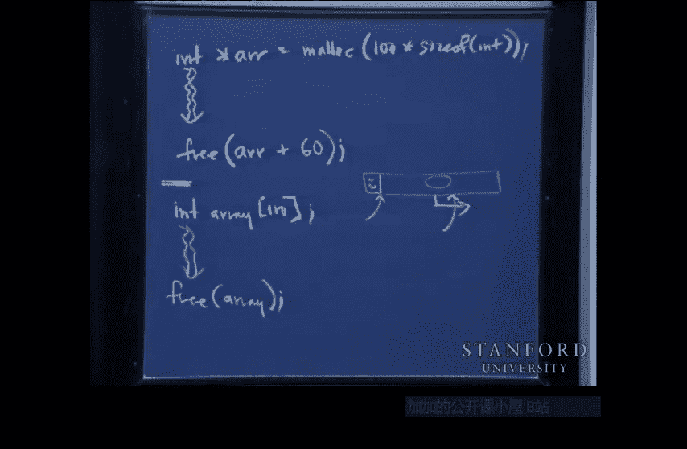

# 斯坦福大学【中英⚡编程范式｜CS107 Programming Paradigms】 p08 P8 ) -BV1aJ1EBHEoN_p8-

🎼，🎼。

This presentation is delivered by the Stanford Center for Professional Development。

Hey， everyone， welcome。 We actually have some handouts for you today。

 We just decided to hand out after you all set down。 So you'll be getting three handouts。

 and they should be posted the website because my T A Dan Wilson is going to do that sometime  before noon。

😊，When I left you last time， I had just given you a little bit of an introduction as to how the heap is managed by software that's included in C libraries that are linked against all of your own code every time something like six degrees or RSG or vector test or whatever is created to remind you from where we were last time。

 we're going to start talking about all the various segments in memory。

嗯。Each application behaves as if it owns all of memory。

 Well give more insight into that in a few in a few lectures。

 I'm specifically interested in this segment。That。In practice is usually， I mean， very approximately。

 but usually right around here。When an application is loaded into memory。

 the lowest address and the highest address of the heap are advertised to a library of code that's responsible for implementing Malik free and realalc。

 Okay， now this is just a general sandbox of bytes。 Malik just hands out， addresses。To the internals。

It actually records behind the scenes how big each figure actually is so that when free is called and passed one of those three pointers there。

 it knows exactly how much memory to don't donate back to the heap。

 I'll explain how that works in a second。Because because this is managed by software。

 Malic free and real， like the person implementing that。

 can use whatever heuristics they want to to make it run as quickly and efficiently and obviously。

 as correctly as possible。 And so we're gonna to talk about some of the heuristics and how that works。

 Now， you've always been under the impression that when you do this。I'll always call it ARR。

Is equal to Malic。And you do something like 40 times size of。Oops， size of int。And actually。

 I'll go ahead and strongly type this pointer。To not be a void star， but to be an int。

You're under the impression that you get exactly 160 B back。

 I can tell you right now that you do not。 you certainly。

Have more than 160 bytes set aside on your behalf。If this is the heap。

I won't draw all the other nodes that have been handed out， but at some point。

It discovers a node that is large enough。To accommodate that request right there。

 we think of it as perfectly sized to be 160 Bs。 This address is ostensibly handed back to you。

And when you pass this either to realallic or to free， it actually can confirm internally。

 or I'm sorry， it can't confirm。 but it just assumes that the pointer that's handed to free or realallic is one that has been previously handed back by either a call to Malik or realallic。

 Okay， so that is some legitimate pointer that has been handed back。

The way memory is set aside on your behalf is that it actually allocates more than that number。 Okay。

 for a variety of reasons。 But what it will normally do。Before it hands back。And address to you。

 if you ask for 160 bytes， it'll usually set aside 164 bytes or 168 bytes， why。

 because it'll actually include space at the beginning。

Of either four or eight or actually 16 or 32 or whatever it decides。

A little header on the full node where it can actually lay down a little bit of information about how big the node is。

 Does that make sense to people。 So if this really is 1 hundred and 60 B， and this is4， it might。

 among other things， write down a 1，64 inside that 4 by figure。 Okay， if it's 8 by。

 it can actually write more than just the size。When you。Get a pointer back。

 You actually don't get a pointer to the head of the entire node。

 You get a pointer that's 4 or 8 by in set from the beginning。Does that make sense。

 You have access seemingly to all of that space right there。When you pass the pointer back to free。

 let's forget about Reelic for minute for a moment， Free says， oh。

 I'm just assuming that this is a pointer that I handed back earlier。 If I really handed this back。

 then I know that I put down as a little footprint how big this node was。

 So I'm going to cast this pointer to be an instar or a long star or a long。

 long star or whatever it wants to so that I can gracefully back up for orerate B。😊。

Interpret those 48 bys in a way that I know I laid down information before and say， oh， look。

 there's a number 1，64。 That means from this point to that point right there should somehow be threaded back into the heap。

Does that make sense to people。Okay， given that right there。Here are a couple problems。

But I want you to understand why they don't work。Aray of is equal to Malik。100。Times， size of。Ins。

 so this is a legitimately allocated block of 100 arrays。

 You know that you're going to get either 104 bytes or 108 bytes just a little bit more。 I'm sorry。

404 or 408。And then you go ahead， and you populate。The array。

 And you realize that you don't need all the space。 Maybe you only need to use 60 of the integers。

 and you've recorded that in some other variable。Okay。

 and so you think you're being a good memory citizen。And you do this。ARR plus 60。Now。

 the code wouldn't get written that way。 It would probably be framed in terms of some local variables。

 say numb ins in use or something like that or effective length。 And you might。

 because you're more sensitive to memory allocation and you might want to donate back what you're not using。

 might think that that should work。Well。If this is the 400 B figure that you've logically gotten and you've been handed that address。

And there's a prenote header of meaningful information there， meaningful to Malic and Realc。

And you go ahead。And hand back that address to free。Depending on the implementation。

 it may be very naive and just assume without error checking that it was something that was handed back via Malic or Reic before。

 it might do some internal checking， but Malic and free and Reelic are supposed to be implemented as quickly as possible and not to do the error checking for you because they're assuming that you're really good at this CNC plus plus programming thing。

 So they're not going to interfere with execution by doing all of this error checking every single time free and Malik it called。

So if you were to do this right here。And it doesn't do any integrity checks on the number that it gets。

 It will blindly back up 4 or 8 by。 Whatever happens to reside in the two integers or the one integer at index 58 and 59。

Would be interpreted as one of these things right here。

 And if it happens to store in the place where 1，64 is stored right there。

 if it happens to store the number 29000， it will go from this point forward。

29000 B and just blindly follow whatever algorithm it does to integrate a 29000 by block back into the heap。

Okay， does that makes sense。 And you're not necessarily sure what impact that has on the heap and what data structures look like。

 I'll give you a sense in a second。 But the bottom line。

 the takeaway point here is you can't do that。 And now you have some insight as to why。Okay。

If you do this。In array。100， and you statically allocate your right。

 and you don't involve the heap at all。And you use it。And because you're new to C programming at。

 you think that you have to free the array。ああ。If it doesn't do any error checking on the address。

 it's not even obligated to do any error checking to confirm that it's in the heap segment in the first place。

 it would go to the base address of your static array， back up 4 or 8 byte。

 whatever figure and bit pattern happens to reside there would be interpreted as the size of some node。

 that should be incorporated into the free list data structure。

 Okay I'm sorry I shouldn't say free list because you don't know that is yet。

 incorporate into the collection of free nodes that the heap can consider for future in response to future calls tomalic and Reeic。

Okay， is this sitting well with everybody。Okay。The best implementations。

 well best is is up for debate， but the fastest implementations don't do error checking。

 they'll use heuristics to make sure that they run as quickly as possible。 Some implementations。

 I've never seen one， but I've read that some implementations do actually basically keep track of a set of void stars that have been handed back and it'll do a very quick check of the void star that it gets passed to it against and make sure it's a member of the set of void stars that have been handed out And if it's in debug mode。

 it might give an error if it's not present if it's not in debug mode it just may。

