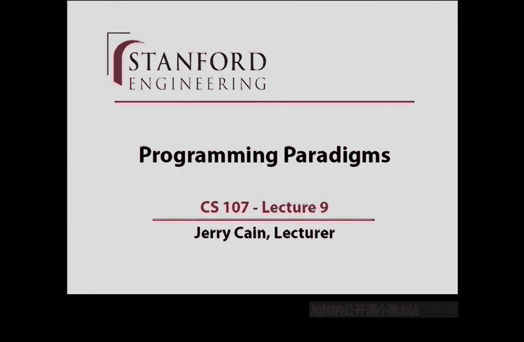
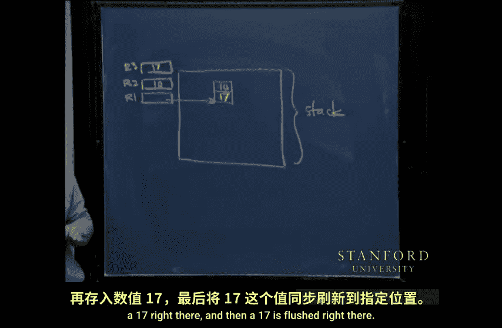

# 斯坦福大学【中英⚡编程范式｜CS107 Programming Paradigms】 p09 P9 ) -BV1aJ1EBHEoN_p9-

Okay。🎼，🎼，This presentation is delivered by the Stanford Center for Professional Development。

Hey， Ron， we're online。 I don't have any handouts for you today。I started to introduce。

The next segment of the course is being the part where we actually cover computer architecture and assembly language。

 We're going to spend a lot of time trying to figure out exactly what are CNncC plus plus code snippets or just the CN plus plus code。

 although we'll only deal with snippets in any one example。

 how it actually compiles to assembly code， talk the memory model talk a little bit about how function column and return works。

 and also to expose you to not a real assembly language。

 but at least a little mock one that we've invented for c1 and7 purposes to kind of show you all of the little gears that are in place to get addition and multiplication and division and function column and return and pointers and all those things to actually work。

 but at the hardware level。 Now when I left you last time。I had started talking about。

The stack segment。And if you remember， probably about halfway through Friday's lecture。

 I had hexagons and circles and triangles as placeholders for basically the skeletal figures that overlaid memory and showed you how all the local variables in a particular function were actually packed together in what was called an activation record。

In many ways， the assembly code that we're gonna to be writing are really just these four byte instructions。

 They're ultimately zeros and ones， but they're interpreted by the hardware to access variables within the triangles in the hexagons。

 Okay， and pull them into registers， maybe add one to them or add 10 to them or pass it to some helper function。

 just to get the the assembly code to imitate exactly what your CNC plus plus code was written to do。

 Okay， so here's the stack segment。 Let me just contrive this one little block of code。

Where I have int eye。I have int J。And then I do I is equal to 10。And then I do J is equal to i plus7。

And then I'll do J plus plus。Let's just assume， not surprisingly。

 that I and J are packed together as some 8 B activation record。

 and they reside somewhere in the stack segment。 I'm just going to draw it randomly right here。 Okay。

 and that address right there。And what it assume is stored。In one of those 32 registers。

But I named last time， I'm just going to go with the first one and call it R 1。

 So R 1 is a general general purpose 4 by bit pattern storeer that actually happens to store the basic address of the activation record that makes up this code snippet。

Okay， now you ultimately know that a1 has to be placed there。And that 18 will eventually go there。

Okay， that makes sense to people。 I'm assuming， Okay， but I actually am more focused not on。

The numbers themselves as the assembly code that actually does that relative to this address right here。

 So I'm going to make some assumptions that the basic address of the two variables that are relevant here are stored in a special dedicated register I'm going to call it R1 now I'll change the name in a little bit and I'm just going illustrate by example what assembly code instructions look like to actually put a 10 right there and then to pull it into a register add 7 to it and flush it back out to the space for J okay。

In order to get a 10 into that space right there。We don't actually deal with that address specifically。

 We just deal with an address that's at an offset of positive4 from the address stored right there。

Okay， the notation for doing this， this one line in our little mock assembly language。

Would compile to that， and that's our first assembly code instruction。Okay， that capital M。

 it's like it's the name of all of Ram。 You think about all of Ram as this big array of bytes。

M is the name of that thing。R1 is the base address。F is an offset。

 This right there identifies the basic addressrass of the4 byte figure in all of Ram that should get a 10。

Does that make sense to people？Okay， so this is an example。Of a store operation。

And it's called a store operation because it actually updates some region of in a stack segment with some new value。

The very next。A fewew instructions are in place to actually take care of J is equal to I plus 7。

I don't want to bank on the fact or rely on the fact that I know because of this small example that I is equal to 10。

 I want to do the most robust thing， which is to actually go and fetch the value of I。

 pull it into a register where you're allowed to do addition， add this7 to it。

 and then flush the result out to M of R plus M of R1。Does that sit well with everybody？Okay。

 so don't back on the fact that there happens to be a 10 right there。

An optimizing compiler might take advantage of that， but we're not writing an optimizing compiler。

 We're just trying to be brute force about the translation process right here。

I want to do this in R 2 and other general purpose register。

 I want to load the4 by bit pattern that happens to reside。Right here。

This is an example of a load operation。Okay， let's make it so that really looks like a load。

R 2 contains the 4 by bit pattern for what's residing in I right there。

 So this corresponds to the understanding that we're going to operate on I's value。

Into R3 and another general purpose register， I'm going to take whatever R2 has as a bit pattern and add the immediate constant 7 to it。

This is an ALU operation。It is actually very often the case that on the right hand side of some AU operation。

 there are either two registers or there's a single register and a constant and that wherever the result is to be stored is identified on the left hand side。

 Okay that probably makes sense to people。This as a bit pattern。

 is the thing that has to be replicated in the space that's really set aside for J。

 And we know where J is because we have R1 storing the base address of it。So right here。

I have yet another store operation。So， two of the registers。R2。

And our three were piecemeal updated with。A  ten0 right there。A 17 right there。

 and then a 17 is flushed right there。

Okay，Does that make sense to people？This load A U store sequence is actually very common and exists more or less on behalf of any any kind of assignment oriented statement in CR C+ plus。

 okay。The very next line really expands to J is equal to J plus 1。

 So it has a structure that's very similar to this。I can reuse registers。I can even。

Discard a temporary value。 that's in R2。 If for whatever reason I want to。

 I don't have to write to R 3 right there。 And then I can do M。

Of R1 is equal to the new value that ended up in R2。Okay。

 I didn't have to be that efficient about the user registers， but it's not a problem。

 If I don't need the old value of J。 And I just want to deal with the incr value。

 It's fine to overwrite R2 and overwrite its old value。

 So this has the same exact structure as that right there。

 It just happens to be dealing with one variable in Ram as opposed to 2。 And this is how this 17。

Goes from an 18， NR2 would also have an 18 inside of it。So a few things to say about this by default。

 all of the load and store and AU operations deal with4 Bte quantities。

 Okay it's clearly the case that pointers and ins are probably by far the most common atomic type you deal with in programming at least in CNncC plus plus。

 So the hardware is set up to optimize by default dealing with4 by4 Bte figures。

 that doesn't mean we can't deal with isolated characters and shorts or that we can't deal with doubles andstructs as a whole。

 but I'm more interested in being4 byte oriented with all of with all of my instructions here。

 a lot of you may be questioning why I bother to do this。You could say， well。

 why don't I just set R3 equal to 10 plus 7？I want to every single one of these blocks。

 this corresponds to that statement， these three correspond to that statement。

 these three correspond to that statement。I want every single block of assembly code instructions to be emitmted or rendered in this context in sensitiveitive manner。

 and the reason I'm saying that is because this code is going to work out and do the right thing。

 even if I change this line right here。Do you understand what I mean when I say that， Okay。

 If I were to hard code in an M of R1 is。